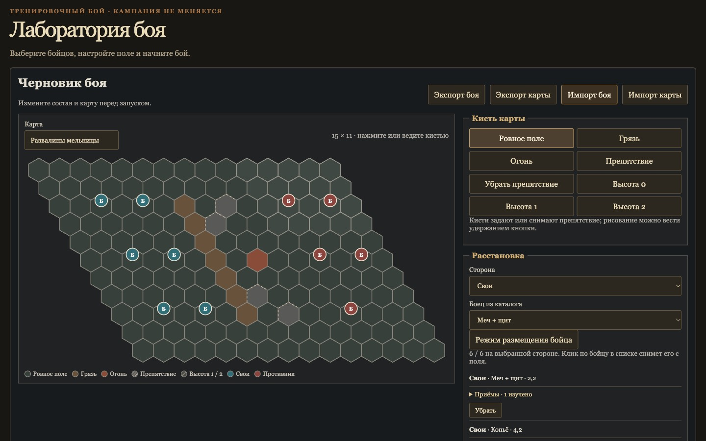
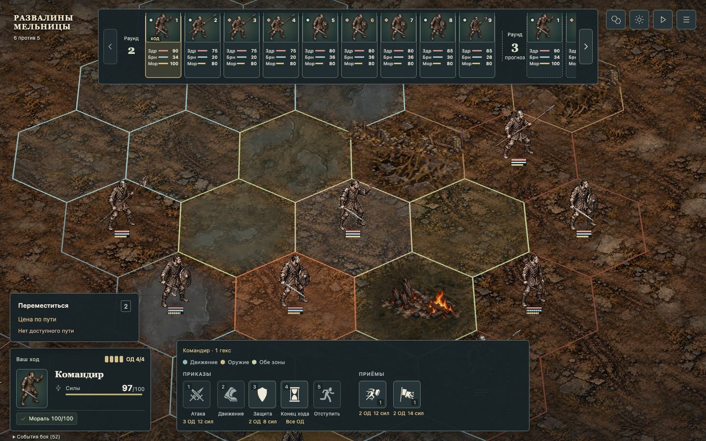
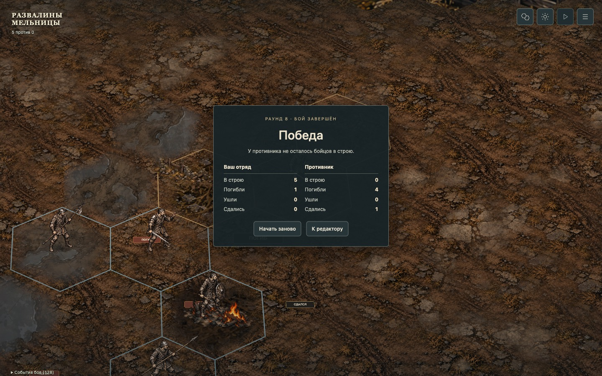

# Human-opponent preset producer — #228

Gated source: `9534bf762118fb8da91bad87c0d77ec5150123aa`; base `b568ee2`.
The coordinator merged documentation-only main `1b1e088` without changing these
three code paths. Publication and CI remain pending at this receipt.

The server catalog exposes detached editable `ruined-mill` and `deserter-band`
configurations. The latter keeps six allies and adds five existing human profiles
(W01/W04/W05/W01/W04) on the unchanged mill map. Rules, AI, default setup and
replay formats are unchanged. No migration or dependency change.

[Independent source review](review-1.md) and [played evaluation](eval-1.md)
ACCEPT the gated producer. Coordinator validate before main integration:8/8PASS;
author and reviewer each ran17focused tests. Integrated coordinator validation 8/8 PASS at ce45df4 (179 tests passed, 47 skipped); exact-head
CI remains pending. Reports retain their original local evidence paths; the selected
public replay/config/capture files beside this README are the published subset.

| Real UI journey                                    | Result                                                    |
| -------------------------------------------------- | --------------------------------------------------------- |
| Seed20261009: manual move/end turn then autobattle | Victory R7/rev133,2 opponents surrendered                 |
| Seed20261010: manual withdrawal then autobattle    | Enemy reaction at rev23; victory R8/rev146,1 surrendered  |
| Default mill reset/start/reload/restart/export     | Original config retained; new session, restored revision4 |

All3 browser downloads succeeded. Replay and incremental application match full
canonical state/RNG/events and12/56/1observed live checkpoints respectively.
No completed flee-to-edge, balance or performance measurement is claimed.
The earlier author's export crash did not reproduce in the evaluator's3downloads.

Try the producer through the existing editor: import
[seed20261009](import-20261009.json) or [seed20261010](import-20261010.json),
then start battle. The catalog-backed picker is still a sequential web task;
**#228 remains open**. Whole-scene visual acceptance remains with the overview
and readability slices. This producer does not accept their inherited defects.

