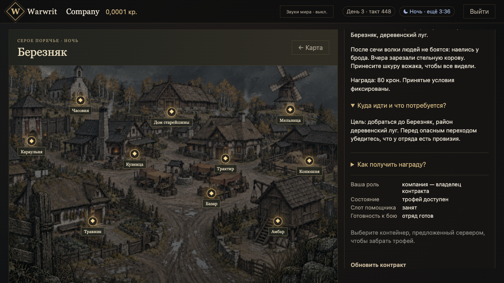
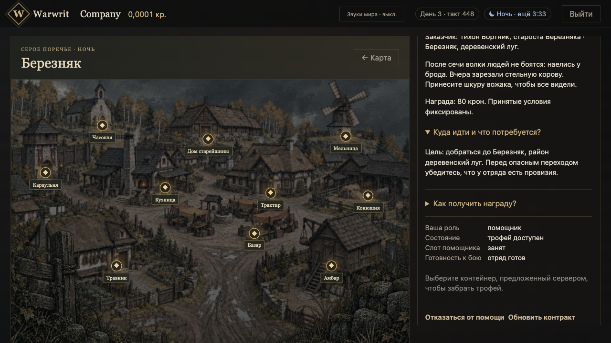

# Pickup248 independent saved-state evaluation

2026-10-21. Frozen source f439db7fed3e39b7f7d22633800f8592f7f299cc.
Independent evaluator: bridge_runtime_recheck. **ACCEPT for destination
projection and nonmutation on the recovered DB6 state.**

The evaluator recovered the retained PostgreSQL17 cluster into a separate
durable clone through read-only access to the original volume. Native encounter,
company, receipt, trophy and ownership identities match the retained snapshot.
This is actual WAL recovery and native readback, not a reconstruction from JSON.
The original volume was never started or modified.

Same-account fixture-session renewal changed only sessions; all11canonical
collections matched before and after. Normal browser reload/Place navigation
for both accounts showed no pickup destination or pickup button. Both request
observers recorded0POST. Final native comparison still matches all11collections:
encounter,admission,commands,encounter receipts,companies,company receipts,proofs,
contracts,world hunt,owners and accounts. Battle remains resolved at revision40;
trophy remains on the ground, unclaimed/unredeemed. No capacity repair or reseed.

These selected captures were taken with services running and no fetch error.
An earlier pair was framed after shutdown and showed Failed to fetch; those
private captures remain historical and are not presented as live acceptance.
The selected framing retains the generic choose-container guidance; it does
not demonstrate a visible explanation of party capacity. The existing empty-state
note is separate from that guidance. No new UI wording was implemented.

The evaluator stopped owned API/web/realtime listeners after the checks.
A distinct DB7 lawful pickup/payment/actual process-restart journey is prepared
but NOT_RUN; this acceptance does not prove payment, the full174/177 scope,
external OIDC, company creation/travel or fullM1.

Private original evidence: .orca/persistent-hud-166/evaluator-prep/
representative-postmerge/fixed-live-{owner,helper}.json, fixed-live-equality.json,
fixed-live-after-native.json and recovery-20261020/RESULT.md. No private sessions
or database snapshots are published here.
