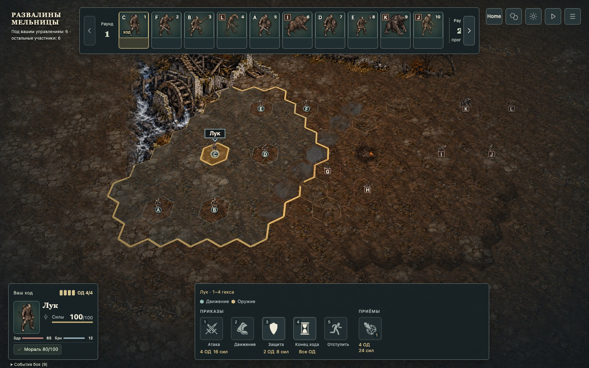
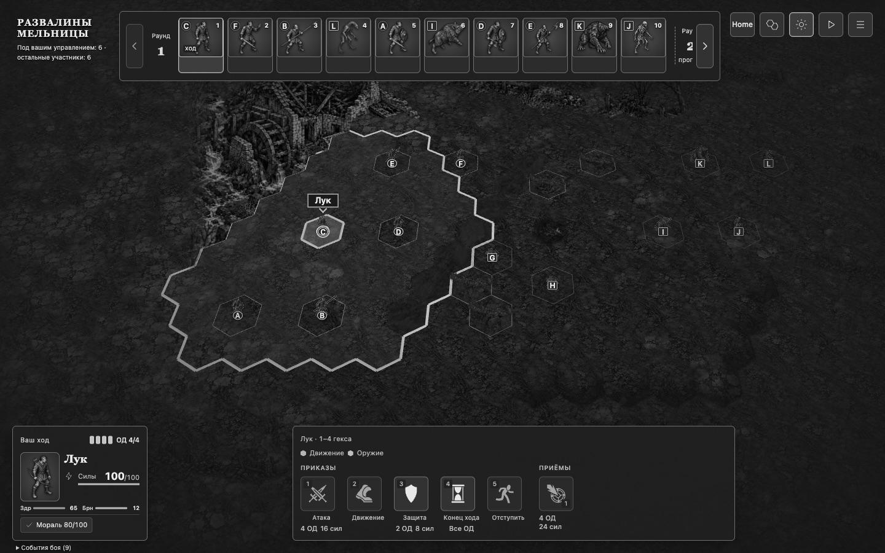
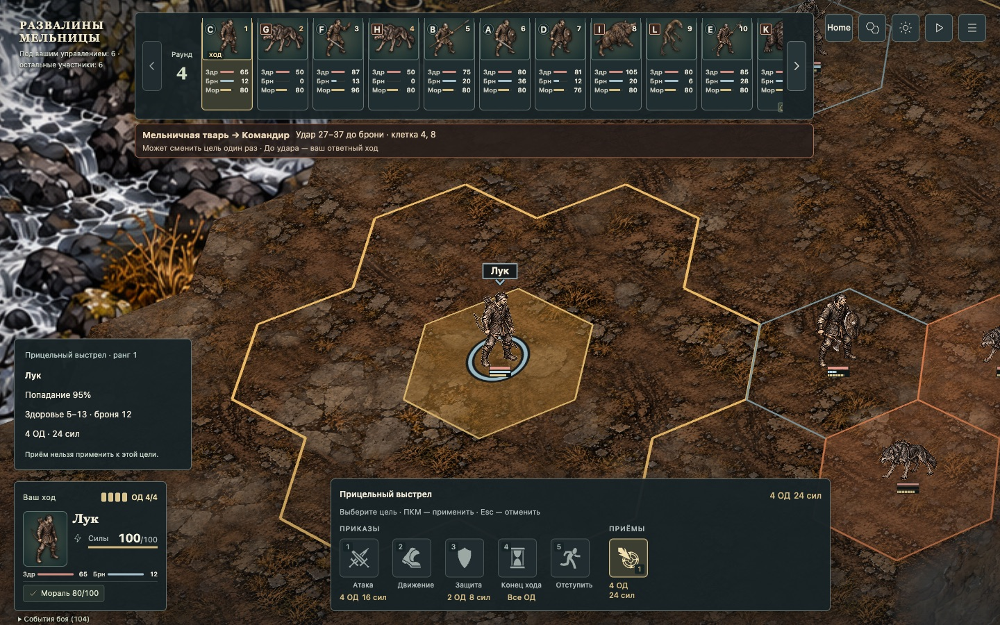
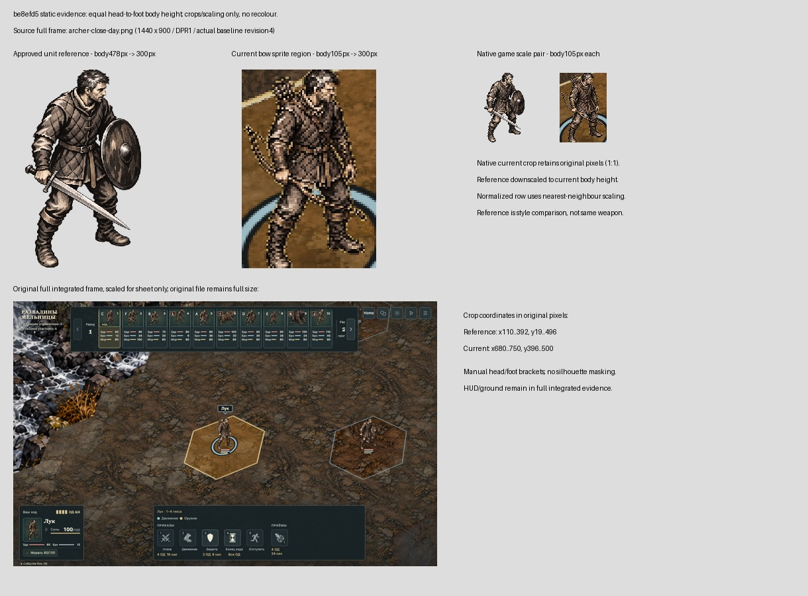

# Separate movement and reach — issue187

## Current checkpoint — 2026-10-20

Source commit: `be8efd51709983b62733fa0436d02d975bc3eae5` on actual main
`7a7f1f1841958ebe74a4c9cc632a6a5ea88fb61d`. Local only; no PR or merge yet.
The owner mission “Implement, review, merge” authorizes delivery after the
existing independent playable, visual and hosted checks.

Movement retains its fill; weapon or selected-skill reach uses the exterior
boundary of supplied cells. Selected-skill data must match actor, activation,
revision and skill. Missing/stale/empty data suppresses the boundary. Internal
reach edges and the combined fill/legend are removed. Rules, costs, RNG and
command admission are unchanged.

Independent source review ACCEPT, including corrections to moving mesh bounds
and borderless movement. Report: .orca/range187/source-review.md. Author focused
coverage: 24 tests across five files PASS; web types, scoped TS/TSX lint and
source formatting PASS. CSS has no ESLint configuration. Normal commit audit
PASS; its type-aware comparison used the tool's reported syntactic fallback,
with no newly blocking dead-code, complexity or duplication findings. Inherited
CSS advisories remain. No threshold or hook was bypassed.

Parent integrated validator on the clean commit: EXIT0, all eight steps PASS,
51 related tests across six files PASS. Logs: .orca/range187/integrated-validation.log
and .orca/validate-*.log. This is scoped integrated verification, not the hosted
full gate.

Independent [browser evaluation](browser-evaluation.md) ACCEPT on the same
commit. The untouched default ruined-mill seed20261009 begins at revision4;
passive viewport/day-night/native Chrome125%/CVD/camera checks sent0POST.
Eighteen separate ordinary End Turn commands reached revision56, enabling
aimed-shot; actual selection uses43 supplied cells for range2–4 and an inner
exclusion contour. Its capture matrix sent0additionalPOST. No draft or state
injection. Current crowd, long weapon and height-step frames are retained.

Actual projected terrain/perspective analysis plus raster samples support the
2CSS-pixel floor in the inspected scene (minimum approximately2.2504CSSpx).
Arbitrary terrain and live missing/stale response substitution are not claimed.
The complete62PNG capture set remains at output/playwright/range187; these JPEG
copies are presentation evidence, not the originals used for pixel measurements.

Independent absolute visual review ACCEPT on the same source: all applicable
rubric criteria score2, motion N/A. The critic inspected all62 current PNGs,
including close/crowd/CVD and the corrected equal-body-height reference sheet.
[Scored report](visual-review.md). Publication and merge remain pending.
#184 affordability bands remain separate. Broader sprint and full M1 are partial.
