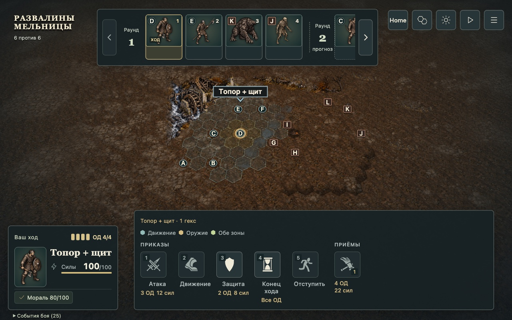
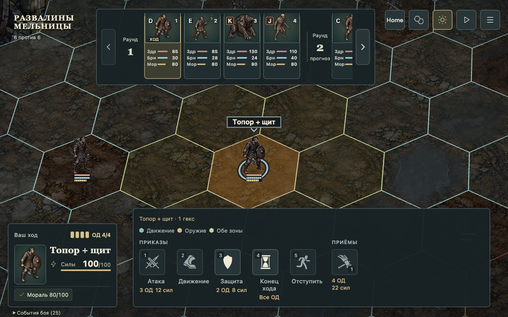
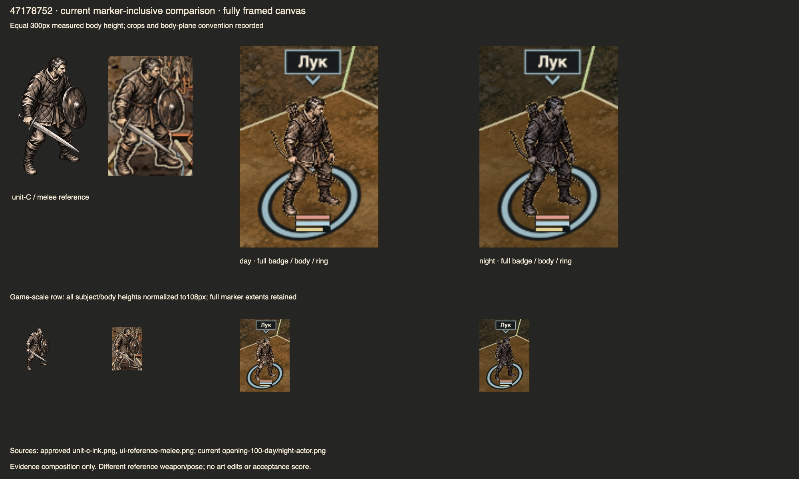

# Acting-fighter marker foundation — Refs #186

2026-10-20, branch `codex/actor-integration-186`, local accepted source
`6eb5263108bc7a88f1d828645fc6c070e3474ecb`, integrated main `137faf88`.
Publication, hosted CI and merge are pending. Owner mission “Implement, review,
merge” authorizes delivery after the existing gates; no deployment or auto-merge.

The current activation owns one static foot ring and a centered overhead name
and chevron. Inspection does not move it to another fighter. The marker follows
server activation changes, is non-pickable, clears at terminal and returns on
restart. Full-field overview, scale-aware letters and bounded inspection stay.

Try the untouched mill, inspect another fighter, use Home and the actor portrait,
then spend the final AP. The server advances zero AP before returning its view;
there is no stationary live-zero-AP screenshot requirement. Enemy intermediate
frames and final issue #186 closure remain #190; this PR uses Refs only.

## Evidence and actual checks

- [Independent played correction](played-correction.md), ACCEPT `47178752`,
  covers actual long-name activation, passive input, precise opaque body/weapon/
  shield/foot/margin samples, empty-cell and targeted-skill Escape cancellation.
  Reuses its real continuous final-AP, casualty/threat, terminal176 and restart.
- That evaluator's enabled/placed-name result did **not** establish full pixel
  readability. Parent subsequently reproduced mill artwork covering the name.
  [Backdrop correction](backdrop-correction.md) records the defect, current
  source-reloaded eight-view readback, diagnostic layering and failures.
- [Independent absolute visual critique](visual.md), ACCEPT current `6eb5263`:
  every applicable static-marker criterion2, finite day/night native100/125
  overview/close and diagnostic cases. Its source comparison justifies reuse of
  unaffected input, CVD, contrast samples, replay and accepted ground/body pairs.
  Current names were inspected as pixels; metadata was not acceptance.
- Coordinator `bash scripts/orca-validate.sh` on clean `6eb5263`: EXIT0,8/8;
  47related tests PASS, package declarations/types/format/lint/normal audit PASS.
  Local log: .orca/uix-w1-scene/backdrop-integrated-validation.log.
- Builder reported a WAIT-window scheduling breach at its normal commit hook.
  Source/commit was preserved; parent later ran validation alone. This remains
  a failed worker obligation, not erased by passing tests or visual review.

These are JPEG exports of the exact inspected originals, not regenerated art.
Full originals, complete matrices, scripts and readbacks remain locally under
.orca/uix-w1-scene/. The normalized reference sheet predates only the final
backdrop-order change; current source captures cover that changed overlap.

## Limits

No mechanics, RNG, protocol/replay, migrations or dependencies change. No new
full battle was replayed solely for the two-line backdrop correction. Current
source boundary comparison and affected pixel proof support reuse, not universal
certification of arbitrary names/crowds/resolutions. Height2 is diagnostic.
Existing tooltip/threat overlap (#195/#196), terminal-intent/results work (#209),
range #187 and enemy presentation #190 retain their owners. Whole HUD/M1,
performance and enjoyment are not accepted; fresh universal contrast/FPS are
NOT_MEASURED. Hosted clean gate and actual-main readback remain pending.
