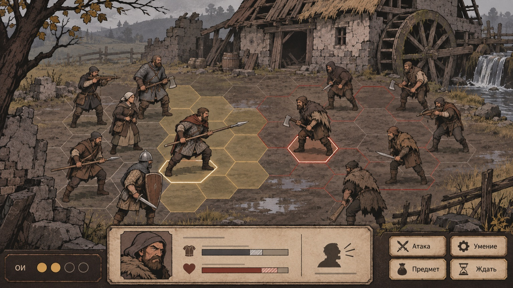
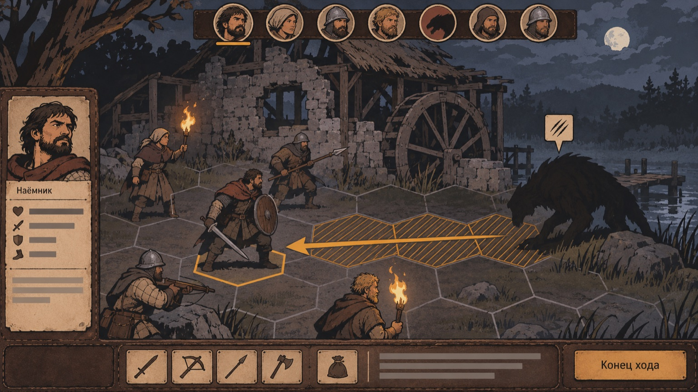
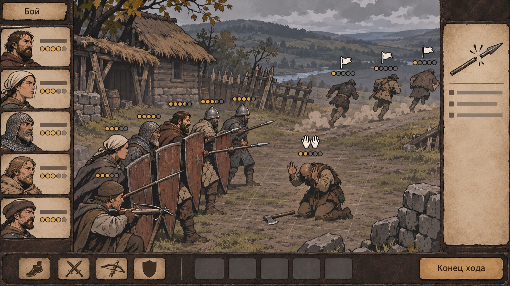
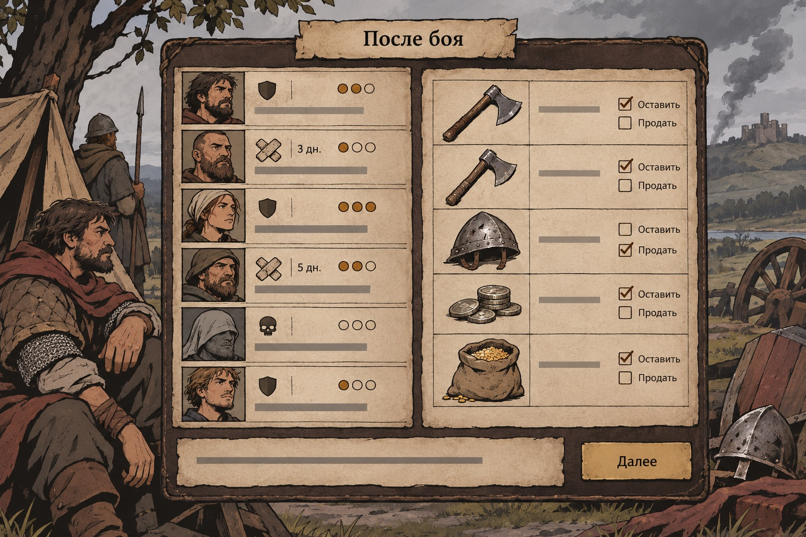

# Референсы боя

Что владелец решил про бой и у какой игры какой приём подсмотрен. Правила
живут в [бой](../wiki/combat.md), [поле боя](../wiki/battlefield-test-maps.md)
и [механиках](../wiki/mechanics/index.md); эта страница — только карта
ориентиров.

Уже решено: дух Battle Brothers; обученный боец в ближнем бою всегда наносит
урон (промахиваются только новобранцы); без укрытий и флангов XCOM
([правило](../wiki/combat.md#урон-в-ближнем-бою--решение-владельца-2026-10-07)).
Стенд: 6×6, поле 15×11, 4 ОД ([vision](../wiki/vision.md#спрайтовый-бой--уточнение-владельца-2026-10-09)).

## Приём → ориентир → наша механика

| Приём                      | Ориентир                 | Что именно работает у ориентира                              | Наша страница                                                                                                                                                        | Статус у нас             |
| -------------------------- | ------------------------ | ------------------------------------------------------------ | -------------------------------------------------------------------------------------------------------------------------------------------------------------------- | ------------------------ |
| Зона контроля              | Battle Brothers          | Выход из соседства с врагом стоит риска; строй держит проход | [zone-of-control](../wiki/mechanics/zone-of-control.md)                                                                                                              | первый приоритет         |
| Мораль с бегством и сдачей | Battle Brothers          | Отряд ломается раньше, чем умирает; бегущих видно            | [morale](../wiki/mechanics/morale.md), [retreat](../wiki/mechanics/retreat.md)                                                                                       | первый приоритет         |
| Намерение крупной угрозы   | Into the Breach          | Удар объявлен до хода игрока — ход игрока становится задачей | [intent](../wiki/mechanics/intent.md)                                                                                                                                | первый приоритет         |
| Броня с прочностью         | Battle Brothers          | Броня и здоровье — две полоски, урон виден по каждой         | [armor](../wiki/mechanics/armor.md)                                                                                                                                  | решено                   |
| Усталость                  | Battle Brothers          | Тяжёлые удары и броня тратят силы бойца                      | [fatigue](../wiki/mechanics/fatigue.md)                                                                                                                              | кандидат                 |
| Смещение / толчок          | Into the Breach          | Толкнуть врага под удар своего — полноценный ход             | [displacement](../wiki/mechanics/displacement.md)                                                                                                                    | кандидат                 |
| Строй                      | Battle Brothers          | Копья через плечо щитоносца, стена щитов                     | [formations](../wiki/mechanics/formations.md)                                                                                                                        | кандидат                 |
| Предпросмотр               | XCOM 2 / Into the Breach | Игрок видит исход до подтверждения                           | [preview](../wiki/mechanics/preview.md)                                                                                                                              | правило: превью = расчёт |
| Подача: камера, темп       | XCOM 2                   | Короткие кадры удара, быстрые ходы врага                     | [battlefield §шесть опор](https://github.com/Vovanostm/warwrit/blob/87e785d537fc4bf4bbb6856456391015350d235b/docs/wiki/battlefield-test-maps.md#шесть-опор-качества) | ≤1,5 с, пропускаемо      |
| Характер наёмника          | Jagged Alliance 3        | Личные таланты меняют решение в бою                          | [talents](../wiki/mechanics/talents.md)                                                                                                                              | кандидат                 |
| Раны после боя             | BB, Darkest Dungeon      | Цена боя живёт дольше боя                                    | [wounds](../wiki/mechanics/wounds.md)                                                                                                                                | в работе                 |

## Три теста каждого боевого приёма

1. **Видно до подтверждения?** Цена, цель, риск, причина отказа.
2. **Есть ли ответ?** У каждого давления — контрход.
3. **Люди, звери и твари играются по-разному?** Иначе механика лишняя.

## Чего не повторять

- Промах при 95 % и скрытая подкрутка (XCOM 2) — показанный шанс обязан быть настоящим.
- Непредсказуемый ИИ (JA3) — враг отступает или сдаётся по видимой причине морали.
- Жёсткий таймер «миссия провалена» (XCOM 2) — давление создаёт обстановка.
- Необъяснённые правила (зона контроля BB) — подсказка до хода, не после.

## Изображения

- Предпросмотр и зона контроля: 
- Намерение твари ночью: 
- Слом морали, бегство и сдача: 
- Итог боя: 
