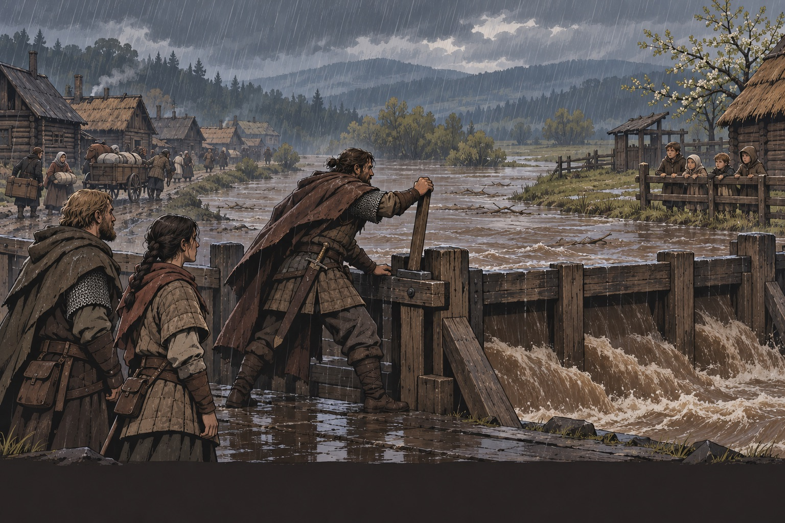
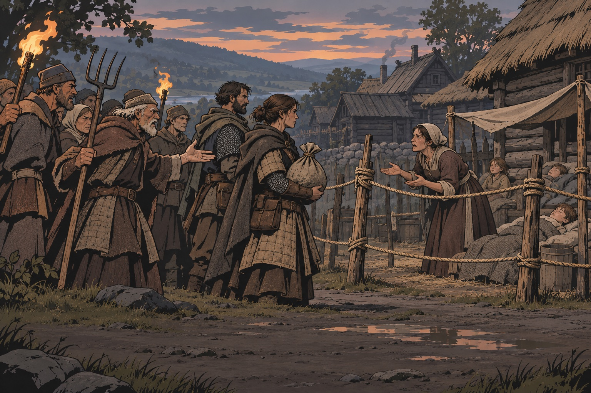
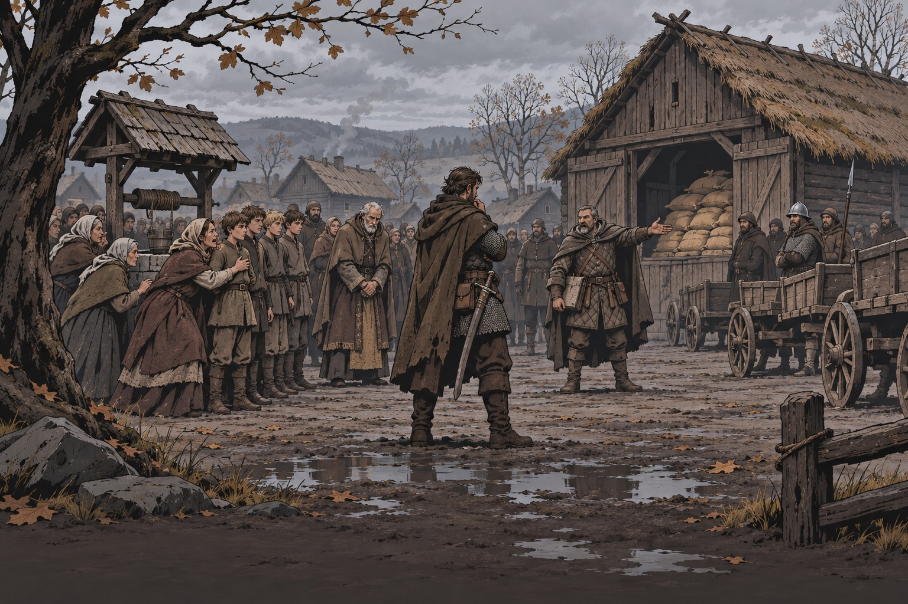
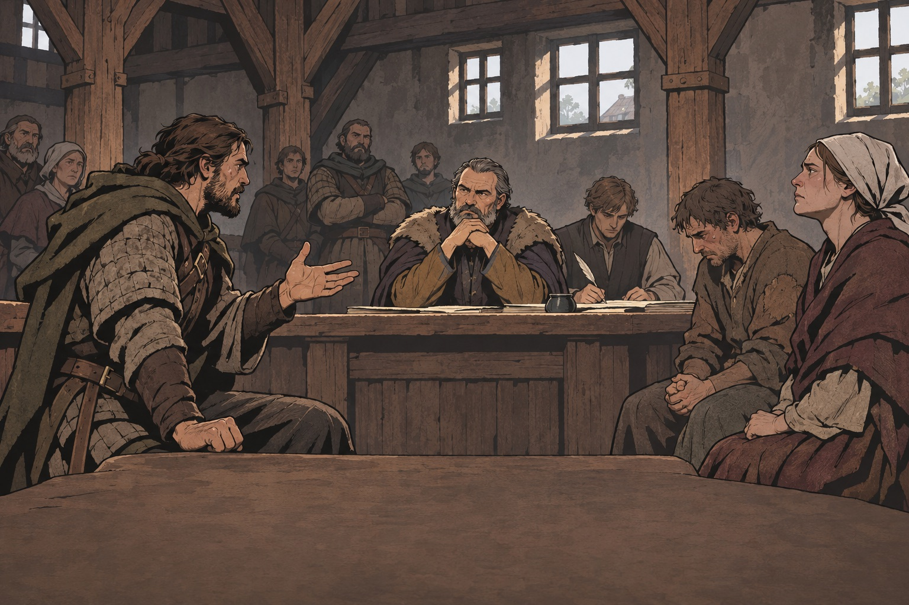
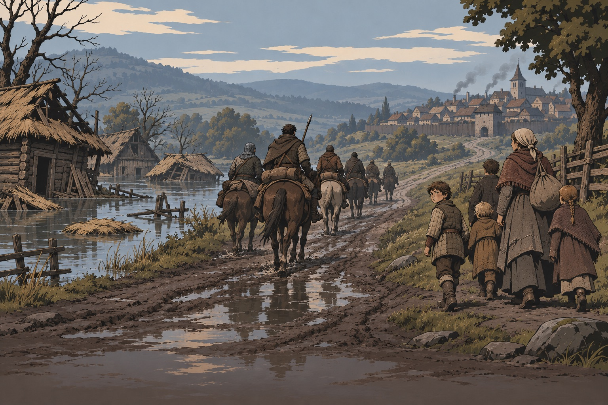

# Моральные выборы

Запрос владельца 2026-11-09: «Ориентир — интереснее история барона и ведьм —
и выбор спасти деревню / спасти детей. Чтобы было больше моральных выборов».

Страница разбирает, почему этот выбор работает, переводит приёмы в правила
для Warwrit и даёт восемь собственных схем. Книги и детективы с похожими
приёмами — в [literature.md](literature.md). Общие схемы контрактов —
[quest-patterns.md](quest-patterns.md).

## Разбор: «Кровавый Барон» и Кроны («Ведьмак 3»)

Квестовая линия Велена: Барон просит найти пропавших жену и дочь. По пути
открывается его вина (пьянство и побои), а след ведёт к болотным Кронам,
которые держат при себе сирот и требуют от окрестных сёл службы и дани.
Ключевая развилка — дух, заточённый в дереве («Шепчущий холм»):

| Решение         | Сироты с болота                  | Деревня Нижние Мары             | Анна и Барон                                          |
| --------------- | -------------------------------- | ------------------------------- | ----------------------------------------------------- |
| Освободить духа | Спасены, позже живут в Новиграде | Дух вырезает почти всех жителей | Анна умирает при снятии проклятия, Барон вешается     |
| Убить духа      | Кроны забирают детей             | Деревня цела                    | Анна жива, но теряет рассудок; Барон увозит её лечить |

Есть пограничный случай: последствия зависят ещё и от того, говорил ли
игрок со старостой деревни. Источники здесь расходятся, поэтому в правило
мы его не берём.

### Почему работает

1. **Выбор делается при неполном знании.** Дух обещает, Кроны угрожают,
   и проверить обоих нельзя. Цена выясняется позже, в другом месте.
2. **У каждого варианта видна жертва.** «Хорошего» конца нет: дети или
   деревня, Анна в рассудке или жива.
3. **Жертвы — знакомые люди.** Игрок уже видел сирот и деревню, говорил
   с Бароном. Выбор касается конкретных людей, а не абстрактной «деревни».
4. **Последствие отложено.** Деревня гибнет не на глазах у игрока. Он
   узнаёт об этом при следующем визите, и это бьёт сильнее.
5. **Игра не выносит приговор.** Ни одна строка не говорит «вы поступили
   правильно». По словам ведущего дизайнера Павла Саско, решение простить
   Барона добавили, чтобы игрок сам осмыслил тему. Принцип Саско —
   «сначала дать сыграть, потом показать и только потом сказать».
6. **Личная драма в масштабе мира.** Семейная история Барона связана с
   войной, разорением края и чужими детьми. Источники:
   [Kotaku](https://kotaku.com/the-story-behind-the-witcher-3s-bloody-baron-quest-1736090893),
   [Wikipedia](https://en.wikipedia.org/wiki/The_Bloody_Baron),
   [GameRant — исходы](https://gamerant.com/witcher-3-should-you-save-or-kill-tree-spirit-whispering-hillock/),
   [Destructoid — доклад Саско](https://www.destructoid.com/cd-projekt-red-designer-breaks-down-the-witcher-3s-best-quest/).

### Что не переносим

Кронов, духа в дереве, проклятие, утопленницу и узнаваемые развилки.
Чудовища в Warwrit редки и привязаны к месту и причине ([бестиарий](../wiki/bestiary/index.md));
новая магия и новые существа — только решением владельца. Поэтому основные
схемы ниже построены на людях, нехватке и войне.

## Другие игры с моральным выбором

| Игра             | Приём                                                                                   | Для Warwrit                                                     | Страница                                             |
| ---------------- | --------------------------------------------------------------------------------------- | --------------------------------------------------------------- | ---------------------------------------------------- |
| This War of Mine | Выживание мирных в осаде: украсть у стариков или голодать; последствие видно в дневнике | Нехватка как источник морали; компания тоже ест                 | [Steam](https://store.steampowered.com/app/282070/)  |
| Frostpunk        | Законы спасают город ценой людей (детский труд, кладбище или снег)                      | Решение старосты, которое банда может поддержать или сорвать    | [Steam](https://store.steampowered.com/app/323190/)  |
| Papers, Please   | Маленький выбор много раз: долг или семья, правило или сочувствие                       | Мелкие развилки в рутине: досмотр на переправе, пропуск беглеца | [Steam](https://store.steampowered.com/app/239030/)  |
| Pathologic 2     | Не успеешь всех: время — цена выбора                                                    | Сроки, при которых банда выбирает, кого спасать                 | [Steam](https://store.steampowered.com/app/505230/)  |
| Pentiment        | Обвинить без доказательства; город помнит ошибку десятилетиями                          | Обвинение как выбор с долгим следом в летописи                  | [Steam](https://store.steampowered.com/app/1205520/) |
| Disco Elysium    | Расследование, где политика и личное мешают истине                                      | Допрос и улики как моральное давление, а не головоломка         | [Steam](https://store.steampowered.com/app/632470/)  |

## Правила моральных выборов в Warwrit

1. **Две жертвы, обе знакомы.** До развилки игрок видел и тех, и других:
   говорил, кормил, ночевал.
2. **Неполное знание.** Ключевой факт проверить нельзя или дорого
   (время, деньги, риск для людей).
3. **Цена в системе игры.** Выбор меняет хотя бы одно из: еду и деньги
   компании, положение места, отношение стороны, раны или потери.
4. **Третий путь бывает, но не бесплатно.** Вывести детей, а потом
   открыть шлюз можно, но это стоит времени, и деревня потеряет часть дворов.
5. **Последствие отложено и видно на карте.** Позже: пустая деревня,
   сироты в городе, новый человек в корчме, запись в летописи.
6. **Мир не судит.** Ни заказчик, ни рассказчик не называют выбор правильным.
   Люди реагируют по-разному, и каждый по-своему прав.
7. **Одна правда для всех банд.** Кто решил первым — тот изменил мир.
   Поздние банды получают продолжение: сирот надо довезти до города,
   а погорельцам нужен лес на стройку.
8. **Не принуждать под дулом.** Выбор «назови, кого убить» — пытка, а не
   решение: в нём нет поступка, только наказание игрока (см. «Выбор Софи» в
   [literature.md](literature.md)). Пусть игрок делает, а не выбирает строку.

## Восемь схем (форма, не канон)

Имена, места и суммы — заглушки. Любая схема становится контрактом только
через [economy-quests](../wiki/economy-quests/index.md) и решение владельца.

### 1. Шлюз — деревня или сиротский двор

Весной вода поднимается у плотины. Открыть шлюз на запад — затопит луг,
где стоит сиротский двор. Не открывать — смоет дворы деревни ниже. Третий
путь: сначала вывести детей, но за это время деревня потеряет часть домов.
**Цена:** отношение деревни или города, еда (детей надо кормить в пути).
**Что помнит мир:** пустая деревня или сироты в городе.

### 2. Кордон — деревня или больные дети

В доме за околицей лихорадка. Старики требуют держать двор закрытым,
внутри — дети и женщина, которая за ними ходит. Банда несёт лекарство.
Прорвать кордон — болезнь может уйти в деревню. Охранять кордон — дети
останутся без помощи. Третий путь: отправить внутрь своего лекаря,
он сам рискует заразиться.

### 3. Зерно или парни

Отступающий полк требует у деревни последнее зерно или мальчишек в
рекруты. Отдать зерно — деревня голодает зимой. Отдать парней — матери
этого не простят. Можно драться, но тогда полк вернётся и сожжёт деревню.
**Цена:** отношение стороны, положение места, вербовка.

### 4. Заказчик-изверг (по мотиву Барона)

Десятник платит, чтобы найти ушедших жену и дочь. По дороге банда
слышит от соседей, почему они ушли. Найти их и сказать ему — заплатит.
Сказать, что не нашли, — останешься без денег. Привести, но с условием —
он может нарушить слово. Беглянки — свободные люди: решать, идти ли им,
должны они сами.

### 5. Свидетель за деньги

На слушании правда спасает вдову, но губит соседа, который кормил
банду всю зиму. Промолчать — вдова потеряет надел.

### 6. Пленный-дезертир

После боя один из беглецов оказывается сыном старосты, нанявшего банду.
Отдать его страже — получить плату. Отпустить — староста об этом не узнает,
а стража узнает. Взять в компанию — у новобранца будет долг и чужие враги.

### 7. Ценой своего

Лекарство одно. Ранен свой боец, и болен ребёнок в деревне. Компания
видит выбор капитана, и это меняет её мораль.

### 8. Поздняя банда (MMO)

Банда приходит в деревню, о которой уже есть запись: «Шлюз открыт на
запад». Сироты живы, деревня пуста. Новая работа — помочь погорельцам
отстроиться или довезти сирот до города. Выбор первой банды стал
обстановкой для второй.

### Сверхъестественный вариант — только по решению владельца

Если владелец разрешит редкую необъяснимую силу, ближайшая форма — у
непогребённых мёртвых. Пример по [compass](../engineering/DESIGN_COMPASS.md#6-examples-form-only--not-canon):
убить зверя дёшево, перезахоронить дорого. Ведьм, проклятий, духов в
деревьях и сделок с потусторонним не добавлять без отдельного решения.

## Итог развилки

Последствия выбора: 
