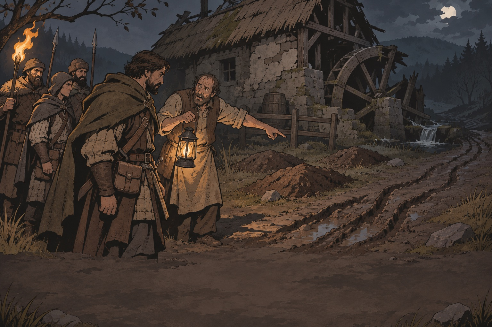
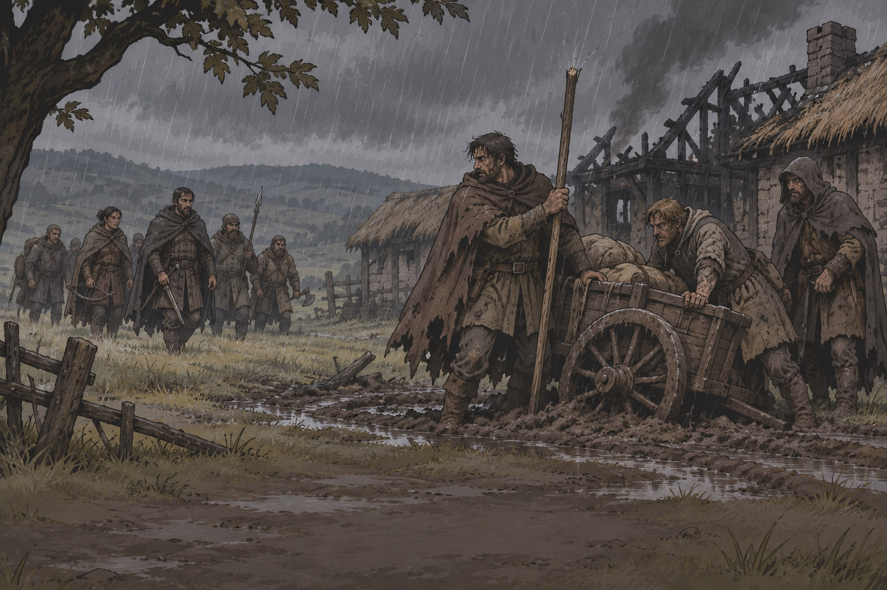
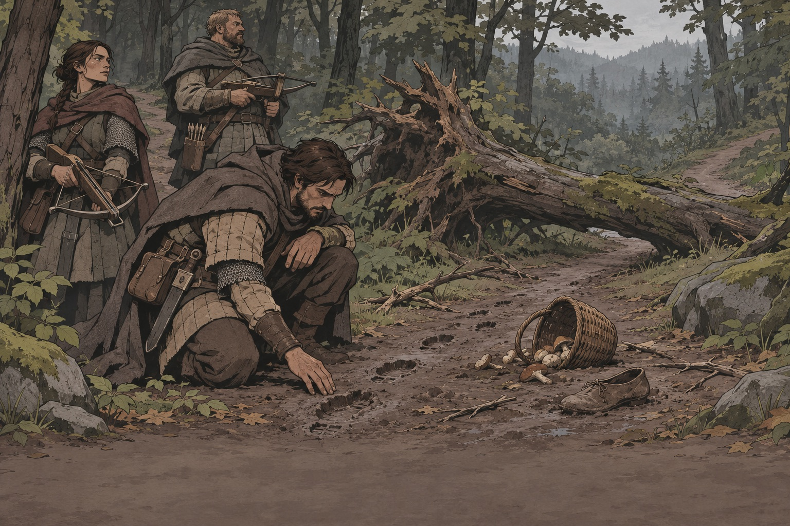
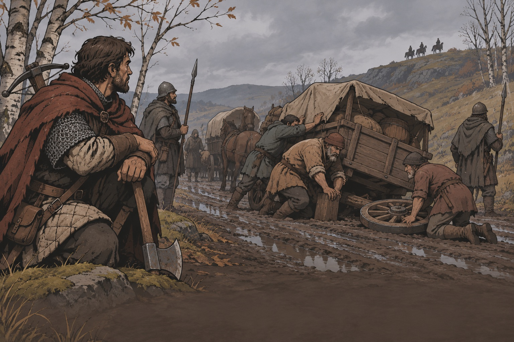
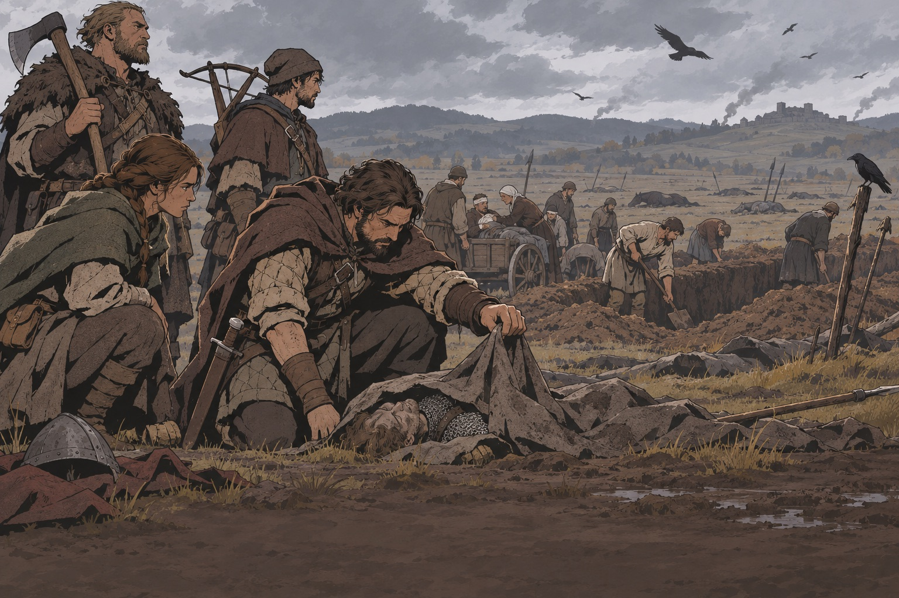
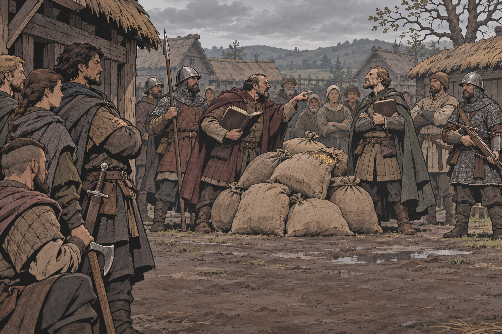
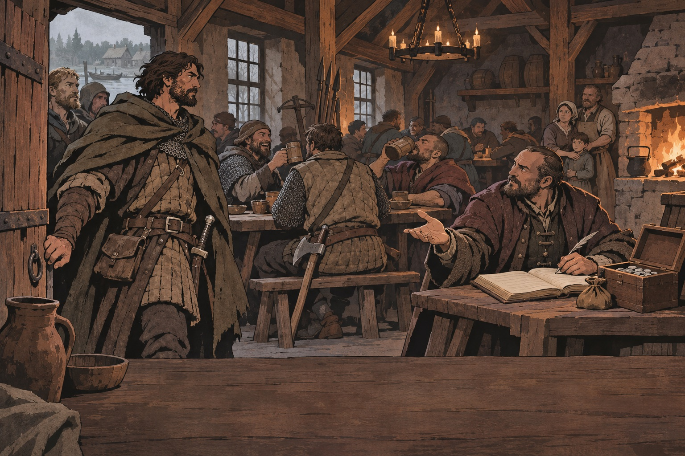
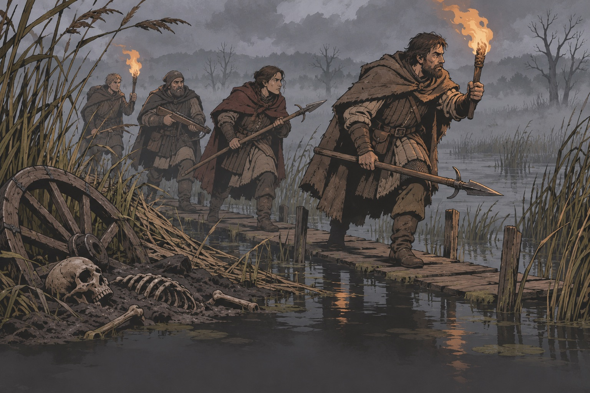
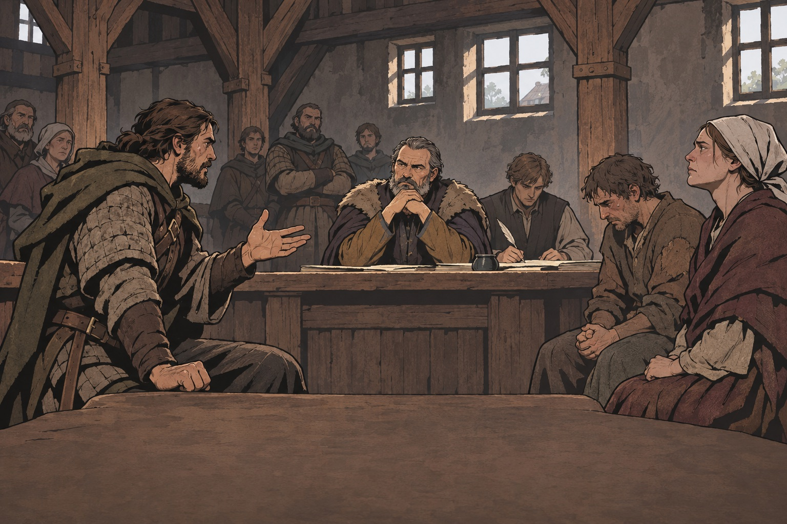

# Референсы квестов — девять схем

Схема — каркас, по которому собирается контракт. Примеры ниже показывают
**форму**; имена, места и суммы в них не канон и не новые карточки.
Существующие 60 карточек и восемь контрактов M1 живут в
[economy-quests](../wiki/economy-quests/index.md) и [Поречье](../wiki/world/porechye.md).
Чек-лист контракта — [DESIGN_COMPASS §5](../engineering/DESIGN_COMPASS.md#5-checklists).

Каждая схема отвечает на пять вопросов: **кто платит и о чём молчит · что
правда · чем платит игрок за выбор · что запомнит место · что будет без банды.**

## 1. Заказ со вторым поворотом

- **Ориентир:** «Ведьмак 3», «Кровавый Барон» — просьба, за которой скрыта вина заказчика.
- **Каркас:** просьба → находка, меняющая взгляд на заказчика → выбор: сделать
  дёшево и оставить причину / исправить причину дорого и с ущербом заказчику.
- **Пример формы** (из compass): мельник платит за зверя → сам схоронил мёртвых
  мелко → убить зверя (дёшево, придёт другой) или перезахоронить (долго, мельник теряет лицо).
- **Референс:** 

## 2. Охота на дезертиров

- **Ориентир:** Battle Brothers (контракты на людей), KCD II (у каждого своя правда).
- **Каркас:** найти людей → выясняется причина бегства → привести / отпустить /
  взять с них плату. Свободный человек может отказаться и уйти.
- **Цена:** деньги заказчика против отношения деревни, где беглецов прятали.
- **Референс:** 

## 3. Пропавший

- **Ориентир:** Pathologic 2 (срок), сказка «Леший» (сомнение в знакомом пути —
  см. [onboarding-references](../wiki/onboarding-references.md)).
- **Каркас:** восстановить путь по следам и остановкам → найти исход.
  Авторская версия выбрана заранее; ответ игрока её не меняет.
- **Без банды:** через N дней исход наступает сам и попадает в летопись.
- **Референс:** 

## 4. Обоз

- **Ориентир:** Foxhole (логистика войны), BB (сопровождение).
- **Каркас:** провести обоз → поломка, наблюдатели на гребне → выбор: бросить
  часть груза ради скорости или чинить под угрозой засады.
- **Место запомнит:** цена зерна в пункте назначения.
- **Референс:** 

## 5. Поле после битвы

- **Ориентир:** параллельные битвы армий ([armies](../wiki/mechanics/armies.md)), EVE (итог боя как событие мира).
- **Каркас:** найти конкретного человека / вещь среди павших → мародёры,
  похоронная работа, раненые → брать добычу или помочь хоронить.
- **Смысл:** исход битвы ведущего порождает работу для банд.
- **Референс:** 

## 6. Два сбора

- **Ориентир:** Battle Brothers (положение поселения), KCD II.
- **Каркас:** два сборщика требуют одно зерно → банда нанята «стоять рядом» →
  кто-то уходит пустым. Положение «Два сбора» снимается.
- **Цена:** отношение той стороны, чей сборщик ушёл пустым.
- **Референс:** 

## 7. Полк на постое

- **Ориентир:** BB (положение меняет цены и вербовку), Wartales.
- **Каркас:** место _занято_ → цены выше, вербовщики в корчме → работа: найти
  потерянный обоз полка / вывести семью / промолчать о пропаже.
- **Референс:** 

## 8. Логово у непогребённых

- **Ориентир:** «Ведьмак» (подготовка к чудовищу), Into the Breach (намерение крупной угрозы).
- **Каркас:** следы → версия, что это → подготовка (огонь, копья, время суток) →
  бой или устранение причины (непогребённые останки).
- **Правило бестиария:** тварь редка, привязана к месту и причине ([bestiary](../wiki/bestiary/index.md)).
- **Референс:** 

## 9. Слушание

- **Ориентир:** Pentiment (обвинить без подтверждения), «Капитанская дочка», XIV «Суд».
- **Каркас:** банда — свидетель → показания меняют исход для другого человека →
  сказать всё / промолчать / указать на другого. Правду игре подтверждать не нужно.
- **Место запомнит:** вдова, судья, писарь — разные взгляды на банду.
- **Референс:** 

## Моральные выборы

Развилки «деревня или дети» по мотиву «Кровавого Барона» и восемь схем
выбора — [moral-choices.md](moral-choices.md). Детективная форма из книг —
[literature.md](literature.md).

## Как не надо

| Ошибка                                      | Где видели          | Проверка                                      |
| ------------------------------------------- | ------------------- | --------------------------------------------- |
| Цепочка «сходи к боярину, потом к воеводе»  | «Смута», Bannerlord | Каждый шаг — решение, находка или бой         |
| Убийство ради убийства                      | Wartales            | У врага есть причина быть здесь               |
| Заказчик без лица                           | Bannerlord          | Имя, желание, молчание                        |
| Финал «настоящее чудовище — человек» всегда | штамп жанра         | Иногда зверь просто опасен, а заказчик честен |
| Повтор для второй банды                     | MMO-шаблон          | Поздняя банда получает продолжение, не повтор |
