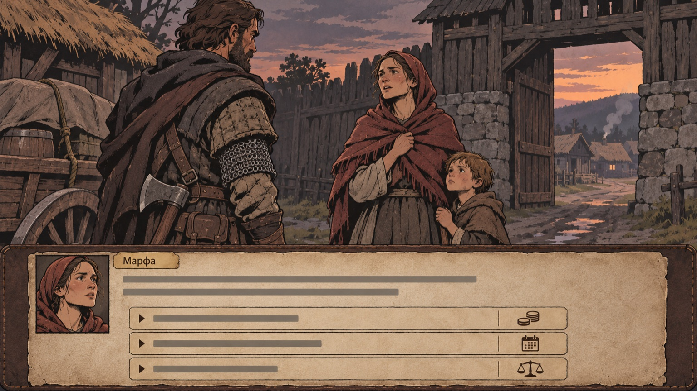
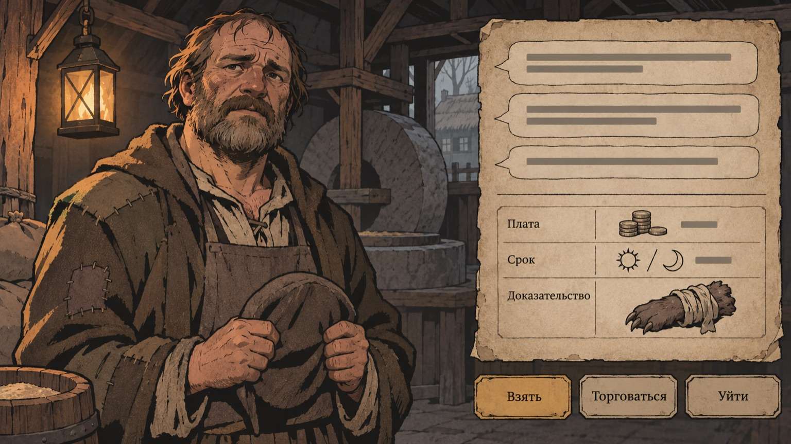
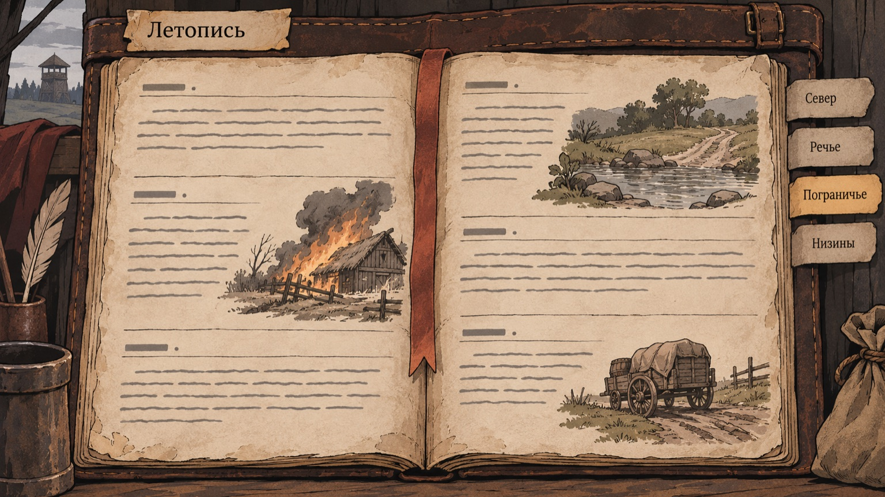

# Референсы текста

Правила языка — в [Как писать](../wiki/world/writing.md) и
[литературный слог](../wiki/world/literary-style.md); критика —
[TEXT_CRITIQUE](../engineering/TEXT_CRITIQUE.md). Литературные и фольклорные
источники разобраны в [onboarding-references](../wiki/onboarding-references.md).
Эта страница собирает приёмы ориентиров по **типам текста** и даёт образцы формы.

## Приёмы ориентиров

| Тип текста            | Ориентир                  | Приём                                         | Наше правило                                          |
| --------------------- | ------------------------- | --------------------------------------------- | ----------------------------------------------------- |
| Доска контрактов      | Battle Brothers           | Короткое объявление с суммой и сроком         | `brief` ≤ 25 слов, условия — в данных                 |
| Разговор с заказчиком | «Ведьмак 3»               | Заказчик рассказывает часть правды, торгуется | Реплика — одно действие, ≤ 15 слов, до 6 реплик       |
| Событие в пути        | Battle Brothers, Wartales | Сцена с выбором и ценой                       | Сцена кончается действием, не моралью                 |
| Летопись              | Pentiment, EVE            | Запись писаря: дата, место, кто, что осталось | Факт и след, без оценки рассказчика                   |
| Голос сословия        | Pentiment                 | Шрифт и речь выдают образование               | Голоса: крестьяне, горожане, солдаты, писари, старики |
| Бестиарий             | «Ведьмак 3»               | Запись охотника: следы, повадки, подготовка   | Странное — редко и одной деталью                      |
| Рассказчик            | Darkest Dungeon           | Узнаваемый голос                              | У нас нет рассказчика-оценщика; говорят люди и вещи   |

## Образцы формы (не канон)

Имена и суммы ниже придуманы для примера и не вводят новых людей мира.

**Доска контрактов**

> Ищут работника мельницы. Пропал третьего дня. Плата — восемь крон, половина вперёд.

**Заказчик**

> — Сколько?
> — Восемь. Больше нет.
> — А за что, если найдём не живого?
> — Тогда шесть. И не рассказывайте жене, где.

**Событие в пути**

> У брода телега без колеса. Мужик сидит на мешках и не встаёт.
> «Колесо дам, — говорит обозная, — мешок возьму». Мужик молчит.

Выборы: _дать колесо за мешок · дать даром · проехать мимо._

**Летопись**

> День 14. Каменный Брод. Банда Ратибора довела обоз до переправы.
> Зерно в Броде подешевело на треть. Двое из банды не вернулись.

**Бестиарий**

> Следы как у волка, но шаг вдвое шире. Ходит только по мокрому.
> Собаки к мельнице не идут.

**Реплика наёмника после боя**

> — Щит держал. Руку не держит.

## Запреты (кратко)

Язык договора в речи людей; готовая мрачность («тьма», «древнее зло»);
штампы («холодок пробежал»); ритм «не просто X, а Y»; вывод «он понял, что…»;
одинаковая последняя фраза серии. Полный список — в
[Как писать](../wiki/world/writing.md#запрещённые-слова-и-приёмы-в-тексте-игрока).

## Изображения к текстовым экранам

- Сцена-новелла: 
- Предложение контракта: 
- Летопись: 
