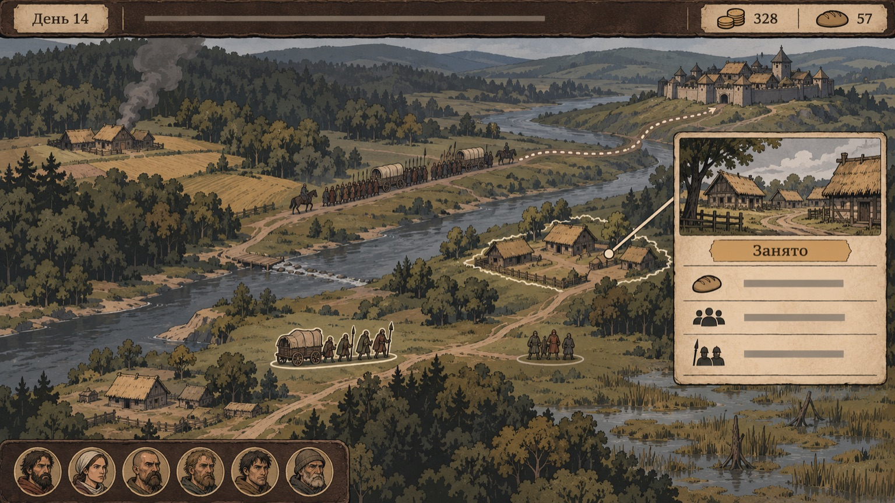
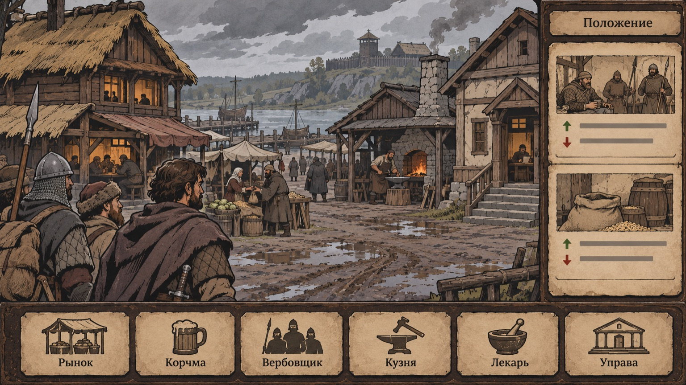
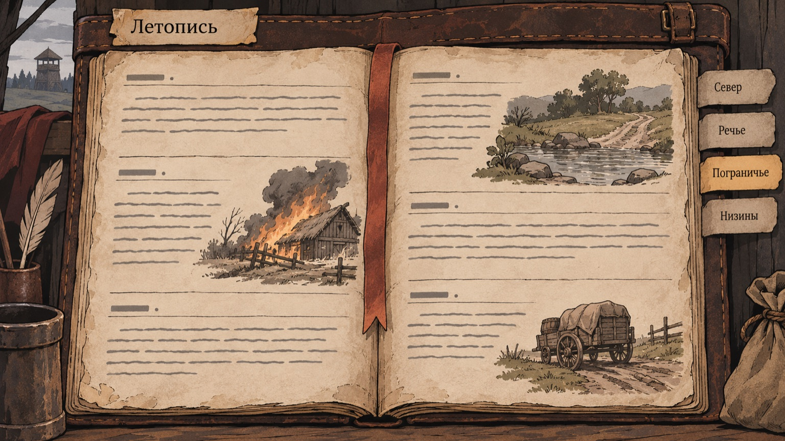
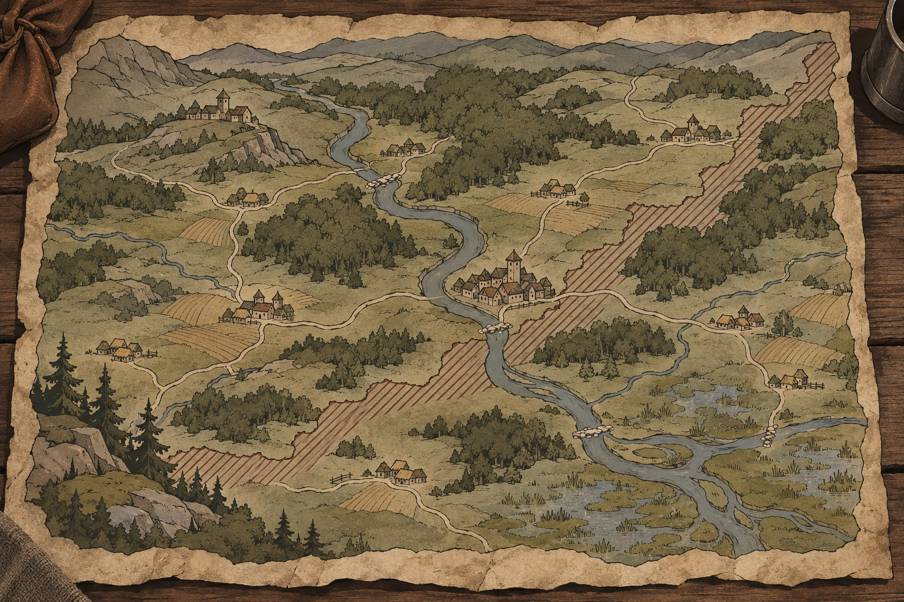
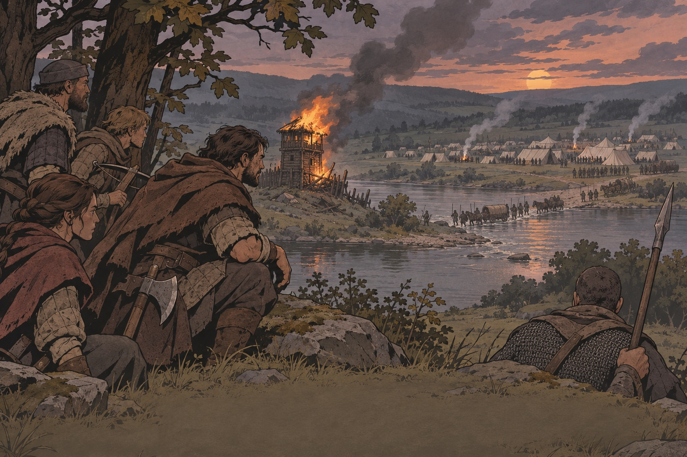
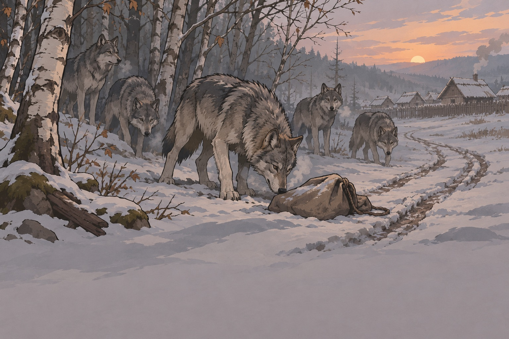

# Референсы мира

Мир Warwrit — один на всех: армии герцогов ходят сами, банды работают вокруг
войны, ведущий задаёт ход войны ([compass §1](../engineering/DESIGN_COMPASS.md#1-what-the-game-is)).
Ниже — какие системы у ориентиров делают мир «живым» и куда это ложится у нас.

## Системы

| Система                  | Ориентир                                      | Как работает у ориентира                                                           | У нас                                                  | Страница                                                |
| ------------------------ | --------------------------------------------- | ---------------------------------------------------------------------------------- | ------------------------------------------------------ | ------------------------------------------------------- |
| Положения поселений      | Battle Brothers                               | Событие у поселения меняет цены и вербовку и рождает контракт, который его снимает | «Два сбора», «Полк на постое»                          | [place-state](../wiki/mechanics/place-state.md)         |
| Пристроенные места       | Battle Brothers                               | Мельница, лесопилка, сторожка при поселении могут сгореть и восстановиться         | Состояние места видно на карте                         | [attached-places](../wiki/mechanics/attached-places.md) |
| Кризис с предупреждением | Battle Brothers                               | Поздний кризис объявляется заранее и меняет весь мир                               | Кризисный сезон                                        | [crisis-season](../wiki/mechanics/crisis-season.md)     |
| Армии сами по себе       | Bannerlord, Foxhole                           | Армии и фронт двигаются без игрока                                                 | Армии герцогов, параллельные битвы                     | [armies](../wiki/mechanics/armies.md)                   |
| Ведущий мира             | живые ролевые кампании, EVE (события игроков) | Человек решает поворотные события                                                  | Ведущий решает битвы за города; сервер — мелкие стычки | [game-master](../wiki/mechanics/game-master.md)         |
| Летопись                 | EVE, Pentiment                                | История пишется действиями и остаётся                                              | Датированные записи банд и армий                       | [chronicle](../wiki/mechanics/chronicle.md)             |
| Сроки и давление         | Pathologic 2                                  | События наступают без игрока                                                       | Без банды исход наступает сам                          | [pressure](../wiki/mechanics/pressure.md)               |
| Отношения сторон         | Battle Brothers                               | Отношение знати и поселений к отряду                                               | Отношение мест и сторон                                | [relations](../wiki/mechanics/relations.md)             |
| Амбиции                  | Battle Brothers                               | Цель компании на сезон                                                             | Цель сезона / амбиция банды                            | [ambitions](../wiki/mechanics/ambitions.md)             |
| Ход мира                 | Foxhole                                       | Война идёт непрерывно, днями                                                       | Мировой ход                                            | [world-turn](../wiki/mechanics/world-turn.md)           |

## Хорошее и плохое событие мира (форма)

- **Плохо:** «В Поречье прошла большая битва» — прошлое, следа нет.
- **Хорошо:** «Полк стоит на постое в Луговце» — место _занято_, цены выше,
  вербовщики в корчме, контракт найти потерянный обоз.
- **Параллельная битва** меняет соседние положения: раненые и дезертиры на
  дорогах, поле для поиска, похоронная работа, цена зерна.

(Примеры — из [compass §6](../engineering/DESIGN_COMPASS.md#6-examples-form-only--not-canon), форма, не канон.)

## Изображения

- Карта мира с армией и бандами: 
- Поселение и его положения: 
- Летопись: 
- Карта-предмет региона: 
- Война с уровня банды: 
- Звери у деревни зимой: 

## Ошибки ориентиров

- Ширина без глубины (Bannerlord, «Смута»): у каждого места — человек, беда и повод прийти.
- Нет сквозной цели (Wartales, Bannerlord): механика питает цель сезона.
- Только люди-враги (Wartales): люди, звери и твари требуют разных ответов; у зверей есть логова на карте.
- Ретконы: события мира датированы и идут только вперёд.
