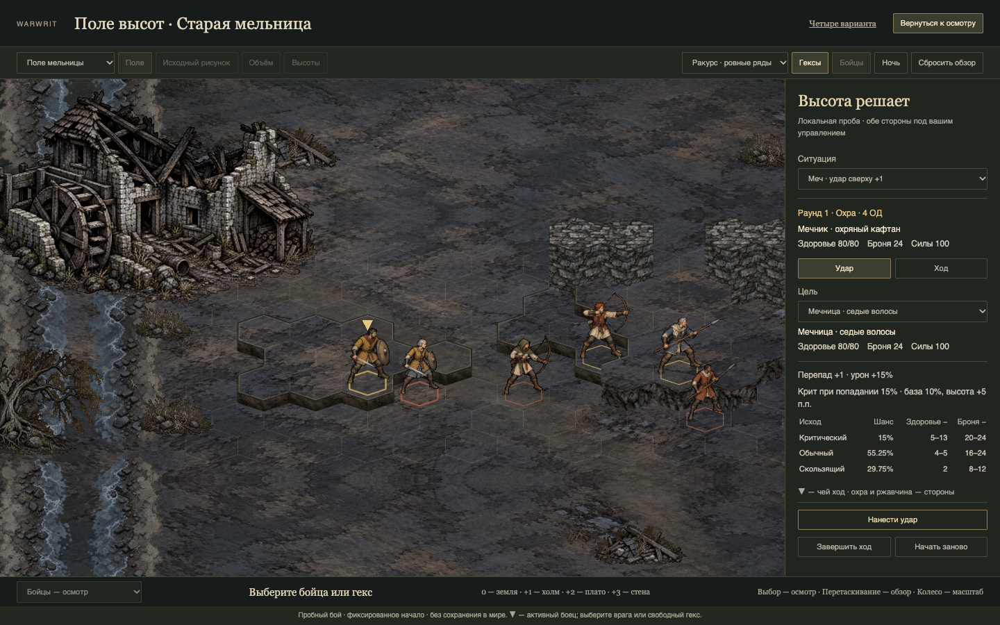

# Поле боя и тестовые карты

## Единый Developer Combat Lab — WLC-06, 2026-11-08

Текущий вход: `/dev/playground/combat` с авторизованным аккаунтом разработчика.
Визуальные редактор и HUD сохранены; новый sandbox запускается по игровым
`m1-domain-bridge-v5`, через общий серверный encounter executor и изолированное
PostgreSQL-хранилище. Старые `/combat-lab`, `/dev/combat-lab` и volatile-сессии
удалены. Версии прежних правил, replay и ресурсы сохранены; unmapped навыки и
особые силы прототипа не превращаются в игровые правила кампании.
[Сценарий, границы, проверки и ограничения WLC-06](../engineering/COMBAT_LAB_CONSOLIDATION.md).
Исторические результаты ниже не являются приёмкой нового стенда или всей M1.

## Действующие правила интерфейса боя — сводка решений 2026-10-10…16

Сведено 2026-11-09 из удалённого журнала (прежние разделы — в
[истории git](https://github.com/Vovanostm/warwrit/blob/87e785d537fc4bf4bbb6856456391015350d235b/docs/wiki/battlefield-test-maps.md)).
Подача поля и камеры заменена решением 2026-10-30 (ниже); эти правила
интерфейса действуют.

- **Цели.** Зона выбранного оружия и враги в ней видны одновременно. Все
  законные цели выделены тёплым контуром, маркером у ног и меткой в очереди;
  союзники и недоступные противники метку не получают (2026-10-10).
- **Одна сетка, состояния цветом.** Одна гексагональная сетка; ход, дальность
  и «ход + дальность» различаются заливкой клетки, без отдельных контуров
  (решение владельца 2026-10-13).
- **Препятствие занимает один гекс** и рисуется в его границах (2026-10-13).
- **Наведение.** Клетка выбирает своего обитателя, даже если курсор не на
  пикселях спрайта; живой важнее трупа; наведение не отдаёт приказ (2026-10-13).
- **Кнопки.** Иконки Game Icons: атака — скрещённые мечи, ход — сапог,
  защита — щит, конец хода — песочные часы, отступление — бегущий боец; у
  приёмов свои силуэты. Команды и приёмы одного размера, одна палитра
  состояний; недоступное приглушено, причина запрета видна (2026-10-13).
- **Очередь ходов** — живая лента портретов, как в Heroes: текущий боец
  выделен, прогноз следующего раунда перестраивается по принятому состоянию;
  без «Порядок неизвестен» (решение владельца 2026-10-16). Наведение на портрет
  связывает его с фигурой; осмотр не меняет исполнителя приказа. До
  подтверждения видны цена, цель, прогноз и риск.
- **Полоски.** Под каждым портретом очереди и фигурой — здоровье, броня,
  мораль, всегда в этом порядке; нулевая броня строку не убирает. На поле —
  компактные полоски у ног без чисел и выносок (решение владельца 2026-10-16).

## Тестовые карты

| Карта                     | Место и проверка                                           | Статус                                               |
| ------------------------- | ---------------------------------------------------------- | ---------------------------------------------------- |
| Т0 «Полигон»              | Ровное поле: масштаб, геометрия, ввод                      | Диагностическая идея                                 |
| Т1 «Опушка у Березняка»   | Берёзовая опушка: силуэты на пёстрой земле                 | Контентный кандидат                                  |
| Т2 «Каменный брод»        | Берег и законный брод: узкий проход                        | Контентный кандидат                                  |
| Т3 «Двор Старой мельницы» | Разрушенная опасная мельница: руины, высоты, крупная тварь | Текущий спрайтовый стенд                             |
| Т4 «Ночная стоянка»       | Лагерь: читаемость ночью                                   | Контентный кандидат                                  |
| Т5 «Северный Двор»        | Укреплённый двор: тесные позиции                           | Контентный кандидат; прежний 12×12 не целевой размер |

Эти названия не утверждают новые сюжетные события и не означают, что все
локации уже нарисованы или приняты. У населённых мест сохраняется их
каноническое состояние; Старая мельница остаётся разрушенной и опасной.

## Качество боя: как это сделано в XCOM — 2026-10-07

Сохраняется принцип: состояние боя отдельно от показа; до приказа видны
путь, расходы, шанс и последствия, после — фактический результат.
XCOM служит ориентиром читаемости и темпа. Его укрытия, база и анимации
не добавляются автоматически. Текущая обратная связь — статичные фигуры,
мгновенные перемещения, короткие надписи и журнал принятых событий.

## Спрайтовая боёвка: ТЗ этапа 1 — 2026-10-09

**Запрос владельца:** подготовить боёвку уровня Battle Brothers / Wartales /
XCOM, сосредоточиться на спрайтах, интересных местах и механиках; десять типов
воинов, десять существ, гексы, интерфейс и стенд. Первый этап — согласование
ТЗ, общего кадра и стиля, с вопросами владельцу, матрицей решений и mind map.
Решения владельца ниже утверждены для этого ТЗ. Числа баланса, перечисленные
особые приёмы и игровая реализация требуют отдельной проверки.

**Ответы владельца в этом согласовании:**

- Основа — «Battle Brothers: позиция, оружие, усталость, мораль» (D1).
- «6 бойцов с каждой стороны». Новый целевой бой — 6×6; диагностический T5
  с 24 фигурами не становится целевым боем. Старое описание двух компаний
  сохраняется как история; участие помощника в новом лимите требует уточнения.
- Нужен генератор боя: выбрать, кто с кем дерётся.
- Этап 1 — «Общий кадр + 2 образца, затем 20 после согласования» (D12).

**Последующее согласование 2026-10-09:** приняты D1–D12 и предложенный состав.
Поле 15×11, человек 80 px при 1440×900, 4 ОД; десять комплектов, полные фигуры,
без анимации сейчас. Зона контроля не запирает отход. Люди бегут и сдаются;
принята основа: при панике сначала безопасный отход, при перекрытом выходе —
сдача, сдавшийся не возвращается к атаке. Перенаведение разрешено один раз
с новым предупреждением и хотя бы одной ответной активацией игрока.
Сразу высоты 0/1/2 с более дорогим подъёмом, грязь и обычный огонь.
Первая карта — мельница. Владелец утвердил атмосферу/стиль общего кадра,
тёмную B053 и **боец C как основу щитника**. Условие запуска двадцати
отдельных художников выполнено; их задача — статичные спрайты, не анимация.
Приёмка направления не означает приёмку игровой интеграции.

Наблюдаемый результат этапа 1: открыть
[экран согласования](https://github.com/Vovanostm/warwrit/blob/79a6ba025bba236dfe4be0665aece98d1c8c4353/assets/art/combat/stage1-2026-10-09/index.html),
рассмотреть общий концепт, сопоставить роли и прочитать принятые развилки.
Экран согласования не исполняет бой. Следующий результат — законченный
настоящий бой на одной карте через существующее ядро и затем расширение.

### Что уже решено, а что требует ответа

| Основание                                                                         | Решение и граница                                                                                                                                                      |
| --------------------------------------------------------------------------------- | ---------------------------------------------------------------------------------------------------------------------------------------------------------------------- |
| Новый запрос 2026-10-09                                                           | Спрайтовое производство персонажей вместо неудачного текущего 3D-направления. Babylon.js сохраняется; новая технология не требуется.                                   |
| [ADR-0006](../architecture/0006-m1-renderer-babylon.md)                           | Чернила/плоская заливка, фиксированный вид 3/4, панорама/масштаб, без вращения.                                                                                        |
| [M1](m1-spec.md), [vision](vision.md)                                             | Исторически: шесть полевых бойцов от компании и помощник второй компанией. Новый ответ выше задаёт 6×6. PvE и общий мир без глобальной паузы сохранены.                |
| [Удар](mechanics/melee.md), решение 2026-10-07                                    | Обученный соседний ближний удар всегда наносит урон щиту, броне или HP. Исключения: новобранцы и бесплотные цели; дальний бой допускает промах. Порог обучения открыт. |
| [DESIGN_COMPASS](../engineering/DESIGN_COMPASS.md)                                | XCOM задаёт предпросмотр, темп и обратную связь. Укрытия и фланговые бонусы XCOM не вводятся.                                                                          |
| [Первая очередь](mechanics/index.md#первая-очередь--решение-владельца-2026-10-08) | Зона контроля, мораль с бегством/сдачей и намерения тварей выбраны первыми. Их конкретные правила ещё предложения.                                                     |
| [Vision, 2026-10-07](vision.md)                                                   | Владелец отверг обязательный бюджет длительности боя. Контракт может быть длинным; таймер миссии не становится требованием этого ТЗ.                                   |
| [Мир](world/index.md), [Поречье](world/porechye.md), [B7](bestiary/catalogue.md)  | Воюющие герцогства — решение; конкретная история и большая часть существ — предложения. Мельница разрушена и опасна; населённые места не рисуем заброшенными.          |

Разбор по `sequential-thinking`: сначала сохранённые решения → затем варианты
правил → риски совместимости → проверяемый минимальный бой → производство.
При первоначальном согласовании скилл прочитан, но MCP-инструмента не было;
вызов тогда не заявлялся. В последующем исследовании готового кода инструмент
`sequentialthinking` доступен и использован для решения и его пересмотра.
Canonical Airtable Notes/Purpose не
обновлялись и не читались заново: это ограничение проектного согласования,
не разрешение менять принятую семантику команд. Исходный архив не восстановлен.

### Матрица решений для владельца

Все строки приняты владельцем 2026-10-09. Конкретные цены/пороги ниже —
параметры будущей проверки, а не уже работающий баланс.

| ID     | Принято                                                                   | Что проверить                                                                |
| ------ | ------------------------------------------------------------------------- | ---------------------------------------------------------------------------- |
| D1     | BB: позиция, оружие, усталость, мораль; XCOM: подача                      | После хода остаются осмысленные разные ответы                                |
| D2     | Десять комплектов без закрытых классов                                    | Отличие тактической задачи каждого                                           |
| D3     | 80 px, поле 15×11, desktop 1440×900                                       | Читаемость 12 фигур, ранний контакт                                          |
| D4     | 4 ОД                                                                      | Стоимости позволяют ход+удар и защиту/отход                                  |
| D5     | Без запирания                                                             | Реакция не отменяет шаг живого бойца; явный прогноз                          |
| D6     | Люди бегут и сдаются; сначала безопасный отход, иначе сдача               | Выход достижим за несколько активаций; сдавшийся не атакует                  |
| D7     | Перенаведение один раз, новое предупреждение и ответная активация         | Нет внезапного удара вслед ушедшей цели                                      |
| D8     | Сразу высоты 0/1/2, грязь, обычный огонь                                  | Подъём дороже, грязь замедляет, огонь опасен; прогноз совпадает с итогом     |
| D9     | Полные фигуры                                                             | Общие оси, свет, ступни, без зеркалирования света                            |
| D10    | Только статичные спрайты сейчас; кадровая анимация позже                  | Нет анимационных листов и motion-gate в этом цикле                           |
| D11    | Разрушенная Старая мельница первой; Т0 для калибровки                     | Законченный ход → угроза → ответ → исход                                     |
| D12    | Двадцать отдельных заданий художникам после выбора стиля                  | Направление согласовано; единые референсы и provenance                       |
| Состав | Перечисленные W01–W10 и B001/B002/B003/B017/B019/B023/B025/B030/B037/B053 | Отбор принят для арта/боевого стенда; новые способности не выданы за готовые |

### Бегство, сдача, перенаведение и местность

**Принятая основа D6:** человек в панике пытается уйти, а при перекрытом
безопасном выходе сдаётся. Бегство и сдача — разные исходы, не смерть.
Маршрут проверяется до выходного гекса, а не только в пределах оставшихся
ОД: боец может убегать несколько активаций. Сдавшийся не атакует, не держит
ZOC и не может собраться обратно в бой. Выход с поля регистрируется один раз.
Порог паники, эффект команды W10 и владение пленным остаются балансом/контрактом
следующего этапа; не вводим выкуп или допрос одним визуальным значком.

**Уточнение для первого стенда (предложение):** безопасный маршрут использует
известные бойцу проходимые гексы без активного огня и избегает свободных ударов,
в том числе через разрешённый осторожный отход. При отсутствии такого пути
люди сдаются только против стороне с человеком, способным принять пленного;
тварь не получает право владения человеком. В бою против зверей человек
продолжает пытаться спастись, даже рискованным путём. Профиль зверя допускает
бегство, но не сдачу; остальные существа получают явную политику, не общее
«все тёмные твари бесстрашны». Это ограничение предотвращает сдачу волку и
не решает судьбу пленного за владельца.

**D5:** урон реакции не отменяет разрешённый шаг живого бойца; гибель до шага
может остановить движение. Конечная рекомендация — один свободный удар каждого
контролирующего между началами двух его активаций и отдельный осторожный отход.
Лимит/цена остаются предложением, но вариант «любой урон оставляет на месте»
отвергнут. Старые правила/replay сохраняются под прежней версией.

**Принятая основа D7:** тяжёлый приём может перенавестись один раз за подготовку.
Новая цель/линия сразу заменяет прежнюю подсветку; журнал отмечает смену.
Исполнение допустимо только после хотя бы одной завершённой ответной активации
стороны игрока после последнего предупреждения. Если следующая очередь твари
наступила раньше, приём продолжает подготовку, а не бьёт внезапно. Второе
перенаведение запрещено; при недопустимой цели — отмена или исполнение по
последней законной линии согласно явному профилю. Прерывание и цена —
параметры профиля. На стенде обязательно проверить плотную очередь тварей,
уход цели, повторное перенаведение и отсутствие возможного ответа.

**Принятая основа D8:** у каждого гекса видимая высота 0/1/2 и явное свойство
поверхности. Подъём и грязь повышают стоимость шага; огонь даёт реальный
опасный эффект. Прогноз показывает суммарную цену высоты/грязи и воздействие
огня до подтверждения. Точные надбавки ОД/сил и величина/момент урона огня —
ещё предложение: задаются единожды в версии правил, не в renderer. Для
первой мельницы предлагаются постоянные отмеченные очаги без распространения
и разрушения зданий; рядом всегда есть сухой обход. Высота не добавляет
неутверждённых бонусов урона, дальности или XCOM-укрытия.

### Десять воинов — выбранные комплекты

W01–W10 — выбранные локальные обозначения арта/стенда, не классы или ID ядра.
Навык приобретается практикой/обучением; смена оружия не даёт мастерства.
W01/W03/W04/W05 опираются на имеющиеся профили; остальные требуют конечных
новых профилей/действий. Здесь утверждается требование различимости, не баланс.

| ID  | Комплект / силуэт            | Задача и предложенный приём                     | Ограничение / противодействие                             |
| --- | ---------------------------- | ----------------------------------------------- | --------------------------------------------------------- |
| W01 | Меч + щит, стёганка/кольчуга | Держать проход; защита                          | Малая дальность, усталость от удержания                   |
| W02 | Топор + щит                  | Давить щит/броню отдельным ударом               | Приём дороже обычного; цена и разрушение щита открыты     |
| W03 | Двуручный топор              | Тяжёлый удар по защищённой цели                 | Нет щита, дорогой удар, нужен подход                      |
| W04 | Копьё                        | Поддержать из второй линии, держать подход      | Теснота/ближний контакт; стена копий пока кандидат        |
| W05 | Лук                          | Подвижная дальняя поддержка                     | Линия, боеприпас и запрет стрельбы в зоне требуют решения |
| W06 | Нож, лёгкий комплект         | Дешёвые короткие удары по плохо защищённой цели | Не игнорирует любую броню; нет выдуманного бонуса фланга  |
| W07 | Молот, тяжёлый комплект      | Стабильное давление на прочность брони          | Новая оружейная политика, малая дальность/нагрузка        |
| W08 | Арбалет                      | Подготовленный сильный выстрел                  | Реальная перезарядка; новый профиль и расходник           |
| W09 | Алебарда / древковое оружие  | Перекрыть линию и сместить цель                 | Новые reach/displacement; не заменяет копьё без отличия   |
| W10 | Командир с обычным оружием   | Собрать дрогнувшего, организовать отход         | Команда расходует действие/силы; без магической ауры      |

W07–W09 — дополнительные авторские предложения этого ТЗ. Они не выдают
молот/арбалет/алебарду за реализованные профили. Разведчик, следопыт и лекарь
из [развития](character-progression.md) остаются допустимыми ролями компании,
но не используются, чтобы набрать десять боевых типов без десяти различий.

### Десять существ — выбранный отбор существующих карточек

Владелец выбрал три зверя и семь необычных существ из списка ниже
для производства спрайтов и проектирования боевого стенда. Все карточки ниже оставлены редакцией B7;
только B001/B053 имеют M1-источник присутствия. Выбор состава не утверждает
архивные биографии, все способности или автоматическое размещение видов в мире.

| ID / источник                                              | Облик / задача боя                                                                                                                                                   | Предлагаемый ответ игрока                                                 |
| ---------------------------------------------------------- | -------------------------------------------------------------------------------------------------------------------------------------------------------------------- | ------------------------------------------------------------------------- |
| [B001 Волк](bestiary/creatures/b001.md)                    | Низкая голова, грубая шерсть; проверяет край группы                                                                                                                  | Держаться вместе, прикрывать отделившегося                                |
| [B002 Бурый медведь](bestiary/creatures/b002.md)           | Тяжёлый зверь; подготовка сильного ближнего удара                                                                                                                    | Не оставаться перед ним, использовать восстановление после удара          |
| [B003 Дикий вепрь](bestiary/creatures/b003.md)             | Клин низкой головы; прямой натиск                                                                                                                                    | Сойти с объявленной линии, оставить выход                                 |
| [B017 Могильный зверь](bestiary/creatures/b017.md)         | Сутулый живой падальщик с длинными передними конечностями                                                                                                            | Защитить раненого/тело; не рисовать воскресшего солдата                   |
| [B019 Могильный сторож](bestiary/creatures/b019.md)        | Костлявая фигура в погребальной ткани, граница могилы                                                                                                                | Предложенная местная задача с предметом; не добавлять религию             |
| [B023 Висельная тень](bestiary/creatures/b023.md)          | Натянутая тонкая фигура у опоры                                                                                                                                      | Видеть область петли и освободить захваченного; бесплотность не доказана  |
| [B025 Камышник](bestiary/creatures/b025.md)                | Высокое узкое тело, волокнистая кожа и согнутая шея                                                                                                                  | Прочитать движение камыша/головы, сохранить строй                         |
| [B030 Береговая плакальщица](bestiary/creatures/b030.md)   | Мешковидное тело, дыхательные щели, бессловесный плач                                                                                                                | Не дать контактного захвата; без магического вытягивания                  |
| [B037 Пустоголос](bestiary/creatures/b037.md)              | Тонкая перепончатая фигура у полого дерева                                                                                                                           | Отличить реально услышанный повтор от команды; без знания чужой биографии |
| [B053 Ночная мельничная тварь](bestiary/creatures/b053.md) | Силуэт из [текущего арта](https://github.com/Vovanostm/warwrit/blob/79a6ba025bba236dfe4be0665aece98d1c8c4353/assets/art/m1/battle/unit-mill-beast.png), ночная охота | Сохранить истинный контракт и коготь; новый натиск только кандидат        |

У каждого нового профиля должны быть: видимая подготовка, одна особая угроза,
понятный контрприём, ограничение способности и законный исход. Различие нельзя
получить только добавлением HP. Числа и стоимость балансируются на стенде.

### Пять мест и разные задачи

| Карта            | Вид и связь с лором                             | Тактическое решение                                                                        |
| ---------------- | ----------------------------------------------- | ------------------------------------------------------------------------------------------ |
| Опушка Березняка | Живая деревня за лугом, берёзы/пни; не руины    | Два подхода, линия стрельбы, защита края группы                                            |
| Каменный Брод    | Река, каменная переправа у работающего города   | Держать узость или отходить до затора; с высотой и дорогим подъёмом; бонус урона не принят |
| Старая мельница  | Сломанное колесо, обваленная крыша, ручей и люк | Обойти тесный проход, вывести раненого, пережить тяжёлую угрозу                            |
| Тихая Гать       | Работающие настилы и камышовый берег            | Не растянуть строй, сохранить сухой путь отхода; без неутверждённого утопления             |
| Северный Двор    | Населённый хутор: амбар, телега, частокол       | Держать ворота, прикрыть выход второй компании                                             |

Ландшафт служит задаче: минимум два реально разных подхода, видимый выход,
понятные препятствия и причина двигаться. Художественные детали не создают
огонь, укрытие, скользкость, ловушку или дополнительный урон. Ночной лагерь
Т4 остаётся отдельной проверкой освещения, не новой шестой локацией мира.

### UX боя: структура и состояния

Базовое окно 1440×900, тот же desktop-интерфейс на мобильном landscape.
Центр — поле; сверху — очередь инициативы с владельцем каждого бойца;
снизу — выбранный боец, здоровье/броня/силы/мораль/ОД и доступные действия.
Справа только временный компактный прогноз; подробный журнал раскрывается.

1. Выбор бойца → видны реальные доступные действия и граница хода.
2. Выбор действия/гекса → путь, стоимость, будущие ОД/силы, реакции зон,
   броня/HP-урон, объявленная угроза и причина запрета. Обученному ближнему
   бойцу показываем силу удара; для стрелка/новобранца — честную вероятность.
3. Подтверждение → ожидаем серверный результат, не имитируем успешный урон.
   Повторный ввод не отправляет второй расход; отмена до отправки бесплатна.
4. Результат → новая позиция статичного спрайта, цифра урона/значок реакции,
   отдельные состояния смерти, бегства и сдачи. Анимации в этом цикле нет.
5. Чужой ход → имя/портрет действующего, видимая причина действий; после
   переподключения актуальное состояние без повторного падения/удара.

Иконка, форма/штриховка и текст дублируют цвет: охра — выбранный путь,
ржавый — опасность, нейтральная холодная линия — доступное поле. Выбор гекса
не заслоняют руки/дерево/HUD; закрывающий объект даёт силуэт/прозрачность.
Клавиши: 1–6 действия, Tab цели, Esc отмена, Space ожидание, Enter подтверждение
конца активации; назначения — предложение для проверки. Панорама не запускает
ход. Опасное действие требует подтверждения по понятному прогнозу.

### Производственный контракт спрайта и агента

Отдельное задание агента на каждый согласованный W/B-ассет, две очереди
с переиспользованием освободившихся агентов при лимите слотов; все получают **один выбранный** общий кадр,
unit-c-ink и соответствующую сцену/карточку. Каждый владеет только своим
каталогом. Родитель владеет общим ТЗ, стилем, сборкой и changelog; независимый
визуальный критик оценивает текущие изображения по полной рубрике.

Выход каждой задачи: прозрачный PNG с настоящей alpha, точный prompt и
источники рядом; постоянная точка ступней, полный силуэт без обрезанного
оружия, общие оси и свет. Размер исходного холста не равен игровому росту;
принятый показ человека — 80 px; размер крупной твари определяется сравнением с дверью
и человеком, не дополнительной клеткой, которой нет в правилах.

Направление согласовано. Производим **одну статичную полную фигуру** на ID,
без шага, удара, смерти и анимационных атласов. Боец C — основа W01;
неудачные прежние W01 v1/v2 остаются историей. Alpha, полный силуэт, pivot,
оружие и единый свет проверяются до сборки общего листа. Точная сетка,
подсветка/путь и контакт с землёй принадлежат отдельному слою интерфейса.
Шесть направлений цели должны оставаться понятными при одном спрайте;
новые facings — только если статичный показ реально не справится.
Кадровая анимация — последующий отдельно согласованный цикл; motion-критерий
сейчас вне scope. [Общий brief двадцати художников](../../assets/art/combat/stage1-2026-10-09/roster/BRIEF.md)
сохраняет единые референсы, ограничения и ответственность.

### Открытые параметры полного боя

D1–D12, состав и направление согласованы; повторять интервью по ним не нужно.
Открыты числа баланса, цена осторожного отхода, пороги паники, стоимость
перенаведения/прерывания, правило линии выстрела, эффекты огня и передача
пленных. Их проверяет один законченный бой, а не новый большой каталог.
Если появится помощник, он входит в общий лимит шести на стороне; отдельный
режим двух полных компаний здесь не запущен и требует решения.

## Полное техническое ТЗ пошагового боя — 2026-10-13

**Статус:** производственная спецификация для проверки владельцем, LOCAL.
Запрос: сначала определить интерфейсы, алгоритмы, готовые технологии и
критерии качества; текущий код боя в этом проходе не изменяется.
Утверждённые решения D1–D12 и Command desk сохраняются. Новые численные
цели, способности и библиотечные зависимости ниже — предложения, а не
автоматически утверждённый баланс или новая архитектура.

### 2. Продукт и граница законченного результата

- Desktop, единое полноэкранное поле и наложенный HUD; базовый кадр 1440×900,
  дополнительные проверки 1280×720 и 1920×1080. Без отдельной мобильной вёрстки.
- Пошаговый бой 1–6 бойцов каждой стороны; представительская приёмка — 6×6.
  15×11 pointy-top гексов, 4 ОД, индивидуальная инициатива.
- Статичные полные фигуры, мгновенные перемещения. Удары, промахи, реакция,
  рана, бегство и сдача передаются краткими надписями и журналом.
- Человек показан высотой 80 px по видимому силуэту в базовом кадре
  1440×900, как принято в D3; прозрачные поля PNG в размер тела не входят.
  Масштаб крупной твари сравнивается с человеком/дверью, а не выравнивается
  с ней по размеру исходного файла.
- Позиция, комплект оружия, силы и мораль определяют решения. Высоты 0/1/2,
  грязь и огонь входят в исполняемый бой. Нет неутверждённых укрытий/фланговых
  бонусов из XCOM или превращения персонажей в закрытые классы.
- Рабочий комплект: поле, интерфейс, правила/AI, конструктор боя, редактор
  карты, импорт/экспорт, повтор, перезапуск и явный исход.
- Двадцать выбранных визуальных профилей остаются существующим каталогом.
  Полный каталог уникальных действий — отдельная незавершённая часть:
  двадцать картинок/наборов характеристик не равны двадцати механикам.
- Кампания, владение пленным после боя, MMO-транспорт и судьба компании
  требуют своих контрактов. Локальный стенд не объявляется production/MMO.

Приёмка результата означает, что игрок понимает: кто ходит, куда можно
идти, кого можно атаковать, сколько это стоит, что угрожает и почему
действие недоступно. У него есть несколько содержательных решений;
UI не заставляет расходовать дополнительные клики на очевидное состояние.

### 3. Архитектура и единственные владельцы правил

| Часть            | Ответственность                                                                       | Недопустимое смешение                                                 |
| ---------------- | ------------------------------------------------------------------------------------- | --------------------------------------------------------------------- |
| `game-core`      | Карта, расходы, активации, допустимые цели, урон, реакции, мораль, исход, RNG, повтор | DOM/Babylon/таймеры/I/O/runtime dependencies                          |
| `protocol`       | Версии сообщений, публичный снимок, прогноз, события, отказ                           | Вторая реализация правил или закрытые факты                           |
| `server`         | Право команды, revision, идемпотентность, атомарное принятие, продолжение AI          | Правила боя внутри маршрута HTTP                                      |
| `web` controller | Ввод, состояние ожидания, режим действия, инспекция                                   | Локальное списание ресурсов и самостоятельное определение доступности |
| Babylon scene    | Проекция, слои, спрайты, метки, определение объекта под курсором                      | Решение о шансах, пути или разрешённости атаки                        |
| React HUD        | Карточки, очередь, команды, тултипы, меню, редакторы                                  | Подмена текущего бойца осматриваемым                                  |

Один public preview от ядра обслуживает подсветку, прогноз и исполнение;
AI использует те же допустимые действия. UI вправе форматировать числа,
но не повторяет формулы. Версия правил входит в replay. Исторические
выпущенные правила не переписываются новым балансом.

### 4. Обязательный порядок слоёв сцены

Это семантический порядок, а не назначение случайных `z-index`/групп.

| Слой               | Содержимое                                                                  | Что может перекрывать                                           |
| ------------------ | --------------------------------------------------------------------------- | --------------------------------------------------------------- |
| Земля              | Подложка, высоты, поверхности                                               | Ничего из последующих слоёв                                     |
| Наземная тактика   | Сетка, доступные клетки, путь, кольца сторон/выделения, объявленная область | Землю; всегда **под непрозрачными пикселями фигур**             |
| Объекты мира       | Спрайты бойцов/препятствий, материальные силуэты, контакты                  | Наземную тактику; друг друга по общей пространственной политике |
| Указатели сущности | Контур именно силуэта цели, полоски, указатель текущего бойца               | Только предназначенную сущность; не всю клетку перед телом      |
| События            | Краткие подписи с привязкой к бойцу/месту                                   | Сцену в выделенной области текста; без перехвата ввода          |
| HUD                | Инициатива, карточки, команды, прогноз                                      | Сцену в своих пределах                                          |
| Поповер/диалог     | Тултип, подтверждение, результат                                            | HUD по явному приоритету; результат исключает боевые тултипы    |

**RENDER-01:** ни одна линия/заливка сетки, пути, наземного выделения,
стрельбы или угрозы не проходит перед телом, оружием, щитом и видимой ногой
фигуры, независимо от высоты, раунда, выбора, дня/ночи и масштаба.
Силуэтная подсветка цели — отдельный эффект по альфа-маске персонажа,
а не оправдание наземного маркера на его теле.
Инвариант включает кольцо текущего бойца, закреплённой инспекции и наведения
на портрет; эти кольца остаются наземными и не перехватывают ввод.

**RENDER-02:** прозрачные поля PNG не образуют прямоугольные заслонки;
контакт стопы совпадает с поверхностью гекса. Нельзя исправлять слои
уменьшением фигуры, поднятием кольца к поясу или общим `always on top`.

**RENDER-03:** все высокие объекты используют согласованную сортировку и
проекцию; стабильное правило при равной глубине. Если обычная сортировка
transparent по центру billboard даёт неверное перекрытие, сравнивается
порядок по точкам опоры в фиксированной камере. Разные виды не получают
несвязанные частные поправки. Пересечение спрайтов по соседним клеткам
проверяется на тесной группе, длинном оружии и крупном существе.

**RENDER-04:** у архитектурного препятствия допустимо пространственное
перекрытие, но текущий/атакуемый боец остаётся доступен через очередь и
ясно связан с местом. Отдельный контур скрытого бойца допустим; перенос
всей наземной сетки в передний слой запрещён.

**Техника реализации:** сначала раздельные проходы наземной тактики и
фигур/объектов. Проверить alpha-test/blending/depth-write и очистку глубины
на границе проходов установленного Babylon. Наземные маркеры рисуются до
фигур; более поздний проход земли над фигурами отсутствует. `alphaIndex`
работает внутри своей очереди и не исправляет порядок между группами.
Смена renderer не требуется. Точный материал/проход выбирается после
минимального контрпримера с непрозрачным телом и прозрачным краем PNG.

**Контракт спрайта:** стабильный asset ID и путь, размер исходника,
границы видимого силуэта, точка опоры стоп, показ относительно человека,
общая проекция/направление света и альфа-маска для выбора. Полная фигура
не обрезается при подготовке атласа; рамка портрета — отдельный crop.
Визуальный прямоугольник не задаёт занятую клетку/дальность/LOS: это факты
ядра. Карта и фигуры соблюдают утверждённый ink/flat-wash; промпты,
происхождение и лицензия сохраняются у потребляемых ресурсов. Сначала
проверяется фигура на поле и в HUD, затем расширяется каталог.

### 5. Геометрия гексов, высота и непрерывный ввод

**HEX-01.** Одна геометрия для центров, углов, границ, заливок, наведения,
пути и опоры фигур. Для pointy-top с радиусом R в плоскости земли:
`x = √3 R(q+r/2)`, `z = 3Rr/2`; кубическая координата `s=-q-r`.
Соседи имеют общую полную грань. Оформление линии не меняет геометрический
размер доступной клетки и не создаёт щелей между заливками.

**HEX-02.** Преобразование экран → луч камеры → поверхность/плоскость →
дробные axial → cube rounding. Прямое округление q/r по отдельности
недопустимо. На точном ребре/вершине выбор детерминирован; с любой стороны
границы существует выбранный гекс. Проверяется вся допустимая поверхность,
не маленький inset-меш. Вне карты выбирается ничто.

**HEX-03.** Высоты используют ближайшую законную поверхность. На швах
допустим plane fallback, но он не выбирает удалённый нижний гекс сквозь
верхний край или HUD. Камера, viewport и размеры canvas учитываются,
включая devicePixelRatio и zoom браузера.

**HEX-04.** PNG проверяется по альфа-маске при выборе фигур. Прозрачный
пиксель пропускает ввод к следующему законному объекту/гексу; непрозрачная
цель выбирает сущность. Декор, сетка, надписи и inactive-метки ввод не ловят.
Ввод через DOM-карточку/диалог не проходит на поле.

**HEX-05.** Наведённый и закреплённый гексы различимы. Выбор клетки A
сохраняется при наведении B. Движение камеры/уход курсора/новая revision
сбрасывают устаревший прогноз, а не отправляют приказ.

### 6. Полноэкранный HUD и информационная иерархия

- Поле занимает 100% viewport по ширине/высоте. Постоянные блоки — overlays,
  без второй боковой страницы управления и вертикальной прокрутки боя.
- Верх: инициатива с изображениями существ, номером раунда и заметным
  текущим бойцом. Следующий раунд отделён; неизвестный порядок честно
  обозначен, не реконструируется клиентом.
- Низ слева: действующий боец, портрет, имя/комплект, HP/броня/силы/мораль,
  ОД с числом, состояния и краткое значение выбранного действия.
- Низ справа: зеркальная карточка наведённого/закреплённого бойца;
  дружеская инспекция подписана как союзник. Это не обязательно противник.
  При неизвестном значении показано «неизвестно», а не 0 или выдуманная цифра.
- Низ по центру: постоянные команды и отдельная группа индивидуальных
  приёмов. Выбор другого юнита для осмотра не перемещает/переставляет кнопки
  действующего бойца. Места под будущие способности сохранены.
- Верх справа: компактные сетка/день-ночь/меню. Перезапуск, replay и
  редакторы доступны через меню; результат также даёт явные выходы.
- Фон карточек достаточно плотный для чтения на светлой траве и тёмной
  земле; орнамент не конкурирует с числами. Сдержанные slate/ink/ochre,
  общий стиль C. Иконки одного набора толщин/размеров, без случайных emoji.

**UI-01:** после одного взгляда различимы активный, свой/чужой,
атакуемый и осматриваемый. Сторона и действие кодируются цветом плюс
формой/иконкой/текстом, а не одним цветом.

**UI-02:** обычный UI-текст целится в контраст 4.5:1, значимые границы и
иконки — 3:1 относительно ближайшей подложки; это новая измеряемая UX-цель,
не заявление о соответствии текущей сцены. Все пять команд доступны
мышью и клавиатурой. Focus виден; никакие действия не требуют hover-only.

**UI-03:** полю нужны зоны для игры: карта по умолчанию вписана в центральное
пространство между HUD. Крайние клетки доступны pan/zoom; карточки не
маскируют единственный вход к цели. Незакрытая часть поля принимает ПКМ.
Размер интерфейса проверяется также при browser zoom 125%.

### 7. Контракт управления и режимов

| Ввод/состояние             | Результат                                                                     |
| -------------------------- | ----------------------------------------------------------------------------- |
| Hover свободного гекса     | Путь действующего бойца, цена ОД/сил, оставшиеся ресурсы и риски              |
| Hover врага                | Прогноз выбранной законной атаки, связь с фигурой и зеркальная карточка       |
| ЛКМ по фигуре/портрету     | Закрепить инспекцию; действующий боец не меняется                             |
| ЛКМ по клетке              | Закрепить клетку/путь; осмотр не расходует ход                                |
| ПКМ в обычном режиме       | По законной цели — атака, по законной пустой клетке — движение                |
| ПКМ в режиме приёма        | Выполнить именно выбранный приём по допустимой цели/области                   |
| Недопустимая цель приёма   | Причина отказа; не подменять приём обычной атакой/ходьбой                     |
| Esc                        | Закрыть верхний поповер/диалог или отменить выбранный приём; не закончить ход |
| Колесо/панорама            | Менять камеру без изменения боя; убрать stale hover                           |
| 1–5 при фокусе поля        | Те же guarded команды; в текстовом поле редактора не действуют                |
| Ожидание ответа            | Видимый pending; второй независимый приказ не отправляется                    |
| Чужой ход/паника/конец боя | Нельзя отдать обычный приказ; инспекция и чтение остаются доступны            |

Попадание курсора в непрозрачную фигуру сначала определяет сущность,
независимо от допустимости команды; затем проверяется выбранное действие.
Недоступный противник не пропускает клик сквозь тело к нижнему гексу и
не подменяет отказ ходьбой. Прозрачное поле PNG — отдельный случай HEX-04.
Друг не превращается в цель атаки; занятая клетка не становится пустой
клеткой перемещения. Отсутствие команды объясняется конкретно:
не хватает ОД/сил, перекрыта линия, далеко, занято, бой завершён.

Пять постоянных команд: атаковать, переместиться, защищаться, завершить
ход, отступить. Отступить доступно по реальному правилу выхода, а не
телепортирует к краю. `wait` в текущем ядре завершает активацию; перенос
в конец того же раунда отдельным «ждать» **не реализован**, это другая
механика. Название кнопки не должно обещать её.

Подтверждение огня — принятое правило. UX для дополнительного подтверждения
реакций/прочих рисков остаётся предложением: сначала явный прогноз, без
постоянных одинаковых диалогов на каждый ход. Позиция кнопок/ввод не меняются
в момент поступления ответа так, чтобы случайный второй клик стал приказом.

### 8. Инициатива, статусы и индивидуальные способности

**QUEUE-01:** hover/focus портрета подсвечивает **силуэт сущности** и её
место; наземный маркер остаётся под фигурой. Ссылка работает в обе стороны:
hover поля выделяет соответствующий портрет. Следующий раунд не получает
придуманные длительности/порядок. Inactive-статус отличается от будущего хода.

**QUEUE-02:** портрет содержит компактные значимые состояния, приоритет
опасных. Избыток — `+N` с полным списком, а не набор неразличимых значков.
Tooltip сообщает название, последствия, оставшееся время/условие окончания
и источник **только если эти значения заданы правилом и доступны наблюдателю**.

| Категория          | Что есть сейчас                                             | Что требуется от будущего профиля                                                                       |
| ------------------ | ----------------------------------------------------------- | ------------------------------------------------------------------------------------------------------- |
| Мораль             | Число, дрогнул, паника, бегство, сдача                      | Порог/политика/восстановление задаются версией правил                                                   |
| Ресурсы/раны       | HP, броня, силы, раны                                       | Причина штрафа и фактическое состояние, без выдуманных длительностей                                    |
| Тактика            | Защита, доступная/потраченная реакция, подготовка удара     | Условия окончания и доступность цели                                                                    |
| Среда              | Находится в огне/грязи, высота                              | Входной урон огня не означает постоянный статус «горит»                                                 |
| Агрессия/намерение | Объявленная угроза/цель, если опубликованы                  | «Агрессивен» как AI-тенденция не равен активному эффекту с бонусом                                      |
| Будущие эффекты    | Отравлен, горит после выхода, кровотечение, оглушён, связан | Кандидаты: нужен исполняемый профиль, срок/stack/cleanse/публичность; сейчас не показывать как реальные |

**ABILITY-01:** для каждого приёма: ID/версия, значок и название, требования
навыка/экипировки, цель (сам/существо/клетка/область), дальность/LOS,
цена ОД/сил/расходника, время подготовки, условия использования, последствия,
способ прекращения и tooltip. Progression предоставляет доступные приёмы;
renderer не вычисляет unlock из портрета или W-ID.

**ABILITY-02:** четыре видимых слота не ограничивают все изученные навыки.
Предложение: стабильные закреплённые четыре плюс «Ещё» для избытка;
проверить 0/1/4/8 доступных приёмов. Заблокированный/неизученный/недоступный
сейчас — разные состояния с причинами. Пустой декоративный слот не выполняет
команду. Горячие клавиши не пересекаются с 1–5 и явно показываются после выбора.

**ABILITY-03:** выбрать приём → показать тип цели/дальность/область/прогноз
→ подтвердить законную цель. Массовая область нужна только профилю AoE;
зона обычного лучника означает возможные одиночные цели, не урон всем.
Новые эффекты активируются вместе с правилами/прогнозом/AI/replay, а не
одним UI-значком. W01–W10 и выбранные B001…B053 —
[существующий каталог визуальных профилей/комплектов](#десять-воинов--выбранные-комплекты).
Описания приёмов в нём остаются предложениями. Конечный исполняемый каталог
приёмов с требованиями/ценами/эффектами требует отдельного согласования;
изображения не считаются готовыми контрактами действий.

### 9. Прогноз и обратная связь

**UIX-01a / #180 — результат 2026-10-19, local ACCEPT, published [PR229](https://github.com/Vovanostm/warwrit/pull/229).**
Optional `attackRefusals` даёт каждому активному публичному врагу ровно
preview либо отказ общего admission ядра. Причины range/LOS/ОД/сил/хода/паники
и утверждённый D1 `threat-not-available` не меняют правила боя. Диагностика
содержит только разрешённые дальности и собственные ресурсы; D1 проверяет
нынешнюю all-visible лабораторию, а не настоящий туман войны. Старые
проекции без поля принимаются; повреждённые данные отклоняются до рендера.
Новых надписей отказа и визуального изменения здесь нет. #184/#187/#207 —
отдельные последующие slices, их готовность не заявляется.

Независимый eval3 ACCEPT; validator8/8, clean bootstrap833PASS/47SKIP,
10kstress/14DB PASS. Парный stress и15 сохранённых command streams на обоих
исходниках совпали по canonical state, всем событиям и числу принятых команд.
Это конечные сгенерированные случаи, не исторический архив всех replay.
Живой путь: стандартная мельница → осмотр/камера0POST → движение/ход мышью
и клавишей → завершённый бой; день/ночь, три размера, native Chrome125%.
[Снимки, независимые отчёты и пределы](../engineering/evidence/uix-w1-projection/README.md).
Ветка `Vovanostm/uix-w1-projection`, source candidate `fa7f516`; CI и merge
с owner `agent:merge-approved` ещё pending. Баланс/производительность
NOT_MEASURED; миграции/деплой не менялись.

Поправка 2026-10-19: первый CI PR229 (39192938216) упал на импорте
server source из web regression fixture. Кандидат `9c92995` заменяет только
fixture на protocol-shaped данные, сохраняя все восемь test bodies; production
не изменён относительно `fa7f516`. Свежий eval4 ACCEPT, coordinator validation8/8,
702PASS/47SKIP и audit PASS;25 focused tests, web typecheck/input-boundary,
реальный осмотр мельницы день/ночь0POST/rev4 и конец хода1POST/rev5 PASS.
Первый audit с validator-only coverage FAIL сохранён; после focused server
coverage штатный audit PASS. Прежние bootstrap/matrix/replay proof не выданы
за новые. Исправление опубликовано в PR229; новый hosted CI и owner-approved merge pending.
[Обновлённый proof](../engineering/evidence/uix-w1-projection/README.md).

Поправка 2026-10-19 перед слиянием PR229: метка `agent:merge-approved`
присутствует; CI39196517767 на `35c117e` SUCCESS. Текущий main `6f1fbae`
интегрирован обычным merge без force-push; сохранены обе истории документов,
apps/packages не изменены относительно принятого кандидата. Coordinator
validate на `128fcb0` PASS8/8 (702PASS/47SKIP, audit PASS). Публикация
и hosted CI нового head ожидаются; merge NOT_RUN.

Поставка 2026-10-19: [PR229](https://github.com/Vovanostm/warwrit/pull/229)
MERGED `1665527` (11:36 UTC), expected head `2508eb6`, owner
`agent:merge-approved`, exact-head CI39243122114 SUCCESS. Прочитаны live
PR/main и CLOSED / `agent:done` #180; обычный diff деревьев пуст, blocking
review threads нет. Eval4 ACCEPT и прежний playable proof переиспользованы;
новый main playtest/game gates NOT_RUN, deployment не выполнялся. Это
датированное дополнение заменяет pending-статусы выше. #184/#187/#207 остаются
последующими срезами; запущен только contract producer #184. Запись пока
local в `Vovanostm/uix-w1-affordability`.

**PREVIEW-01:** прогноз связан с ruleset/revision/activation/actor/action/target.
Смена любого входа инвалидирует его. Запрос предпросмотра не изменяет
состояние, боевой RNG, журнал или инициативу. Старый прогноз не может
стать разрешением команды на новой revision.

**PREVIEW-02:** путь показывает расход и остаток ОД/сил, количество шагов,
цену подъёма/грязи, огонь и все доступные реакции. Цена полного пути
условна на завершение; при известном риске гибели явно указать, что цель
может не быть достигнута. Блокировка/плохая клетка подсвечивается иначе.

**PREVIEW-03:** для атаки: шанс попадания/промаха, диапазоны HP/брони
**при попадании**, цена и основание недоступности. 100% у обученного
соседнего ближнего удара не скрывать; бесплотность/новобранец — явные
правила, не картинка. Не смешивать raw damage, ожидаемый урон и потери HP.

**PREVIEW-04:** две реакции учитывают последовательное разрушение брони;
фактический исход для каждого разрешённого броска находится в прогнозируемой
границе. Предпросмотр не обещает определённый бросок или знание скрытого врага.

**FEEDBACK-01:** моментальный шаг меняет позицию сразу после принятой
команды, без tween/проходной анимации. Надписи связаны с принятыми событиями:
«Удар», «Промах», «Броня −N», «Здоровье −N», «Ответный удар», «Паника»,
«Бежит», «Сдался», «Наведение изменено». Нет повторного показа при hover,
переключении сетки или старом retry.

**FEEDBACK-02:** длинный пакет AI сворачивается в читаемые подписи по юнитам,
с сохранением всех фактов в журнале; метки не накладываются друг на друга,
портреты или кнопки и не являются pickable. При нескольких событиях виден
итог и возможность открыть подробности. Смерть — отметка, не стоящее тело;
при повторном занятии клетки живая фигура читается и выбирается.

### 10. Тактическое ядро и алгоритмы

| Задача                 | Решение                                                                                          | Инвариант/контрпример                                                                                            |
| ---------------------- | ------------------------------------------------------------------------------------------------ | ---------------------------------------------------------------------------------------------------------------- |
| Доступная зона и путь  | Одно ограниченное поле Dijkstra с метками ОД/сил и родителями                                    | Более дешёвый по ОД путь может быть дороже по силам; недоминируемые метки сохраняются                            |
| Выбор конкретного пути | Цена ОД, затем сил, затем стабильный tie-break по маршруту                                       | Hover и исполнение используют один путь; чужой более безопасный обход не обещается молча                         |
| Гексовое расстояние    | Cube distance, шесть соседей                                                                     | Нет квадратного Manhattan и разных метрик в AI/renderer                                                          |
| LOS                    | Геометрическая линия по гексам с опубликованной политикой ребра/вершины, препятствиями и высотой | Обратное направление и оба направления вдоль границы проверяются; лучник не стреляет сквозь стену                |
| Проходимость редактора | BFS/компоненты связности по статическим проходимым клеткам                                       | Полная стена не запускает 60 раундов пустой защиты; временно занятый проход не считается стеной                  |
| Реакции                | Одна общая политика контролирующего и последовательность уходов                                  | Bow/panic/incorporeal/spent/mill не создают обычную реакцию; доступная реакция из origin делает путь рискованным |
| Бегство                | Поиск выхода на всей карте, ресурсы ограничивают исполняемый префикс                             | Недостаток ОД не означает отсутствие пути; safe не допускает текущие известные огонь/реакции                     |
| Инициатива             | Существующий расчёт по инициативе/усталости/ранам                                                | Версия и порядок стабильны при повторе; UI не сортирует самостоятельно                                           |
| Урон                   | Общая подготовка/разрешение удара и прогноза                                                     | Защита реально влияет на потери; броня последовательна; отказ атомарен                                           |
| RNG/replay             | Явное состояние RNG, принятие команд с версией правил                                            | Seed + тот же setup/команды → тот же исход; другое решение меняет последовательность бросков                     |

Для поля 165 клеток/4 ОД оставить простую конечную очередь; heap не
появляется ради названия алгоритма. TinyQueue — готовый резерв при
измеренной потребности. Неправильный единичный visited при двух бюджетах
запрещён: метка `(AP=2, силы=12)` не всегда хуже `(AP=3, силы=8)`.

Политика LOS на точном ребре требует явного решения: существующая версия
сохраняется, новый supercover/симметричный вариант сначала проходит
контрпримеры и совместимость. Honeycomb line сам по себе не задаёт
укрытия, попадание, проходимость или требуемую симметрию.

### 11. AI: содержательные решения и объяснимые ограничения

1. Сначала принудительные состояния: паника/сдача, объявленная подготовка,
   перенаведение/исполнение после ответа. AI не обходит эти правила.
2. Собрать только законные команды из тех же public/pure подготовок:
   возможные атаки, позиции, защита, завершение. Учитывать полный расход.
3. Сравнить добивание, прогноз HP/брони, силы, подход, известный ответный риск,
   объявленную область и контекст группы. ID — последний tie-break,
   не определитель цели. Не читать скрытые планы игрока или будущий RNG.
4. Если достигнут контакт, а на удар не хватает ресурса, не бегать туда-сюда
   между целями. Изолированная дуэльная защита не блокирует активность
   тяжёлого в группе. При риске/недостатке сил защита/ожидание имеют смысл.
5. Тактические склонности профилей задают разные предпочтения внутри законных
   действий: зверь, дальняя поддержка, тяжёлый, объявленный удар. Это конечные
   политики, не новый универсальный behavior-tree framework.
6. Повторное посещение клетки за одну активацию, полные пустые ожидания и
   многократная отмена собственной подготовки — сигналы для проверки причины,
   а не автоматический запрет всех отступлений или смены цели.
7. Локальный диагностический журнал сохраняет выбранную команду, законные
   альтернативы и короткую причину. Игрок видит только опубликованную угрозу,
   не служебные utility-числа или скрытые факты.

**Проверка глубины:** из одного setup/seed сыграть наступление, удержание,
атака+отход, защита прохода и ответ на подготовку. Сравнить решения, потери,
повторы ходов и причины AI, а не только победу. Успех одной агрессивной
стратегии не доказывает интерес; число команд не равняется числу решений.
Запретить скрытую подкрутку RNG ради нужного win rate.

**Защита от рутины:** ноль ручных «завершить» при 0 ОД; быстрый переход AI;
без повторного подтверждения обычного безопасного хода; сохранённые составы;
история подробностей вместо чтения многословных сообщений после каждого удара.
Обязательного лимита минут боя нет — владелец его отверг. Насколько бой
интересен, проверяется владельцем; до этого удовольствие **NOT_MEASURED**.

### 12. Конструктор боя и редактор карты

**EDITOR-01:** выбрать тип карты, имя/seed, 1–6 юнитов каждой стороны,
комплект/существо из каталога и позицию; бой людей против людей и смешанные
составы допустимы согласно профилям. Случайный состав — воспроизводимое
создание setup, а не случайные изменения уже начатого боя.

**EDITOR-02:** инструменты земли/грязи/огня, высота 0/1/2, препятствие,
постановка/удаление юнита. Видимая выбранная кисть, preview клетки и
легенда. Рисование не подменяется выполнением боевой команды. Предложение
следующего этапа — отмена/повтор изменения карты; текущая реализация
не считается принятым undo/redo без проверки.

**EDITOR-03:** до запуска проверить полноту 165 клеток, координаты,
дубликаты/занятость, юнитов на препятствии, размер сторон, профиль,
seed, выходы и статическую связность. Ошибка выделяет место и объясняет
исправление. Невалидный импорт не заменяет текущую карту/состав.

**EDITOR-04:** именованные локальные черновики, сохранить/загрузить,
JSON карты и боя с schemaVersion, импорт/экспорт. Загрузка не меняет
принятый setup текущего боя; «начать» создаёт новый бой. Перезапуск
использует принятый setup, а не последнюю несохранённую карту редактора.

**EDITOR-05:** после результата понятны «заново», «к редактору», «экспорт
повтора». Изменения кампании отсутствуют. При перезапуске временного API
потерянная сессия объясняется, локальный черновик можно восстановить;
не заявлять сохранение боя, которого нет.

### 13. Команды, синхронизация и терминальные состояния

- Авторизованный actor/side, текущая activation/revision и валидный payload
  проверяются до изменения. Неверная команда не меняет HP/ОД/RNG/журнал.
- Один request ID + тот же body получает тот же receipt; конфликт body
  отклоняется. Потеря ответа не порождает второй удар. GET/replay read-only.
- Pending хранит исходный body/request ID; retry не берёт новый hover.
  Старый ack не откатывает новый снимок и не вызывает повторное AI-продолжение.
- Автозавершение 0 ОД/паника продолжаются только на принятой команде или
  создании; общий конечный лимит не допускает зависания обработчика.
- Результат вычисляет ядро. Видны победа/поражение/ничья, причина,
  активные/погибшие/ушедшие/сдавшиеся по обеим сторонам. «Остался в строю»
  не включает сдавшегося. Противник может победить, сохранив живых бойцов.
- После terminal обычные действия недоступны; тултипы команд/приёмов
  не закрывают выходы. Осмотр, чтение журнала, replay и restart доступны.
- Capability/личные данные не включаются в экспорт/логи. Будущие reconnect,
  canonical storage и приём пленного реализуются своим серверным контрактом.

### 14. Готовые технологии: что применять, что не переносить

| Потребность         | Выбор/статус                                                    | Граница и причина                                                                                                                                                                |
| ------------------- | --------------------------------------------------------------- | -------------------------------------------------------------------------------------------------------------------------------------------------------------------------------- |
| Отрисовка           | **Сохранить Babylon.js 9.28.0 из lockfile**, Apache-2.0         | Уже выбран; rendering groups/depth/alpha/sort исследованы. Ошибка слоёв не требует смены движка                                                                                  |
| DOM HUD             | **Существующие React 19 + Vite 7**                              | Семантические кнопки, портреты, tooltip/focus; Babylon только поле                                                                                                               |
| Hex math            | **Honeycomb как проверенный источник геометрии**, MIT           | Формулы/rounding и тесты; адаптация нужна лишь для отсутствующего общего правила. Не добавлять второй владелец координат                                                         |
| Pathfinding         | **Существующее многоресурсное поле Dijkstra**                   | Ранее исследованный Athena Crisis — алгоритмический образец; чужой игровой движок/арт не переносится                                                                             |
| Priority queue      | **TinyQueue, резерв**, ISC                                      | Только после измеренного bottleneck; pure source с уведомлением лицензии, без runtime dependencies core                                                                          |
| Tooltip positioning | **Floating UI DOM — кандидат**, MIT                             | `computePosition/flip/shift/autoUpdate`; только web. Устраняет ручную геометрию края, но не резервирует произвольные HUD-прямоугольники и не создаёт accessibility автоматически |
| JSON                | **Существующие валидаторы/protocol**, Ajv уже в devDependencies | Сохранить владельца схемы; Ajv не дублирует доменные проверки. Новый schema generator не нужен                                                                                   |
| Правила/replay/AI   | **Существующий чистый TypeScript core**                         | Не заменять на boardgame.io/Colyseus Room, не добавлять универсальный rule engine                                                                                                |
| Сеть/хранение       | **Node 24/pnpm 11, Fastify, PostgreSQL/Kysely/pg**              | Принятая база. Colyseus 0.18 — отдельный будущий адаптер, не источник правил                                                                                                     |
| Проверки            | **Vitest + текущий Playwright workflow**                        | Контрпримеры чистого ядра и реальные пользовательские действия/снимки; не имитировать бой в mock UI                                                                              |

Phaser/Pixi могут обслуживать другие спрайтовые игры, но не являются
выбранным решением Warwrit: здесь нет доказанного ограничения Babylon,
которое оправдывает переписывание scene/input. Wesnoth/OpenXcom — материалы
для изучения механик; GPL-код и чужой арт не предлагаются к переносу.
Не существует подтверждённого готового модуля, который одновременно
исполняет все правила этого проекта и соблюдает его архитектурные границы.

**Условие Floating UI:** выбрать только после короткого web-прототипа
на 4 углах viewport, длинном тексте, 125% zoom, canvas-virtual anchor,
перекрытии карточек и terminal. Обновление позиционирования живёт только
пока поповер виден; при закрытии подписки очищаются. Если `flip/shift`
не избегают существенного перекрытия фигуры/команд, ограниченный набор
законных размещений и стабильная область инспекции остаются необходимыми.
Пакет не устанавливался; выбор/интеграция/совместимость с React 19 **NOT_RUN**.

#### Проверенные исходники GitHub, 2026-10-13

Три поиска `gh search repos`: `hex grid coordinates`, `sprite depth sorting`,
`floating ui positioning`. Найдены три вторичных семейства, один запрос пуст;
направления уточнены известными upstream из предшествующего исследования.
Три углублённых upstream: Honeycomb, Babylon, Floating UI. GitHub-запросы
последовательные; не заявляется полный обзор рынка. Первое предположение
о ветке Honeycomb `main` получило 422; metadata показывает `master`,
после чего использован подтверждённый pinned commit.

- **Honeycomb `6353276ef8197fbdba60d0c964f7bd4f2169064c`, INSPECTED:**
  [hexToPoint](https://github.com/flauwekeul/honeycomb/blob/6353276ef8197fbdba60d0c964f7bd4f2169064c/src/hex/functions/hexToPoint.ts),
  [pointToCube](https://github.com/flauwekeul/honeycomb/blob/6353276ef8197fbdba60d0c964f7bd4f2169064c/src/hex/functions/pointToCube.ts),
  [coordinate test](https://github.com/flauwekeul/honeycomb/blob/6353276ef8197fbdba60d0c964f7bd4f2169064c/src/hex/functions/hexToPoint.test.ts),
  package.json и MIT LICENSE прочитаны. Latest release metadata: v4.1.5,
  2023-11-20. Формулы обеих ориентаций присутствуют; TESTS_FOUND,
  запуск чужих тестов в этом проходе NOT_RUN. Это не готовый ZOC/LOS/AI.
- **Babylon 9.28.0 `0520900e8d7afcb7b7923bb9bad913e49b6cf919`, INSPECTED:**
  [RenderingManager](https://github.com/BabylonJS/Babylon.js/blob/0520900e8d7afcb7b7923bb9bad913e49b6cf919/packages/dev/core/src/Rendering/renderingManager.ts)
  и [RenderingGroup](https://github.com/BabylonJS/Babylon.js/blob/0520900e8d7afcb7b7923bb9bad913e49b6cf919/packages/dev/core/src/Rendering/renderingGroup.ts).
  Проверены default auto-clear depth/stencil и сортировка alphaIndex→distance,
  а также соответствующий установленный JS/typings и root Apache-2.0.
  Tag commit «Version update 9.28.0», 2026-09-24. Эти API не гарантируют
  семантически правильный порядок наземных маркеров: его задаёт приложение.
- **Floating UI `dc62df23d72ad96d456c007d48d4541786fcd7eb`, INSPECTED:**
  [computePosition](https://github.com/floating-ui/floating-ui/blob/dc62df23d72ad96d456c007d48d4541786fcd7eb/packages/core/src/computePosition.ts),
  [flip](https://github.com/floating-ui/floating-ui/blob/dc62df23d72ad96d456c007d48d4541786fcd7eb/packages/core/src/middleware/flip.ts),
  [shift](https://github.com/floating-ui/floating-ui/blob/dc62df23d72ad96d456c007d48d4541786fcd7eb/packages/core/src/middleware/shift.ts),
  [autoUpdate](https://github.com/floating-ui/floating-ui/blob/dc62df23d72ad96d456c007d48d4541786fcd7eb/packages/dom/src/autoUpdate.ts),
  [tests](https://github.com/floating-ui/floating-ui/blob/dc62df23d72ad96d456c007d48d4541786fcd7eb/packages/core/test/computePosition.test.ts).
  Прочитаны package.json DOM 1.8.0, MIT root/core/dom LICENSE и история
  изменений flip (types exactOptionalPropertyTypes, configurable detectOverflow).
  TESTS_FOUND для middleware/virtual non-uniform scale; запуск NOT_RUN.
  DOM зависит от core/utils: нельзя называть весь набор zero-dependency.

Статус исследования: **supported choice сохранить существующие renderer,
геометрию/ядро; discriminating experiment needed для новой tooltip-зависимости**.
У TinyQueue/Athena и отклонённых поисков сохраняется
[предыдущая доказательная база](https://github.com/Vovanostm/warwrit/blob/87e785d537fc4bf4bbb6856456391015350d235b/docs/wiki/battlefield-test-maps.md#углублённая-перепроверка-и-более-простой-поиск--2026-10-09),
это не новое тестирование их кода. Никакие чужие скрипты не исполнялись,
код/арт не копировался и зависимости не устанавливались. Исходники для
чтения сохранены локально в `output/github-combat-spec-2026-10-13/`.

### 15. Проверяемая матрица приёмки

Каждый существенный дефект получает сценарий, ожидаемое наблюдение и
публичный результат. Снимок подтверждает внешнее состояние, реальные
действия — ввод; исходник объясняет причину, но не заменяет эти проверки.

| ID  | Сценарий                                                            | Критерий принятия                                                                  |
| --- | ------------------------------------------------------------------- | ---------------------------------------------------------------------------------- |
| V01 | Контрпример владельца: выбранный лучник, 6×6, доступная зона        | Ни один пиксель наземного контура/заливки перед непрозрачным телом/оружием         |
| V02 | Каждый выбранный визуальный профиль; active/hover/pin/attack/threat | Инвариант слоёв соблюдён для малого зверя, высокого существа и длинного оружия     |
| V03 | Плотная группа на одном уровне и ступени 0→1→2                      | Видны силуэты/стопы/цели, нет прямоугольной alpha-заслонки/всплывающего кольца     |
| V04 | V01/V03: день/ночь, grid on/off, min/default/max zoom               | Читаемость и порядок слоёв сохранены; эталон стиля не заменён фильтром             |
| V05 | 1280×720, 1440×900, 1920×1080; browser zoom 125%                    | HUD/tooltip/диалог помещаются; края доступны камерой; без scroll/reflow            |
| I01 | Hover A→B, выбор A, панорама/zoom/уход курсора                      | Верный текущий гекс, pin A сохранён, stale путь исчезает; нет приказов             |
| I02 | Рёбра/вершины каждого законного гекса, включая высоты/край          | Нет мёртвых зон, соседние центры/грани совпадают; внешние точки не выбирают карту  |
| I03 | Прозрачный край PNG, тело цели, HUD, inactive marker                | Правильная сущность/клетка; ни HUD, ни декор не выпускают клик в бой               |
| I04 | Hover/focus всех портретов и целевой фигуры                         | Связь портрет↔поле верна, actor не меняется от осмотра                             |
| I05 | Move/attack ПКМ на центре и у границы; invalid/друг/занято          | Одна принятая законная команда, нужная позиция/цель, верный расход; отказ без POST |
| I06 | 0/1/4/8 приёмов, Esc, недоступная цель, клавиатура                  | Явный mode, причины, overflow; нет случайной ходьбы вместо приёма                  |
| I07 | Pending/double click/lost ack/retry/stale revision                  | Нет второго удара/движения/AI-продолжения; body и request ID сохранены             |
| I08 | Длинный tooltip у четырёх краёв/поверх результата                   | Читаемый текст, не закрывает цель/команды/выход; hover и focus проверены           |
| C01 | Два разных ресурса, грязь/подъём/огонь, заблокированный путь        | Общий канонический путь/цена; независимый простой oracle не теряет законную метку  |
| C02 | Bow LOS по ребру/вершине, дальность, высота, AP0                    | Подсвечены ровно законные клетки/цели; прогноз соответствует исполнению            |
| C03 | Guarded удар и две последовательные реакции                         | Потери входят в опубликованные диапазоны; реакция не запирает живого               |
| C04 | Panic origin reaction, spent/bow, люди/звери, несколько активаций   | Safe без доступной реакции; human surrender только при законных условиях           |
| C05 | Prepare→уход→retarget→ответ→execute; повтор retarget/LOS block      | Нет удара раньше ответа; отмена/гарантированный удар по версии профиля             |
| C06 | AP0, обе стороны panicked, 240-командный коридор                    | Нет ручных пустых кликов/отдельного малого scheduler-limit; корректный исход       |
| A01 | Rush/hold/kite/group-heavy из одного setup                          | Нет воспроизведённых пустых циклов; объяснимая реакция/выбор, честный seed         |
| E01 | Paint/place/save/load/import/export/reload/start/restart            | Нет потери текущего черновика при отказе; принятый setup воспроизводится           |
| E02 | Полная стена, занятый проход, чужой JSON/дубликаты                  | Статическая блокировка отвергнута до старта, временная занятость не подменяет её   |
| T01 | Победа/поражение/ничья/бегство/сдача; restart/editor                | Правильные counts/причина, нет боевых tooltip поверх результата                    |
| R01 | Replay исторических и новых правил, одинаковые команды              | Точные ресурсы/статусы/позиции/исход; повтор детерминирован                        |

Геометрическую согласованность/непрерывность проверять для всей карты,
визуальные случаи — по представительным сочетаниям риска, не бездумным
декартовым перебором всего контента. Pixel-mask проверка сравнивает один
кадр с/без наземного слоя: непрозрачная маска тела не меняется от этого слоя;
тонкие полупрозрачные края оцениваются отдельно. Скриншоты текущей интеграции
передаются критику без авторского вывода «исправлено».

### 16. Нефункциональные цели и обязательные поставочные материалы

Предложения бюджета, подлежащие измерению: локальный hover/выбор реагирует
за ≤100 ms p95; на поддерживаемом MacBook/Chrome поле 165 клеток/12 фигур
стремится к 60 FPS без постоянного пересоздания всего поля; синхронная
AI-цепочка не должна блокировать UI дольше видимого pending. Точный MacBook,
Chrome, devicePixelRatio, ночной/тесный сценарий и диапазон zoom указываются
в измерении. Числа не получены из тестов правил; текущие latency/FPS
**NOT_MEASURED**, сервер 2 cores/4 GB — ограничение, не измеренная мощность.
Оптимизировать только воспроизведённую проблему, сохраняя детерминизм.

Поставка содержит исходники и версии, сведения о лицензиях/арте, принятые
правила с provisional-параметрами, реальные UX-сценарии, репрезентативные
день/ночь снимки, журнал команд/replay и точные результаты проверок.
Screenshot, health, количество тестов и согласие агентов по отдельности
не являются DoD. Итоговый full gate идёт по существующему bootstrap один
раз на интегрированном коде; documentation-only проход не запускает его.

## Решение владельца: живая очередь вместо заглушки — 2026-10-16

Владелец уточнил: «А зачем вообще писать "Порядок неизвестен"? пусть как
в heroes - перестраивается в реальном времени». Это заменяет рекомендацию
выше свернуть неизвестный порядок до компактного знака: текст, вопросительный
знак и соответствующая служебная подсказка не нужны.

Требуемое поведение: лента показывает предстоящие ходы портретами, выделяет
действующего бойца и обновляется при изменении принятого состояния боя.
Прошедшие ходы и выбывшие бойцы не занимают места в предстоящей очереди.
Следующий раунд показывает текущий прогноз порядка, который перестраивается
по мере изменения инициативы/состава; никаких выдуманных будущих действий/RNG.
Расчёт использует те же правила инициативы и tie-break, что начало раунда;
по переходе раунда прогноз заменяется фактической очередью. Подпись об
«неизвестности» не заменяет недостающую проекцию.

Техническая причина существующей заглушки подтверждена исходниками базы
`39b67c6`: CombatLabView передаёт initiativeOrder/turnIndex текущего раунда,
сервер projection.ts копирует их из ядра. Следующего порядка в контракте нет.
В engine.ts orderInitiative уже рассчитывает порядок по effectiveInitiative
(усталость/ранения) с каноническим tie-break при начале раунда. Этот расчёт
должен стать источником прогноза; повторная сортировка по собственным правилам
в браузере недопустима. Текущий порядок раунда остаётся согласован с ядром.

Проверка реализации: после изменения инициативы меняется прогноз; после
выбывания исчезает портрет; ходивший боец не повторяется среди оставшихся
ходов текущего раунда; на границе раунда показан действительный следующий
боец. Hover/focus/осмотр не меняют порядок или состояние. Эти сценарии пока
**NOT_RUN**. Здесь исправлен документированный UX-контракт, код остаётся
неизменённым: активный интеграционный автор параллельно меняет HUD/контроллер.
Источник «Heroes» — ориентир владельца; конкретная версия Heroes и её
механика в этом уточнении не исследовались.

## Камера, сетка и высоты — решение владельца 2026-10-30

Владелец повторно выбрал показанный ниже вариант и уточнил, что под
«field of view» имеет в виду **перспективу камеры**. Перспективная подача
сетки читается и выглядит хуже выбранного варианта. Этот раздел заменяет
статус «только предварительное предложение ракурса» от 2026-10-29; прежние
записи о перспективе/FoV ниже сохраняются как история, не текущая цель.

**Текущая визуальная цель:** ортографическая камера «Ракурс · ровные ряды»
из локальной пробы `648830d8`. В исходном `camera-view.ts` это
`frontal`: elevation 35°, yaw 0°; в `terrain-scene.ts` используется
`Camera.ORTHOGRAPHIC_CAMERA`. Это проверяемая исходная настройка эталона,
не измерение чужой игры. При переносе нужно сохранить согласованные оси
поля, рисунка и бойцов. Масштабирование меняет ортографический охват,
не угол перспективного FoV.

- Ряды гексов ровные, параллельные направления не сходятся вдаль; клетки
  одинакового уровня сохраняют одинаковый масштаб в глубину. Дальний ряд
  не сжимается перспективой. Поворот и наклон не меняются автоматически
  при выборе бойца или приближении.
- Сетка — тонкие спокойные линии, связанные с реальной поверхностью клеток.
  В обзоре и вблизи её толщина остаётся читаемой; общая граница клетки
  не превращается в двойную яркую полосу. Выбор и допустимый приказ
  различимы без плотной заливки всего поля.
- Высота читается самой формой: ровная верхняя площадка и выраженный
  земляной/каменный уступ между уровнями. Не сглаживать разницу уровней
  до почти незаметной волны. Рисунок боковой грани согласован с грунтом;
  ноги, клетка выбора и указатель опираются на одну геометрию.
- Выбранная клетка/боец и предпросмотр действия явно показывают свой уровень
  и перепад, например «Высота +1» и «Перепад +1». Не заставлять игрока
  угадывать высоту по цвету грунта. Конкретные боевые модификаторы берутся
  из действующих правил, а не из случайных чисел на эталонном кадре.
- Гекс, маршрут, заливки и контуры остаются за непрозрачными пикселями
  тела, оружия, щита и ног, в том числе на уступе и ночью. Панели не
  перекрывают бойцов при штатном кадрировании.

Кадр задаёт язык отображения, а не фиксированную карту для каждого боя.
Состав, проходимость, высоты, дальность и исходы остаются у существующих
серверных владельцев. У мельницы сохраняются её руины и география; обычное
поле не получает мельничные стены или высоты ради сходства со скриншотом.
Уточнение о камере не меняет правил видимости/обнаружения и мировой
картографии. Новой механики FoV этим решением не вводится.

**Приёмка переноса:** в существующем обычном бою показать тот же принцип
камеры и сетки, клетку на 0 рядом с +1/+2, выбор и приказ через перепад,
обзор/приближение, день/ночь и плотную группу над панелью. Проверить
совпадение выбранной клетки с фактическим попаданием мыши и парные кадры
с наземными наложениями/без них при неизменных фигурах и HUD. Независимый
визуальный критик сравнивает результат именно с этим кадром и текущим
стилевым профилем. Наличие другой красивой текстуры или зелёная сборка
не закрывают эти критерии.

**Состояние 2026-10-30:** выбранная проба сохранена; открытый
`combat-lab?environment=open-field` пока не соответствует выбранной подаче.
На текущих v3-кадрах независимый критик подтвердил видимость плотной группы
над панелью и лучника на +1 без пересечения тела сеткой; полный результат
REJECT/BLOCKED. Техническая поправка 2026-10-30: прежняя запись «камера уже ортографическая»
была ошибочной. У helper есть такое значение по умолчанию, но сцена явно
передавала `perspective`, включая перспективную камеру; расчёт кадра также
использовал перспективное преобразование. Требуется согласованно изменить
камеру, проекцию, кадрирование и привязку рисунка вместе со ступенями/сеткой.
Игровая приёмка этого переноса `NOT_RUN`.
