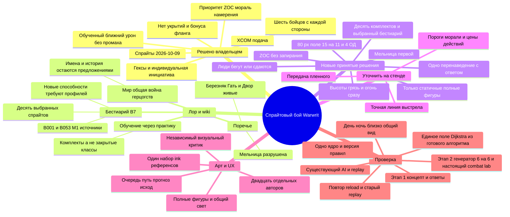

# Поле боя и тестовые карты

## Текущее состояние — 2026-10-17

[PR160](https://github.com/Vovanostm/warwrit/pull/160) объединяет исправления
читаемости в отдельном worktree `combat-live-queue/warwrit`, ветка
`codex/combat-readability`. Опубликованный `793ebd3` прошёл полный чистый CI,
но получил полный независимый **REJECT; в main ещё не слит**.
Локальный `d185b71` объединяет мощение и почву в постоянном масштабе,
добавляет светотень склонов и усиление ночных фигур. Его полный независимый
проход тоже завершён **REJECT**: общий вид **2/2/1/2/2/2/1**, близкий —
**3/3/1/2/2/2/1**. Ночная читаемость улучшилась до 2; рисунок земли,
стык двора с мельницей и показ высот остаются блокерами.
Разрешение на слияние уже есть; оставшиеся блокеры относятся к качеству.

После этого REJECT подготовлена следующая локальная техника: новая чернильная
почва, авторская карта распределения мощения, узкие связанные уступы и
разрушенная ограда/завалы в материалах мельницы. Исходники и свежий игровой
путь проверены; полный независимый визуальный проход нового варианта идёт.
[Текущий проход](#авторские-материалы-и-узкий-связный-уступ--2026-10-17).

Стенд [5336/combat-lab](http://127.0.0.1:5336/combat-lab), API3036,
показывает локальные изменения и отличается от опубликованного кандидата.
Бои временные, без записи в кампанию. Полный DoD M1 не принят;
баланс, удовольствие от игры и FPS не измерены.

В объединённом варианте реализованы:

- Сетка с шагом 2.6 и связанные склоны с шагом высоты 0.28.
  Поверхность общая для геометрии, сетки, выбора клетки и опор фигур.
- Целые портреты всех 20 профилей с одинаковым внутренним отступом;
  здоровье, броня и мораль сразу под портретами и ногами на поле.
  Полевые полоски 32×16 CSS px, отступ 4 px, без выносок.
- Спрайты в полном разрешении, отдельная фильтрация близкого и общего вида.
  Перспектива из слитого PR159 сохранена.
- Единые материалы plain/mud/fire/blocked для редактора и сгенерированных карт.
  Типы и высоты берутся из канонических клеток; новые правила не добавлены.
- Живая очередь из PR158; выбор портрета/бойца в журнале фокусирует камеру,
  Home возвращает обзор, WASD, перетаскивание и колесо управляют камерой.

Игровые проверки опубликованного `793ebd3` прошли: все 20 профилей на трёх
полях, три размера desktop, день/ночь, крупные существа, сетка/наложения,
максимальное приближение и четыре края камеры. Полоски 32×16 CSS px с отступом
4 px, выбор клеток и отсутствие приказов при осмотре подтверждены. Настоящее
движение, совпадение трёх ресурсов, завершение боя и повторный запуск проверены.
[CI39034184313](https://github.com/Vovanostm/warwrit/actions/runs/39034184313)
успешен: 820 unit PASS / 47 SKIPPED, 10 000 stress боёв, 20 deterministic reruns,
100 replay checks, 14 DB-проверок, покрытие и аудит 57 файлов прошли.

Полная визуальная проверка открыла все обязательные кадры, включая отдельных
бойцов на высотах 0/1/2. Оценки общего вида — **2/2/1/1/2/2/1**, близкого —
**3/3/1/1/2/2/1**. Главные дефекты: мелкая повторяющаяся фактура вместо цельного
рисунка двора, переход от мельницы к пустой земле, слабые ночные фигуры и
визуально плоские высоты. Наземные контуры не пересекали непрозрачные фигуры.
Прежний зелёный CI не отменяет визуальный REJECT.

Локальная коррекция прошла проверки исходников и игровой путь; обязательный
аудит 61 изменённого относительно main файла прошёл без обхода проверки
(8 унаследованных замечаний исключены). Это не визуальная приёмка.
Повторяющиеся оценки 1 требуют смены техники композиции грунта и показа
рельефа, а не очередной настройки оттенков. Новый CI локального `d185b71`,
его публикация, слияние и путь из main — NOT_RUN.
[Полный результат и новая техника](#цельный-рисунок-поля-и-светотень-высот--2026-10-17).

[Требования владельца](#читаемость-бойцов-и-единый-рендер-поля--2026-10-16),
[аналоги и UX](#проверка-текстов-и-избыточности-ux--2026-10-16).
Датированные результаты ниже относятся к своим версиям;
оперативный checkpoint — [CURRENT_PLAN](../engineering/CURRENT_PLAN.md).

**Историческая поставка — 2026-10-16: [PR157](https://github.com/Vovanostm/warwrit/pull/157) слит в main, игровой путь из main проверен.**
Цикл `codex/combat-cycle-20261016` объединён коммитом `2072a64`;
исходный черновик сохранён. Запуск: `pnpm dev:combat`, страница `/combat-lab`.
Проверенный стенд из чистой main: web 5330/API 3030, рабочая копия
`~/.codex/worktrees/battle-camera-pan/warwrit`. После перезапуска
временного API нужен новый бой: сервер не хранит сессии в базе.

- Основа: статичные спрайты, 6×6, 15×11, 4 ОД, высоты/грязь/огонь,
  полноэкранный «Пульт командира». ЛКМ — осмотр, ПКМ — приказ;
  тянуть ЛКМ/WASD — камера, колесо — масштаб.
- Конструктор теперь позволяет выбирать ранги приёмов каждого бойца.
  «Без изученных приёмов» сохраняет пустой набор, «Приёмы профиля»
  копирует профиль. Несовместимое оружие блокирует исполнение, сохраняя
  изученный ранг. Это настройка боя, не обучение персонажа кампании.
- Разделены фазы движения/реакций/паники/подготовки и выбора AI;
  политика, RNG и исторические версии не меняются. Нового основания
  для численного усиления AI пока не воспроизведено.
- Результаты 13 октября ниже — история соответствующих кадров/проверок.
  После исправления надписей чистый PR gate прошёл на окончательном head;
  независимая абсолютная визуальная проверка приняла статичные кадры.
  [Проверка после слияния](#поставка-в-main-и-проверка-после-слияния--2026-10-16)
  отдельно подтверждает текущий запуск из main.

[Текущие требования](#полное-техническое-тз-пошагового-боя--2026-10-13)
и [принятый HUD](#единый-боевой-интерфейс--2026-10-13) задают границы.
Публикация, merge и проверка из main записаны ниже. Весь DoD игры,
сравнение стратегий и удовольствие от боя не объявляются достигнутыми.

**Актуальное решение — 2026-10-09:** [спрайтовое ТЗ и принятая матрица](#спрайтовая-боёвка-тз-этапа-1--2026-10-09)
заменяют для текущего цикла прежнее направление 3D/анимации, 6 бойцов от
каждой компании и отложенные высоты. Теперь 6×6 суммарно, статичные фигуры,
80 px/15×11/4 ОД и высоты/грязь/огонь сразу. Разделы 2026-10-07 ниже
сохранены как датированная история, а не текущий план производства.

**Дополнение по готовому коду — 2026-10-09:** [матрица повторного использования](#повторное-использование-готового-кода--2026-10-09)
задаёт конкретные исходники алгоритмов, границы адаптации и проверки. Бой
продолжается на существующем ядре; новый движок целиком не выбран.
После [углублённой перепроверки](#углублённая-перепроверка-и-более-простой-поиск--2026-10-09)
лидер изменён: одно ограниченное поле Dijkstra по образцу Athena Crisis,
без обязательного heap; tinyqueue — готовый резерв. Полный перенос ngraph
больше не является требованием S2.

## Аналоги и правила настройки — 2026-10-16

Исследование ограничено конкретными источниками; это не опрос всей
аудитории и не доказательство баланса Warwrit.

| Наблюдение                                                                                                                                                                                       | Вывод для текущей проверки                                                       | Граница                                                                  |
| ------------------------------------------------------------------------------------------------------------------------------------------------------------------------------------------------ | -------------------------------------------------------------------------------- | ------------------------------------------------------------------------ |
| [BB: позиция, оружие и ресурсы](https://battlebrothersgame.com/tactical-combat-mechanics/)                                                                                                       | Показывать цену и последствия до приказа                                         | Ранняя официальная статья, не спецификация последней версии              |
| [Wartales: порядок](https://steamcommunity.com/app/1527950/discussions/0/3834298505966809069/), [добивание до ответа](https://steamcommunity.com/app/1527950/discussions/0/3827539750712587615/) | Проверять осмысленный ответ и разные решения при одном setup                     | Отдельные обсуждения 2023 года, не консенсус игроков                     |
| [XCOM 2: спор о предпросмотре цели](https://steamcommunity.com/app/268500/discussions/0/1474221865189387290/)                                                                                    | Подсветка, прогноз и исполнение должны говорить об одной цели                    | Обсуждение 2017 года, не установленный баг всех версий                   |
| [Athena Crisis: кандидаты атак](https://github.com/nkzw-tech/athena-crisis/blob/1d7033db46ebf0e5435368673faf05764f66f256/dionysus/lib/getPossibleAttacks.tsx)                                    | Сначала законность/достижимость, потом оценка урона, добивания и ответного риска | INSPECTED; собственные правила ресурсов/контратаки, не готовый модуль BB |

Свежие поиски GitHub `turn based tactics utility ai` и `utility ai tactics`
не дали кандидатов. Проверен существующий upstream Athena Crisis на
фиксированном commit `1d7033db46ebf0e5435368673faf05764f66f256`:
`getPossibleAttacks`, `sortPossibleAttacks`, история файла и MIT лицензия
исходников. Лицензия отдельно исключает арт/брендинг. В оценке есть бонус
добивания и отказ от невыгодной контратаки; перенос коэффициентов в Warwrit
не обоснован. Модуль зависит от собственного MapData/Unit/Vision и не является
изолированной библиотекой. Чужой код не запускался и не переносился;
новая зависимость не выбрана. Предыдущие Honeycomb/Babylon-источники ниже
сохраняются. Это supported choice сохранить собственные конечные правила,
а не утверждение, что лучшего решения не существует.

Цикл настройки: воспроизвести конкретный провал → сохранить setup/seed/приказы
→ проверить законные альтернативы → изменить только причину → повторить
тот же бой и исторический replay → независимая критика. Успех автодуэли
не доказывает тактическую глубину. Текущие публичные сценарии проверяют
выбор открытой/бронированной цели, потраченную реакцию, дальнее преимущество
и выход при панике. Нового провала для перенастройки AI пока не выявлено.

Канонические Learning/Social и Definitions Notes/Purpose перечитаны
16 октября. Прогрессия кампании остаётся практикой/обучением с доверенными
событиями и идемпотентными начислениями; численные параметры предварительны.
Wiki-каталог 52 перков/13 дисциплин — предложение замены, не утверждённая
ветка развития. Ранги в конструкторе проверяют доступность существующих
приёмов и не начисляют XP, не открывают новые дисциплины и не делают respec
при смене оружия.

## Результат интеграции и игровые проверки — 2026-10-16

Локальный кандидат содержит конструктор рангов, уточнённую очередь и
разделённые владельцы ввода/сцены. Контур получает прозрачный запас
134×134 при исходной маске выбора 128×128; тело, PNG, опора стоп и масштаб
не меняются. Символьный план наземных маркеров отдельно от рисования
проверяет приоритеты цели/пути/угрозы и не меняет разрешения ядра.

Независимый игровой критик провёл отдельный настоящий бой через UI:
15 ручных приказов в раундах 1–2, затем автобой. Итог — победа в раунде 8,
шесть союзников в строю, шесть противников погибли. Экспорт содержит
158 команд, включая подготовку, одно перенаведение, исполнение угрозы
и бегство; повторных пунктов движения в одной активации не обнаружено.
Прицельный выстрел: прогноз HP 17–25, фактически 22; укол ранга 3:
17–23, фактически 18. Некорректный «Собраться» по врагу отклонён без
подмены другим действием; при 0 ОД ход передаётся автоматически.
Это один сценарий, не сравнение стратегий и не доказательство баланса;
качество ответа на угрозу и удовольствие игрока **NOT_MEASURED**.

Подсказки теперь различают неподходящее снаряжение, ресурсный отказ и
отсутствие подходящих целей. Исправлена подтверждённая гонка: поздняя
загрузка каталога стирала сообщение о недоступной сохранённой сессии.
Проверка исходников выявила вызов getter sessionStorage вне try; доступ
стал ленивым внутри обработки отказа, есть SecurityError-регрессия.
Типы HUD вынесены из компонента, устранив запрещённый цикл импортов.

Проверки интегрированного кода: web/server typecheck, lint, architecture,
dead-code/pattern/content и **795 PASS / 47 SKIPPED** в unit coverage.
Обычный аудит относительно main прошёл: ноль новых блокирующих замечаний;
стилевые рекомендации не объявлены устранёнными. Первые попытки выявили
неформатированный файл галереи, lint по локально скачанному research-тексту
и цикл типов; причины исправлены без ослабления gate. Первые промежуточные
коммиты имели явно записанный NOT_RUN hook; следующие blocked-патчи
интегрированы без обхода и коммитятся только через обычный проходящий gate.
[Чистый CI 38909754401](https://github.com/Vovanostm/warwrit/actions/runs/38909754401)
прошёл на опубликованном head `87c5c6a`: bootstrap, 10 000 стресс-боёв,
20 повторов детерминизма, 100 replay-проверок, 14 настоящих PostgreSQL
проверок на временной базе, coverage и строгий аудит. Эти результаты
относятся к тому head; следующая коррекция требует нового CI.

Свежий независимый визуальный критик отклонил плотный бой: «ШАГ»
перекрывал предупреждение подготовки. Причина — события размещались
до создания текущих предупреждений и не резервировали их прямоугольники.
Теперь сначала создаются предупреждения, затем события занимают свободные
места над фигурами/надписями. Один UI-прогон из JSON, 24 одиночных шага,
раунд 3/revision 59 повторил состояние; новые дневные/ночные пары сделаны
после остановки камеры. Восемь focused-проверок, web typecheck, lint/format
и свежий coverage **796 PASS / 47 SKIPPED**; source-review без материальных
замечаний. Повторная абсолютная визуальная приёмка и новый CI ожидаются.

Отдельная проверка автора контура (`a9e114a`, интеграция `e87a379`):
12 исходных тел/опор/размеров не изменены, все 12 контуров имеют запас
134/128 и не перехватывают выбор. Наведение/выбор головы не отправили
приказ и сохранили actor/revision 4. Две проверки/types/lint/format прошли;
его критик принял только контур (3/2/2/2/3/2/2, движение N/A).
Это не подменяет приёмку всей текущей сцены. История первоначального
missing-coverage ERROR, covered-audit FAIL и промежуточного NOT_RUN hook
сохранена; финальная интеграция проходит обычный hook.

Локальные доказательства (не отслеживаются Git):
`output/playwright/critic-battle-replay.json`, `critic-aim-preview.png`,
`critic-terminal.png`, `cycle-final-day.png`, `cycle-final-night.png`;
результаты gate — `output/combat-cycle-20261016/`.

## Поставка в main и проверка после слияния — 2026-10-16

[PR157](https://github.com/Vovanostm/warwrit/pull/157) объединён
16 октября в 14:50 UTC: проверенный head `2c1ac2a`, merge
`2072a6468e4552cb7f7ae685c09e9ba98efe9a96`. Обычный diff всего дерева
head → merge пуст. Исходная dirty-копия b44f5c1 не переключалась и не
сбрасывалась; отдельная чистая main обновлена fast-forward.

[Окончательный CI38915129341](https://github.com/Vovanostm/warwrit/actions/runs/38915129341)
**SUCCESS на проверенном head**: 796 unit PASS / 47 SKIPPED;
10 000 стресс-боёв, 20 повторов детерминизма, 100 replay-проверок;
14 настоящих PostgreSQL-проверок на временной базе, coverage и строгий
аудит 232 изменённых файлов прошли. Пропуски не названы выполненными.

Первый повторный визуальный просмотр не дал вердикта в отведённое время.
Новый независимый критик открыл фиксированный пакет эталонов, сравнений,
дневных/ночных сцен, плотной группы/высот/угроз и пар с наземными
наложениями и без них. Абсолютный вердикт **ACCEPT**: все семь критериев
2–3 в игровом и крупном масштабе, движение N/A. Непрозрачные фигуры не
пересекаются с наземной сеткой; прежнее пересечение надписей не повторилось.
Оставшиеся замечания — полировка равномерного светлого контура и связи
надписи с её бойцом. Собственный ввод критика **NOT_RUN**; изображения не
подменяют проверку действий. Более ранний REJECT сохранён как история выше.

Реальный путь автора из main на web 5330/API 3030:

1. Возврат исходной карты/состава в редакторе → новый бой, 12 фигур.
2. Наведение на доступный гекс → путь/цена; ПКМ → лучник пришёл в (1,5),
   revision 4 → 5, ОД 4 → 3, как в прогнозе.
3. «Защищаться» → guarding применён, ход передан следующему бойцу.
4. Автобой → победа людей, раунд 9 / revision 161, пять союзников выжили.
5. «Начать заново» → 12 активных; меню → редактор → новый бой.
   Оставлен раунд 1 / revision 4, лучник, 4 ОД, все 12 активны.

После перезапуска API прежняя временная сессия отсутствовала: UI показал
восстановимое сообщение вместо ложного результата боя. В консоли это
один 404 старой сессии; после создания боя новых ошибок нет. При старте до готовности API
старый открытый экран кратко получил ECONNREFUSED; проверка начата после
готовности обоих процессов. Никакие приказы через подмену состояния не
инъецировались; диагностика использовала публичный ответ и проекцию сцены.

Локальные доказательства в чистой main (не отслеживаются Git):
`output/playwright/main-path-preview.png`, `main-defend.png`,
`main-autobattle-terminal.png`, `main-ready.png`;
`output/combat-cycle-20261016/main-snapshot.txt`, `main-terminal.txt`, `main-dev.log`.
Полный пакет критика и CI-лог сохранены в integration worktree.

Это поставка боевого стенда, не полная M1/MMO. Сравнение стратегий,
баланс, удовольствие и device/FPS **NOT_MEASURED**; кампанийные XP/52 перка
не реализованы. Живая перестройка верхней очереди и более компактный HUD
согласованы как отдельное продолжение другого чата, не часть PR157.

## История направления — 2026-10-07

Прежний план 3D-персонажей, дыхания, ударных клипов, 24 фигур и отложенных
высот заменён решениями 9 октября. Его производственные указания удалены
из действующей страницы; полная редакция сохранена в истории Git до
16 октября. Исторические источники не меняют текущие 6×6 и статичные фигуры.

## Тестовые карты

| Карта                     | Место и проверка                                           | Статус                                               |
| ------------------------- | ---------------------------------------------------------- | ---------------------------------------------------- |
| Т0 «Полигон»              | Ровное поле: масштаб, геометрия, ввод                      | Диагностическая идея                                 |
| Т1 «Опушка у Березняка»   | Берёзовая опушка: силуэты на пёстрой земле                 | Контентный кандидат                                  |
| Т2 «Каменный брод»        | Берег и законный брод: узкий проход                        | Контентный кандидат                                  |
| Т3 «Двор Старой мельницы» | Разрушенная опасная мельница: руины, высоты, крупная тварь | Текущий спрайтовый стенд                             |
| Т4 «Ночная стоянка»       | Лагерь: читаемость ночью                                   | Контентный кандидат                                  |
| Т5 «Северный Двор»        | Укреплённый двор: тесные позиции                           | Контентный кандидат; прежний 12×12 не целевой размер |

Эти названия не утверждают новые сюжетные события и не означают, что все
локации уже нарисованы или приняты. У населённых мест сохраняется их
каноническое состояние; Старая мельница остаётся разрушенной и опасной.

## Качество боя: как это сделано в XCOM — 2026-10-07

Сохраняется принцип: состояние боя отдельно от показа; до приказа видны
путь, расходы, шанс и последствия, после — фактический результат.
XCOM служит ориентиром читаемости и темпа. Его укрытия, база и анимации
не добавляются автоматически. Текущая обратная связь — статичные фигуры,
мгновенные перемещения, короткие надписи и журнал принятых событий.

## Спрайтовая боёвка: ТЗ этапа 1 — 2026-10-09

**Запрос владельца:** подготовить боёвку уровня Battle Brothers / Wartales /
XCOM, сосредоточиться на спрайтах, интересных местах и механиках; десять типов
воинов, десять существ, гексы, интерфейс и стенд. Первый этап — согласование
ТЗ, общего кадра и стиля, с вопросами владельцу, матрицей решений и mind map.
Решения владельца ниже утверждены для этого ТЗ. Числа баланса, перечисленные
особые приёмы и игровая реализация требуют отдельной проверки.

**Ответы владельца в этом согласовании:**

- Основа — «Battle Brothers: позиция, оружие, усталость, мораль» (D1).
- «6 бойцов с каждой стороны». Новый целевой бой — 6×6; диагностический T5
  с 24 фигурами не становится целевым боем. Старое описание двух компаний
  сохраняется как история; участие помощника в новом лимите требует уточнения.
- Нужен генератор боя: выбрать, кто с кем дерётся.
- Этап 1 — «Общий кадр + 2 образца, затем 20 после согласования» (D12).

**Последующее согласование 2026-10-09:** приняты D1–D12 и предложенный состав.
Поле 15×11, человек 80 px при 1440×900, 4 ОД; десять комплектов, полные фигуры,
без анимации сейчас. Зона контроля не запирает отход. Люди бегут и сдаются;
принята основа: при панике сначала безопасный отход, при перекрытом выходе —
сдача, сдавшийся не возвращается к атаке. Перенаведение разрешено один раз
с новым предупреждением и хотя бы одной ответной активацией игрока.
Сразу высоты 0/1/2 с более дорогим подъёмом, грязь и обычный огонь.
Первая карта — мельница. Владелец утвердил атмосферу/стиль общего кадра,
тёмную B053 и **боец C как основу щитника**. Условие запуска двадцати
отдельных художников выполнено; их задача — статичные спрайты, не анимация.
Приёмка направления не означает приёмку игровой интеграции.

Наблюдаемый результат этапа 1: открыть
[экран согласования](../../assets/art/combat/stage1-2026-10-09/index.html),
рассмотреть общий концепт, сопоставить роли и прочитать принятые развилки.
Экран согласования не исполняет бой. Следующий результат — законченный
настоящий бой на одной карте через существующее ядро и затем расширение.

### Что уже решено, а что требует ответа

| Основание                                                                         | Решение и граница                                                                                                                                                      |
| --------------------------------------------------------------------------------- | ---------------------------------------------------------------------------------------------------------------------------------------------------------------------- |
| Новый запрос 2026-10-09                                                           | Спрайтовое производство персонажей вместо неудачного текущего 3D-направления. Babylon.js сохраняется; новая технология не требуется.                                   |
| [ADR-0006](../architecture/0006-m1-renderer-babylon.md)                           | Чернила/плоская заливка, фиксированный вид 3/4, панорама/масштаб, без вращения.                                                                                        |
| [M1](m1-spec.md), [vision](vision.md)                                             | Исторически: шесть полевых бойцов от компании и помощник второй компанией. Новый ответ выше задаёт 6×6. PvE и общий мир без глобальной паузы сохранены.                |
| [Удар](mechanics/melee.md), решение 2026-10-07                                    | Обученный соседний ближний удар всегда наносит урон щиту, броне или HP. Исключения: новобранцы и бесплотные цели; дальний бой допускает промах. Порог обучения открыт. |
| [DESIGN_COMPASS](../engineering/DESIGN_COMPASS.md)                                | XCOM задаёт предпросмотр, темп и обратную связь. Укрытия и фланговые бонусы XCOM не вводятся.                                                                          |
| [Первая очередь](mechanics/index.md#первая-очередь--решение-владельца-2026-10-08) | Зона контроля, мораль с бегством/сдачей и намерения тварей выбраны первыми. Их конкретные правила ещё предложения.                                                     |
| [Vision, 2026-10-07](vision.md)                                                   | Владелец отверг обязательный бюджет длительности боя. Контракт может быть длинным; таймер миссии не становится требованием этого ТЗ.                                   |
| [Мир](world/index.md), [Поречье](world/porechye.md), [B7](bestiary/catalogue.md)  | Воюющие герцогства — решение; конкретная история и большая часть существ — предложения. Мельница разрушена и опасна; населённые места не рисуем заброшенными.          |

Разбор по `sequential-thinking`: сначала сохранённые решения → затем варианты
правил → риски совместимости → проверяемый минимальный бой → производство.
При первоначальном согласовании скилл прочитан, но MCP-инструмента не было;
вызов тогда не заявлялся. В последующем исследовании готового кода инструмент
`sequentialthinking` доступен и использован для решения и его пересмотра.
Canonical Airtable Notes/Purpose не
обновлялись и не читались заново: это ограничение проектного согласования,
не разрешение менять принятую семантику команд. Исходный архив не восстановлен.

### Матрица решений для владельца

Все строки приняты владельцем 2026-10-09. Конкретные цены/пороги ниже —
параметры будущей проверки, а не уже работающий баланс.

| ID     | Принято                                                                   | Что проверить                                                                |
| ------ | ------------------------------------------------------------------------- | ---------------------------------------------------------------------------- |
| D1     | BB: позиция, оружие, усталость, мораль; XCOM: подача                      | После хода остаются осмысленные разные ответы                                |
| D2     | Десять комплектов без закрытых классов                                    | Отличие тактической задачи каждого                                           |
| D3     | 80 px, поле 15×11, desktop 1440×900                                       | Читаемость 12 фигур, ранний контакт                                          |
| D4     | 4 ОД                                                                      | Стоимости позволяют ход+удар и защиту/отход                                  |
| D5     | Без запирания                                                             | Реакция не отменяет шаг живого бойца; явный прогноз                          |
| D6     | Люди бегут и сдаются; сначала безопасный отход, иначе сдача               | Выход достижим за несколько активаций; сдавшийся не атакует                  |
| D7     | Перенаведение один раз, новое предупреждение и ответная активация         | Нет внезапного удара вслед ушедшей цели                                      |
| D8     | Сразу высоты 0/1/2, грязь, обычный огонь                                  | Подъём дороже, грязь замедляет, огонь опасен; прогноз совпадает с итогом     |
| D9     | Полные фигуры                                                             | Общие оси, свет, ступни, без зеркалирования света                            |
| D10    | Только статичные спрайты сейчас; кадровая анимация позже                  | Нет анимационных листов и motion-gate в этом цикле                           |
| D11    | Разрушенная Старая мельница первой; Т0 для калибровки                     | Законченный ход → угроза → ответ → исход                                     |
| D12    | Двадцать отдельных заданий художникам после выбора стиля                  | Направление согласовано; единые референсы и provenance                       |
| Состав | Перечисленные W01–W10 и B001/B002/B003/B017/B019/B023/B025/B030/B037/B053 | Отбор принят для арта/боевого стенда; новые способности не выданы за готовые |

### Бегство, сдача, перенаведение и местность

**Принятая основа D6:** человек в панике пытается уйти, а при перекрытом
безопасном выходе сдаётся. Бегство и сдача — разные исходы, не смерть.
Маршрут проверяется до выходного гекса, а не только в пределах оставшихся
ОД: боец может убегать несколько активаций. Сдавшийся не атакует, не держит
ZOC и не может собраться обратно в бой. Выход с поля регистрируется один раз.
Порог паники, эффект команды W10 и владение пленным остаются балансом/контрактом
следующего этапа; не вводим выкуп или допрос одним визуальным значком.

**Уточнение для первого стенда (предложение):** безопасный маршрут использует
известные бойцу проходимые гексы без активного огня и избегает свободных ударов,
в том числе через разрешённый осторожный отход. При отсутствии такого пути
люди сдаются только против стороне с человеком, способным принять пленного;
тварь не получает право владения человеком. В бою против зверей человек
продолжает пытаться спастись, даже рискованным путём. Профиль зверя допускает
бегство, но не сдачу; остальные существа получают явную политику, не общее
«все тёмные твари бесстрашны». Это ограничение предотвращает сдачу волку и
не решает судьбу пленного за владельца.

**D5:** урон реакции не отменяет разрешённый шаг живого бойца; гибель до шага
может остановить движение. Конечная рекомендация — один свободный удар каждого
контролирующего между началами двух его активаций и отдельный осторожный отход.
Лимит/цена остаются предложением, но вариант «любой урон оставляет на месте»
отвергнут. Старые правила/replay сохраняются под прежней версией.

**Принятая основа D7:** тяжёлый приём может перенавестись один раз за подготовку.
Новая цель/линия сразу заменяет прежнюю подсветку; журнал отмечает смену.
Исполнение допустимо только после хотя бы одной завершённой ответной активации
стороны игрока после последнего предупреждения. Если следующая очередь твари
наступила раньше, приём продолжает подготовку, а не бьёт внезапно. Второе
перенаведение запрещено; при недопустимой цели — отмена или исполнение по
последней законной линии согласно явному профилю. Прерывание и цена —
параметры профиля. На стенде обязательно проверить плотную очередь тварей,
уход цели, повторное перенаведение и отсутствие возможного ответа.

**Принятая основа D8:** у каждого гекса видимая высота 0/1/2 и явное свойство
поверхности. Подъём и грязь повышают стоимость шага; огонь даёт реальный
опасный эффект. Прогноз показывает суммарную цену высоты/грязи и воздействие
огня до подтверждения. Точные надбавки ОД/сил и величина/момент урона огня —
ещё предложение: задаются единожды в версии правил, не в renderer. Для
первой мельницы предлагаются постоянные отмеченные очаги без распространения
и разрушения зданий; рядом всегда есть сухой обход. Высота не добавляет
неутверждённых бонусов урона, дальности или XCOM-укрытия.

### Десять воинов — выбранные комплекты

W01–W10 — выбранные локальные обозначения арта/стенда, не классы или ID ядра.
Навык приобретается практикой/обучением; смена оружия не даёт мастерства.
W01/W03/W04/W05 опираются на имеющиеся профили; остальные требуют конечных
новых профилей/действий. Здесь утверждается требование различимости, не баланс.

| ID  | Комплект / силуэт            | Задача и предложенный приём                     | Ограничение / противодействие                             |
| --- | ---------------------------- | ----------------------------------------------- | --------------------------------------------------------- |
| W01 | Меч + щит, стёганка/кольчуга | Держать проход; защита                          | Малая дальность, усталость от удержания                   |
| W02 | Топор + щит                  | Давить щит/броню отдельным ударом               | Приём дороже обычного; цена и разрушение щита открыты     |
| W03 | Двуручный топор              | Тяжёлый удар по защищённой цели                 | Нет щита, дорогой удар, нужен подход                      |
| W04 | Копьё                        | Поддержать из второй линии, держать подход      | Теснота/ближний контакт; стена копий пока кандидат        |
| W05 | Лук                          | Подвижная дальняя поддержка                     | Линия, боеприпас и запрет стрельбы в зоне требуют решения |
| W06 | Нож, лёгкий комплект         | Дешёвые короткие удары по плохо защищённой цели | Не игнорирует любую броню; нет выдуманного бонуса фланга  |
| W07 | Молот, тяжёлый комплект      | Стабильное давление на прочность брони          | Новая оружейная политика, малая дальность/нагрузка        |
| W08 | Арбалет                      | Подготовленный сильный выстрел                  | Реальная перезарядка; новый профиль и расходник           |
| W09 | Алебарда / древковое оружие  | Перекрыть линию и сместить цель                 | Новые reach/displacement; не заменяет копьё без отличия   |
| W10 | Командир с обычным оружием   | Собрать дрогнувшего, организовать отход         | Команда расходует действие/силы; без магической ауры      |

W07–W09 — дополнительные авторские предложения этого ТЗ. Они не выдают
молот/арбалет/алебарду за реализованные профили. Разведчик, следопыт и лекарь
из [развития](character-progression.md) остаются допустимыми ролями компании,
но не используются, чтобы набрать десять боевых типов без десяти различий.

### Десять существ — выбранный отбор существующих карточек

Владелец выбрал три зверя и семь необычных существ из списка ниже
для производства спрайтов и проектирования боевого стенда. Все карточки ниже оставлены редакцией B7;
только B001/B053 имеют M1-источник присутствия. Выбор состава не утверждает
архивные биографии, все способности или автоматическое размещение видов в мире.

| ID / источник                                              | Облик / задача боя                                                                      | Предлагаемый ответ игрока                                                 |
| ---------------------------------------------------------- | --------------------------------------------------------------------------------------- | ------------------------------------------------------------------------- |
| [B001 Волк](bestiary/creatures/b001.md)                    | Низкая голова, грубая шерсть; проверяет край группы                                     | Держаться вместе, прикрывать отделившегося                                |
| [B002 Бурый медведь](bestiary/creatures/b002.md)           | Тяжёлый зверь; подготовка сильного ближнего удара                                       | Не оставаться перед ним, использовать восстановление после удара          |
| [B003 Дикий вепрь](bestiary/creatures/b003.md)             | Клин низкой головы; прямой натиск                                                       | Сойти с объявленной линии, оставить выход                                 |
| [B017 Могильный зверь](bestiary/creatures/b017.md)         | Сутулый живой падальщик с длинными передними конечностями                               | Защитить раненого/тело; не рисовать воскресшего солдата                   |
| [B019 Могильный сторож](bestiary/creatures/b019.md)        | Костлявая фигура в погребальной ткани, граница могилы                                   | Предложенная местная задача с предметом; не добавлять религию             |
| [B023 Висельная тень](bestiary/creatures/b023.md)          | Натянутая тонкая фигура у опоры                                                         | Видеть область петли и освободить захваченного; бесплотность не доказана  |
| [B025 Камышник](bestiary/creatures/b025.md)                | Высокое узкое тело, волокнистая кожа и согнутая шея                                     | Прочитать движение камыша/головы, сохранить строй                         |
| [B030 Береговая плакальщица](bestiary/creatures/b030.md)   | Мешковидное тело, дыхательные щели, бессловесный плач                                   | Не дать контактного захвата; без магического вытягивания                  |
| [B037 Пустоголос](bestiary/creatures/b037.md)              | Тонкая перепончатая фигура у полого дерева                                              | Отличить реально услышанный повтор от команды; без знания чужой биографии |
| [B053 Ночная мельничная тварь](bestiary/creatures/b053.md) | Силуэт из [текущего арта](../../assets/art/m1/battle/unit-mill-beast.png), ночная охота | Сохранить истинный контракт и коготь; новый натиск только кандидат        |

У каждого нового профиля должны быть: видимая подготовка, одна особая угроза,
понятный контрприём, ограничение способности и законный исход. Различие нельзя
получить только добавлением HP. Числа и стоимость балансируются на стенде.

### Пять мест и разные задачи

| Карта            | Вид и связь с лором                             | Тактическое решение                                                                        |
| ---------------- | ----------------------------------------------- | ------------------------------------------------------------------------------------------ |
| Опушка Березняка | Живая деревня за лугом, берёзы/пни; не руины    | Два подхода, линия стрельбы, защита края группы                                            |
| Каменный Брод    | Река, каменная переправа у работающего города   | Держать узость или отходить до затора; с высотой и дорогим подъёмом; бонус урона не принят |
| Старая мельница  | Сломанное колесо, обваленная крыша, ручей и люк | Обойти тесный проход, вывести раненого, пережить тяжёлую угрозу                            |
| Тихая Гать       | Работающие настилы и камышовый берег            | Не растянуть строй, сохранить сухой путь отхода; без неутверждённого утопления             |
| Северный Двор    | Населённый хутор: амбар, телега, частокол       | Держать ворота, прикрыть выход второй компании                                             |

Ландшафт служит задаче: минимум два реально разных подхода, видимый выход,
понятные препятствия и причина двигаться. Художественные детали не создают
огонь, укрытие, скользкость, ловушку или дополнительный урон. Ночной лагерь
Т4 остаётся отдельной проверкой освещения, не новой шестой локацией мира.

### UX боя: структура и состояния

Базовое окно 1440×900, тот же desktop-интерфейс на мобильном landscape.
Центр — поле; сверху — очередь инициативы с владельцем каждого бойца;
снизу — выбранный боец, здоровье/броня/силы/мораль/ОД и доступные действия.
Справа только временный компактный прогноз; подробный журнал раскрывается.

1. Выбор бойца → видны реальные доступные действия и граница хода.
2. Выбор действия/гекса → путь, стоимость, будущие ОД/силы, реакции зон,
   броня/HP-урон, объявленная угроза и причина запрета. Обученному ближнему
   бойцу показываем силу удара; для стрелка/новобранца — честную вероятность.
3. Подтверждение → ожидаем серверный результат, не имитируем успешный урон.
   Повторный ввод не отправляет второй расход; отмена до отправки бесплатна.
4. Результат → новая позиция статичного спрайта, цифра урона/значок реакции,
   отдельные состояния смерти, бегства и сдачи. Анимации в этом цикле нет.
5. Чужой ход → имя/портрет действующего, видимая причина действий; после
   переподключения актуальное состояние без повторного падения/удара.

Иконка, форма/штриховка и текст дублируют цвет: охра — выбранный путь,
ржавый — опасность, нейтральная холодная линия — доступное поле. Выбор гекса
не заслоняют руки/дерево/HUD; закрывающий объект даёт силуэт/прозрачность.
Клавиши: 1–6 действия, Tab цели, Esc отмена, Space ожидание, Enter подтверждение
конца активации; назначения — предложение для проверки. Панорама не запускает
ход. Опасное действие требует подтверждения по понятному прогнозу.

### Производственный контракт спрайта и агента

Отдельное задание агента на каждый согласованный W/B-ассет, две очереди
с переиспользованием освободившихся агентов при лимите слотов; все получают **один выбранный** общий кадр,
unit-c-ink и соответствующую сцену/карточку. Каждый владеет только своим
каталогом. Родитель владеет общим ТЗ, стилем, сборкой и changelog; независимый
визуальный критик оценивает текущие изображения по полной рубрике.

Выход каждой задачи: прозрачный PNG с настоящей alpha, точный prompt и
источники рядом; постоянная точка ступней, полный силуэт без обрезанного
оружия, общие оси и свет. Размер исходного холста не равен игровому росту;
принятый показ человека — 80 px; размер крупной твари определяется сравнением с дверью
и человеком, не дополнительной клеткой, которой нет в правилах.

Направление согласовано. Производим **одну статичную полную фигуру** на ID,
без шага, удара, смерти и анимационных атласов. Боец C — основа W01;
неудачные прежние W01 v1/v2 остаются историей. Alpha, полный силуэт, pivot,
оружие и единый свет проверяются до сборки общего листа. Точная сетка,
подсветка/путь и контакт с землёй принадлежат отдельному слою интерфейса.
Шесть направлений цели должны оставаться понятными при одном спрайте;
новые facings — только если статичный показ реально не справится.
Кадровая анимация — последующий отдельно согласованный цикл; motion-критерий
сейчас вне scope. [Общий brief двадцати художников](../../assets/art/combat/stage1-2026-10-09/roster/BRIEF.md)
сохраняет единые референсы, ограничения и ответственность.

### Настоящий стенд: этап 2 после согласования

Владелец отдельно потребовал генератор 6×6 с выбором противников. Конструктор
в экране согласования задаёт шесть слотов каждой стороны из выбранных W/B-профилей,
карту, симметричную/разнесённую расстановку и номер повторяемого сценария.
Он формирует читаемый черновик, а не запускает правила. В настоящем lab
сервер проверяет согласованные профили, допустимые уникальные позиции,
предел 6×6, blocked и лимиты; явный выбор/повторяемый seed идут в BattleSetup.
Случайный подбор — отдельная кнопка с явными фильтрами и seed, не произвольный
недопустимый состав. UI не выдаёт новый W/B-профиль за существующий.

Сохранить существующий `combat-lab`, его auth, ядро, публичную проекцию и
версионирование; не строить второй симулятор с собственными правилами.
Прямое чтение исходников 2026-10-09: `apps/server/src/combat-lab/scenario.ts`
содержит `m0-3v3-v1`, радиус 3 и один blocked; протокол ограничен этой
сценой и пятью профилями. Это исходная диагностика, не готовый большой бой.
Граф подтвердил корень, но время индексации относительно HEAD не сообщил;
его результат использован только как указатель, source проверен напрямую.
Текущий README lab прямо отмечает отсутствие PB05 opponent scheduler;
подключение реального управления противником/существующей AI-политики и
проверка окончания боя входят в S3, не считаются уже работающими.

| Шаг | Где / что меняем                                                                                       | Критерий завершения                                                                                                                                |
| --- | ------------------------------------------------------------------------------------------------------ | -------------------------------------------------------------------------------------------------------------------------------------------------- |
| S1  | `apps/web/src/renderer/battle-scene.ts` и art; сохранённая камера, точные гексы, выбранные два образца | Боец/тварь на настоящем поле, выбор/масштаб/день/ночь; статичный спрайт не выдан за готовый бой                                                    |
| S2  | `packages/game-core/src/combat/`, публичные exports                                                    | Новая версия реализует решённый ближний урон, ZOC без запирания и высоты/грязь/огонь; прежний ruleset/replay сохранён                              |
| S3  | `packages/protocol/src/combat-lab.ts`, серверный `combat-lab`, web controller/view                     | Версионированный выбор T0 и одной боевой карты; 6×6, выбор составов/карты, серверный противник, ход/удар/защита/отход и настоящий terminal outcome |
| S4  | Те же владельцы; согласованные morale/intent/shot-line                                                 | Паника/бегство/сдача и однократное перенаведение с ответной активацией имеют реальные события и одинаковый прогноз/результат                       |
| S5  | Отдельные art-каталоги W01–W10/B IDs, карты/UX                                                         | Расширение после одного принятого playable; 20 типов различимы, пять карт решают разные задачи                                                     |

S2–S4 применяют [контракт повторного использования](#повторное-использование-готового-кода--2026-10-09):
S2 следует [последующей перепроверке](#углублённая-перепроверка-и-более-простой-поиск--2026-10-09):
адаптирует готовый цикл ограниченного Dijkstra в одно поле доступных позиций;
S3 подключает существующий `chooseAiCommand` к серверному lab;
S4 добавляет только правила морали/намерений Warwrit. Отдельный движок,
новая сеть и новый генератор случайных чисел в эти шаги не входят.

Сценарии приёмки: обученный удар без промаха; разрешённый промах новобранца;
выстрел блокирован стеной; безопасный/рискованный выход из ZOC; спасение
раненого; уход с объявленной линии; бегство зверя и человека; сдача человека при перекрытом выходе;
сдавшийся не атакует; новое предупреждение при перенаведении;
подъём/грязь изменяют цену, огонь даёт реальный эффект; 12
бойцов в целевом 6×6 без закрытого ввода (24 только стресс-представление T5);
повтор запроса/перезагрузка без второго результата;
старый replay воспроизводится. Профили/параметры перечислены явно, одинаковый
seed и команды дают тот же исход, недопустимая команда не меняет состояние.

Это будущие проверки, **NOT_RUN**. Каждый шаг — критерий + самый маленький
нужный typecheck/тест. Full gate один раз на финальном интегрированном коде,
не на этом ТЗ. Стенд держит отдельные диагностические состояния, не изменяет
сохранённую компанию владельца. FPS/память/длительность — **NOT_MEASURED**.
Ни миграции, ни новая зависимость этим согласованием не назначаются.

### Mind map: решения, лор и исполнение

### GitHub: что действительно найдено

Первый поиск этапа 1 выполнен живым `gh search repos`, три направления: hex-геометрия,
тактический бой, открытые XCOM/Wesnoth реализации; до 20 семейств и трёх
углублённых кандидатов. Точное `hex grid typescript` ничего не вернуло;
уточнение honeycomb и hexagonal grid дало геометрические библиотеки.
Неинформативные combat-demo без доказанной подходящей лицензии/границы
не выбраны; React/Vue-grid не заменяет Babylon renderer. Полный охват GitHub
не заявлен; закрытые исходники BB/Wartales/XCOM 2 не исследованы.

| Кандидат, зафиксированный commit                                                                   | Прочитанное и вывод                                                                                                                                                                                                                                                                                                                                                                                                                                             |
| -------------------------------------------------------------------------------------------------- | --------------------------------------------------------------------------------------------------------------------------------------------------------------------------------------------------------------------------------------------------------------------------------------------------------------------------------------------------------------------------------------------------------------------------------------------------------------- |
| [Honeycomb](https://github.com/flauwekeul/honeycomb/tree/6353276ef8197fbdba60d0c964f7bd4f2169064c) | [line.ts](https://github.com/flauwekeul/honeycomb/blob/6353276ef8197fbdba60d0c964f7bd4f2169064c/src/grid/traversers/line.ts), line.test.ts, A* example, package.json, MIT LICENSE. Линия использует floating-point interpolation/epsilon; A* пример зовёт отдельный abstract-astar и Math.random. Не готовая политика shots/ZOC. Latest release v4.1.5 от 2023-11-20; открытые вопросы line/pathfinding #128/#119 просмотрены по метаданным, не воспроизведены. |
| [Wesnoth](https://github.com/wesnoth/wesnoth/tree/2d1d355d9a52938c1b1b4115df29cfc755ec0324)        | [pathfind.cpp](https://github.com/wesnoth/wesnoth/blob/2d1d355d9a52938c1b1b4115df29cfc755ec0324/src/pathfind/pathfind.cpp#L134), включая enemy_zoc/paths/cost: зона учитывает видимых врагов и может поглощать остаток движения. Это другой вариант ZOC, а не доказательство реакции BB. COPYING GPLv2 прочитан; не рекомендован перенос кода/арта.                                                                                                             |
| [OpenXcom](https://github.com/OpenXcom/OpenXcom/tree/4a4bae5fa2e5a09282928e84943fc84b093e34ff)     | [UnitWalkBState.cpp](https://github.com/OpenXcom/OpenXcom/blob/4a4bae5fa2e5a09282928e84943fc84b093e34ff/src/Battlescape/UnitWalkBState.cpp#L402): расходы TU и энергия вызываются рядом со startWalking; это не требуемое разделение чистого ядра и показа Warwrit. LICENSE GPLv3 прочитан. Источник о старом X-COM, не XCOM 2 и не готовая web-зависимость.                                                                                                    |

**Итог поиска: нужен различающий эксперимент, новая зависимость не выбрана.**
Использовать существующую hex-геометрию ядра; Honeycomb рассматривать только
для внешней визуальной диагностики при доказанной нехватке своих функций.
Проверка-контрпример перед решением о линии: ребро/вершина, отражённый маршрут,
blocked по обе стороны ребра, занятый промежуточный гекс; прогноз должен
совпадать с исполнением. Чужой код не запускался и не копировался, его тесты
**NOT_RUN**, FPS и пригодность интеграции **NOT_MEASURED**. Лицензии арта не
проверены: чужие ассеты не предлагаются к использованию.

### Повторное использование готового кода — 2026-10-09

**Новый запрос владельца:** «надо найти на github готовые модули и алгоритмы,
чтобы не писать боёвку самому с нуля». Требование к следующей реализации:
использовать уже работающее ядро Warwrit и адаптировать проверенный открытый
алгоритм для недостающего взвешенного движения. Подходящий готовый движок,
который исполняет все D1–D12 без изменения архитектуры, этим поиском не найден.
Это граница поиска, не утверждение об отсутствии таких движков вообще.

**Рекомендация первого прохода, пересмотренная ниже:** исходники однонаправленного A*/Dijkstra из
`ngraph.path` как основа адаптации; существующие hex/AI/инициатива/RNG/replay
Warwrit как основа боя. Статус внешнего кода — **proposed / experiment needed**:
ничего не установлено и не перенесено. Подключение неизменённого npm-пакета
в `game-core` не предлагается: пакетная зависимость нарушит контракт чистого
ядра, а ниже обнаружен конкретный случай, требующий исправления алгоритма.

#### Что уже есть и какой пробел закрываем

Проверены исходники этого checkout: [hex.ts](../../packages/game-core/src/combat/hex.ts)
уже содержит axial-координаты, соседей, расстояние, blocked/occupancy и BFS;
[engine.ts](../../packages/game-core/src/combat/engine.ts) — команды, инициативу,
урон и окончание боя; [ai.ts](../../packages/game-core/src/combat/ai.ts) —
`chooseAiCommand`, доктрины `aggressive`/`survivor`, отход и `runAiBattle`;
[random.ts](../../packages/game-core/src/combat/random.ts) и
[replay.ts](../../packages/game-core/src/combat/replay.ts) — явный RNG и повторы.
Существующий поиск минимизирует число шагов, а `applyMove` умножает длину
пути на постоянную цену. Для грязи и подъёма нужен поиск по стоимости переходов.
Наличие AI в ядре не означает наличие opponent scheduler в lab.

| Задача ТЗ                                    | Готовая основа                                                  | Решение и работа, которая остаётся                                                                                                         |
| -------------------------------------------- | --------------------------------------------------------------- | ------------------------------------------------------------------------------------------------------------------------------------------ |
| Гексы 15×11, соседи, расстояния, занятость   | Hex-модуль Warwrit; Honeycomb из первого поиска                 | Сохранить axial `q/r`; добавить данные поля. Вторую геометрию не вводить                                                                   |
| Путь, область 4 ОД, грязь и подъём           | Однонаправленный `ngraph.path.aStar`, heap, восстановление пути | Адаптировать исходники; единая стоимость перехода из версии правил для прогноза, исполнения и AI                                           |
| Выход из ZOC и бегство                       | Тот же поиск + существующий `survivor`                          | Огонь/реакции фильтруются политикой безопасного пути; ZOC не становится непроходимой стеной; путь к выходу проверяется дальше текущих 4 ОД |
| Очередь бойцов, усталость, RNG, урон, replay | Существующее ядро                                               | Расширять новую версию правил; не заменять готовую очередь чужим scheduler                                                                 |
| Противник в настоящем стенде                 | `chooseAiCommand` + серверный lab                               | Сервер исполняет законные команды через то же ядро, проверяет terminal outcome и гонку повторных запросов                                  |
| Более сильный AI после первого playable      | MCTS/UCT из `boardgame.io`                                      | Отложенный кандидат. Сначала продемонстрировать конкретный провал текущего AI; затем адаптировать поиск, а не весь framework               |
| Линия выстрела                               | Линия Honeycomb; FOV ROT.js как исследовательский материал      | Правило ребра/вершины всё ещё открыто. FOV не равен линии попадания; отдельную туманную видимость в scope не добавлять                     |
| Генератор «кто с кем»                        | Существующие BattleSetup/валидатор/lab и явный seed             | Выбор двух составов и авторской карты; это не требование процедурно генерировать мельницу                                                  |
| Мораль, сдача и перенаведение                | Утверждённые D6/D7 и команды Warwrit                            | Собственная конечная политика: чужая библиотека не знает, кто принимает пленного и когда игрок успел ответить                              |
| Спрайты, выбор, HUD                          | Существующие Babylon renderer и web controller                  | Интегрировать утверждённые PNG и UX; библиотека правил не поставляет нужный арт/интерфейс                                                  |

#### Матрица первого прохода и проверенные исходники

`INSPECTED` означает чтение реализации; `TESTS_FOUND` — чтение соответствующих
тестов, без запуска. Звёзды и примеры на главной странице не являются доказательством.

| Кандидат и фиксированная редакция                                                                                                            | Подтверждено                                                                                                                                                                                                                                                                                                                                                                                                                                                                                                                           | Ограничение / решение                                                                                                                                                                                                                                                               |
| -------------------------------------------------------------------------------------------------------------------------------------------- | -------------------------------------------------------------------------------------------------------------------------------------------------------------------------------------------------------------------------------------------------------------------------------------------------------------------------------------------------------------------------------------------------------------------------------------------------------------------------------------------------------------------------------------- | ----------------------------------------------------------------------------------------------------------------------------------------------------------------------------------------------------------------------------------------------------------------------------------- |
| [ngraph.path, 3dba5d0](https://github.com/anvaka/ngraph.path/tree/3dba5d04ace3317b487bee1f6e0e614ae57cd4f5), package.json 1.6.1, MIT         | [a-star.js](https://github.com/anvaka/ngraph.path/blob/3dba5d04ace3317b487bee1f6e0e614ae57cd4f5/a-star/a-star.js): `distance`, `blocked`, `oriented`; heuristic=0 даёт Dijkstra. [NodeHeap.js](https://github.com/anvaka/ngraph.path/blob/3dba5d04ace3317b487bee1f6e0e614ae57cd4f5/a-star/NodeHeap.js), pool/defaultSettings/typings/package/LICENSE прочитаны. [Тесты](https://github.com/anvaka/ngraph.path/blob/3dba5d04ace3317b487bee1f6e0e614ae57cd4f5/test/a-star.js): веса, blocked, направленность — TESTS_FOUND               | Лучший источник взвешенного поиска для адаптации, **не готовая боёвка**. Нет готовой области бюджета и учёта двух ресурсов; путь возвращается goal→start со стартом. Нужны исправления ниже. npm-релиз 1.6.1 не проверен; inspected commit не приравнивается к установленной версии |
| [ROT.js, 46782e2 / tag v2.2.1](https://github.com/ondras/rot.js/tree/46782e248c2db9d379a5e4f13bb8323f18dff04b), BSD-3-Clause                 | [AStar](https://github.com/ondras/rot.js/blob/46782e248c2db9d379a5e4f13bb8323f18dff04b/src/path/astar.ts), Dijkstra/Path/constants: topology=6, doubled-координаты; оба поиска используют вес 1. [Speed scheduler](https://github.com/ondras/rot.js/blob/46782e248c2db9d379a5e4f13bb8323f18dff04b/src/scheduler/speed.ts): повтор через `1/getSpeed`; EventQueue/MinHeap/FOV прочитаны. [Path tests](https://github.com/ondras/rot.js/blob/46782e248c2db9d379a5e4f13bb8323f18dff04b/tests/spec/path.js), scheduler tests — TESTS_FOUND | Отклонён как модуль движения/инициативы: единичный вес не реализует D8, speed-time меняет индивидуальную очередь по раундам. FOV — запасной материал, без принятия в бой                                                                                                            |
| [boardgame.io, 5e9a2c9](https://github.com/boardgameio/boardgame.io/tree/5e9a2c94bde803fae8b081958c406c4d0a7be8ae), package.json 0.50.2, MIT | [MCTSBot](https://github.com/boardgameio/boardgame.io/blob/5e9a2c94bde803fae8b081958c406c4d0a7be8ae/src/ai/mcts-bot.ts): select/UCT, expand, playout, backpropagate, ограничение iterations/depth. Bot/reducer/turn-order и manifest/LICENSE прочитаны; [AI tests](https://github.com/boardgameio/boardgame.io/blob/5e9a2c94bde803fae8b081958c406c4d0a7be8ae/src/ai/ai.test.ts): seeded крестики-нолики/activePlayers — TESTS_FOUND                                                                                                    | Framework целиком отклонён для этого цикла: `G/ctx`, собственный reducer/plugins и Koa/Socket.IO дублируют существующий стек. Даже экспорт `/ai` использует их reducer и `setimmediate`. MCTS — только последующая адаптация, не готовая тактика BB                                 |

Лицензионные источники:
[ngraph MIT](https://github.com/anvaka/ngraph.path/blob/3dba5d04ace3317b487bee1f6e0e614ae57cd4f5/LICENSE),
[ROT BSD](https://github.com/ondras/rot.js/blob/46782e248c2db9d379a5e4f13bb8323f18dff04b/license.txt),
[boardgame MIT](https://github.com/boardgameio/boardgame.io/blob/5e9a2c94bde803fae8b081958c406c4d0a7be8ae/LICENSE).
У NodeHeap есть отдельная атрибуция tinyqueue/Vladimir Agafonkin;
[upstream ISC](https://github.com/mourner/tinyqueue/blob/6f4349d466d79c6ccd3d243f26356efd65ac5b05/LICENSE)
прочитан. При переносе сохранить оба уведомления и условия рядом с кодом,
записать исходный commit и локальные изменения. BSD требует также уведомлений
при бинарном распространении и запрещает использование имени автора для endorsement.
Лицензия исходников не лицензирует чужие изображения, музыку или брендинг.

В первом проходе дополнительно отобран [Athena Crisis](https://github.com/nkzw-tech/athena-crisis):
полноценная TypeScript-тактика, но тогда проверена только граница лицензии,
не алгоритмы. [LICENSE.md, 1d7033d](https://github.com/nkzw-tech/athena-crisis/blob/1d7033db46ebf0e5435368673faf05764f66f256/LICENSE.md)
разрешает исходники по MIT и отдельно ограничивает art/content/sound, включая
удалённые данные. Это кандидат следующего исследования, **UNKNOWN** по гексам,
BB-правилам и стоимости интеграции; не основание обещать готовый движок.
Wesnoth/OpenXcom остаются механизмами сравнения из первого поиска; их GPL-код
и арт к переносу этим ТЗ не предлагаются. Unity/Rust-кандидаты не выбраны
для текущего TS-ядра; проекты без лицензии не предлагаются к копированию.

#### Первоначальный контракт адаптации ngraph.path для S2

Сохранён как история причин и проверок. [Повторная оценка ниже](#углублённая-перепроверка-и-более-простой-поиск--2026-10-09)
снимает обязательный перенос ngraph: единый ограниченный поиск проще
обслуживает выбранный размер поля и обе шкалы ресурсов.

1. **Один конечный модуль поиска.** В `packages/game-core/src/combat/` адаптировать
   готовый цикл A*/Dijkstra, heap и восстановление пути. Использовать существующих
   соседей/ключи гексов, без `ngraph.graph`, DOM, часов, I/O и нового RNG. Не переносить
   greedy/NBA*, публичные Euclid/Manhattan utilities или framework ради малого поля.
   Greedy не гарантирует минимальную стоимость. Для первого стенда heuristic=0;
   hex-distance × минимальная цена шага допустима позже только при доказанной
   согласованности эвристики. Путь наружу — start→goal без start, как текущий `findPath`.
2. **Стоимость принадлежит версии правил.** Переход задаёт целые цены ОД/сил,
   опасность и допустимость для конкретного бойца. Подъём и спуск — разные
   направленные переходы; blocked/occupancy фильтруются до включения в поиск.
   UI/AI не рассчитывают свои цены. Область хода и выбранный путь используют
   одну адаптацию поиска; реализация проверяет тот же путь до изменения состояния.
   Старый BFS и постоянные цены остаются доступны прежним ruleset/replay.
3. **Исправить обнаруженную границу upstream.** В `visitNeighbour` узел кладётся
   в heap **до** `blocked`; при извлечении goal проверяется до конечности стоимости.
   Контрпример из чтения: граф только `a→b`, переход запрещён, цель `b` может
   вернуть `[b]` с бесконечной стоимостью вместо «пути нет». Это **INSPECTED**,
   не выполненная репродукция. Адаптация включает узел только после допустимого
   перехода и успешного улучшения конечной стоимости; запрещённая цель не достигается.
   Дополнительно `distance/blocked` реально вызываются как `(neighbor,current,link)`:
   нормализовать направление, иначе подъём оплачивается как спуск.
4. **Бюджеты и повторяемость.** Не отбрасывать доступный путь только потому,
   что минимальный по ОД маршрут требует слишком много сил. Для движения
   одной активации ключ состояния при необходимости включает потраченные ОД/силы;
   отбросить превышающие бюджет и доминируемые варианты. Это конечное расширение
   готового поиска, а не отдельный планировщик. Положительная минимальная цена
   шага и конечные бюджеты ограничивают область; точные цены остаются балансом.
   Равные стоимости разрешаются стабильным порядком гексов/состояний, не порядком
   загрузки JSON. Длинный безопасный маршрут бегства ищется без отсечения по
   оставшимся ОД; расход текущей активации проверяется отдельно.
5. **Сначала различающий эксперимент внутри S2.** На небольшой явной карте:
   два грязных перехода по 3 ОД против сухого обхода из трёх по 1 ОД — выбран
   обход; вверх/вниз имеют разные цены; единственный запрещённый переход к цели
   даёт отсутствие пути; занятая клетка не проходит. Значения 3/1 — тестовые
   веса, не новый баланс Warwrit. Проверить равные маршруты при перестановке
   входных данных и вариант, где чуть более дорогой путь укладывается в силы.
   Прогноз, ядро и AI должны выбирать одинаковый законный маршрут; старый replay
   остаётся прежним. Пока эти проверки **NOT_RUN**. При провале кандидат не принят:
   фиксируется конкретный случай и выбирается следующий источник алгоритма.

#### Граница заимствования AI и собственных правил

Для S3 использовать `chooseAiCommand`; обновить его сравнение путей и бюджет
движения на единую стоимость S2 вместо `path.length`. В S4 добавить принятые
состояния паники/сдачи/подготовки в конечную политику существующего AI.
Отдельные библиотечные state machines/behaviour trees не нужны для этих
проверяемых веток. Авторитет команды и повторного запроса сохраняет сервер.

Если после одного законченного боя текущая политика систематически выбирает
плохой ход, следующим ограниченным экспериментом может быть MCTS из boardgame.io.
Переносить только алгоритм выбора: перечисление законных Warwrit-команд,
копии состояния и собственный `applyCombatCommand`, фиксированное число
итераций и отдельный явный seed планировщика. Симуляции не расходуют RNG
настоящего боя; AI не получает скрытых сведений противника. Случайный поиск
не является доказанным решением для неполной информации. Стохастический урон
требует проверки распределения исходов: нельзя выбирать ход по знанию будущего
боевого броска. Это **отложенный proposal**, не условие первого стенда.

Потребуют собственной реализации именно правила Warwrit: обучение и исключения
ближнего удара, расходы сил, свободная реакция без запирания, паника/плен,
окно ответа после перенаведения, эффекты огня и профили W/B. Они остаются в одном
ядре. Готовый поиск/существующий AI сокращают общую алгоритмическую работу,
но не заменяют определение баланса и проверку законченного боя.

#### Охват и фактический результат исследования

Живой поиск 2026-10-09: `gh search repos`, GitHub REST через `gh api` и
`gh search code` (legacy, без regex). Три направления: hex/weighted path,
полные тактические движки, reusable AI/очередь. Восемь repo-запросов:
`hex pathfinding`, `turn based tactical combat engine`, `tactical rpg typescript`,
`ngraph.path`, `rot.js`, `utility ai typescript`, `tactical language:TypeScript`,
`boardgame.io`. Получено 19 разных repo, один явный fork ngraph считался
тем же семейством: 18 семейств, три углублённых кандидата. Точные engine/utility
запросы вернули пусто; широкий tactical дал также нерелевантные проекты.
Code-запрос `blocked distance` внутри ngraph не дал результата; файлы найдены
через дерево фиксированного commit и прочитаны напрямую.

Проверены manifest/лицензии/реализации/тесты трёх финалистов, последние issues
и tags. Открытые [ngraph #41](https://github.com/anvaka/ngraph.path/issues/41)
(`blocked + distance`) и [#43](https://github.com/anvaka/ngraph.path/issues/43)
(ESM/CJS breaking change) прочитаны; жалобы не считаются воспроизведением
на inspected commit. [ROT #218](https://github.com/ondras/rot.js/issues/218)
описывает асимметричный hex FOV; не воспроизведено, FOV для shots не выбран.
Для ngraph/boardgame latest-release API ответил 404; использованы tags и
package.json, а не выдуманные даты релизов. У ROT tag v2.2.1 совпадает с
inspected HEAD, хотя latest-release API показывает старый v0.5.0.

**Завершение: experiment needed, с конкретным лидером и контрактом адаптации.**
Загружены только тексты исходников в игнорируемый локальный каталог
`output/github-combat-reuse-2026-10-09/`; чужой код/скрипты и тесты не запускались.
Репродукция контрпримера, интеграция, игровые проверки — **NOT_RUN**;
производительность и экономия времени — **NOT_MEASURED**. Предлагается
переиспользование алгоритма, а не доказанная готовность внешней зависимости.
Граф вернул правильный root/HEAD, но не время индексации; поиск символов
не дал результата, поэтому локальные владельцы проверены прямым чтением.
Новые правила/лор и canonical Airtable этим инженерным дополнением не меняются.

### Углублённая перепроверка и более простой поиск — 2026-10-09

**Запрос:** «более глубокий анализ и перепроверка существующего — может найдёшь
более оптимальные решения». Выполнены чтение ещё трёх кандидатов, изолированные
контрпримеры и сравнение двух вариантов поиска на целевом размере поля.
Это уточнение инженерного решения; D1–D12 и баланс не пересогласовывались.

**Новая рекомендация для S2:** сохранить всё работающее ядро; адаптировать
одноисточниковый ограниченный Dijkstra по образцу `calculateRadius` /
`getMovementPath` Athena Crisis. Результат — все доступные позиции, расходы
ОД/сил и связи для восстановления пути. Использовать простой список фронта
с выбором минимальной стоимости; для 4 ОД нет измеренной причины сразу
переносить heap, pool, graph-модель и семейство A*. Проверенный готовый
`tinyqueue` — резерв при выявленной потребности. Это выбор формы алгоритма
с поддерживающим экспериментом, **не принятие готовой производственной реализации**.

#### Что перепроверка подтвердила и исправила

| Проверяемое утверждение                                    | Проверка и результат                                                                                                                                                  | Следствие                                                                                                                                            |
| ---------------------------------------------------------- | --------------------------------------------------------------------------------------------------------------------------------------------------------------------- | ---------------------------------------------------------------------------------------------------------------------------------------------------- |
| ngraph можно взять без исправления blocked                 | Неизменённый `a-star.js` с его исходными heap/pool: граф только `a→b`, ребро запрещено. Получено `[b]` вместо отсутствия пути — **REPRODUCED**                        | Первоначальный контрпример подтверждён; библиотека без исправления не принимается                                                                    |
| Цена перехода вызывается как from→to                       | На `low→high` callback получил `high,low` — **REPRODUCED**                                                                                                            | Прямое использование типовых имён аргументов ошибочно для подъёма                                                                                    |
| Равный путь не зависит от порядка исходных рёбер           | ngraph выбрал `s→a→g`, а после перестановки равных рёбер `s→b→g` — **REPRODUCED**                                                                                     | Стабильный порядок должен задаваться явно, особенно для preview/replay                                                                               |
| abstract-astar проще и безопаснее как готовый TS-модуль    | Неизменённый алгоритм после локального transpile: `s→a=10`, `s→b=1`, `s→g=5`, `b→a=1`, `a→g=1`, heuristic=0. Получено `s→g=5`, ожидается `s→b→a→g=3` — **REPRODUCED** | `MinHeap.upsert` после уменьшения ключа вызывает только down-heap. Кандидат отклонён; отсутствие сбоев на случайном корпусе не опровергает этот тест |
| Один «лучший» путь на клетку достаточно хранить всегда     | Путь за 2 ОД/14 сил и обход за 3 ОД/4 силы при бюджетах 4 ОД/8 сил: законен только обход — **REPRODUCED** на прототипе                                                | Нужны недоминируемые метки ОД/сил, если цены ресурсов не пропорциональны                                                                             |
| Для области хода надо искать путь отдельно к каждому гексу | Прототип один раз обходит достижимые позиции; путь выбирается из результата. Стоимости совпали с независимым oracle                                                   | Один результат обслуживает границу хода, наведение и кандидатов AI                                                                                   |
| Heap обязателен для выбранного размера боя                 | На пяти полях с независимыми ценами ОД/сил пик фронта 12–24 метки; median у heap 0,0129 ms, у списка 0,0136 ms                                                        | Столь малая разница не оправдывает дополнительный механизм в первом стенде; выигрыш — в форме запроса                                                |

Последний замер — прототип в Node, не текущий lab. На указанных пяти полях
получено 18–39 доступных клеток и 19–47 недоминируемых меток. При положительной
целой цене шага не меньше 1 ОД бюджет 4 ОД геометрически ограничен 61 гексом
с центром; препятствия/грязь/подъём сокращают область. Это не предел числа
меток на произвольном графе и не оценка числа боёв на сервере.

#### Новые источники и матрица выбора

| Источник, pinned commit                                                                                                                   | Что прочитано                                                                                                                                                                                                                                                                                                                                                                                                             | Решение                                                                                                                                                                                                                                                                                  |
| ----------------------------------------------------------------------------------------------------------------------------------------- | ------------------------------------------------------------------------------------------------------------------------------------------------------------------------------------------------------------------------------------------------------------------------------------------------------------------------------------------------------------------------------------------------------------------------- | ---------------------------------------------------------------------------------------------------------------------------------------------------------------------------------------------------------------------------------------------------------------------------------------- |
| [Athena Crisis, 1d7033d](https://github.com/nkzw-tech/athena-crisis/tree/1d7033db46ebf0e5435368673faf05764f66f256)                        | [Radius.tsx](https://github.com/nkzw-tech/athena-crisis/blob/1d7033db46ebf0e5435368673faf05764f66f256/athena/Radius.tsx): `calculateRadius`, `moveable`, `getPathCost`; [getMovementPath](https://github.com/nkzw-tech/athena-crisis/blob/1d7033db46ebf0e5435368673faf05764f66f256/athena/lib/getMovementPath.tsx), UI caller/getMoveableFields, AI findPathToTarget/getPossibleAttacks, Radius tests, Vector и manifests | Лучший источник **формы запроса**: поле доступности и путь из него, проверка маршрута той же стоимостью. Не подключать весь движок: `Vector.adjacent()` даёт 4 соседей и Manhattan distance, radius/fuel используют одну накопленную стоимость; есть чужие world/unit/vision зависимости |
| [abstract-astar, 4086d45](https://github.com/JSuder-xx/abstract-astar/tree/4086d45098ce799cbea4b83e5e9c88658f9aa0f7)                      | [src/index.ts](https://github.com/JSuder-xx/abstract-astar/blob/4086d45098ce799cbea4b83e5e9c88658f9aa0f7/src/index.ts): A* + MinHeap; README/manifest/MIT, path/heap tests                                                                                                                                                                                                                                                | Отклонён после воспроизведённого неправильного decrease-key. Один TS-файл и нулевые runtime dependencies сами по себе не доказывают правильность                                                                                                                                         |
| [jkstra, afc879a](https://github.com/bbecquet/jkstra/tree/afc879af8b8553df90a7835daabba10881465ec4)                                       | [DijkstraIterator](https://github.com/bbecquet/jkstra/blob/afc879af8b8553df90a7835daabba10881465ec4/src/algos/DijkstraIterator.js), Dijkstra, NodeFlagger, Graph, API, iterator tests, manifest/README                                                                                                                                                                                                                    | Есть traversal/edgeCost/edgeFilter, но флаги пишутся в вершины, нужна внешняя `updatable-priority-queue`. README/manifest говорят MIT; полного текста LICENSE в дереве не найдено. Не выбран к переносу; разрешение и уведомления остаются непроверенными                                |
| [tinyqueue, 6f4349d](https://github.com/mourner/tinyqueue/tree/6f4349d466d79c6ccd3d243f26356efd65ac5b05), источник heap из первого поиска | [index.js](https://github.com/mourner/tinyqueue/blob/6f4349d466d79c6ccd3d243f26356efd65ac5b05/index.js), package.json (3.0.0), LICENSE, test.js: небольшая очередь без runtime dependencies, настраиваемое сравнение                                                                                                                                                                                                      | Готовый резерв очереди; детерминированная выгрузка 200 элементов и пустой pop проверены. Если понадобится — локальный pure-source перенос с ISC, без npm runtime dependency в ядре. Отдельный update-key не нужен: класть улучшенную метку, устаревшую пропускать                        |

[Лицензия Athena](https://github.com/nkzw-tech/athena-crisis/blob/1d7033db46ebf0e5435368673faf05764f66f256/LICENSE.md)
MIT распространяется на source/docs; контент, брендинг, арт, звук и удалённые
данные имеют отдельные условия. Переносить только выбранный алгоритмический
фрагмент с исходным уведомлением и списком изменений. Геометрия, игровые типы,
таблицы юнитов, режимы транспорта/тумана/реликвий и ассеты не переносятся.
У tinyqueue сохраняется [ISC](https://github.com/mourner/tinyqueue/blob/6f4349d466d79c6ccd3d243f26356efd65ac5b05/LICENSE).
Полный Athena runtime, его тесты и `fastpriorityqueue` **NOT_RUN**: вывод о
форме алгоритма основан на исходниках и отдельном прототипе, а не запуске игры.

#### Уточнённый контракт S2–S4

1. **S2: одно поле движения.** В существующем combat-модуле адаптировать
   цикл ограниченного Dijkstra и восстановление пути. На входе — текущий снимок,
   активный боец, разрешённые переходы и остатки ресурсов; на выходе — доступные
   метки и их родительские связи. При наведении восстанавливать путь из этого
   поля, а не запускать поиск для каждой клетки. Результат переиспользуется
   только в той же revision/активации/политике движения; после действия пересчитать.
   Это локальные производные данные, не новый сервис, сохранение или второй движок.
2. **Два ресурса действительно независимы.** Если цены сил/ОД всегда строго
   пропорциональны, достаточно одной метки. Иначе хранить недоминируемые пары:
   A доминирует B только когда A расходует не больше обоих ресурсов. Родители
   принадлежат **меткам**, а не только гексам; иначе восстановление может склеить
   несовместимые маршруты. Родительские цепочки сохранять неизменными, даже
   если метка больше не входит в активный фронт; равные пары дедуплицировать
   по явному стабильному порядку. Цены переходов — целые, неотрицательные,
   ОД не меньше 1; поиск только на конечном поле. Гексы сравнивать существующим
   `compareHex`, стабильные ID — code-unit порядком новой версии,
   без locale/случайного tie-break.
3. **Стоимость и разрешение общие.** Один владелец стоимости перехода и
   подготовки маршрута используется preview, исполнением и AI. Фильтровать
   blocked/занятость до включения метки; закрытое ребро не закрывает клетку
   для всех других входов. Устаревшие метки пропускать при извлечении.
   Ограниченный поиск идёт без эвристики; scan-frontier достаточно первого
   стенда. Подключать ISC-очередь только если замер реального пути ввода выявит
   задержку именно этого поиска. Дальние цели бегства используют тот же цикл
   без текущего лимита ОД, с конечным полем и явной безопасной политикой;
   фактически исполняется доступный префикс, не обещание мгновенного выхода.
4. **Preview не равен speculative execution.** Текущий `applyMove` только
   вычисляет BFS-путь и постоянные расходы; готового movement/attack preview
   в проверенных combat/lab исходниках не найдено. В новой версии нужна общая
   чистая подготовка/валидация, а не копирование формул в клиент. Не вызывать
   боевой RNG ради прогноза; публиковать диапазоны и известные реакции без
   скрытых сведений. Реакция/гибель/смещение могут изменить исполнение:
   подсветка опасного маршрута не гарантирует выживание. Поиск стоимости не
   заменяет последовательное разрешение реакций по правилам.
5. **Команда и путь должны соответствовать UX.** Сейчас `MoveCommand` содержит
   только `to`; ядро само выбирает путь. Для первого стенда достаточно показывать
   именно канонический маршрут. Если UX позволяет выбрать иной обход к тому же
   гексу, новая версия должна передавать явный маршрут и проверять соседство,
   стоимость, занятость, актуальность и законную цель до расхода. V1-команда и
   старые replay остаются неизменными. Не выдавать выбор обхода за реализованный
   при неизменённом протоколе. Поле/preview проходят через публичные границы
   `@warwrit/*` и серверную проекцию; canonical state не отправляется ради удобства UI.
6. **S3: AI использует доступные позиции.** Сначала подключить существующий
   `chooseAiCommand` к server lab. Затем заменить `path.length` и постоянный
   `availableMoveSteps` результатом S2. Сравнивать законные позиции для атаки,
   а не просто путь к занятой клетке врага минус `maximumRange`: с линией выстрела
   и новой местностью такая арифметика не гарантирует атаку. Резервировать ОД/силы
   на действие при выборе позиции. Athena показывает перечисление/оценку
   законных атак без обязательного MCTS; её конкретные веса/бонусы Warwrit не получает.
   Отсутствующий opponent scheduler всё ещё нужно реализовать, не переписывая ядро.
7. **S4: конечные правила прежде нового планировщика.** Паника/безопасный отход/
   сдача, объявление приёма/одно перенаведение/ответная активация остаются явными
   правилами Warwrit. Безопасный поиск фильтрует известный огонь и запрещённые
   реакции; рискованные реакции прогнозируются отдельной политикой. Не обещать,
   что две ресурсные метки уже решают любую историю расхода реакций. MCTS,
   behaviour-tree и state-machine frameworks не являются условием первой мельницы.

Новая проверка S2: одиночный bounded search → поле и восстановление выбранного
пути → такой же расход в исполнении → тот же кандидат AI → обновление после
accepted command. Дополнительно: blocked-only goal, направление высоты,
два ресурса, равные пути при перестановке данных, устаревший preview и старый replay.
Это критерии будущей интеграции, не результат уже сделанных игровых изменений.

#### Исполненные проверки и границы доказательства

Изолированная среда: Node **24.20.0**, macOS arm64; чистые прочитанные модули
без установки пакетов, upstream build/install/test scripts и соединения с
игровым сервером. `abstract-astar` transpile выполнен установленным TypeScript;
ngraph/tinyqueue исполнялись из зафиксированных исходников. Получены:

- Baseline Warwrit: `vitest run` трёх combat-файлов hex/fixtures/order-compatibility
  — **14/14 PASS**; трёх server lab-файлов pb01/actions/routes — **7/7 PASS**.
  Это текущие правила/границы lab, не новый бой 6×6 с D5–D8.
- Scalar corpus: seed `20261009`, 120 направленных графов по 7 вершин,
  положительные веса и forbidden edges. Два прототипа single-source совпали
  с независимым Bellman–Ford для всех 1680 проходов. Среди 5880 point-to-point
  запросов ngraph — 398 несовпадений; процент не переносится на игровую карту.
  Abstract-astar на этом корпусе не ошибся, но провалил отдельный decrease-key
  сценарий выше — поэтому общий зелёный случайный корпус не принимается за proof.
- Resource corpus: 100 графов по 6 вершин, 4 ОД/8 сил — совпадение прототипа
  с полным перечислением допустимых коротких маршрутов; отдельно пять полей
  15×11 с независимыми весами ОД/сил и бюджетами 4/12, оба варианта фронта
  совпали с тем же независимым перечислением. Только эти входы **PASS**.

| Изолированный запрос                                   | Median, ms | p95, ms | Объём                                   |
| ------------------------------------------------------ | ---------: | ------: | --------------------------------------- |
| 165 отдельных ngraph-запросов для будущей области хода |     3,2425 |  3,4053 | 5 синтетических axial-полей, 60 samples |
| Одно bounded поле, TinyQueue, один ресурс              |     0,0108 |  0,0130 | Те же поля/бюджет 4 ОД, 60 samples      |
| Одно bounded поле, линейный фронт, один ресурс         |     0,0118 |  0,0148 | Те же поля/бюджет, 60 samples           |
| Поле с независимыми ОД/силами, TinyQueue               |     0,0129 |  0,0360 | 5 других полей, 100 samples             |
| Поле с независимыми ОД/силами, линейный фронт          |     0,0136 |  0,0334 | Те же поля, 100 samples                 |

Первый ряд — сравнение **возможной неудачной организации запросов**, не замер
текущего web/lab и не лучшей модифицированной ngraph traversal. Построение
графа, JSON/auth, сеть, renderer, full-scene и многопользовательская нагрузка
в замер не входят. Короткие микрозамеры чувствительны к JIT/GC/таймеру;
разница между очередью и списком не является уверенным преимуществом.
Ускорение всей боёвки, FPS и серверная ёмкость **NOT_MEASURED**.

Локальные воспроизводимые входы/команды и результаты сохранены без tracked-ссылок:
`output/github-combat-recheck-2026-10-09/probe.mjs`, `resource-probe.mjs`,
`probe-results.json`; запуск — `node` соответствующего файла из корня repo.
Это исследовательские прототипы, не production-модуль и не принятие source-fork.
Импорты исходников и standalone-очередь осмотрены перед запуском.

Новый поиск: шесть repo-запросов `jkstra`, `abstract-astar`, `hex tactical engine`,
`tactical RPG engine`, `athena-crisis`, `weighted dijkstra javascript`;
до четырёх результатов на запрос. 15 repo, 13 семейств после двух Athena forks;
три новых глубоких кандидата плюс перепроверка ранее найденного ngraph и
исходного tinyqueue. Пустые hex/weighted запросы не доказывают отсутствие решений.
Из issue-проверки jkstra #10 — предложение другой очереди, не доказательство
дефекта или скорости; у остальных последние issues/tags не дали новой причины
для выбора. Материал recheck остаётся ограниченным этим сравнением.

Граф использован для поиска текущих владельцев, но его `git.head_sha` описывает
живой checkout, а не доказывает свежесть индекса: у `orderInitiative` индекс
показывает прежнюю сигнатуру/localeCompare, source использует ruleset-aware
`compareCombatUnitIds`. Выводы проверены прямым чтением. Датированные причины
первой рекомендации сохранены; **текущая рекомендация — этот раздел**.
Интеграция нового поиска/preview/правил/полного стенда и браузерная проверка
**NOT_RUN**. Игровой код, зависимости и миграции не менялись.

### Рабочий прототип и редакторы — 2026-10-09

**Новый DoD владельца:** «рабочий прототип. Без анимаций. моментальные
перемещения. Вместо анимаций ударов — надписи сверху над персонажами.
Возможность создания кастомного боя, редактор сражений, редактор карт».
Реализация идёт с тремя исполнителями в отдельных worktree; parent владеет
сервером, протоколом, интеграцией и этой страницей. Это следующий playable
после этапа согласования, не утверждение всего будущего баланса/бестиария.

Запуск: `pnpm dev:combat`, затем `http://127.0.0.1:5320/combat-lab`.
[Скрипт запуска](../../scripts/start-sprite-combat.sh) собирает protocol/core
и запускает отдельные loopback API/web; `COMBAT_API_PORT` / `COMBAT_WEB_PORT`
меняют порты. Этот стенд не подключает базу кампании. Сессии боя живут в
памяти сервера, карты и составы сохраняются локальными черновиками/JSON.

Конструктор принимает по 1–6 бойцов на сторону, повторяющиеся профили
при уникальных ID/позициях, карту 15×11, номер сценария 0…4294967295.
Доступны 20 утверждённых визуальных профилей. Их характеристики и привязка
к пяти существующим оружейным комплектам — **временные пресеты стенда**:
арбалет использует базовое правило лука, нож — базовое правило raider;
особые способности, привязь B023, паника/сдача и намерения/перенаведение
не выдаются за реализованные механики бестиария.

Редактор карты задаёт plain/mud/fire, препятствие и высоту 0/1/2 каждой
клетки; редактор расстановки задаёт профиль/сторону/стартовую клетку.
JSON боя и отдельной карты имеют явную версию. Импорт проверяется до
замены черновика; препятствие под бойцом, неизвестные поля/профили,
повторные клетки/позиции и полностью закрытые края отхода не принимаются.
Сервер независимо повторяет проверку до выделения сессии.

`sprite-prototype-v1` сохраняет существующие команды и вводит отдельные
стоимости местности, не меняя старые M0/M1 replay. Один ограниченный поиск
с двумя бюджетами обслуживает движение/прогноз/AI. Здесь фронт — сортируемый
массив; исследовательские микрозамеры выше **не измеряют эту реализацию**.
Это собственная реализация Warwrit по изученной форме алгоритма Athena;
чужой исходный код и новый runtime dependency не копировались.
Временные цены: шаг 1 ОД/4 силы; грязь добавляет 1 ОД/1 силу,
каждый уровень подъёма — 1 ОД/4 силы; огонь отнимает 5 здоровья за
вошедшую клетку без брони. Смерть прерывает путь и расход на пройденном
префиксе, ход переходит к следующему живому бойцу. Лучник проверяет луч
через округлённые axial-клетки; препятствие или промежуточная высота над
лучом закрывает выстрел. Это явное правило первого стенда, не финальное
решение спорных попаданий по ребру/вершине.

Противник продолжает реальную серверную сессию через `chooseAiCommand`
после принятого действия и при создании, если первым ходит противник.
GET и повтор исторической квитанции не двигают AI. Обе стороны и команды
входят в защищённый экспорт replay. Схема lab v1 расширена отдельным
scenario ID и необязательными полями; прежний `m0-3v3-v1` остаётся доступен.
Предел создания sprite-конфигурации — 32 КиБ; старый сценарий, действия
и удаление сохраняют предел 4 КиБ, session/replay limits и capability auth.

**Результат интеграции — 2026-10-10:** рабочий локальный прототип. Перемещения
мгновенные, кадры фигур статичны; атаки, урон, защита, шаг и смерть имеют
надписи над фигурами. Подписи учитывают занятые силуэтами области; стоимость
пути и атаки остаётся в панели. Новый нарисованный фон мельницы и точный prompt
сохранены в `assets/art/combat/stage1-2026-10-09/battlefield/`. Полная сетка
включается отдельно; препятствия имеют камни и контур, огонь — статичный знак
пламени, цели — контур. Тонкий контур по alpha-силуэту сохраняет читаемость
днём/ночью. Прозрачные поля спрайтов пропускают выбор на гекс.

Проверенный браузерный путь, 1440×1000: рисование местности и высот,
расстановка/удаление, именованное сохранение и загрузка, экспорт/импорт карты
и боя, создание 6×6, реальные серверные ходы противника, выбор/мгновенный шаг,
защита. Неверный JSON не меняет текущий черновик. Огонь: прогноз −5, после
шага здоровье 60→55. Отход с q=0 приводит к завершению боя. Кастомная дуэль
W01/W02 закончилась победой игрока в раунде 6; replay содержит 21 команду,
включая 10 AI. Перезапуск после reload сохраняет принятый кастомный состав.
При недоступном каталоге перезапуск сохраняет бой и сообщает причину до DELETE.
Надпись «ЗАЩИТА» сохраняется после шести AI-перемещений. Проверены отдельные
клики по непрозрачному телу и прозрачному углу → лежащему под ним гексу.

Focused проверки: **14 файлов / 62 теста PASS**, web/server TypeScript PASS.
Независимое итоговое source-review GPT-6.1 Sol: блокирующих дефектов не найдено;
ревьюер не исполнял браузерные сценарии. Независимая визуальная приёмка **v10
ACCEPT**: все семь применимых критериев ≥2, motion N/A. Предыдущие интегрированные
проходы REJECT привели к смене техники фона, alpha-контуру и размещению надписей
вне силуэтов. Лёгкая вырезанность контура и плоский знак огня — неблокирующая
полировка. Это приёмка статичного диагностического боя, не полного M1.

Владелец уточнил выбор моделей: дальнейшие исполнители только GPT-6.1 Sol /
GPT-6 Luna; предыдущие профили ревьюеров GPT-6 Sol больше не запускаются.
Итоговый `scripts/bootstrap.sh` **PASS** на отдельной постоянной копии текущего
кода, без постороннего `.claude/launch.json` и с одноразовой PostgreSQL:
format/lint/architecture/dead-code/patterns/content/build/typecheck;
102 test files PASS, 7 skipped; 666 tests PASS, 47 skipped; combat stress
10 000 боёв, 20 deterministic reruns и 100 replay checks PASS; migrations
smoke и реальные encounter/OIDC checks 14/14 PASS. Первые попытки остановились
на форматировании постороннего launch JSON, затем неиспользуемых экспортах
и трёх ложных срабатываниях по SupplyShop props. Экспорты убраны; прямо
используемые props получили точечные пояснения анализатору без изменения поведения.
Лог: `output/sprite-prototype-full-gate-clean.log` (локальная evidence, не tracked).

Отдельный `pnpm check:changes` **FAIL**: новый код добавляет 39 замечаний
сложности и 5 групп повторов; повторный аудит после удаления unused exports
подтвердил ноль dead-code issues. Это блокирует обычный commit-hook. Снижение
сложности либо явное разрешение владельца на локальный commit с этим долгом
остаются отдельным решением; аудит не объявлен пройденным. Commit пока
NOT_DONE; публикация/слияние/деплой не выполнялись.
Запуски API в режиме разработки теряют volatile-сессию при перезапуске процесса;
draft/JSON остаются локальными. При смене исходников во время проверки отмечены
временные 500/404; при намеренном сбое каталога — 503; favicon — 404.
Это не отчёт о нулевых ошибках консоли. Производительность NOT_MEASURED.

**Управление на поле — 2026-10-10:** владелец запросил маршрут и расход ОД
при наведении, ПКМ для движения/атаки. Реализовано в том же локальном стенде:
ЛКМ — осмотр, наведение — канонический путь от активного бойца и ОД/силы/огонь,
ПКМ по свободной доступной клетке — мгновенный шаг, по доступному противнику —
атака с предварительной ценой и шансом. Инициатива определяет действующего
бойца; выбор другого персонажа открывает его карточку. Защита/ожидание/отход
остаются кнопками. Колесо — масштаб, средняя кнопка — сдвиг поля.
Старый прогноз скрывается после нового revision, выхода курсора и навигации.
Прозрачные поля фигур сохраняют выбор нижележащей клетки. Огонь требует
подтверждения; недоступные цели/клетки и союзники не отправляют действие.

Браузерные проверки: наведение без клика показало путь 3 ОД, состояние не
изменилось; ПКМ получил 200, позиция стала 0,3, ОД 4→1. Соседний путь
1 ОД имеет линию от бойца до клетки (2 опорные точки). Наведение на врага показало
3 ОД/100%, ПКМ дал `attack.resolved`/попадание и ОД 4→1. ПКМ по союзнику
и препятствию сохранил revision. Выход курсора скрывает подсказку; pan и
wheel очищают старый прогноз. Отмена шага через огонь сохранила revision 0,
позицию, здоровье 60 и 4 ОД; подтверждение дало позицию 1,5, здоровье 55,
3 ОД. Нативное контекстное меню подавлено. Снимки находятся локально в
`output/playwright/sprite-hover-*.png` и `sprite-right-click-attack.png`.
После перехода инициативы к командиру тот же ввод выполнил шаг в 0,6
за показанные 3 ОД (4→1); команда использовала нового активного бойца.
Web typecheck, scoped ESLint и 12 focused UI/controller/camera tests PASS.
Независимое source-review GPT-6.1 Sol не нашло оставшихся блокирующих
дефектов управления. Первый визуальный проход REJECT: тонкий маршрут
сливался с охристой растительностью. Линия получила толстый охристый след
с тёмной обводкой; новые кадры `sprite-hover-route-v2-day.png` и
`sprite-hover-route-v2-night.png` дали независимый абсолютный **ACCEPT**:
все семь применимых критериев 2, motion N/A. Это приёмка показанного
управления/сцены; критик сам не выполнял команды. Полный gate после этой
поправки NOT_RUN; предыдущий PASS относится к прототипу до изменения
управления. Обычный commit по-прежнему заблокирован ранее описанным аудитом;
NOT_DONE, без публикации/слияния/деплоя.

**Лучник: зона и прогноз — 2026-10-10:** запрос владельца — подсветить
зону нанесения урона, при наведении показать над целью примерный урон
и шанс промаха; реализация поручена gamedev-субагенту GPT-6.1 Sol.
Ядро отдаёт `rangedAttackArea` для доступного одиночного выстрела:
текущее оружие `bow`, 1–4 гекса, 4 ОД/16 сил, существующий LOS по
препятствиям/высоте. Препятствия, активные союзники и бесплотные цели
исключены; пустые клетки обозначают возможные позиции целей. Это
прогноз текущей активации; после расхода ОД зона может исчезнуть.

Над наведённой доступной целью панель показывает «При попадании»,
диапазон потери здоровья/брони и `100 − hitChance` как шанс промаха.
Текущая броня учитывается общим с исполнением расчётом; показанная потеря
ограничена текущими запасами цели. Предпросмотр не бросает RNG и не
обещает попадание. Существующее исполнение, события, порядок RNG и старые
replay сохраняются: вынесена только та же арифметика урона. Поля lab v1
добавлены как необязательные, старые ответы/клиенты остаются совместимыми.
Панель не перехватывает мышь и скрывается при уходе с цели, новом revision,
навигации камеры и изменении размера поля. Проверки интеграции ниже.

Браузерная проверка: карта с лучником 3,5, открытой целью 6,5 и закрытой
целью 3,8 за препятствием 3,7. Зона содержит 51 клетку/51 видимый маркер;
закрытая цель исключена. Наведение не меняет revision/ОД, ПКМ по закрытой
цели тоже; подсказка сообщает недоступность. Открытая цель: здоровье 2–4,
броня 12–18 при попадании, промах 25%, цена 4 ОД. Реальная атака через ПКМ
получила 200/попадание, сняла 3 здоровья и 16 брони, ОД 4→0; оба результата
в диапазоне. При 0 ОД зона и надпись исчезают. Перезапуск восстановил
исходный прогноз. Панель поднята выше пересекающихся фигур/надписей и
соединена с выбранной целью. Масштабирование скрывает прогноз без изменения
боя; панель/линия имеют `pointer-events: none`.

Focused parent checks **7 файлов / 44 теста PASS**, core/protocol build,
core/server/web typecheck, scoped ESLint PASS. Gamedev проверил пять типов
оружия, четыре состояния брони, два здоровья и 16 seed: диапазон содержит
фактическую потерю, прогноз сохраняет state/RNG, replay совпадает.
Первый core typecheck нашёл test-only `structuredClone` вне доступных globals;
снимки заменены сериализацией, итоговый typecheck PASS. Независимое
source-review GPT-6.1 Sol не нашло блокирующих дефектов расчёта/зоны.
Итоговая независимая визуальная приёмка **v3 ACCEPT**: все семь применимых
критериев 2, motion N/A. В дневном и ночном кадрах видны все три фигуры,
панель не перекрывает их, линия однозначно связывает прогноз с целью.
Первый v1 визуальный проход не заметил закрытую панелью третью фигуру.
Автор исправил размещение и запросил полный повторный проход.
Дополнительное source-review (коллизии/линия) не выявило блокеров.
Снимки: `output/playwright/archer-zone-forecast-v3-day.png`,
`archer-zone-forecast-v3-night.png`, `archer-shot-result.png` — локальная
evidence, не tracked. Визуальный критик не выполнял команды самостоятельно.
Полный gate после поправки NOT_RUN; ранее описанный аудит по-прежнему
блокирует обычный commit (NOT_DONE). Публикация/слияние/деплой не выполнялись.

### Пять концептов полноэкранного боя — 2026-10-10

**Новая граница владельца:** подготовить пять вариантов и остановиться до
его выбора. Только desktop; поле занимает всю ширину и высоту viewport,
интерфейс лежит поверх. Нижний левый блок — действующий боец с портретом и
характеристиками; нижний правый — зеркальный осмотр наведённой/закреплённой
цели. Иконки действий имеют подсказки. Позднейшее уточнение: инициатива
**сверху**, с границами раундов как в присланном Olden Era; состояния на
портретах; отдельные способности, открываемые развитием навыков.

[Пять интерактивных концептов](../../assets/art/combat/stage1-2026-10-09/ui-fullscreen-concepts-v2/index.html)
и [лист сравнения](../../assets/art/combat/stage1-2026-10-09/ui-fullscreen-concepts-v2/comparison.png).
Локальный запуск: `http://127.0.0.1:5320/@fs/Users/vovanostm/learn/warwrit/assets/art/combat/stage1-2026-10-09/ui-fullscreen-concepts-v2/index.html`.
«Экран целиком» открывает один вариант; Esc возвращает выбор. Внешняя галерея
не входит в игровой HUD. Форматирование и масштабирование едины для desktop;
фон заполняет любой проверенный desktop aspect, гексы и фигуры сохраняют
одну проекцию. Отдельной мобильной компоновки нет.

| №      | Концепт              | Разница в работе с экраном                                                                           | Компромисс                                                          |
| ------ | -------------------- | ---------------------------------------------------------------------------------------------------- | ------------------------------------------------------------------- |
| **01** | **Пульт командира**  | Три устойчивых нижних острова; базовые действия и приёмы рядом, с разделением; ясные карточки        | Самый простой для освоения, но низ выглядит более собранным в пульт |
| **02** | **Воздух и контуры** | Мягкие прозрачные карточки, круглые действия и приёмы; минимум видимых рамок                         | Больше ощущения поля; важна читаемость на сложной земле             |
| **03** | **Полевой журнал**   | Таблицы ресурсов, два коротких ряда: базовые команды и приёмы над ними                               | Разделение команд очевиднее, нижний центр плотнее                   |
| **04** | **Боковые приказы**  | Базовые действия вертикально над левым бойцом; рядом короткая группа приёмов; низ по центру свободен | От приказа слева до цели справа длиннее путь взгляда                |
| **05** | **Печати приказов**  | Шестиугольные базовые приказы; приподнятый отдельный ряд способностей                                | Приёмы заметнее; центральная группа занимает больше высоты          |

Все пять имеют верхнюю очередь, текущий ход в охряной рамке, разные знаки
сторон, явные границы раундов 1/2 и серый **прогноз** начала следующего.
Прогноз не обещает неизменный порядок: гибель, отход и пересчёт инициативы
обновляют его из правил. Наведение/фокус портрета выделяет соответствующую
фигуру; осмотр не передаёт ей право хода. Эффекты находятся под портретом,
отдельно от рамки стороны и признака текущего хода; наведённый значок
раскрывает пояснение, фокус портрета перечисляет состояния.

#### Проработка компонентов — поправка владельца 2026-10-10

Владелец отклонил грубое оформление и потребовал проработать каждый участок.
Все пять компоновок получили общий набор компонентов: спокойные slate/charcoal
подложки, единый ритм отступов и границ, системный шрифт для данных и serif
для имён. Акцент охры означает текущий ход/выбранное действие; цвет стороны,
эффект и право хода — разные признаки. Поле по-прежнему занимает весь viewport.

- **Очередь:** крупнее кадрированы лица; порядковый номер, свой/чужой, текущий
  ход и прогноз следующего раунда разделены визуально. Эффекты лежат в отдельной
  полосе под портретом, имеют собственную подсказку.
- **Карточки:** имя → крупное текущее значение ресурса → меньший максимум;
  здоровье/броня/усталость имеют разные полосы и иконки. Усталость растёт к
  максимуму, поэтому не маскируется под оставшийся запас сил. Мораль и эффекты
  вынесены в подписанные chips; зеркальная цель сохраняет эту иерархию.
- **Команды:** выбранное действие, hover/focus, недоступное, ещё не изученное и
  пустое место различаются. Иконки выстрела/прицеливания/быстрой стрельбы/стены
  копий разные. Подсказка заблокированного действия не затемняется вместе с
  кнопкой. Выбранный приём имеет явное охряное выделение, которое снимается при выборе
  базовой команды. Клавиши 1/2/3/5/Space и 6–9 работают как демонстрация выбора.
- **Атака:** круг вероятности, явный шанс промаха, раздельные диапазоны потери
  здоровья/брони, условие «при попадании» и цена. Имя и тонкая линия связывают
  вынесенный прогноз с целью. Числа иллюстративные, новых параметров нет.
- **Путь:** стоимость и остаток ОД разделены; четыре сегмента показывают
  потраченный/оставшийся ресурс, ниже — усталость и местность. Прогнозы атаки
  и движения выбирают свободное место относительно фигур и HUD этой сцены.
- **Подсказки:** отдельный верхний слой активной группы. Первый visual REJECT
  выявил перекрытие подсказок C/D/E способностями и перекрытие фигур прогнозом
  движения; исправлены слои и размещение. При самостоятельной браузерной
  проверке увеличенный прогноз атаки пересёк мельничную тварь; размещение
  поправлено и проверено повторно. Это не универсальная приёмка произвольной
  карты: плотные формации и игровая камера требуют проверки при внедрении.

#### Способности и подробные состояния

Под приёмы зарезервированы четыре слота в каждой компоновке; показаны
**выучена и доступна / выучена, но не подходит оружие / не изучена / свободный
слот**. Это образцы ёмкости интерфейса, не лимит изученных навыков. При выборе
варианта добавить явное «Ещё» для избытка приёмов, сохраняя порядок слотов и
базовые команды. Пассивный навык показывается в карточке/описании, не получает
кнопку исполнения. Названия «Прицельный выстрел», «Стена копий», «Быстрая
стрельба» в макете — предложения-примеры, а не активированные правила,
утверждённые пороги или дополнительная бесплатная способность.

| Слой                   | Предлагаемое отображение                                                       | Статус правил / ограничение                                                                                                          |
| ---------------------- | ------------------------------------------------------------------------------ | ------------------------------------------------------------------------------------------------------------------------------------ |
| Ресурсы                | Здоровье, броня, ОД, усталость; точные значения и полосы                       | Существующие ресурсы; числа в галерее иллюстративные                                                                                 |
| Мораль                 | Спокоен → дрогнул/испуган → паника                                             | Мораль существует; точные новые пороги/поведение не вводятся макетом. Показывать одно текущее состояние, не три одновременных значка |
| Продолжающийся вред    | Отравлен, горит, кровотечение                                                  | Предложения UX. Не задавать урон, длительность, стаки. Огонь местности сейчас не означает эффект горения бойца                       |
| Ограничение действия   | Истощён; в перспективе оглушён/замедлен, если появятся соответствующие правила | Признак невозможности действия объясняет конкретный запрет. Новых контроля/штрафов сейчас нет                                        |
| Защита                 | Щит/guarding                                                                   | Уже есть; точная граница — следующая собственная активация, не двусмысленное «1 ход»                                                 |
| Подготовка / намерение | Готовит приём; отдельно линия/цель и время ответа                              | Планируемое поведение. Не смешивать с DOT или показывать скрытую цель AI                                                             |
| Наблюдаемое поведение  | Наступает/агрессия                                                             | Не дебафф и не раскрытие доктрины AI. Доступно лишь подтверждённое публичное поведение                                               |
| Исход                  | Погиб, ушёл с поля, сдался                                                     | Разные исходы. Погибший/ушедший не получает будущую активацию; сдача согласована как направление, ещё не текущий transport state     |
| Местность              | Высота, грязь, огонь клетки                                                    | В прогнозе пути/карточке клетки; не засорять ими очередь статусных эффектов                                                          |

Шаблон подсказки эффекта: **влияние → момент срабатывания → граница снятия →
сложение → источник**. Неопределённое помечать как не определено, скрытое —
«?», без придуманных таймеров/порогов. На портрете до трёх наиболее важных
значков, затем «+N» и полный список; этот overflow-контракт нужен выбранному
UX, а не новые эффекты движка. Угроза/намерение остаются отдельным слоем.
Gamedev GPT-6.1 Sol сверил таксономию с текущими
[моралью](mechanics/morale.md), [намерениями](mechanics/intent.md),
[развитием](character-progression.md), [приёмами](character-abilities.md)
и публичным состоянием стенда. Формулировка старой wiki «в ядре» сама по себе
не доказывает новую реализацию.

#### Управление и границы согласования

- ЛКМ закрепляет осмотр; hover временный и возвращается к закреплённой цели.
  Союзник подписан как союзник; текущий лучник слева не меняется.
- Движение показывает границу, путь, цену и остаток ОД. Выстрел — свою зону,
  доступных противников, HP/броню при попадании и вероятность промаха.
- Иконки имеют hover/focus-подсказки с именем, клавишей, ценой и запретом.
  Недоступный отход остаётся доступным для чтения причины и не меняет режим.
- При внедрении: предпросмотр из одной текущей проекции; pending защищает от
  повтора. 0 ОД, чужой ход, конец боя, неизвестные характеристики, труп, отсутствие
  цели и reconnect имеют явные состояния. Панорама не отдаёт приказ.
- Tooltip ограничивается viewport. Вне карточек/кнопок HUD не перехватывает
  поле. При интеграции закрытую HUD клетку можно вывести камерой в свободный
  центр; взаимодействие/плотные формации требуют отдельной игровой проверки.

PNG уже утверждены; новые HTML/CSS/SVG используют их без генерации арта.
Пять присланных владельцем кадров сохранены в `references/` рядом с макетами;
их пиксели — референс компоновки, не источник команд или разрешение переносить
чужой арт/лоровые символы. [Происхождение](../../assets/art/combat/stage1-2026-10-09/ui-fullscreen-concepts-v2/provenance.json).

**Проверка новой редакции:** синтаксис PASS; браузерные взаимодействия всех
пяти вариантов PASS: 12 фигур, 15 портретов, две границы раундов, четыре слота
приёмов, hover/focus выделяет фигуру, закрепление/возврат осмотра, режимы,
маршрут и остаток ОД, подсказки/причины запрета. Прогнозы атаки и движения не
пересекают фигуры в проверенной сцене; фон заполняет 1440×900, 1920×1080 и
1366×768. Page errors / запросы записи: отсутствуют. Итоговый полный независимый
visual review ACCEPT — GPT-6.1 Sol, все применимые критерии ≥2, motion N/A. Игровые/full gates и интегрированная приёмка NOT_RUN:
game source/commands/AI/replay не менялись. Старые четыре концепта ниже —
история; их рекомендация A не выбирает текущую редакцию.

**Возобновление 2026-10-11:** web-просмотр восстановлен на прежнем порту;
открытие галереи и полного экрана проверено. Первая попытка браузерного
помощника обнаружила закрытую сессию; после открытия с согласованной средой
повтор прошёл. Финальная проверка всех пяти макетов PASS, включая
выбор/снятие выбора приёма и отсутствие перекрытия карточки бойца подсказкой
выстрела в A/B. Все пять кадров выбранного приёма сохранены в
`output/playwright/ui-five-*-skill-selected.png` (локальная evidence).
Синтаксис, форматирование JS/CSS/HTML/документов, scoped links и diff PASS.
Первый полный независимый проход GPT-6.1 Sol — ACCEPT: все применимые
критерии ≥2, motion N/A. Последующий проход выбранного приёма дал REJECT в C/E: подсказка над
приподнятым рядом закрыла ноги нижних бойцов. Для всех приёмов C/E вместо
размещения над кнопкой используется свободная левая область над карточкой;
итоговая браузерная проверка всех пяти вариантов PASS, включая отсутствие
пересечений для ready/unavailable/locked/empty подсказок C/E. Финальная
абсолютная визуальная оценка всех пяти — **ACCEPT**: все применимые критерии
≥2; motion N/A. Дневные/ночные кадры и интерактивные состояния просмотрены
критиком; самостоятельное проведение боя им NOT_RUN. Это приёмка макетов для
сравнения, не интегрированной игры и не выбор владельца. Выбор остаётся OPEN.

**Решение владельца — 2026-10-11: утверждён 01 «Пульт командира».**
Ограничение выбора закрыто; перенос в рабочий бой разрешён. Очередь, карточки,
прогнозы и команды используют публичное состояние стенда; следующий раунд
пока не имеет канонического прогноза, слоты способностей зарезервированы.
На момент решения интегрированная игровая/визуальная приёмка PENDING;
результат внедрения и последующих проверок записан ниже.
Идущий UI-исполнитель остановлен; его worktree и renderer-hover работа
сохранены отдельно, не интегрированы. Общий commit-аудит предыдущего прототипа
остаётся NOT_DONE; текущий результат local, без публикации/слияния/деплоя.

#### Рабочий «Пульт командира» — 2026-10-11

Концепт 01 перенесён в `/combat-lab` локально. Поле Babylon занимает весь
viewport; очередь и зеркальные карточки наложены сверху. Наведение/фокус
портрета выделяет фигуру, ЛКМ закрепляет осмотр, hover поля временно заменяет
его. Осмотр не меняет действующего бойца. Камера стартового отряда помещает
всех двенадцать фигур в свободную область между панелями; проекция и масштаб
спрайтов сохранены. Портрет алебардиста учитывает верхний прозрачный отступ.
Прогноз размещён
в свободной верхней левой области проверенных сцен. Выбор клетки сохраняет
осмотр закреплённого противника, но показывает путь; выбор бойца снимает
выбранный путь. Наведение поля имеет приоритет над сохранённым фокусом очереди.

Пять команд — иконки с hover/focus-подсказками, реальными ценами и причинами
запрета. Клавиши 1–5 выполняют те же команды при фокусе поля; открытое меню
блокирует эти клавиши, Esc закрывает его. Меню содержит запись боя,
перезапуск принятого состава и переход к редактору боя/карты. Сообщение сервера
не меняет положение кнопок; устаревшее сообщение об ожидании ответа после
успеха убрано. Pending/неизвестный ответ сохраняет прежнюю защиту и повтор
того же запроса.

На портретах отображаются фактическая защита/ранения/исход и состояния
«Дрогнул»/«Истощён» по публичным порогам текущих правил. Карточки показывают
HP/броню/силы/мораль и текущие/максимальные значения; ОД принадлежат только
действующему бойцу. Прогноз пути, ОД/сил, огня, попадания/промаха и урона
при попадании приходит из проекции сервера. Следующий раунд отделён явно,
но его порядок пока неизвестен. Четыре слота приёмов видимы и недоступны:
развитие навыков, способности, сдача, агрессия как состояние и таймеры
отравления/горения этим UI-изменением не реализованы.

**Проверки:** web typecheck и scoped ESLint PASS; девять статических UI-тестов
PASS, включая путь при закреплённой цели. Браузер: осмотр/подсветка/возврат
закрепления, запрет без мутации,
Esc, импорт/сохранение/запуск черновика, выстрел с расходом 4 ОД, состояние
0 ОД, блокировка pending, движение по ПКМ, раунд 2 и перезапуск того же
состава PASS. Переход «противник → клетка с сохранённым осмотром → противник»
проверен с реальными сегментами расхода ОД; page errors в игровом проходе
отсутствуют. Реальная команда защиты принята: состояние guarding показано
в очереди и карточке; после проверки состав 6×6 перезапущен. Клавиша 4 в поле
принята, при открытом меню не мутирует бой. Возврат к редактору и сброс на
мельницу 6×6 PASS. Canvas заполняет 1366×768, 1440×900, 1920×1080; карточки,
команды и слоты находятся в viewport. Девять кнопок команд/приёмов имеют
одну базовую линию даже при сообщении о запуске. Самостоятельный браузерный
проход помощника сначала остановлен ARIA-disabled ожиданием; физический
клик подтвердил защиту. Состояние file chooser очищено через штатный upload;
последующий игровой проход завершён с явным отчётом. Ошибочный промежуточный
импорт константы сценария исправлен до финальных typecheck/браузерных проверок.

Независимый source review нашёл конфликт фокуса портрета с наведением поля:
порядок приоритетов исправлен. Итоговый узкий source review выбора пути/цели
не нашёл наблюдаемого блокера; проверки в браузере выполнены автором.
Первый integrated visual review **REJECT**:
яркая оранжевая зона конкурирует
с фигурами, в движении нет сегментного расхода ОД. Зона приглушена,
отдельный сильный маркер оставлен цели; прогноз получил потраченные/оставшиеся
сегменты и длину пути вместо технических координат. Стороны обозначены
кругом/ромбом. Повторная полная абсолютная визуальная оценка GPT-6.1 Sol —
**ACCEPT** для проверенных 2×2/6×6, дня/ночи и трёх desktop размеров:
все применимые критерии ≥2, motion N/A. Числовая иерархия, различение
раунда/действующего бойца/цели и ресурсная инфографика — 3; палитра,
интеграция сцены, состояния, команды, подсказки и viewport — 2. Обе прежние
оценки 1 устранены. Критик самостоятельно открыл все 19 игровых/сравнительных
кадров и четыре референса; его независимое выполнение браузерных команд
NOT_RUN. Тесное кадрирование части существ, пустое место очереди 2×2 и
оформление hotkeys остаются необязательной полировкой. Full gate
NOT_RUN для этого UI-цикла. Форматирование, scoped links и diff PASS. Последний выполненный commit-аудит ветки: **FAIL** —
4 файла статических галерей не распознаны как entrypoints, 99 complexity
находок и 15 групп дубликатов в 159 изменённых файлах относительно main.
Аудит не обойдён; этот цикл не исправляет все находки всей ветки. Результат
local, не опубликован/не слит/не развёрнут. Произвольные
плотные формации и поздний баланс NOT_MEASURED. Локальные изображения:
`output/playwright/command-desk-mill-{day,night}.png`, `command-desk-shot.png`,
`command-desk-move.png`, `command-desk-status.png`,
`command-desk-reference-comparison.png`, `command-desk-close-comparison.png`.

#### Непрерывный выбор гекса — исправление 2026-10-11

Владелец сообщил о мёртвых зонах на границах и потребовал подсветку выбранной
клетки. Источник щелей: размер input-диска был 94% гекса. Ground и его контур
теперь имеют полный радиус; прозрачные края спрайтов по-прежнему не забирают
ввод. При отсутствии физического попадания стык высот разрешается через луч
камеры и cube rounding непрерывной плоскости поля. Отсутствующие клетки и
полоса за приподнятой внешней границей исключаются проверкой реальной высоты.
Один picker обслуживает hover, ЛКМ и ПКМ; стоимость и путь остаются из сервера.
Общий inverse вынесен из прежней battle scene в `renderer/hex-projection.ts`
без изменения его арифметики и правил боя.

Наведение: светлый контур и slate-заливка; закреплённая ЛКМ клетка: охряный
контур и заливка. При наведении на другую клетку закрепление остаётся видно,
путь показывает наведённую цель. При совпадении нет дублирования маркеров.
Камера/защита pending/альфа-маски фигур сохранены.

Проверки: 140 точек на 20 общих рёбрах и 180 углов в браузере, ноль мёртвых
зон; закрепление A при hover B и движение по ПКМ у ребра к B приняты, расход
3 ОД совпал с проекцией. Десять scoped тестов (девять HUD и один regression
рёбер/углов/отрицательных осей), web typecheck и scoped ESLint PASS.
Read-only source review нашёл потерю закреплённого маркера и лишнюю полосу
выбора у высокой внешней границы: оба исправлены; повторный просмотр не нашёл
наблюдаемого блокера. Ещё 240 точек на 35 стыках высот 0/1/2: ноль
мёртвых зон. После реальной панорамы и масштабирования приподнятая клетка
выбирается в центре; полоса за её внешним краем и за картой не выбирается.
Камера и hover не мутируют бой. Наведение на фигуру вепря и возврат осмотра
к закреплённому волку также PASS. Независимая полная абсолютная визуальная
оценка GPT-6.1 Sol — **ACCEPT** для переданных day/night и height-test состояний:
все применимые критерии ≥2, motion N/A; различение закрепления/наведения и
ресурсная инфографика — 3. Критик открыл шесть текущих кадров и четыре
референса; самостоятельная проверка точности кликов NOT_RUN. Пустые тёмные
края фона в диагностической экстремальной панораме — существующий предел
кадрирования; произвольная камера, карты/формации и полная игра этим проходом
не приняты. Форматирование/scoped links/diff PASS.
Первая браузерная попытка завершилась Failed to fetch: dev-процессы были
остановлены. После восстановления API 3022/web 5320 повторные проходы PASS.
Full gate NOT_RUN для этого исправления; результат local, общий audit-блокер
ветки сохраняется, без коммита/публикации/слияния/деплоя. Локальные кадры:
`output/playwright/hex-hover-pinned-{day,night}.png`.

#### Геометрия сетки и совпадение маркеров — исправление 2026-10-11

Владелец показал кадр с промежутками между гексами. Предыдущий проход
проверял непрерывность ввода, но пропустил несовпадение геометрии маркеров.
Уточнение причины: полный ground и линейный контур уже совпадали; шестиугольный
Babylon torus, используемый как рамка маркера, дополнительно поворачивался
на 30° и становился flat-top относительно pointy-top клеток. Радиус заливки
движения составлял 68%, выстрела 92%, выбора 98%, создавая видимые промежутки.

**GitHub research: supported choice.** Проверен
[Honeycomb, commit 6353276](https://github.com/flauwekeul/honeycomb/tree/6353276ef8197fbdba60d0c964f7bd4f2169064c):
[hexToPoint](https://github.com/flauwekeul/honeycomb/blob/6353276ef8197fbdba60d0c964f7bd4f2169064c/src/hex/functions/hexToPoint.ts),
[pointToCube](https://github.com/flauwekeul/honeycomb/blob/6353276ef8197fbdba60d0c964f7bd4f2169064c/src/hex/functions/pointToCube.ts),
[Hex.corners](https://github.com/flauwekeul/honeycomb/blob/6353276ef8197fbdba60d0c964f7bd4f2169064c/src/hex/hex.ts),
[тест координат](https://github.com/flauwekeul/honeycomb/blob/6353276ef8197fbdba60d0c964f7bd4f2169064c/src/hex/functions/hexToPoint.test.ts)
и [MIT](https://github.com/flauwekeul/honeycomb/blob/6353276ef8197fbdba60d0c964f7bd4f2169064c/LICENSE).
Одна поисковая ветка GitHub «hex grid typescript honeycomb», один основной
кандидат; дополнительно проверены release/open issues. Последний release
в ответе GitHub — v4.1.5 от 2023-11-20; не утверждается активное сопровождение.
Попытка получить `redblobgames/hexagons` вернула 404: этот источник не проверен.
Upstream-тесты NOT_RUN; чужой код не запускался. Поиск не исчерпывающий.

| Вариант                                                | Решение и причина                                                                                                             |
| ------------------------------------------------------ | ----------------------------------------------------------------------------------------------------------------------------- |
| Pointy-top алгоритм Honeycomb как проверочный источник | Выбран: согласованы центры, вершины и cube rounding; совместим с существующей axial-системой                                  |
| Подключение Honeycomb целиком                          | Не требуется для воспроизведённого дефекта: формула центров уже правильная, библиотека не исправляет ориентацию Babylon torus |
| Уменьшение расстояния между центрами                   | Отклонено: правильные клетки начнут перекрываться; изменятся масштаб и привязки фигур                                         |

Для радиуса R=1/√3: `x=√3·R·(q+r/2)=q+r/2`,
`z=3·R·r/2=√3·r/2`; углы вершин `30°+60°·i`.
Соседи одного уровня имеют ровно две общие вершины — одно полное ребро.
Формула центров и радиус теперь общие для двух web battle renderers в
`apps/web/src/renderer/hex-projection.ts`.
`apps/web/src/renderer/hex-mesh.ts` сохраняет нужный поворот
диска XY→XZ, но оставляет native torus без дополнительного поворота.
Это исправление собственных адаптеров и стандартных геометрических формул;
копии библиотечного кода и новой зависимости нет.

Ground, зона движения, зона выстрела и подсветка выбранной/наведённой клетки
теперь используют полный радиус. Рамки маркеров совпадают с контуром;
шестиугольные основания фигур используют ту же ориентацию. Светлый hover и
охряное закрепление ЛКМ сохранены. Высоты 0/1/2 остаются реальными: разные
уровни могут смещаться в проекции, прежний непрерывный picker обслуживает стыки.
Core, AP, маршруты, RNG, protocol/server и зависимости не менялись.

**Проверки LOCAL:** 11 тестов PASS (девять HUD, inverse regression и новый
regression реальных Babylon meshes через NullEngine: все шесть соседей,
общее ребро, рамка/заливка и выбор по обе стороны границы). Web typecheck,
scoped ESLint PASS. В браузере 165 ground-клеток, 444 соседних ребра:
две общие вершины в XZ у каждой пары; максимальное расхождение ground/outline
≈4.5×10⁻⁷ world units. 45 рамок зоны выстрела и заливки совпали с клетками.
150 pointer probes на рёбрах и 180 на углах — ноль мёртвых зон. Закрепление
A при hover B различимо; ПКМ у ребра переместил бойца к B, потрачено ожидаемых
3 ОД. Source reviewer GPT-6.1 Sol: наблюдаемых блокеров нет; его browser/typecheck
NOT_RUN. Независимый абсолютный визуальный проход GPT-6.1 Sol — ACCEPT: все
применимые критерии ≥2; непрерывность сетки/совпадение рамок и различение
закрепления/hover — 3. Открыты шесть текущих кадров и четыре референса;
материальных замечаний нет. Самостоятельный browser/input критика NOT_RUN,
motion N/A. Форматирование/scoped owning links/diff PASS. Full game gate
NOT_RUN для этого ограниченного renderer fix.

Локальные кадры: `output/playwright/hex-grid-{day,night}.png`,
`hex-grid-hover-{day,night}.png`, `hex-grid-{comparison,close-comparison}.png`.
Первый snapshot-вызов упёрся в права глобального npm cache; повтор с существующим
workspace cache прошёл. Проверка первой загрузки также показала 404 favicon;
это не ошибка геометрии. Результат local; общий branch audit по-прежнему
блокирует коммит, без обхода/публикации/слияния/деплоя.

#### Контраст доступной зоны движения — исправление 2026-10-11

Владелец показал недостаточно заметную подсветку движения. Предыдущий
геометрический ACCEPT не утверждает достаточный контраст для владельца.
Доступные клетки теперь имеют отдельную slate-teal заливку (alpha 0.34),
непрозрачный светлый холодный контур и тёмную подложку. Зона читается при
выключенной и включённой общей сетке, на земле днём и ночью. Материал hover
не усилен вместе со всей зоной; охряное закрепление и светлый hover остаются
отдельными сигналами. Контур hover/закрепления поднят над рамками движения,
чтобы они не скрывали выбранную клетку. Зона выстрела сохраняет охряный цвет.

Показаны только `movementPreview` из сервера, без новой клиентской оценки
доступности. Новые маркеры непикабельны и удаляются при обновлении проекции.
Координаты/радиус/путь/AP/правила, protocol/server/core не менялись.
Владелец изменения: web `combat-lab/sprite-battle-scene.ts`; описание управления
уточнено в [README](../../apps/web/src/combat-lab/README.md).

**LOCAL проверки:** web typecheck/scoped ESLint PASS. В реальном браузере
39 канонических направлений = 39 заливок, 39 светлых рамок и 39 подложек;
45 клеток выстрела отображаются отдельно. ЛКМ закрепляет 0,3; hover 0,4
сохраняет оба маркера. Движение по ПКМ к доступной клетке потратило 4 ОД;
при ОД=0 не осталось ни одной mesh зоны движения. Первый probe ошибочно
ожидал доступную цель для выстрела в стартовом сценарии: `attackPreview`
был пуст. Исправлен сценарий проверки (ход за 4 ОД), повтор PASS;
это ошибка проверочного скрипта, не результат принятой атаки.

Независимый абсолютный визуальный критик GPT-6.1 Sol — **ACCEPT**:
все применимые критерии ≥2; различение доступного/недоступного и зоны
движения/выстрела — 3; видимость земли — 2, фигур — 3. Материальных замечаний
нет, motion N/A. Открыты новые day/night, grid и hover кадры и две comparison
страницы; approved references повторно использованы из предыдущего просмотра.
Самостоятельный browser/input критика NOT_RUN. Новые game tests/full gate
NOT_RUN для визуального изменения; форматирование/scoped links/diff PASS.

Кадры: `output/playwright/movement-contrast-{day,night,grid-day,grid-night}.png`,
`movement-contrast-hover-{day,night}.png`, `movement-contrast-pair-{day,night}.png`,
`movement-contrast-{comparison,close-comparison}.png`.
Результат local; прежний общий branch audit блокирует коммит, без обхода,
публикации/слияния/деплоя. Приёмка ограничена представленным сценарием и кадрами.

### Четыре концепта боевого интерфейса — 2026-10-10

**Новая оценка владельца:** текущий UI/UX выглядит плохо; нужен пересмотр
ближе к Heroes / Wartales / Battle Brothers и четыре предложения экрана.
Предыдущий ACCEPT подтверждает проверенную читаемость/управление, но **не
согласование композиции владельцем**. Внедрённый экран пока сохранён;
новые варианты — предложения для выбора, не принятый производственный UI.

[Переключаемые макеты](../../assets/art/combat/stage1-2026-10-09/ui-concepts-2026-10-10/index.html)
показывают одну сцену в четырёх компоновках 1440×900. Для локального Vite:
`http://127.0.0.1:5320/@fs/Users/vovanostm/learn/warwrit/assets/art/combat/stage1-2026-10-09/ui-concepts-2026-10-10/index.html`.
Кнопка «Экран целиком» показывает масштаб 1:1; Esc возвращает сравнение.
Переключаются осмотр, режим действия, полная сетка и день/ночь. Макет
не отправляет боевые команды; иллюстративные числа и простая зона без LOS
не заменяют каноническое ядро. При внедрении выбранного варианта все цены,
доступность, RNG и результаты обязаны приходить из существующей проекции.

Что меняется: техническая шапка вынесена из игровой иерархии; именные
прямоугольники заменены компактными портретами инициативы; команды имеют
иконки, подписи и цены; выстрел выделен сильнее вторичных действий.
Портрет действующего бойца отделён от цели. Прогноз имеет устойчивое место
в A/C/D, рядом с целью в B. Зона получила тонкие границы и слабую заливку,
не маскируя поверхность. Никаких новых способностей, биографий, эмблем,
анимаций или лора; используются текущие PNG мельницы и утверждённые фигуры.

| Концепт                              | Компоновка / доля поля                                                                                      | Сильная сторона                                                 | Компромисс                                                                                |
| ------------------------------------ | ----------------------------------------------------------------------------------------------------------- | --------------------------------------------------------------- | ----------------------------------------------------------------------------------------- |
| **A — Консоль** · Heroes             | Поле 1412×607 (~66% экрана); сверху 12 портретов; снизу единая полоса 146 px: действующий, приказы, прогноз | Короткий путь взгляда от цели к цене и приказу; широкое поле    | Подробные состояния требуют отдельного раскрытия                                          |
| **B — Свободное поле** · Wartales    | Фон во весь экран; очередь/портрет/приказы отдельными неподвижными островами; прогноз возле цели            | Самая большая сцена, меньше ощущения рамки                      | При интеграции панели обязаны избегать фигур/доступных клеток; больше перемещений взгляда |
| **C — Досье бойца** · BB             | Слева ресурсы/оружие, поле 1154×625 (~56%), снизу приказы и очередь                                         | Цена каждого действия и состояние бойца постоянно перед глазами | Широкая постоянная карточка уменьшает поле; больше информации для освоения                |
| **D — Тактическая панель** · Warwrit | Поле 1082×654 (~55%), снизу действующий/приказы, справа цель/прогноз/очередь                                | Явное разделение того, кто ходит, и того, кого осматривают      | Наименьшая ширина поля; нужен отдельный игровой зум/контактный тест                       |

**Рекомендация: A** как наиболее цельный и понятный основной экран;
D — альтернатива для подробного тактического чтения. Gamedev GPT-6.1 Sol
подготовил независимый read-only разбор текущего UI и четырёх компоновок.
Это рекомендация, выбор владельца **OPEN**. Варианты отличаются
информационной архитектурой, а не только цветом. Рисовка Warwrit сохраняется;
дерево/металл и компактные команды — ориентиры, чужой интерфейс не переносится.

Референсы лично открыты через браузер: [Heroes III — кадр боя](https://strelow.blogspot.com/2019/03/heroes-of-might-and-magic-iii.html)
(компактная нижняя полоса), [Wartales — кадр интерфейса](https://chromabox.com/blog/test-wartales-une-early-access-deja-bien-finie.html)
(большое поле, компактные действия и прогноз), [BB — официальный кадр](https://store.playstation.com/de-de/product/EP3736-CUSA28064_00-BATTLEBROTHERSEU)
(ресурсы бойца, действия и нижние портреты). [Dev Blog 75](https://battlebrothersgame.com/dev-blog-75-progress-update-reworked-ui/)
объясняет материалы UI BB. Левое досье C и правый инспектор D — наши
интерпретации, а не точная реконструкция франшиз. Внешние кадры остаются
локальной evidence в `output/playwright/ui-ref-*.png`, не частью игрового арта.
[Происхождение и brief](../../assets/art/combat/stage1-2026-10-09/ui-concepts-2026-10-10/provenance.json)
сохраняют точные ссылки, используемый метод и границы.

Браузер: все четыре вкладки, 12 фигур/12 позиций инициативы, пять кнопок
в пределах 1440×900, сохранение лучника при осмотре цели, смена режима,
полная сетка 165 гексов, день/ночь и fullscreen/Esc **PASS**. Все изображения
загружаются; page errors и запросов записи в проверенном пути нет.
`node --check` и форматирование/scoped links/diff **PASS**. Первый вспомогательный
сравнительный лист остановился на загрузке localhost-изображений из about:blank;
после перехода на локальную страницу кадр сохранён, это не дефект макета.
Независимый визуальный проход нашёл обрезанные портреты волка/копейщика
в C (initiative legibility 1) и дневную подпись A при ночном свете.
Кадрирование исправлено по исходным фигурам, подпись синхронизирована.
Итоговая повторная оценка четырёх концептов **ACCEPT**, все применимые
критерии ≥2; это не приёмка работающего боя. Позднейший запрос пяти
полноэкранных концептов заменяет эту развилку; A/C/D старой редакции
не соответствуют новому требованию поля на весь экран.

[Четыре кадра рядом](../../assets/art/combat/stage1-2026-10-09/ui-concepts-2026-10-10/comparison.png)
и отдельные `concept-a/b/c/d-day.png` сохранены с макетами. Ночные/крупные
проверочные кадры находятся локально в `output/playwright/ui-concept-*.png`.
Production game source, commands/rules/replay/dependencies/migrations не менялись;
игровые тесты, full gate и integrated playable acceptance **NOT_RUN**.
Выбор/внедрение экрана ещё не выполнены. Статус local; публикации/слияния/деплоя нет.
Существующий общий commit-аудит прототипа остаётся отдельным блокером **NOT_DONE**.

### Читаемость целей и панель действий — 2026-10-10

Запрос владельца: зона лучника и враги в ней должны быть видны одновременно;
все доступные для атаки юниты должны выделяться; люди, волки и твари должны
отделяться от земли; нужен UI-референс сцены и панель действий. Два gamedev
исполнителя GPT-6.1 Sol работали в отдельных постоянных worktree, parent
интегрировал результат. Независимые source/visual reviewers также GPT-6.1 Sol.

Зона выстрела получила более заметную заливку и границы гексов. Все цели
из канонического `attackPreviews` выделяются тёплым контуром и контрастным
маркером у ног, а также меткой в инициативе/списке. Это относится и к ближнему
бою; союзники и недоступные противники не получают метку законной цели.
При 0 ОД, ходе противника или завершённом бою доступность не показывается.
Тонкий светлый/чернильный контур, контактные тени и разные формы оснований
(круг союзника, гекс противника) усиливают разделение фигур и земли днём/ночью.
Цвета остаются в утверждённой приглушённой палитре. Анимаций нет.

Под полем расположена единая панель: портрет/имя действующего бойца,
четыре индикатора ОД, движение, атака, защита, завершение хода и отход.
Цены берутся из публичного `@warwrit/game-core`; web объявляет существующий
workspace dependency, новая внешняя библиотека не добавлена. Недоступные
действия показывают причину; осмотр цели сохраняет действующего бойца.
«Ждать» переименовано в «Завершить ход» по существующей семантике;
защита также явно предупреждает о завершении активации. Автоматическое
завершение при 0 ОД в этом цикле не введено. ПКМ, подтверждение огня и
точные pending/retry guards сохранены. Легенда различает ход, выстрел,
доступную цель и огонь. При 1440×900 низ панели находится на 860 px.

[UI-референс](../../assets/art/combat/stage1-2026-10-09/ui-reference-v1.html)
содержит четыре настоящих кадра интеграции: лучник день/ночь, ближний бой,
мельница 6×6. Для запущенного Vite открыть
`http://127.0.0.1:5320/@fs/Users/vovanostm/learn/warwrit/assets/art/combat/stage1-2026-10-09/ui-reference-v1.html`;
обычный `/assets/art/…` возвращает SPA, а не эту страницу.
Кадры и HTML находятся рядом; это референс текущей компоновки.

Полный старт 6×6 сначала получил **REJECT**: шесть людей в прежней плотной
диагонали перекрывали друг друга, scene/individual readability = 1.
Новый стандартный черновик мельницы использует два столбца и три разнесённых
ряда: люди q=2/4, противники q=11/13, r=2/5/8. Изменены только стартовые
позиции новых стандартных боёв. Сохранённые/импортированные расстановки,
масштаб спрайтов, seed, характеристики, местность, правила и старые replay
сохраняются. **Бои rush/hold из оценки AI ниже относятся к прежнему старту**;
эти числа не доказывают баланс новой расстановки.

Проверки реального UI, 1440×900: лучник — 50 канонических клеток,
50 заливок/50 контуров; доступны ровно `target` и `wolf-open`.
Закрытый препятствием враг, дальняя мельничная тварь и союзник исключены.
Наведение показало здоровье 2–4, броню 12–18 при попадании, промах 25%,
4 ОД; hover/осмотр не меняли revision. Осмотр врага сохранял «Лук» в панели.
Выстрел кнопкой принят, ОД 4→0, подсветка исчезла, атака недоступна;
кнопка завершения хода принята. В ближнем бою выделены две канонические
цели `heavy`/`wolf`, зона стрельбы отсутствует. Мельница показывает 12
инициативных карточек; новые позиции уникальны, внутри карты, вне
препятствий/огня. Четыре вкладки референса загружают изображения 1440×900.

Web/server typecheck и scoped ESLint **PASS**. `BattleView.test.tsx`
**5 PASS**, `custom-battle.test.ts` **4 PASS**. Два промежуточных UI-прогона
ошиблись из-за широкого поиска текста, совпавшего со статичной легендой;
assertions уточнены до маркера доступной цели, итоговый прогон PASS.
Независимое source-review не нашло конкретного дефекта; сохранение прежнего
прогноза в pending/uncertain отмечено как неблокирующий UX-риск при
заблокированных командах. Визуальный критик сам открыл кадры и сравнил
с `unit-c-ink.png` и `staraya-melnitsa.png`: отдельные bow/melee day/night
**ACCEPT**; повторный полный mill day/night **ACCEPT**, все применимые
критерии ≥2, motion N/A. Умеренная толщина контуров/заливка/рамки disabled
кнопок остаются полировкой. Более плотные позиции позднего боя и старые
компактные черновики этим вердиктом не приняты.

Локальная evidence, не tracked: `output/playwright/readability-mill-v2-day.png`,
`readability-mill-v2-night.png`, `readability-detail-day.png`,
`readability-detail-night.png`, `readability-ap0.png`,
`readability-reference-page.png`. Documentation format/scoped links/diff PASS.
Full gate/build/migrations после этой UI-поправки **NOT_RUN**;
баланс новой расстановки и человеческое удовольствие **NOT_MEASURED**.
Результат локально доступен; существующий общий аудит сложности/повторов
по-прежнему блокирует обычный commit, **NOT_DONE**. Нет публикации,
слияния, деплоя или приёмки полного M1.

### Игровая проверка AI и тактической глубины — 2026-10-10

Владелец запросил перезапуск dev, бои через пользовательский интерфейс и
оценку выбора целей, эффективности противников и глубины без рутины.
Стенд заново запущен через `pnpm dev:combat`; API 3022 и страница 5320
доступны. Кампания/БД не затрагивались. Исходники боёвки в этом проходе
**не менялись**: это проверка и предложение следующего цикла.

**Вывод:** рабочий прототип допускает тактические решения, но ещё не
выдерживает требование «уровень BB без рутины». Независимый игровой критик
GPT-6.1 Sol пришёл к тому же выводу по журналам и кадрам. Отдельный gamedev
GPT-6.1 Sol исследовал текущую политику AI и чистые контрпримеры.
Это не новая приёмка полной игры или художественного стиля.

#### Реальные бои через интерфейс

Пять боёв доведены до результата в браузере 1440×1000. Составы импортированы
через штатный редактор; действия выполнялись кликами по фигурам/карточкам,
клеткам и кнопкам. Первые перемещения — ПКМ, затем также ЛКМ с подтверждением
кнопкой. Автоматизация реализует явно заданные политики игрока; состояние
и replay читаются для проверки, команды напрямую через API не отправлялись,
состояние игры в браузере не подменялось. Это не исследование удовольствия
человека и не соревнование оптимальных стратегий.

| Бой / политика игрока                                                                                    | Результат                                                  | Принятые действия игрока                            | Наблюдение                                                                                      |
| -------------------------------------------------------------------------------------------------------- | ---------------------------------------------------------- | --------------------------------------------------- | ----------------------------------------------------------------------------------------------- |
| Мельница 6×6: сближение без входа в огонь, первая доступная цель                                         | Победа, раунд 9; 1 погибший                                | 104: 36 атак, 18 перемещений, 5 защит, 45 ожиданий  | Быстрых волков можно уничтожить раньше подхода тяжёлой группы; южный контакт всё же стоил бойца |
| Тот же состав/карта/seed: удержание стартовых позиций, оценка урона/добивания, шаг копья к соседней цели | Победа, раунд 22; 5 погибших                               | 112: 37 атак, 5 перемещений, 34 защиты, 36 ожиданий | Неподвижный северный щитник не прикрыл южную группу; последние раунды свелись к обмену ударами  |
| W01 против B019: удар за 3 ОД, шаг назад за 1 ОД                                                         | Победа, раунд 7; W01 сохранил 80/80 здоровья и 36/36 брони | 19: 7 атак, 6 перемещений, 6 ожиданий               | AI шесть раз повторил сближение и защиту, не атаковал ни разу                                   |
| Тот же W01/B019 и seed, без шага назад                                                                   | Победа, раунд 7; W01 осталось 38 здоровья / 0 брони        | 13: 7 атак, 6 ожиданий                              | Враг сделал 6 атак; уход действительно выключил его угрозу, а не только ускорил бой             |
| Два W01, сплошная стена q=7                                                                              | Ничья, `round-limit`, раунд 60                             | 60 защит игрока + 60 защит AI                       | Ноль атак/перемещений; здоровье и броня не изменились                                           |

Две политики мельницы различались также выбором целей и сближением копья.
Это сравнение двух игровых подходов на одном старте, а не изолированный
эксперимент одной переменной или доказательство общего превосходства rush.
Последовательности RNG при разных командах тоже различаются. Replay содержит
соответственно 162, 214, 31, 25 и 120 команд обеих сторон.

Четыре дополнительные **короткие пробы, не законченные бои**:

- У волка рядом W01 на 5,5 и W05 на 6,4. При `a-tank` / `z-bow` его первая
  атака направлена на щитника; после смены только человеческих ID на
  `z-tank` / `a-bow` — на лучника. Профили, позиции и seed сохранены.
- AI-копейщик W04 на 5,5 сразу бьёт W01 на 7,5, не сравнивая вариант шага.
- Управляемый W04 в такой геометрии показывает **61%** с двух клеток;
  реальный шаг в 6,5 за 1 ОД оставляет 3 ОД и меняет прогноз на **100%**.
  Последующий удар принят, снял 3 здоровья/20 брони. Безопасность сближения
  зависит от угрозы ответа: 100% не делает его безусловно лучшим в любой ситуации.

Gamedev дополнительно воспроизвёл через чистое ядро игнорирование цели
с 1 здоровьем/без брони ради первой по ID бронированной цели, а также
65%→100% для отдельной синтетической пары. Эти цифры относятся к его
параметрам; браузерные пресеты копья выше дали 61%, а не 65%.

#### Как противник принимает решения сейчас

- [Атака](../../packages/game-core/src/combat/ai.ts): берётся первый
  доступный `previewCombatAttacks(state)[0]`. Цели отсортированы по ID в
  [sprite-prototype](../../packages/game-core/src/combat/sprite-prototype.ts).
  Прогноз урона, здоровье, броня и шанс известны, но не ранжируют удар.
- Когда удара нет, тот же поиск строит путь к позиции атаки. Путь предпочитает
  меньший урон огня, затем меньшие ОД/силы и стабильный порядок координат.
  AI выбирает доступный префикс, оставляющий ресурсы на удар; иначе сближается.
  Обход может выглядеть флангом, но совместный план окружения не вычисляется.
- Горизонт — доступность удара в текущей активации. Нет оценки ответного
  урона следующего хода, угрозы отхода цели, защиты своего стрелка или
  согласования нескольких бойцов. Лук стреляет и в соседнюю цель.
- [Lab continuation](../../apps/server/src/combat-lab/routes.ts) использует
  стандартную `aggressive`: атака → сближение → защита/ожидание.
  `survivor` с порогами здоровья/морали существует, но здесь не выбран.
  Паника/сдача не подключены; в завершённых боях враги с моралью 0 продолжали
  драться. Люди и существа используют одну политику при разных пресетах.
- AI получает полный `BattleState`; все фигуры в lab открыты обеим сторонам.
  Предвидения RNG нет. Его вычислительное время отдельно **NOT_MEASURED**;
  исследована результативность решений, а не производительность сервера.

#### Что уже создаёт выбор, а что превращается в повторение

| Решение                                           | Фактическая глубина                                                             | Ограничение                                                                                                     |
| ------------------------------------------------- | ------------------------------------------------------------------------------- | --------------------------------------------------------------------------------------------------------------- |
| Где встретить быструю и тяжёлую группы            | Дистанция и инициатива меняют момент контакта; доступны обходы препятствий/огня | Противник не согласует темп атаки разных ролей                                                                  |
| Кого добить / чью броню снять                     | Прогноз позволяет игроку сравнивать последствия                                 | AI пользуется техническим порядком целей                                                                        |
| Копьё: дистанция или шаг к гарантированному удару | Реальный обмен 1 ОД за точность и новую позицию                                 | AI не сравнивает эту альтернативу с текущим ударом и ответной угрозой                                           |
| Ударить и отойти от тяжёлого                      | Работает и сохраняет здоровье                                                   | Пока это безопасная повторяемая петля, не меняющаяся задача                                                     |
| Отдохнуть вместо атаки                            | В этих пробах не потребовалось                                                  | Минимум сил людей 82/82/84/88 в четырёх боевых прогонах; восстановление 18 обычно покрывает атаку 12–16 и шаг 4 |
| Защита и прикрытие                                | Защита полезна против части атак                                                | Гарантированный соседний удар обученного человека игнорирует шанс защиты; щит не перехватывает удар по соседу   |
| Закончить ход                                     | Остаток 1 ОД иногда допускает полезный шаг                                      | При 0 ОД потребовались ещё 14/20/6 кликов в rush/hold/kite; это не новая тактика                                |

В плотном контакте живые фигуры и полупрозрачные стоящие трупы перекрываются.
Карточки и контуры помогают, но занятость гексов читается хуже. Ошибочный
пользовательский клик не воспроизведён: ранний `scene.pick` в автоматизации
не учитывал alpha-проверку приложения; после обычного выбора через UI все
записанные перемещения достигли ожидаемых клеток. Это ограничение метода,
не доказательство поломки управления.

#### Следующий короткий цикл: предложения, не реализованные правила

1. **Ответ на безопасный отход.** Сначала использовать существующие действия:
   тяжёлый противник сравнивает сближение с удержанием позиции. Если он остаётся
   в двух клетках, мечнику придётся потратить 1 ОД на подход и 3 на удар,
   уже без шага назад; у тяжёлого появляется ответ. В группе учитывать помощь
   союзника, а не автоматически преследовать. Это кандидат, в этом проходе
   альтернативная политика не запускалась. DoD: у kite появляется риск или
   необходимость изменить план; не вводить запирающую ZOC. Если в конкретном
   составе легального ответа нет, изменение цены/реакции — отдельное решение.
2. **Остановить пустые состояния и лишние клики.** При 0 ОД завершать
   активацию автоматически; при ненулевом остатке сохранять выбор. Нынешнее
   ожидание назвать «Закончить ход» согласно фактическому поведению. Проверять
   связность геометрии при создании/объяснять полностью разделённое поле;
   временно занятый проход не считать вечной недостижимостью. Не выдавать
   автоматическую победу после нескольких повторений. DoD: нет 60 одинаковых
   защит на стене и обязательного пользовательского клика при 0 ОД.
3. **Боевые причины выбора AI.** Сравнивать добивание, ожидаемый урон
   здоровью/броне, угрозу цели и ответную опасность; ID — последний критерий
   равенства. Сопоставлять текущую атаку с доступными шагом+атакой, используя
   существующие прогнозы и конечные кандидаты. DoD: перестановка ID не меняет
   выбор при различной боевой выгоде, а копейщик видит обе альтернативы.
   Новый AI-фреймворк/MCTS для этих случаев не требуется.
4. **Читаемость контакта.** Живой боец имеет приоритет; погибший — компактный
   лежащий знак/маркер, не второй стоящий силуэт на том же гексе. До масштабной
   генерации новых спрайтов повторить плотный 6×6. Это UX/визуальная поправка,
   не новое правило боя.
5. **Затем — ограниченные источники глубины.** На одном законченном бою
   настроить цены сил/восстановление, чтобы отдых иногда конкурировал с атакой;
   проверить детерминированную пользу щита, сохраняя утверждённое отсутствие
   промаха у обученного соседнего удара. Подключать уже принятые бегство/сдачу
   людей и объявленный приём одной твари с ответом игрока. Для зверей/людей/
   тварей задать различную цель поведения по существующим карточкам.
   Новые числа, способности и давления не считать согласованными этим отчётом.

Перед расширением контента повторить эти конкретные ситуации и законченную
мельницу. Желательный критерий: в одном бою есть несколько причин изменить
план после контакта, а одна последовательность не даёт безответную победу
во всех проверенных составах. Число решений само по себе не доказывает интерес.
Изменения семантики активации/стоимостей должны сохранять старые ruleset/replay;
сохранённые V1-команды не переписываются.

Локальная evidence, **не tracked**: `output/playwright/ai-mill-rush.json`,
`ai-mill-hold.json`, `ai-sword-kite-heavy.json`, `ai-sword-static-heavy.json`,
`ai-wall.json` и соответствующие `*-summary.json`; четыре `ai-id-*`/`ai-spear-*`
пробы, кадры `ai-mill-*.png`, `ai-kite-*.png`, CLI-журналы.
Каждый JSON содержит наблюдения и защищённо прочитанный экспорт replay,
без capability. Консоль: один favicon 404; игровых HTTP-отказов в записанных
действиях нет. Вспомогательные прогоны сначала остановились на геометрическом
pick без alpha и неверном ожидании async-перезапуска/file chooser; метод
исправлен, сравнения сохранены отдельными завершёнными запусками.

UI-результаты, documentation format/diff и новые локальные ссылки: PASS.
Сплошная проверка ссылок исторических документов: FAIL — пять старых
абсолютных ссылок в CURRENT_PLAN ведут к отсутствующим файлам других
worktree и `/private/tmp`; они вне этого изменения и не исправлялись. Gamedev и
независимый игровой критик — GPT-6.1 Sol; второй не управлял браузером сам.
Полная визуальная приёмка, новые game tests и full gate в этом анализе
**NOT_RUN**. Удовольствие человека, общий win rate, баланс всех профилей и
время решения AI **NOT_MEASURED**. Изменения локальные; ранее описанный аудит
по-прежнему блокирует общий commit, NOT_DONE. Публикации/слияния/деплоя нет.

### Открытые параметры полного боя

D1–D12, состав и направление согласованы; повторять интервью по ним не нужно.
Открыты числа баланса, цена осторожного отхода, пороги паники, стоимость
перенаведения/прерывания, правило линии выстрела, эффекты огня и передача
пленных. Их проверяет один законченный бой, а не новый большой каталог.
Если появится помощник, он входит в общий лимит шести на стороне; отдельный
режим двух полных компаний здесь не запущен и требует решения.

### Фактический результат этапа 1

Подготовлены ТЗ, матрица, выбранный состав, пять карт, UX-состояния, mind map,
исследование и общий растровый концепт с точным prompt. Два отдельных агента
создали контрольные прозрачные спрайты W01/B053 и точные prompts/provenance.
Владелец подтвердил все D1–D12, состав и направление после двух образцов.
Двадцать индивидуальных статичных задач запущены после этого согласования.
Это не отменяет исполнителей текущей карты/других пакетов и не назначает
общую ветку для их кода. Новые игровые правила и настоящий стенд **NOT_RUN**.
Локальные проверки: формат документов/HTML/provenance, синтаксис встроенного
JavaScript, JSON и локальные ссылки PASS; PNG alpha подтверждён для обоих
образцов. Browser 1440×900: четыре вкладки, смена 80→100 px и подложки,
выбор арбалетчика/Березняка/варианта 42, сборка шести участников каждой
стороны и черновика решений проверены; ошибок console не получено.
Первый exact-label UI lookup «Место» не нашёл label с пробелом; исправленный
локатор по видимому label выполнил проверку, источник не менялся ради неё.

Независимый первый проход общего кадра: материалы 3, силуэт/поза/рендер/
палитра/лор 2, scene integration 1 из-за сетки, масштаба и неясных blocked.
Общий кадр сохранён как непринятый концепт. Вместо дальнейшей генерации сетки
экран калибровки строит её, путь и опоры из одной векторной проекции; это
геометрический макет Т0, не доказательство интеграции с ядром/локацией.
Формальная игровая приёмка BLOCKED: нет реальных day/night кадров
и законченного боя. Motion после ответа владельца вне текущего scope.
Второй независимый проход просмотрел два образца и
калибровку 63/80/100/140 px: W01 props 1 (длинный светлый меч), B053 value 1
(светлые клинья шерсти), scene integration 1 у обоих (занятый гекс/опора и
свет ещё не доказаны), остальные статичные критерии 2. Эти два образца
исправлены отдельными edit-заданиями: W01 v2 с коротким тусклым мечом,
B053 v2 с тёмной шерстью и сдержанными когтями; v1 сохранены с provenance.
Ночная кнопка меняет только подложку; она намеренно не считается проверкой
освещения. Посадка, реальная hit-area по occupancy и общий свет остаются
обязательными S1-условиями.
Последующий абсолютный проход: B053 v2 по статичным критериям ≥2;
W01 props остаётся 1 (теперь меч читается ножом) два прохода подряд.
Поэтому выбран подход с утверждённым C. Общий v3 содержит 6 людей/6 волков;
scene integration 1 из-за отсутствия точной сетки/выбора/пути. Владелец принял
направление, а точные оверлеи поручены runtime, не растровой генерации.
ТЗ и направление согласованы; интегрированная приёмка остаётся BLOCKED.
Это локальная подготовка, не публикация,
merge, deployment или готовая боёвка.

### Полный статичный состав — результат после согласования

После принятия направления выполнены двадцать индивидуальных арт-заданий;
агенты работали по [одному brief](../../assets/art/combat/stage1-2026-10-09/roster/BRIEF.md)
в отдельных каталогах, освободившиеся агенты получали следующий ассет.
Все двадцать PNG и точные prompts/provenance сохранены в `roster/`.
Галерея показывает 19 новых фигур и [существующего волка B001](../../assets/art/m1/battle/unit-wolf.png).
Новые B001 v1/v2/v3 отклонены: дымка осталась даже после отдельного extraction
и смены референса. Старый волк сохраняет свою левую ориентацию и свет;
зеркалирование не использовано. Это явный fallback, не двадцатая новая принятая фигура.

B023: исходный запрос изображения был отклонён генератором; следующий запрос
показывает безопасную стоящую волокнистую фигуру с поясным шнуром к опоре.
Сцены казни/подвешенного тела нет. Исходная петля не изображена, карточка лора
не переписана; точные запросы и ошибка сохранены в provenance. Первая B037 содержала неподтверждённое переносное дерево. По замечанию
критика оно удалено в `roster/b037/sprite-v2.png`; дерево станет отдельным
предметом среды. B030 v2 усиливает дыхательную щель/ведущий край после
оценки силуэта 1. Исходные варианты и точные edit-prompts сохранены.

Повторная браузерная проверка: все двадцать изображений основного состава
загрузились; 13 ответов D1–D12/состав совпадают с ответами владельца;
80/220 px и ночная подложка переключаются. Снимки сравнения сохранены локально
в `output/combat-stage1-2026-10-09/roster-final-*.jpg` (не игровые кадры).
JSON, локальные HTML-ссылки, пары PNG/provenance и синтаксис скрипта PASS.
Первый полный статичный проход: W04/W09 silhouette 1 из-за уменьшения тела
древковым оружием; B030 silhouette/pose 1; B037 props/lore 1. Остальные
статичные критерии ≥2 (W01 ink 3). Исправления: PNG B030/B037 v2 и отдельные
измеренные head/foot pivots каждого человека; в галерее 80/220 px задаётся
высотой тела, оружие не уменьшает бойца. Боец C масштабируется тем же правилом
в Т0. Пивоты приближённые, визуально выбранные в исходных PNG и проверенные
по alpha-областям; физическая occupancy не выводится из рисунка.
Повторная абсолютная оценка всего состава ожидается; игровая приёмка BLOCKED.

### Завершающие исправления статичного каталога — 2026-10-09

Повторный полный проход на `9dfb94d` подтвердил исправление роста W04/W09
и отсутствие переносного дерева у B037 v2. B030 v2 второй раз получила
silhouette/pose 1; B023 — props/lore 1 из-за отсутствия исходной петли.
Это потребовало смены подхода, а не очередной настройки прежнего изображения.

- B030 v3 создана заново без старого рисунка в качестве входа: вертикальное
  складчатое мешковидное тело с ведущей мембраной и крупными дыхательными
  щелями. Размер 80 px теперь считается по видимой высоте 1192 исходных
  пикселя; руки, глаза, зубы и новые способности не добавлены.
- B023 v2 показывает укоренённую раздвоенную опору, пустую петлю на ветви
  и непрерывный поясной шнур стоящей фигуры. Опора/верёвка остаются
  неподвижными предметами сцены: перед игровым использованием их требуется
  отделить от выбираемого существа. Предыдущий отказ генератора и оба
  варианта сохранены, карточка лора не переписана.

Обновлённая галерея загружает все двадцать выбранных PNG, включая прежнего
волка B001. Смена 80/220 px и дневной/ночной подложки проверена, console errors
не получено. Текущие снимки: `output/combat-stage1-2026-10-09/roster-revised-*.jpg`
и `roster-deliverable.jpg`; это локальные снимки каталога, не игрового света.
Синтаксис встроенного JS, локальные HTML-ссылки и JSON новых provenance PASS.
Временный размер окна сброшен; вкладка оставлена открытой.

Независимый полный абсолютный проход по обновлённым 20 PNG и снимкам:

| Изображения                                       | Силуэт | Поза | Чернила | Дневные значения | Материалы | Предметы/лор |
| ------------------------------------------------- | ------ | ---- | ------- | ---------------- | --------- | ------------ |
| W01–W02                                           | 3      | 3    | 3       | 2                | 3         | 2            |
| W03–W10                                           | 2      | 2    | 2       | 2                | 2         | 2            |
| Все десять выбранных B, включая B023 v2 и B030 v3 | 2      | 2    | 2       | 2                | 2         | 2            |

B030 v3 больше не читается неподвижной кучей. Однако композиция B023 v2
получила scene integration 1: один PNG совмещает неподвижное дерево/верёвку
и выбираемую тварь. Простого пояснения в интерфейсе недостаточно; назначено
разделение ассетов. Фактический свет и интеграция остальных фигур не оценены.
Полная приёмка **BLOCKED**: нет игровых day/night кадров, occupancy/попадания
по гексу и законченного боя; по рубрике также нужны попарные листы
референс/кандидат одинакового роста. Motion вне согласованного scope.
Размытый ранний ночной снимок 80 px заменён свежим
`roster-revised-80-night-clear.jpg`; подложка всё равно не доказывает игровой свет.

Сплошная проверка ссылок большого исторического CURRENT_PLAN — FAIL: остановилась
на старой ссылке в удалённый `/private/tmp/warwrit-map-polish-01a1031c/`.
Она вне этого изменения и не исправлялась. Проверка всех ссылок owning ТЗ
и изменённых разделов CURRENT_PLAN/CHANGELOG PASS (32 пути).

Последнее исправление после этого прохода: B023 разделена двумя edit-заданиями
на `roster/b023/sprite-v3.png` (только тварь) и `fixture.png` (неподвижное
дерево с пустой петлёй). Горизонтальный шнур не запечён ни в одном ассете:
настоящий стенд должен рисовать связь от опоры до существа отдельным слоем
и проверять её предел по явному профилю. Галерея использует только v3;
ссылка на предмет сцены доступна отдельно. Оба PNG 1254×1254 RGBA с настоящей
alpha; prompts/provenance и прежние изображения сохранены. Видимый нижний
край стопы близок к краю исходного холста (одна строка alpha-маржи), поэтому
framing проверяется критиком; большой запас отступа не заявляется.
Все двадцать фигур загрузились; масштаб/подложки/console, JS/JSON/HTML-ссылки
PASS. Новые локальные снимки: `roster-separated-{80,220}-{day,night}.jpg`.

Финальный независимый абсолютный проход по четырём новым снимкам и выбранным
PNG: W01/W02 — силуэт/поза/чернила/материалы 3, дневные значения/лор 2;
W03–W10 и все десять существ, включая B023 v3, — все шесть статичных
критериев 2. B023 v3 и `fixture.png` действительно разделены; видимого
обрезания пальца нет. Узкая нижняя alpha-маржа остаётся риском подготовки
pivot/атласа, а не обнаруженным визуальным дефектом. Ночной снимок 80 px
чёткий. Дополнительная настройка PNG не требуется этим проходом.
Полный вердикт остаётся **BLOCKED** из-за отсутствия настоящей сцены,
попарных сравнений и законченного боя; реальные ночные значения не оценены.

Этап 1 завершён в согласованном объёме: решения/направление утверждены,
ТЗ и экран просмотра сохранены, статичный каталог подготовлен и проверен.
Следующий S1 — существующий renderer, мельница, точные гексы и два образца
в настоящей сцене; затем S2–S4 дают исполняемый бой 6×6. Тесты игрового ядра
и full gate **NOT_RUN**, performance **NOT_MEASURED**: игровой код не менялся.
Локальная подготовка сохранена в рабочих коммитах; PR/merge/deployment нет.

### Алгоритм доведения боёвки — 2026-10-12

Запрос владельца: законченная, продуманная локальная боёвка; идеи проверять
по независимой критике и реальным боям. Граница этого цикла — S2–S4 на
Старой мельнице и калибровочном поле: редакторы, 6×6, статичные фигуры,
позиция/оружие/силы/мораль, явное объявленное давление и terminal outcome.
Двадцать уникальных наборов способностей, прогрессия навыков, судьба пленных,
кампания и пять законченных карт не объявляются готовыми этим результатом.

**Исполняемый цикл улучшения:** воспроизвести конкретный дефект через публичные
команды или интерфейс → ранжировать по влиянию на выбор игрока → исправить
одну причину → повторить тот же контрпример и сравнить альтернативные стратегии
из одного старта → передать текущие изображения/журнал независимому критику →
исправить материальные замечания и повторить затронутый путь. Остановка —
проверенные S2–S4 и устранённые названные дефекты, а не число итераций,
согласие агентов или зелёная сборка. Разные стратегии меняют историю RNG;
одинаковый seed не означает одинаковые броски при разных командах.

| Воспроизведено критиком                                                                      | Исправление в новой версии стенда                                                                                     | Проверяемый эффект                                                                      |
| -------------------------------------------------------------------------------------------- | --------------------------------------------------------------------------------------------------------------------- | --------------------------------------------------------------------------------------- |
| Цель определяется ID, копейщик не сравнивает подход с ударом                                 | Отдельная tactical-политика: добивание, ожидаемый урон, цена подхода и ответная угроза; ID только последний tie-break | Изменение технического имени не меняет приоритет разных по ценности целей               |
| Меч 3 ОД + отход 1 ОД бесплатно побеждает тяжёлого                                           | В изолированной дуэли тяжёлый держит дистанцию 2; конечные свободные удары при отходе                                 | Подход + удар забирают 4 ОД; выход из зоны имеет явную цену риска                       |
| Мечник на дистанции 2 запирает тяжёлого, лучник расстреливает сбоку                          | Ограничить выжидание изолированной дуэлью                                                                             | В группе тяжёлый движется/атакует вместо девяти защит до смерти                         |
| Защита и ожидание против обученного соседнего удара дают одинаковый урон                     | Уменьшить силу входящего удара, сохранив гарантированное попадание                                                    | Защита уменьшает потери брони/HP; один владелец расчёта исполнения/прогноза             |
| 0 ОД требует дополнительной кнопки                                                           | Scheduler записывает обычный wait и продолжает бой                                                                    | Нет ручного нулевого хода; повтор запроса не повторяет AI/автозавершение                |
| Полная стена даёт 60 раундов пустой защиты                                                   | Одна проверка проходимости всех стартов в web/server, без учёта временных бойцов                                      | Редактор объясняет необходимость прохода до запуска; занятый проход разрешён            |
| Паника/сдача/намерения отсутствовали                                                         | Версионированные команды/события/состояния с публичной проекцией                                                      | Бегство на несколько активаций, сдача только людям, новый ответ после перенаведения     |
| Два свободных удара прогнозируют урон по исходной броне                                      | Последовательные консервативные границы с учётом предыдущего разрушения брони                                         | Второй действительный урон не превышает опубликованную границу                          |
| Тяжёлый ходит туда-сюда за одну активацию после достижения цели                              | После сравнения доступных ударов удержать достигнутую дистанцию, если на удар не хватает ресурсов                     | Нет смены цели ради пустого движения и лишнего свободного удара                         |
| 128 автоматических команд не доводят полностью паникующий коридор до исхода                  | Остаток общего лимита 4 000 команд вместо отдельного меньшего лимита                                                  | Допустимый сценарий с 240 командами завершается на раунде 60                            |
| Соседние фигуры закрывают тела и основания друг друга                                        | Масштаб представления 82% при тех же пропорциях/точках ног, приоритет кольца текущего/выбранного бойца                | Повторный дневной/ночной тесный бой, а не только разреженный старт                      |
| Экран поражения утверждает, что у противника нет бойцов, хотя два ещё живы                   | Причина исхода зависит от победившей стороны                                                                          | Текст поражения согласован с собственными потерями и живыми противниками                |
| «Безопасное» бегство допускает реакцию из исходной клетки; лучник ошибочно перекрывает выход | Опасность по действительным контролирующим реакциям, проверка реакций всего пути                                      | Рискованный путь помечен `safe=false`; лучник/потраченная реакция не заставляют сдаться |
| Подсказка выключенной команды перекрывает кнопки результата                                  | Скрыть подсказки команд/приёмов при наличии результата                                                                | Все девять наведений и фокус защиты не закрывают перезапуск/редактор                    |
| Погибший стоит поверх нового бойца                                                           | Компактная неперехватывающая ввод отметка вместо стоящего тела                                                        | Живая фигура на занятой повторно клетке читается и выбирается                           |

**Совместимость:** новые custom/lab бои используют `sprite-prototype-v2`.
`m0-prototype-v1`, `sprite-prototype-v1`, domain-bridge и записанные команды
сохраняют прежние правила; транспорт lab v1 допускает новые аддитивные поля.
AI-политика выбирает команды, replay воспроизводит сами принятые команды.
Паника контролируемой стороны и 0 ОД продолжаются только после принятого
действия/создания; GET и исторический retry не двигают бой.

**Временный баланс v2:** восстановление 10 сил в начале активации; защита
снижает raw damage на 25%, минимум 1; паника human/beast при морали ≤20.
Выход ищется на всём поле, безопасный — без огня, действующих зон свободной
реакции и реакций по всему пути, включая выход из исходной клетки. Опасность
использует канонические правила реакций: лучник, потраченная реакция, паника,
бесплотность и мельничный объявленный удар не перекрывают безопасный выход.
Нехватка ОД сейчас не повод для сдачи.
Безопасный путь отсутствует: человек сдаётся способному вражескому человеку,
против зверей ищет рискованный выход. Остальные профили `steady` — явная
политика стенда, не новый канон «все твари бесстрашны».
Мельничная B053: подготовка 2 ОД/8 сил, перенос цели один раз, выполнение
4 ОД/оружейные силы, дальность 2, обычный тяжёлый урон без внезапного наведения.
После каждого предупреждения требуется завершённая ответная активация;
изменившаяся после единственного перенаведения цель приводит к отмене.
Свободный удар: один между началами активаций контролирующего; живой уходящий
продолжает шаг, гибель до шага останавливает путь. Лучник, паникующий,
сдавшийся, бесплотный и готовящая удар мельничная тварь зону не удерживают.
Цена осторожного отхода и запрет стрельбы в соседстве остаются предложениями,
не вводятся молча.

**Результат проверки — 2026-10-13, LOCAL PLAYABLE:** новый стенд работает на
`http://127.0.0.1:5320/combat-lab`; API 3022 запущен без watch, чтобы проверка
сборки не уничтожала текущий бой. Оба прогона ниже созданы через редактор,
все действия игрока выполнены через настоящий интерфейс. Карта, состав,
атрибуты и seed 20261009 совпадают; battle ID различается.

| Стратегия на текущей версии                 | Исход     | Раунд / принятые команды | Свой отряд                 | Противник            |
| ------------------------------------------- | --------- | ------------------------ | -------------------------- | -------------------- |
| Наступление, доступные удары и сближение    | Победа    | 8 / 147                  | 5 в строю, 1 погиб         | 6 погибли            |
| Удержание позиции, защита и доступные удары | Поражение | 14 / 187                 | 4 погибли, 2 ушли в панике | 2 в строю, 4 погибли |

Это две конкретные стратегии, а не замер общей сложности или интереса.
Наступление: 11 обычных атак AI, 4 защиты, 18 перемещений, 2 выполненных
объявленных удара. Удержание: 21 обычная атака, 7 защит, 26 перемещений,
5 подготовок/4 попытки выполнения: 2 удара, 2 отмены; одно перенаведение.
20/35 ожиданий AI приходятся только на 0 или 1 ОД. Независимое сравнение
каждой AI-команды с текущей политикой: 0 расхождений, 0 повторных посещений
клетки за одну активацию в обоих боях. Пустых ожиданий при полных ОД нет.
Скоринг совместно оценивает HP и броню, поэтому иногда выбирает разрушение
брони вместо большего немедленного урона по HP; это гипотеза балансировки,
а не доказанный дефект.

Калибровка через интерфейс: мечник ударил/отошёл, получил риск свободного
удара; тяжёлый удержал дистанцию 2, после нового подхода ответил обычной
атакой. Все три ответные атаки этого короткого seed-прогона промахнулись;
нулевые потери не означают отсутствия реакции. Прогноз отхода показал
56%, здоровье 9–12 и броню 33–36. B053: первое предупреждение → отход
игрока → однократное перенаведение с новым ответом → защита игрока → удар.
Фактические потери 8 HP/29 брони вошли в прогноз 7–9/24–33 перед исполнением.
В полном удержании четыре автоматические команды бегства дали два отхода.
Два рискованных бегства закончились гибелью от реакции, третье — отходом
с 61 HP; все три имеют `safe=false`. Четвёртый боец ушёл безопасно, без
прогнозируемой и фактической реакции. Независимый критик выявил старую ошибку
`safe=true` при реакции; после исправления маршрутов прежний R19/218-прогон
заменён текущим R14/187, прежняя интерпретация безопасности отменена.
Смена пути меняет последующую историю RNG, поэтому различие раундов само
по себе не измеряет усиление AI.

Отдельный пользовательский бой против людей: 26 защит через UI, 89 принятых
команд, поражение R5, 4 погибших/2 сдавшихся против 6 живых. Сдавшиеся после
сдачи не атакуют и не выбираются целями. Replay/публичная проекция совпадают,
повтор детерминирован. Запрет сдачи зверям, отмена из-за LOS, лимит реакции
и атомарный отказ также покрыты публичными core-проверками.

Replay каждого полного боя и коротких калибровок совпал с текущей публичной
проекцией (позиции, статусы, ресурсы, ОД, раунд, ревизия и исход), повторное
воспроизведение детерминировано. Доступны локальные журналы:
`output/playwright/ai-v2-final-mill-rush.json`,
`output/playwright/ai-v2-safe-mill-hold.json`,
`output/playwright/ai-v2-safe-human-surrender.json`,
`output/playwright/ai-v2-final-kite-partial.json`,
`output/playwright/ai-v2-final-retarget.json` и соответствующие
`*-replay-check.json`. Это некоммитящиеся локальные доказательства.

**Независимая критика:** GPT-6.1 Sol воспроизвёл и перепроверил материальные
контрпримеры; текущие публичные повторы/журналы проверены независимо.
Визуальный первый проход REJECT: тесная группа скрывала фигуры/основания,
scene integration и target association = 1. После уменьшения представления
до 82% и приоритета текущего/выбранного/наведённого кольца полный абсолютный
проход ACCEPT: все применимые критерии ≥2; route/reaction и terminal = 3,
scene/target = 2, motion N/A. Отдельный readback перенаведения ACCEPT.
Кадры: `output/playwright/completion-v2-scale-day.png`, `-scale-night.png`,
`-scale-comparison.png`, `-danger.png`, `-retarget.png`, `-terminal.png`,
`-hold-terminal.png`, `-surrender-terminal.png`. Независимое управление
браузером критиком NOT_RUN; авторские реальные UI-проходы PASS. Независимый
игровой/source-критик ACCEPT конечного S2–S4: текущие rush/hold/surrender и
короткие kite/retarget воспроизведены, открытых материальных дефектов нет.
Финальный визуальный readback поражения/сдачи ACCEPT: числа/текст = 3,
компоновка = 3, читаемость неактивного статуса = 2. Начальная подсказка
перекрывала кнопки (layout = 1); исправлена, повторный кадр принят. Панель
результата закрывает наземные отметки; их геометрию/перехват ввода в этих
двух финальных кадрах критик отдельно не проверял.

**Проверки:** 75 focused tests PASS в расширенном промежуточном прогоне;
после последней LOS/AI-правки 4 файла/46 tests PASS, затем 12 UI tests PASS
после исправления причины поражения. После safety-исправления 3 файла/37 tests
PASS, повтор S4 15 tests PASS; core build/typecheck и scoped ESLint PASS.
Первый typecheck новой проверки FAIL на readonly fixture, исправлен и повтор
PASS; первый lint FAIL на неиспользуемом setup теста, удалён и повтор PASS.
Терминальный tooltip: первый UI check FAIL, специфичность селектора исправлена;
повтор всех девяти hover и фокуса защиты PASS. Core build/typecheck, web/server
typecheck, scoped ESLint PASS. Historical stress: 10 000 боёв,
20 детерминированных повторов и 100 replay checks PASS; это совместимость
исторической боёвки, не нагрузочный замер нового tactical AI. Migration smoke
и 14 настоящих PostgreSQL/identity-проверок PASS на отдельной одноразовой БД,
которая удалена после проверки. Изменений миграций нет.

**Ограничения поставки:** общий `pnpm verify` FAIL на форматировании:
чужой `.claude/launch.json` и принадлежащий циклу `types.ts`; второй исправлен
и проверен отдельно, чужой файл сохранён. Последующие стадии общей цепочки
NOT_RUN, полный clean gate не объявляется PASS. Ранее выполненный аудит
общей рабочей ветки остаётся незакрытым (галереи, сложность, дублирование);
нового обхода hook, коммита или публикации нет. Состояние LOCAL/WIP, не
published/merged. Новые зависимости, production-боёвка и хранение пленных
не введены. FPS, время AI на целевом сервере, общая балансировка и удовольствие
игрока NOT_MEASURED. Уникальные способности и прогрессия остаются за границей
этого цикла; четыре места под приёмы честно недоступны.

Закрывающая проверка owning-секций: форматирование, пять локальных ссылок
на отслеживаемые документы и `git diff --check` PASS. В браузере оставлен
свежий бой мельницы 6×6 при 1440×900: 12 портретов, действующий лучник,
активные подсказки работают; API live 200. Старый запрос после перезапуска
API получил ожидаемый 404 потерянной временной сессии, новый бой создан
успешно. Evidence: `output/playwright/completion-v2-ready.png`.

## Полное техническое ТЗ пошагового боя — 2026-10-13

**Статус:** производственная спецификация для проверки владельцем, LOCAL.
Запрос: сначала определить интерфейсы, алгоритмы, готовые технологии и
критерии качества; текущий код боя в этом проходе не изменяется.
Утверждённые решения D1–D12 и Command desk сохраняются. Новые численные
цели, способности и библиотечные зависимости ниже — предложения, а не
автоматически утверждённый баланс или новая архитектура.

### 1. Исправление прежней приёмки и причина дефекта

На снимке владельца контур выбранного гекса проходит перед ногами/оружием
лучника. Это **дефект RENDER-01**, а не допустимое оформление выделения.
Прежний visual ACCEPT не доказывает соблюдение этого условия; приёмка
сцены пересмотрена: **REJECT до исправления и проверки наложений**.
Результаты отдельных боёв/replay сохраняются как история, но не принимают
визуальную интеграцию или весь продукт.
Независимый визуальный критик повторно просмотрел снимок и исходник:
scene integration/marker layering = **1**, текущая сцена **REJECT**.
Он подтвердил пропуск того же нарушения в прежней проверке масштаба;
это ошибка приёмки, а не новая допустимая трактовка маркера.
В [рубрику визуальной критики](../engineering/VISUAL_CRITIQUE.md#mandatory-combat-layering-checks--2026-10-13)
добавлены обязательные случаи наложений и блокирующий инвариант.

В текущем `apps/web/src/combat-lab/sprite-battle-scene.ts` фигура и её
силуэт находятся в `renderingGroupId=1`, наземное кольцо текущего/выбранного
бойца — в группе 2. У установленного Babylon.js 9.28.0 группы по умолчанию
очищают depth/stencil между проходами; более поздний наземный маркер
поэтому получает возможность рисоваться поверх фигуры. Изменение группы
ради читаемости маркера нарушило смысл слоя. Наличие правильных координат
гекса, тестов или независимого ACCEPT этот результат не исправляет.

Источник замечания: пользовательский снимок
`codex-clipboard-6235d07a-f2cb-4ea9-80c9-4aa77ed53945.png`.
Изображение просмотрено, причина проверена по текущему исходнику и исходнику
установленной версии renderer. Исправление кода и повторная визуальная
приёмка **NOT_RUN в этом проходе ТЗ**.

### 2. Продукт и граница законченного результата

- Desktop, единое полноэкранное поле и наложенный HUD; базовый кадр 1440×900,
  дополнительные проверки 1280×720 и 1920×1080. Без отдельной мобильной вёрстки.
- Пошаговый бой 1–6 бойцов каждой стороны; представительская приёмка — 6×6.
  15×11 pointy-top гексов, 4 ОД, индивидуальная инициатива.
- Статичные полные фигуры, мгновенные перемещения. Удары, промахи, реакция,
  рана, бегство и сдача передаются краткими надписями и журналом.
- Человек показан высотой 80 px по видимому силуэту в базовом кадре
  1440×900, как принято в D3; прозрачные поля PNG в размер тела не входят.
  Масштаб крупной твари сравнивается с человеком/дверью, а не выравнивается
  с ней по размеру исходного файла.
- Позиция, комплект оружия, силы и мораль определяют решения. Высоты 0/1/2,
  грязь и огонь входят в исполняемый бой. Нет неутверждённых укрытий/фланговых
  бонусов из XCOM или превращения персонажей в закрытые классы.
- Рабочий комплект: поле, интерфейс, правила/AI, конструктор боя, редактор
  карты, импорт/экспорт, повтор, перезапуск и явный исход.
- Двадцать выбранных визуальных профилей остаются существующим каталогом.
  Полный каталог уникальных действий — отдельная незавершённая часть:
  двадцать картинок/наборов характеристик не равны двадцати механикам.
- Кампания, владение пленным после боя, MMO-транспорт и судьба компании
  требуют своих контрактов. Локальный стенд не объявляется production/MMO.

Приёмка результата означает, что игрок понимает: кто ходит, куда можно
идти, кого можно атаковать, сколько это стоит, что угрожает и почему
действие недоступно. У него есть несколько содержательных решений;
UI не заставляет расходовать дополнительные клики на очевидное состояние.

### 3. Архитектура и единственные владельцы правил

| Часть            | Ответственность                                                                       | Недопустимое смешение                                                 |
| ---------------- | ------------------------------------------------------------------------------------- | --------------------------------------------------------------------- |
| `game-core`      | Карта, расходы, активации, допустимые цели, урон, реакции, мораль, исход, RNG, повтор | DOM/Babylon/таймеры/I/O/runtime dependencies                          |
| `protocol`       | Версии сообщений, публичный снимок, прогноз, события, отказ                           | Вторая реализация правил или закрытые факты                           |
| `server`         | Право команды, revision, идемпотентность, атомарное принятие, продолжение AI          | Правила боя внутри маршрута HTTP                                      |
| `web` controller | Ввод, состояние ожидания, режим действия, инспекция                                   | Локальное списание ресурсов и самостоятельное определение доступности |
| Babylon scene    | Проекция, слои, спрайты, метки, определение объекта под курсором                      | Решение о шансах, пути или разрешённости атаки                        |
| React HUD        | Карточки, очередь, команды, тултипы, меню, редакторы                                  | Подмена текущего бойца осматриваемым                                  |

Один public preview от ядра обслуживает подсветку, прогноз и исполнение;
AI использует те же допустимые действия. UI вправе форматировать числа,
но не повторяет формулы. Версия правил входит в replay. Исторические
выпущенные правила не переписываются новым балансом.

### 4. Обязательный порядок слоёв сцены

Это семантический порядок, а не назначение случайных `z-index`/групп.

| Слой               | Содержимое                                                                  | Что может перекрывать                                           |
| ------------------ | --------------------------------------------------------------------------- | --------------------------------------------------------------- |
| Земля              | Подложка, высоты, поверхности                                               | Ничего из последующих слоёв                                     |
| Наземная тактика   | Сетка, доступные клетки, путь, кольца сторон/выделения, объявленная область | Землю; всегда **под непрозрачными пикселями фигур**             |
| Объекты мира       | Спрайты бойцов/препятствий, материальные силуэты, контакты                  | Наземную тактику; друг друга по общей пространственной политике |
| Указатели сущности | Контур именно силуэта цели, полоски, указатель текущего бойца               | Только предназначенную сущность; не всю клетку перед телом      |
| События            | Краткие подписи с привязкой к бойцу/месту                                   | Сцену в выделенной области текста; без перехвата ввода          |
| HUD                | Инициатива, карточки, команды, прогноз                                      | Сцену в своих пределах                                          |
| Поповер/диалог     | Тултип, подтверждение, результат                                            | HUD по явному приоритету; результат исключает боевые тултипы    |

**RENDER-01:** ни одна линия/заливка сетки, пути, наземного выделения,
стрельбы или угрозы не проходит перед телом, оружием, щитом и видимой ногой
фигуры, независимо от высоты, раунда, выбора, дня/ночи и масштаба.
Силуэтная подсветка цели — отдельный эффект по альфа-маске персонажа,
а не оправдание наземного маркера на его теле.
Инвариант включает кольцо текущего бойца, закреплённой инспекции и наведения
на портрет; эти кольца остаются наземными и не перехватывают ввод.

**RENDER-02:** прозрачные поля PNG не образуют прямоугольные заслонки;
контакт стопы совпадает с поверхностью гекса. Нельзя исправлять слои
уменьшением фигуры, поднятием кольца к поясу или общим `always on top`.

**RENDER-03:** все высокие объекты используют согласованную сортировку и
проекцию; стабильное правило при равной глубине. Если обычная сортировка
transparent по центру billboard даёт неверное перекрытие, сравнивается
порядок по точкам опоры в фиксированной камере. Разные виды не получают
несвязанные частные поправки. Пересечение спрайтов по соседним клеткам
проверяется на тесной группе, длинном оружии и крупном существе.

**RENDER-04:** у архитектурного препятствия допустимо пространственное
перекрытие, но текущий/атакуемый боец остаётся доступен через очередь и
ясно связан с местом. Отдельный контур скрытого бойца допустим; перенос
всей наземной сетки в передний слой запрещён.

**Техника реализации:** сначала раздельные проходы наземной тактики и
фигур/объектов. Проверить alpha-test/blending/depth-write и очистку глубины
на границе проходов установленного Babylon. Наземные маркеры рисуются до
фигур; более поздний проход земли над фигурами отсутствует. `alphaIndex`
работает внутри своей очереди и не исправляет порядок между группами.
Смена renderer не требуется. Точный материал/проход выбирается после
минимального контрпримера с непрозрачным телом и прозрачным краем PNG.

**Контракт спрайта:** стабильный asset ID и путь, размер исходника,
границы видимого силуэта, точка опоры стоп, показ относительно человека,
общая проекция/направление света и альфа-маска для выбора. Полная фигура
не обрезается при подготовке атласа; рамка портрета — отдельный crop.
Визуальный прямоугольник не задаёт занятую клетку/дальность/LOS: это факты
ядра. Карта и фигуры соблюдают утверждённый ink/flat-wash; промпты,
происхождение и лицензия сохраняются у потребляемых ресурсов. Сначала
проверяется фигура на поле и в HUD, затем расширяется каталог.

### 5. Геометрия гексов, высота и непрерывный ввод

**HEX-01.** Одна геометрия для центров, углов, границ, заливок, наведения,
пути и опоры фигур. Для pointy-top с радиусом R в плоскости земли:
`x = √3 R(q+r/2)`, `z = 3Rr/2`; кубическая координата `s=-q-r`.
Соседи имеют общую полную грань. Оформление линии не меняет геометрический
размер доступной клетки и не создаёт щелей между заливками.

**HEX-02.** Преобразование экран → луч камеры → поверхность/плоскость →
дробные axial → cube rounding. Прямое округление q/r по отдельности
недопустимо. На точном ребре/вершине выбор детерминирован; с любой стороны
границы существует выбранный гекс. Проверяется вся допустимая поверхность,
не маленький inset-меш. Вне карты выбирается ничто.

**HEX-03.** Высоты используют ближайшую законную поверхность. На швах
допустим plane fallback, но он не выбирает удалённый нижний гекс сквозь
верхний край или HUD. Камера, viewport и размеры canvas учитываются,
включая devicePixelRatio и zoom браузера.

**HEX-04.** PNG проверяется по альфа-маске при выборе фигур. Прозрачный
пиксель пропускает ввод к следующему законному объекту/гексу; непрозрачная
цель выбирает сущность. Декор, сетка, надписи и inactive-метки ввод не ловят.
Ввод через DOM-карточку/диалог не проходит на поле.

**HEX-05.** Наведённый и закреплённый гексы различимы. Выбор клетки A
сохраняется при наведении B. Движение камеры/уход курсора/новая revision
сбрасывают устаревший прогноз, а не отправляют приказ.

### 6. Полноэкранный HUD и информационная иерархия

- Поле занимает 100% viewport по ширине/высоте. Постоянные блоки — overlays,
  без второй боковой страницы управления и вертикальной прокрутки боя.
- Верх: инициатива с изображениями существ, номером раунда и заметным
  текущим бойцом. Следующий раунд отделён; неизвестный порядок честно
  обозначен, не реконструируется клиентом.
- Низ слева: действующий боец, портрет, имя/комплект, HP/броня/силы/мораль,
  ОД с числом, состояния и краткое значение выбранного действия.
- Низ справа: зеркальная карточка наведённого/закреплённого бойца;
  дружеская инспекция подписана как союзник. Это не обязательно противник.
  При неизвестном значении показано «неизвестно», а не 0 или выдуманная цифра.
- Низ по центру: постоянные команды и отдельная группа индивидуальных
  приёмов. Выбор другого юнита для осмотра не перемещает/переставляет кнопки
  действующего бойца. Места под будущие способности сохранены.
- Верх справа: компактные сетка/день-ночь/меню. Перезапуск, replay и
  редакторы доступны через меню; результат также даёт явные выходы.
- Фон карточек достаточно плотный для чтения на светлой траве и тёмной
  земле; орнамент не конкурирует с числами. Сдержанные slate/ink/ochre,
  общий стиль C. Иконки одного набора толщин/размеров, без случайных emoji.

**UI-01:** после одного взгляда различимы активный, свой/чужой,
атакуемый и осматриваемый. Сторона и действие кодируются цветом плюс
формой/иконкой/текстом, а не одним цветом.

**UI-02:** обычный UI-текст целится в контраст 4.5:1, значимые границы и
иконки — 3:1 относительно ближайшей подложки; это новая измеряемая UX-цель,
не заявление о соответствии текущей сцены. Все пять команд доступны
мышью и клавиатурой. Focus виден; никакие действия не требуют hover-only.

**UI-03:** полю нужны зоны для игры: карта по умолчанию вписана в центральное
пространство между HUD. Крайние клетки доступны pan/zoom; карточки не
маскируют единственный вход к цели. Незакрытая часть поля принимает ПКМ.
Размер интерфейса проверяется также при browser zoom 125%.

### 7. Контракт управления и режимов

| Ввод/состояние             | Результат                                                                     |
| -------------------------- | ----------------------------------------------------------------------------- |
| Hover свободного гекса     | Путь действующего бойца, цена ОД/сил, оставшиеся ресурсы и риски              |
| Hover врага                | Прогноз выбранной законной атаки, связь с фигурой и зеркальная карточка       |
| ЛКМ по фигуре/портрету     | Закрепить инспекцию; действующий боец не меняется                             |
| ЛКМ по клетке              | Закрепить клетку/путь; осмотр не расходует ход                                |
| ПКМ в обычном режиме       | По законной цели — атака, по законной пустой клетке — движение                |
| ПКМ в режиме приёма        | Выполнить именно выбранный приём по допустимой цели/области                   |
| Недопустимая цель приёма   | Причина отказа; не подменять приём обычной атакой/ходьбой                     |
| Esc                        | Закрыть верхний поповер/диалог или отменить выбранный приём; не закончить ход |
| Колесо/панорама            | Менять камеру без изменения боя; убрать stale hover                           |
| 1–5 при фокусе поля        | Те же guarded команды; в текстовом поле редактора не действуют                |
| Ожидание ответа            | Видимый pending; второй независимый приказ не отправляется                    |
| Чужой ход/паника/конец боя | Нельзя отдать обычный приказ; инспекция и чтение остаются доступны            |

Попадание курсора в непрозрачную фигуру сначала определяет сущность,
независимо от допустимости команды; затем проверяется выбранное действие.
Недоступный противник не пропускает клик сквозь тело к нижнему гексу и
не подменяет отказ ходьбой. Прозрачное поле PNG — отдельный случай HEX-04.
Друг не превращается в цель атаки; занятая клетка не становится пустой
клеткой перемещения. Отсутствие команды объясняется конкретно:
не хватает ОД/сил, перекрыта линия, далеко, занято, бой завершён.

Пять постоянных команд: атаковать, переместиться, защищаться, завершить
ход, отступить. Отступить доступно по реальному правилу выхода, а не
телепортирует к краю. `wait` в текущем ядре завершает активацию; перенос
в конец того же раунда отдельным «ждать» **не реализован**, это другая
механика. Название кнопки не должно обещать её.

Подтверждение огня — принятое правило. UX для дополнительного подтверждения
реакций/прочих рисков остаётся предложением: сначала явный прогноз, без
постоянных одинаковых диалогов на каждый ход. Позиция кнопок/ввод не меняются
в момент поступления ответа так, чтобы случайный второй клик стал приказом.

### 8. Инициатива, статусы и индивидуальные способности

**QUEUE-01:** hover/focus портрета подсвечивает **силуэт сущности** и её
место; наземный маркер остаётся под фигурой. Ссылка работает в обе стороны:
hover поля выделяет соответствующий портрет. Следующий раунд не получает
придуманные длительности/порядок. Inactive-статус отличается от будущего хода.

**QUEUE-02:** портрет содержит компактные значимые состояния, приоритет
опасных. Избыток — `+N` с полным списком, а не набор неразличимых значков.
Tooltip сообщает название, последствия, оставшееся время/условие окончания
и источник **только если эти значения заданы правилом и доступны наблюдателю**.

| Категория          | Что есть сейчас                                             | Что требуется от будущего профиля                                                                       |
| ------------------ | ----------------------------------------------------------- | ------------------------------------------------------------------------------------------------------- |
| Мораль             | Число, дрогнул, паника, бегство, сдача                      | Порог/политика/восстановление задаются версией правил                                                   |
| Ресурсы/раны       | HP, броня, силы, раны                                       | Причина штрафа и фактическое состояние, без выдуманных длительностей                                    |
| Тактика            | Защита, доступная/потраченная реакция, подготовка удара     | Условия окончания и доступность цели                                                                    |
| Среда              | Находится в огне/грязи, высота                              | Входной урон огня не означает постоянный статус «горит»                                                 |
| Агрессия/намерение | Объявленная угроза/цель, если опубликованы                  | «Агрессивен» как AI-тенденция не равен активному эффекту с бонусом                                      |
| Будущие эффекты    | Отравлен, горит после выхода, кровотечение, оглушён, связан | Кандидаты: нужен исполняемый профиль, срок/stack/cleanse/публичность; сейчас не показывать как реальные |

**ABILITY-01:** для каждого приёма: ID/версия, значок и название, требования
навыка/экипировки, цель (сам/существо/клетка/область), дальность/LOS,
цена ОД/сил/расходника, время подготовки, условия использования, последствия,
способ прекращения и tooltip. Progression предоставляет доступные приёмы;
renderer не вычисляет unlock из портрета или W-ID.

**ABILITY-02:** четыре видимых слота не ограничивают все изученные навыки.
Предложение: стабильные закреплённые четыре плюс «Ещё» для избытка;
проверить 0/1/4/8 доступных приёмов. Заблокированный/неизученный/недоступный
сейчас — разные состояния с причинами. Пустой декоративный слот не выполняет
команду. Горячие клавиши не пересекаются с 1–5 и явно показываются после выбора.

**ABILITY-03:** выбрать приём → показать тип цели/дальность/область/прогноз
→ подтвердить законную цель. Массовая область нужна только профилю AoE;
зона обычного лучника означает возможные одиночные цели, не урон всем.
Новые эффекты активируются вместе с правилами/прогнозом/AI/replay, а не
одним UI-значком. W01–W10 и выбранные B001…B053 —
[существующий каталог визуальных профилей/комплектов](#десять-воинов--выбранные-комплекты).
Описания приёмов в нём остаются предложениями. Конечный исполняемый каталог
приёмов с требованиями/ценами/эффектами требует отдельного согласования;
изображения не считаются готовыми контрактами действий.

### 9. Прогноз и обратная связь

**PREVIEW-01:** прогноз связан с ruleset/revision/activation/actor/action/target.
Смена любого входа инвалидирует его. Запрос предпросмотра не изменяет
состояние, боевой RNG, журнал или инициативу. Старый прогноз не может
стать разрешением команды на новой revision.

**PREVIEW-02:** путь показывает расход и остаток ОД/сил, количество шагов,
цену подъёма/грязи, огонь и все доступные реакции. Цена полного пути
условна на завершение; при известном риске гибели явно указать, что цель
может не быть достигнута. Блокировка/плохая клетка подсвечивается иначе.

**PREVIEW-03:** для атаки: шанс попадания/промаха, диапазоны HP/брони
**при попадании**, цена и основание недоступности. 100% у обученного
соседнего ближнего удара не скрывать; бесплотность/новобранец — явные
правила, не картинка. Не смешивать raw damage, ожидаемый урон и потери HP.

**PREVIEW-04:** две реакции учитывают последовательное разрушение брони;
фактический исход для каждого разрешённого броска находится в прогнозируемой
границе. Предпросмотр не обещает определённый бросок или знание скрытого врага.

**FEEDBACK-01:** моментальный шаг меняет позицию сразу после принятой
команды, без tween/проходной анимации. Надписи связаны с принятыми событиями:
«Удар», «Промах», «Броня −N», «Здоровье −N», «Ответный удар», «Паника»,
«Бежит», «Сдался», «Наведение изменено». Нет повторного показа при hover,
переключении сетки или старом retry.

**FEEDBACK-02:** длинный пакет AI сворачивается в читаемые подписи по юнитам,
с сохранением всех фактов в журнале; метки не накладываются друг на друга,
портреты или кнопки и не являются pickable. При нескольких событиях виден
итог и возможность открыть подробности. Смерть — отметка, не стоящее тело;
при повторном занятии клетки живая фигура читается и выбирается.

### 10. Тактическое ядро и алгоритмы

| Задача                 | Решение                                                                                          | Инвариант/контрпример                                                                                            |
| ---------------------- | ------------------------------------------------------------------------------------------------ | ---------------------------------------------------------------------------------------------------------------- |
| Доступная зона и путь  | Одно ограниченное поле Dijkstra с метками ОД/сил и родителями                                    | Более дешёвый по ОД путь может быть дороже по силам; недоминируемые метки сохраняются                            |
| Выбор конкретного пути | Цена ОД, затем сил, затем стабильный tie-break по маршруту                                       | Hover и исполнение используют один путь; чужой более безопасный обход не обещается молча                         |
| Гексовое расстояние    | Cube distance, шесть соседей                                                                     | Нет квадратного Manhattan и разных метрик в AI/renderer                                                          |
| LOS                    | Геометрическая линия по гексам с опубликованной политикой ребра/вершины, препятствиями и высотой | Обратное направление и оба направления вдоль границы проверяются; лучник не стреляет сквозь стену                |
| Проходимость редактора | BFS/компоненты связности по статическим проходимым клеткам                                       | Полная стена не запускает 60 раундов пустой защиты; временно занятый проход не считается стеной                  |
| Реакции                | Одна общая политика контролирующего и последовательность уходов                                  | Bow/panic/incorporeal/spent/mill не создают обычную реакцию; доступная реакция из origin делает путь рискованным |
| Бегство                | Поиск выхода на всей карте, ресурсы ограничивают исполняемый префикс                             | Недостаток ОД не означает отсутствие пути; safe не допускает текущие известные огонь/реакции                     |
| Инициатива             | Существующий расчёт по инициативе/усталости/ранам                                                | Версия и порядок стабильны при повторе; UI не сортирует самостоятельно                                           |
| Урон                   | Общая подготовка/разрешение удара и прогноза                                                     | Защита реально влияет на потери; броня последовательна; отказ атомарен                                           |
| RNG/replay             | Явное состояние RNG, принятие команд с версией правил                                            | Seed + тот же setup/команды → тот же исход; другое решение меняет последовательность бросков                     |

Для поля 165 клеток/4 ОД оставить простую конечную очередь; heap не
появляется ради названия алгоритма. TinyQueue — готовый резерв при
измеренной потребности. Неправильный единичный visited при двух бюджетах
запрещён: метка `(AP=2, силы=12)` не всегда хуже `(AP=3, силы=8)`.

Политика LOS на точном ребре требует явного решения: существующая версия
сохраняется, новый supercover/симметричный вариант сначала проходит
контрпримеры и совместимость. Honeycomb line сам по себе не задаёт
укрытия, попадание, проходимость или требуемую симметрию.

### 11. AI: содержательные решения и объяснимые ограничения

1. Сначала принудительные состояния: паника/сдача, объявленная подготовка,
   перенаведение/исполнение после ответа. AI не обходит эти правила.
2. Собрать только законные команды из тех же public/pure подготовок:
   возможные атаки, позиции, защита, завершение. Учитывать полный расход.
3. Сравнить добивание, прогноз HP/брони, силы, подход, известный ответный риск,
   объявленную область и контекст группы. ID — последний tie-break,
   не определитель цели. Не читать скрытые планы игрока или будущий RNG.
4. Если достигнут контакт, а на удар не хватает ресурса, не бегать туда-сюда
   между целями. Изолированная дуэльная защита не блокирует активность
   тяжёлого в группе. При риске/недостатке сил защита/ожидание имеют смысл.
5. Тактические склонности профилей задают разные предпочтения внутри законных
   действий: зверь, дальняя поддержка, тяжёлый, объявленный удар. Это конечные
   политики, не новый универсальный behavior-tree framework.
6. Повторное посещение клетки за одну активацию, полные пустые ожидания и
   многократная отмена собственной подготовки — сигналы для проверки причины,
   а не автоматический запрет всех отступлений или смены цели.
7. Локальный диагностический журнал сохраняет выбранную команду, законные
   альтернативы и короткую причину. Игрок видит только опубликованную угрозу,
   не служебные utility-числа или скрытые факты.

**Проверка глубины:** из одного setup/seed сыграть наступление, удержание,
атака+отход, защита прохода и ответ на подготовку. Сравнить решения, потери,
повторы ходов и причины AI, а не только победу. Успех одной агрессивной
стратегии не доказывает интерес; число команд не равняется числу решений.
Запретить скрытую подкрутку RNG ради нужного win rate.

**Защита от рутины:** ноль ручных «завершить» при 0 ОД; быстрый переход AI;
без повторного подтверждения обычного безопасного хода; сохранённые составы;
история подробностей вместо чтения многословных сообщений после каждого удара.
Обязательного лимита минут боя нет — владелец его отверг. Насколько бой
интересен, проверяется владельцем; до этого удовольствие **NOT_MEASURED**.

### 12. Конструктор боя и редактор карты

**EDITOR-01:** выбрать тип карты, имя/seed, 1–6 юнитов каждой стороны,
комплект/существо из каталога и позицию; бой людей против людей и смешанные
составы допустимы согласно профилям. Случайный состав — воспроизводимое
создание setup, а не случайные изменения уже начатого боя.

**EDITOR-02:** инструменты земли/грязи/огня, высота 0/1/2, препятствие,
постановка/удаление юнита. Видимая выбранная кисть, preview клетки и
легенда. Рисование не подменяется выполнением боевой команды. Предложение
следующего этапа — отмена/повтор изменения карты; текущая реализация
не считается принятым undo/redo без проверки.

**EDITOR-03:** до запуска проверить полноту 165 клеток, координаты,
дубликаты/занятость, юнитов на препятствии, размер сторон, профиль,
seed, выходы и статическую связность. Ошибка выделяет место и объясняет
исправление. Невалидный импорт не заменяет текущую карту/состав.

**EDITOR-04:** именованные локальные черновики, сохранить/загрузить,
JSON карты и боя с schemaVersion, импорт/экспорт. Загрузка не меняет
принятый setup текущего боя; «начать» создаёт новый бой. Перезапуск
использует принятый setup, а не последнюю несохранённую карту редактора.

**EDITOR-05:** после результата понятны «заново», «к редактору», «экспорт
повтора». Изменения кампании отсутствуют. При перезапуске временного API
потерянная сессия объясняется, локальный черновик можно восстановить;
не заявлять сохранение боя, которого нет.

### 13. Команды, синхронизация и терминальные состояния

- Авторизованный actor/side, текущая activation/revision и валидный payload
  проверяются до изменения. Неверная команда не меняет HP/ОД/RNG/журнал.
- Один request ID + тот же body получает тот же receipt; конфликт body
  отклоняется. Потеря ответа не порождает второй удар. GET/replay read-only.
- Pending хранит исходный body/request ID; retry не берёт новый hover.
  Старый ack не откатывает новый снимок и не вызывает повторное AI-продолжение.
- Автозавершение 0 ОД/паника продолжаются только на принятой команде или
  создании; общий конечный лимит не допускает зависания обработчика.
- Результат вычисляет ядро. Видны победа/поражение/ничья, причина,
  активные/погибшие/ушедшие/сдавшиеся по обеим сторонам. «Остался в строю»
  не включает сдавшегося. Противник может победить, сохранив живых бойцов.
- После terminal обычные действия недоступны; тултипы команд/приёмов
  не закрывают выходы. Осмотр, чтение журнала, replay и restart доступны.
- Capability/личные данные не включаются в экспорт/логи. Будущие reconnect,
  canonical storage и приём пленного реализуются своим серверным контрактом.

### 14. Готовые технологии: что применять, что не переносить

| Потребность         | Выбор/статус                                                    | Граница и причина                                                                                                                                                                |
| ------------------- | --------------------------------------------------------------- | -------------------------------------------------------------------------------------------------------------------------------------------------------------------------------- |
| Отрисовка           | **Сохранить Babylon.js 9.28.0 из lockfile**, Apache-2.0         | Уже выбран; rendering groups/depth/alpha/sort исследованы. Ошибка слоёв не требует смены движка                                                                                  |
| DOM HUD             | **Существующие React 19 + Vite 7**                              | Семантические кнопки, портреты, tooltip/focus; Babylon только поле                                                                                                               |
| Hex math            | **Honeycomb как проверенный источник геометрии**, MIT           | Формулы/rounding и тесты; адаптация нужна лишь для отсутствующего общего правила. Не добавлять второй владелец координат                                                         |
| Pathfinding         | **Существующее многоресурсное поле Dijkstra**                   | Ранее исследованный Athena Crisis — алгоритмический образец; чужой игровой движок/арт не переносится                                                                             |
| Priority queue      | **TinyQueue, резерв**, ISC                                      | Только после измеренного bottleneck; pure source с уведомлением лицензии, без runtime dependencies core                                                                          |
| Tooltip positioning | **Floating UI DOM — кандидат**, MIT                             | `computePosition/flip/shift/autoUpdate`; только web. Устраняет ручную геометрию края, но не резервирует произвольные HUD-прямоугольники и не создаёт accessibility автоматически |
| JSON                | **Существующие валидаторы/protocol**, Ajv уже в devDependencies | Сохранить владельца схемы; Ajv не дублирует доменные проверки. Новый schema generator не нужен                                                                                   |
| Правила/replay/AI   | **Существующий чистый TypeScript core**                         | Не заменять на boardgame.io/Colyseus Room, не добавлять универсальный rule engine                                                                                                |
| Сеть/хранение       | **Node 24/pnpm 11, Fastify, PostgreSQL/Kysely/pg**              | Принятая база. Colyseus 0.18 — отдельный будущий адаптер, не источник правил                                                                                                     |
| Проверки            | **Vitest + текущий Playwright workflow**                        | Контрпримеры чистого ядра и реальные пользовательские действия/снимки; не имитировать бой в mock UI                                                                              |

Phaser/Pixi могут обслуживать другие спрайтовые игры, но не являются
выбранным решением Warwrit: здесь нет доказанного ограничения Babylon,
которое оправдывает переписывание scene/input. Wesnoth/OpenXcom — материалы
для изучения механик; GPL-код и чужой арт не предлагаются к переносу.
Не существует подтверждённого готового модуля, который одновременно
исполняет все правила этого проекта и соблюдает его архитектурные границы.

**Условие Floating UI:** выбрать только после короткого web-прототипа
на 4 углах viewport, длинном тексте, 125% zoom, canvas-virtual anchor,
перекрытии карточек и terminal. Обновление позиционирования живёт только
пока поповер виден; при закрытии подписки очищаются. Если `flip/shift`
не избегают существенного перекрытия фигуры/команд, ограниченный набор
законных размещений и стабильная область инспекции остаются необходимыми.
Пакет не устанавливался; выбор/интеграция/совместимость с React 19 **NOT_RUN**.

#### Проверенные исходники GitHub, 2026-10-13

Три поиска `gh search repos`: `hex grid coordinates`, `sprite depth sorting`,
`floating ui positioning`. Найдены три вторичных семейства, один запрос пуст;
направления уточнены известными upstream из предшествующего исследования.
Три углублённых upstream: Honeycomb, Babylon, Floating UI. GitHub-запросы
последовательные; не заявляется полный обзор рынка. Первое предположение
о ветке Honeycomb `main` получило 422; metadata показывает `master`,
после чего использован подтверждённый pinned commit.

- **Honeycomb `6353276ef8197fbdba60d0c964f7bd4f2169064c`, INSPECTED:**
  [hexToPoint](https://github.com/flauwekeul/honeycomb/blob/6353276ef8197fbdba60d0c964f7bd4f2169064c/src/hex/functions/hexToPoint.ts),
  [pointToCube](https://github.com/flauwekeul/honeycomb/blob/6353276ef8197fbdba60d0c964f7bd4f2169064c/src/hex/functions/pointToCube.ts),
  [coordinate test](https://github.com/flauwekeul/honeycomb/blob/6353276ef8197fbdba60d0c964f7bd4f2169064c/src/hex/functions/hexToPoint.test.ts),
  package.json и MIT LICENSE прочитаны. Latest release metadata: v4.1.5,
  2023-11-20. Формулы обеих ориентаций присутствуют; TESTS_FOUND,
  запуск чужих тестов в этом проходе NOT_RUN. Это не готовый ZOC/LOS/AI.
- **Babylon 9.28.0 `0520900e8d7afcb7b7923bb9bad913e49b6cf919`, INSPECTED:**
  [RenderingManager](https://github.com/BabylonJS/Babylon.js/blob/0520900e8d7afcb7b7923bb9bad913e49b6cf919/packages/dev/core/src/Rendering/renderingManager.ts)
  и [RenderingGroup](https://github.com/BabylonJS/Babylon.js/blob/0520900e8d7afcb7b7923bb9bad913e49b6cf919/packages/dev/core/src/Rendering/renderingGroup.ts).
  Проверены default auto-clear depth/stencil и сортировка alphaIndex→distance,
  а также соответствующий установленный JS/typings и root Apache-2.0.
  Tag commit «Version update 9.28.0», 2026-09-24. Эти API не гарантируют
  семантически правильный порядок наземных маркеров: его задаёт приложение.
- **Floating UI `dc62df23d72ad96d456c007d48d4541786fcd7eb`, INSPECTED:**
  [computePosition](https://github.com/floating-ui/floating-ui/blob/dc62df23d72ad96d456c007d48d4541786fcd7eb/packages/core/src/computePosition.ts),
  [flip](https://github.com/floating-ui/floating-ui/blob/dc62df23d72ad96d456c007d48d4541786fcd7eb/packages/core/src/middleware/flip.ts),
  [shift](https://github.com/floating-ui/floating-ui/blob/dc62df23d72ad96d456c007d48d4541786fcd7eb/packages/core/src/middleware/shift.ts),
  [autoUpdate](https://github.com/floating-ui/floating-ui/blob/dc62df23d72ad96d456c007d48d4541786fcd7eb/packages/dom/src/autoUpdate.ts),
  [tests](https://github.com/floating-ui/floating-ui/blob/dc62df23d72ad96d456c007d48d4541786fcd7eb/packages/core/test/computePosition.test.ts).
  Прочитаны package.json DOM 1.8.0, MIT root/core/dom LICENSE и история
  изменений flip (types exactOptionalPropertyTypes, configurable detectOverflow).
  TESTS_FOUND для middleware/virtual non-uniform scale; запуск NOT_RUN.
  DOM зависит от core/utils: нельзя называть весь набор zero-dependency.

Статус исследования: **supported choice сохранить существующие renderer,
геометрию/ядро; discriminating experiment needed для новой tooltip-зависимости**.
У TinyQueue/Athena и отклонённых поисков сохраняется
[предыдущая доказательная база](#углублённая-перепроверка-и-более-простой-поиск--2026-10-09),
это не новое тестирование их кода. Никакие чужие скрипты не исполнялись,
код/арт не копировался и зависимости не устанавливались. Исходники для
чтения сохранены локально в `output/github-combat-spec-2026-10-13/`.

### 15. Проверяемая матрица приёмки

Каждый существенный дефект получает сценарий, ожидаемое наблюдение и
публичный результат. Снимок подтверждает внешнее состояние, реальные
действия — ввод; исходник объясняет причину, но не заменяет эти проверки.

| ID  | Сценарий                                                            | Критерий принятия                                                                  |
| --- | ------------------------------------------------------------------- | ---------------------------------------------------------------------------------- |
| V01 | Контрпример владельца: выбранный лучник, 6×6, доступная зона        | Ни один пиксель наземного контура/заливки перед непрозрачным телом/оружием         |
| V02 | Каждый выбранный визуальный профиль; active/hover/pin/attack/threat | Инвариант слоёв соблюдён для малого зверя, высокого существа и длинного оружия     |
| V03 | Плотная группа на одном уровне и ступени 0→1→2                      | Видны силуэты/стопы/цели, нет прямоугольной alpha-заслонки/всплывающего кольца     |
| V04 | V01/V03: день/ночь, grid on/off, min/default/max zoom               | Читаемость и порядок слоёв сохранены; эталон стиля не заменён фильтром             |
| V05 | 1280×720, 1440×900, 1920×1080; browser zoom 125%                    | HUD/tooltip/диалог помещаются; края доступны камерой; без scroll/reflow            |
| I01 | Hover A→B, выбор A, панорама/zoom/уход курсора                      | Верный текущий гекс, pin A сохранён, stale путь исчезает; нет приказов             |
| I02 | Рёбра/вершины каждого законного гекса, включая высоты/край          | Нет мёртвых зон, соседние центры/грани совпадают; внешние точки не выбирают карту  |
| I03 | Прозрачный край PNG, тело цели, HUD, inactive marker                | Правильная сущность/клетка; ни HUD, ни декор не выпускают клик в бой               |
| I04 | Hover/focus всех портретов и целевой фигуры                         | Связь портрет↔поле верна, actor не меняется от осмотра                             |
| I05 | Move/attack ПКМ на центре и у границы; invalid/друг/занято          | Одна принятая законная команда, нужная позиция/цель, верный расход; отказ без POST |
| I06 | 0/1/4/8 приёмов, Esc, недоступная цель, клавиатура                  | Явный mode, причины, overflow; нет случайной ходьбы вместо приёма                  |
| I07 | Pending/double click/lost ack/retry/stale revision                  | Нет второго удара/движения/AI-продолжения; body и request ID сохранены             |
| I08 | Длинный tooltip у четырёх краёв/поверх результата                   | Читаемый текст, не закрывает цель/команды/выход; hover и focus проверены           |
| C01 | Два разных ресурса, грязь/подъём/огонь, заблокированный путь        | Общий канонический путь/цена; независимый простой oracle не теряет законную метку  |
| C02 | Bow LOS по ребру/вершине, дальность, высота, AP0                    | Подсвечены ровно законные клетки/цели; прогноз соответствует исполнению            |
| C03 | Guarded удар и две последовательные реакции                         | Потери входят в опубликованные диапазоны; реакция не запирает живого               |
| C04 | Panic origin reaction, spent/bow, люди/звери, несколько активаций   | Safe без доступной реакции; human surrender только при законных условиях           |
| C05 | Prepare→уход→retarget→ответ→execute; повтор retarget/LOS block      | Нет удара раньше ответа; отмена/гарантированный удар по версии профиля             |
| C06 | AP0, обе стороны panicked, 240-командный коридор                    | Нет ручных пустых кликов/отдельного малого scheduler-limit; корректный исход       |
| A01 | Rush/hold/kite/group-heavy из одного setup                          | Нет воспроизведённых пустых циклов; объяснимая реакция/выбор, честный seed         |
| E01 | Paint/place/save/load/import/export/reload/start/restart            | Нет потери текущего черновика при отказе; принятый setup воспроизводится           |
| E02 | Полная стена, занятый проход, чужой JSON/дубликаты                  | Статическая блокировка отвергнута до старта, временная занятость не подменяет её   |
| T01 | Победа/поражение/ничья/бегство/сдача; restart/editor                | Правильные counts/причина, нет боевых tooltip поверх результата                    |
| R01 | Replay исторических и новых правил, одинаковые команды              | Точные ресурсы/статусы/позиции/исход; повтор детерминирован                        |

Геометрическую согласованность/непрерывность проверять для всей карты,
визуальные случаи — по представительным сочетаниям риска, не бездумным
декартовым перебором всего контента. Pixel-mask проверка сравнивает один
кадр с/без наземного слоя: непрозрачная маска тела не меняется от этого слоя;
тонкие полупрозрачные края оцениваются отдельно. Скриншоты текущей интеграции
передаются критику без авторского вывода «исправлено».

### 16. Нефункциональные цели и обязательные поставочные материалы

Предложения бюджета, подлежащие измерению: локальный hover/выбор реагирует
за ≤100 ms p95; на поддерживаемом MacBook/Chrome поле 165 клеток/12 фигур
стремится к 60 FPS без постоянного пересоздания всего поля; синхронная
AI-цепочка не должна блокировать UI дольше видимого pending. Точный MacBook,
Chrome, devicePixelRatio, ночной/тесный сценарий и диапазон zoom указываются
в измерении. Числа не получены из тестов правил; текущие latency/FPS
**NOT_MEASURED**, сервер 2 cores/4 GB — ограничение, не измеренная мощность.
Оптимизировать только воспроизведённую проблему, сохраняя детерминизм.

Поставка содержит исходники и версии, сведения о лицензиях/арте, принятые
правила с provisional-параметрами, реальные UX-сценарии, репрезентативные
день/ночь снимки, журнал команд/replay и точные результаты проверок.
Screenshot, health, количество тестов и согласие агентов по отдельности
не являются DoD. Итоговый full gate идёт по существующему bootstrap один
раз на интегрированном коде; documentation-only проход не запускает его.

### 17. План реализации после этого ТЗ

| Очередь | Наблюдаемый результат                                                | Владелец и граница                                         | Стоп-критерий                                                             |
| ------- | -------------------------------------------------------------------- | ---------------------------------------------------------- | ------------------------------------------------------------------------- |
| P0      | Гекс/путь не перекрывают фигуру в исходном контрпримере и тесном бою | Web scene/material/layer; правила/RNG неизменны            | V01–V04 и I03 PASS, новый абсолютный visual ACCEPT ≥2                     |
| P1      | Все ключевые действия удобны и однозначны                            | HUD/controller/tooltip/input                               | I01–I08/V05/T01, реальный бой/редактор; нет новых визуальных замечаний    |
| P2      | Приёмы, прогрессия и составы реально отличаются                      | Отдельные конечные core profiles/preview/AI/protocol и HUD | ABILITY/C/R критерии; владелец утверждает конкретные новые профили/баланс |
| P3      | Готовый комплект локаций и проверенная глубина                       | Контент/карты/editor, сохраняются лор/общая проекция       | Повторимые разные стратегии, визуальная приёмка каждой карты, измерения   |

Перед P0 — кодовый контрпример и проверка этого ТЗ. Не расширять каталог,
анимации или технологии, пока основное поле не соблюдает слои и ввод.
В каждом цикле: воспроизведение → минимальное исправление → тот же сценарий
→ независимая критика → исправление → повтор затронутого результата.
Критик обязан проверить инварианты, а не только числовой rubric-score.
Существенный видимый дефект блокирует ACCEPT независимо от средних оценок.

**Статус этого прохода:** полное ТЗ и source-research подготовлены локально;
новые алгоритмы/зависимости/исправление RENDER-01 не реализованы,
новая игровая приёмка NOT_RUN. Предыдущий общий аудит ветки остаётся
незакрытым; коммит/публикация/merge/deploy не выполнялись.
Независимая read-only проверка ТЗ не выявила конфликта D1–D12 для P0/P1;
уточнены разделение picking/допустимости команды и статус каталога приёмов.
Форматирование, ссылки новых разделов и scoped diff проверены;
это проверка документа, а не исправленного игрового результата.

## Реализация ТЗ: sprite v3 — 2026-10-13

**Основание:** последующий запрос владельца «Implement with subagents»; DoD —
отрисовка боёв/высот, ИИ, навыки и автобитвы. Работа на
`codex/sprite-combat-stage1`, локальная интеграция поверх
`b44f5c1e0445413b4ed2eb2bf554b248266d73a1`; только агенты GPT-6.1 Sol.
Это отдельный DB-free стенд, без кампании, анимаций и изменения исторических
правил. Ниже текущая реализация и конечная приёмка; прежний результат ТЗ
«RENDER-01 не исправлен» остаётся историческим и заменяется этой редакцией.

### Реализованные границы

- Земля, сетка, зоны хода/выстрела, путь, угрозы и все наземные кольца —
  группа 0; фигуры/контур сущности — группа 1. Надписи событий — отдельный
  передний слой. Прозрачность спрайта не записывает прямоугольную маску глубины.
  Одинаковый стабильный порядок сущностей используется для отрисовки и
  проверки непрозрачного тела при вводе; прозрачный край отдаёт ввод земле.
- Верх гекса и открытые ступени высот 0/1/2 имеют одну геометрию/метаданные
  выбора. Ступени получили UV и существующий ink-материал грунта; новая
  технология/зависимость не добавлялась. Числа высоты появляются только на
  наведённой/закреплённой пустой клетке, максимум две подписи. Высота и
  поверхность занятой клетки видны в карточке существа.
- Подпись ожидаемого тяжёлого урона закрепляется над целью, пока та стоит
  в объявленной клетке; дублирующие подписи подготовки/перенаведения подавлены
  при совпадающей живой угрозе. Отмена/исполнение/сменившаяся цель остаются
  отдельными событиями. После исправления сцена полностью перезагружена.
- Новые сессии выбирают `sprite-prototype-v3`. Исторические v1/v2 replay
  сохраняют записанную семантику, включая прежние события урона. V3 при
  добивании сообщает реальную потерю HP, а не превышение оставшегося здоровья.
- Ранги навыков независимы от комплекта: отсутствие ранга — не изучен,
  допустимы целые 1/2/3. Неподходящее оружие, цель, AP/силы, дальность/LOS,
  паника и чужая активация отвергаются без частичной мутации. Сервер
  публикует канонические preview; UI не исполняет свою копию правил.
- Четыре слота приёмов и явный overflow показывают весь изученный набор;
  targeted mode выбирает только законную цель, Esc отменяет его. Щитная
  подготовка — команда на себя; остальные приёмы подтверждаются ПКМ по цели.
- ИИ сравнивает законные обычные атаки/приёмы и позиции с учётом ожидаемого
  урона, добивания, следующей атаки, огня и ответного риска. Паника, бегство,
  сдача людей и одна смена цели объявленной угрозы сохранены из v2.
- `advanceCombatAutoplay` применяет тот же reducer/журнал/RNG до одной
  команды, смены активации или исхода; ограничение команд возвращает
  явный `command-limit`, без выдуманного победителя. В lab клиент посылает
  `autoplay`, сервер выбирает одну команду активного человека и обычным
  порядком продолжает врагов. «Один шаг», старт и остановка доступны в HUD.
  Остановка запрещает новые шаги после уже отправленного pending.
- Capability, side/revision/activation, exact-body idempotency и границы
  памяти/replay сохранены. GET и повтор receipt не продолжают ИИ.
  Подсказки `ruleHints`/процент защиты — только производная серверная
  проекция; web не зависит от game-core. Без hints исторический HUD не
  выдумывает числовые правила. Сервер владеет проверкой связности карты;
  отказ создания сохраняет черновик и объясняет необходимость прохода.

### Конечные приёмы и предварительные параметры

| Приём              | Цена ОД/сил | Условие и эффект рангов 1/2/3                                                                                            |
| ------------------ | ----------- | ------------------------------------------------------------------------------------------------------------------------ |
| Упор щитом         | 2/12        | sword-shield; защита 40/45/50% до следующей собственной активации                                                        |
| Удар по броне      | 4/22        | sword-shield/great-weapon/raider, сосед; +80/100/120 процентных пунктов к оружейному повреждению брони, без обхода брони |
| Дальний укол       | 4/20        | spear, ровно 2 гекса, LOS; +15/20/25 пунктов точности                                                                    |
| Прицельный выстрел | 4/24        | bow, 2–4 гекса, LOS; +15/20/25 пунктов точности и +3/6/9 базового урона                                                  |
| Собраться          | 2/14        | человек-союзник в пределах 2 гексов, включая себя; +12/18/24 морали, ограничено максимумом                               |

Бонус точности приёма сохраняет невозможное/гарантированное попадание профиля
(0/100); для вероятностного попадания верхний предел 95%. Это локальная настройка,
не утверждённый баланс кампании или замена 52 предложений из
[каталога способностей](character-abilities.md#локальные-команды-sprite-v3--2026-10-13).
Редактор не начисляет XP и не подтверждает обучение по книге/практике.
Двадцать существующих визуальных профилей не означают 20 уникальных наборов
способностей или законченных специфических правил всего бестиария.

### Выполненная приёмка и пределы доказательства

| Проверка                    | Фактический результат                                                                                                                                                                                                                                                                              |
| --------------------------- | -------------------------------------------------------------------------------------------------------------------------------------------------------------------------------------------------------------------------------------------------------------------------------------------------- |
| Пять приёмов через UI       | Все исполнены настоящими командами; expanded overflow/tooltip, rank 3 brace и rally после входящего урона проверены                                                                                                                                                                                |
| Автобой через UI            | Шаг/старт/стоп PASS; после стопа ревизия перестала меняться. Полный бой мельницы: победа людей, раунд8, ревизия151                                                                                                                                                                                 |
| Редактор                    | Рисование высоты 2/грязи, локальное сохранение, reload/load, импорт/экспорт боя и карты, реальный старт PASS. Неверный JSON и разделённая стена отвергнуты; черновик/повторный старт сохранены                                                                                                     |
| Идентичность выбора         | 58 near-edge внутренних точек + 16 видимых граней ступеней выбрали ожидаемый гекс. HUD, скрытые поверхности и все пересечённые прямоугольники фигур консервативно исключены; это не проверка alpha этих фигур                                                                                      |
| Alpha/HUD ввод              | Непрозрачное тело лучника выбирает лучника; прозрачный край выбирает землю. ПКМ на карточке и hover/click инициативы:0 POST/actions, ревизия/активный actor неизменны                                                                                                                              |
| Pixel-mask анализ           | NOT_MEASURED: в дополнительной пробе не найден непрерывный alpha≥254 interior с двухпиксельным запасом; нулевой sample count не считается PASS. Прямой overlay-off/on визуальный пакет остаётся отдельным свидетельством                                                                           |
| Геометрия/непрерывность     | Hex tests и ранее выполненные 240 edge/corner + 66 step samples PASS; последние доказывают наличие маркера, не identity, и не подменяют новую проверку выше                                                                                                                                        |
| UI масштабы                 | 1280×720/1920×1080 без document overflow, min/max camera zoom и pin/hover/route/portrait captures. 1152×720 — CSS-эквивалент 1440×900 при 125%; реальный browser zoom 125% NOT_RUN                                                                                                                 |
| Объявленная угроза          | V3 revision 2, цель 5,5, 27–37 до брони и ответный ход до удара; текущие day/night captures                                                                                                                                                                                                        |
| V3 ИИ/автобой/replay        | 12 боёв 6×6: мельница/height-fire-mud × люди/существа × seed 42/7/20261009. Все закончились R8–11, 151–188 команд, всего 2085. Все 5 приёмов выбраны; незаконных команд, расхождений preview/replay, мутации входа, недетерминизма, повторов движения внутри активации и пустых раундов не найдено |
| Стоимость тяжёлого приёма   | В 36 сравнениях armor-pressure не выбирался с меньшим ожидаемым уроном обычного удара. Обычная атака мечом/raider стоит 3 ОД, поэтому две атаки за 4 ОД невозможны; будущая усталость/позиционный обмен не измерены                                                                                |
| Независимые проверки        | Source/boundary reviewer не воспроизвёл дефект authority/hints/ranks/connectivity/replay; browser input критиком NOT_RUN. Финальный абсолютный visual ACCEPT для текущего полного image packet, все применимые оценки ≥2; это не запуск ввода самим критиком и не реальный browser zoom125%        |
| Итоговый isolated verify    | PASS: format/lint/architecture/dead-code/patterns/content/build/typecheck, 108 test files / 737 tests; 7 files / 47 tests skipped — не PASS; unrelated launch.json исключён, SupplyShop взят из HEAD                                                                                               |
| Baseline stress             | PASS: 10 000 боёв, 20 повторов детерминизма, 100 replay, 1 302 384 команд, максимум 327 команд / 33 раунда. Это базовый stress, V3 доказывает отдельная 12-case матрица                                                                                                                            |
| Полный bootstrap/PostgreSQL | NOT_RUN: Docker/Colima не отвечают, disposable migration/integration gate не завершён. Чужая/сохранённая БД не использовалась; cleanup двух dedicated compose attempts не подтверждён                                                                                                              |
| Аудит ветки/коммит          | FAIL: 130 complexity findings и 17 clonegroups после исключения 49 inherited findings. Проверки/пороги не ослаблены; hook bypass, коммит/публикация/merge/deploy не выполнялись                                                                                                                    |

Локальные evidence paths (не tracked и потому без Markdown-ссылок):
`output/playwright/combat-v3-*.png`,
`output/combat-implementation-2026-10-13/` (journeys, AI matrix, gate logs).
Первый probe identity нашёл перекрытие 4,7→4,6 соседним прямоугольником фигуры;
исключение только occupied destination было неполным oracle. После явного
исключения пересечённых фигур terrain identity PASS; это исправление проверки,
не скрытый исправленный дефект боевого ввода. Первые editor/HUD probes
ошибались в label/class selectors; после чтения реального DOM повтор прошёл.

Первый полный isolated verify упал на устаревшей fixture без hints; fixture
исправлена и повтор PASS. Ранее web→game-core boundary был воспроизведён
и устранён через серверную проекцию. Общий audit остаётся реальным отдельным
блокером закрытия ветки, а PostgreSQL gate — ограничением окружения.
Не заявляются двадцать законченных ability profiles, poison/burning status
engine, кампанийная прогрессия/плен, оптимальный ИИ, общий баланс/удовольствие,
latency/FPS или ёмкость сервера: NOT_MEASURED / не реализованы.

**Как проверить:** `pnpm dev:combat`, `/combat-lab`; редактор → состав/ранги/
высоты → «Начать бой». Hover — путь/стоимость/прогноз; ПКМ — приказ;
иконка приёма → законная цель → ПКМ; «Один шаг»/старт/стоп — автобой.
Состояние локальной кампании не меняется, серверные сессии теряются при
перезапуске API; сохранённые браузерные черновики/экспорт остаются.

## Завалы принадлежат одному гексу — 2026-10-13

**Запрос владельца:** по снимку боя непонятно, какие клетки занимают руины.
Локальное исправление на `codex/sprite-combat-stage1`; правила блокировки,
LOS/путей, состояние боя и исторические replay не изменены.

Причина: декоративный plane 1,8×1,8 при ширине гекса 1 растягивал завал на
соседние клетки. Его положение считало опорой нижний край 512px PNG, хотя
видимый рисунок занимает `(77,170)–(435,407)` и окружён пустыми полями.
Прежний тонкий контур/слабая заливка не объясняли границу препятствия.

- Существующий квадратный спрайт уменьшен равномерно до 1,1; центр видимого
  рисунка `(256,288.5)` совмещён с центром занятого гекса. RGB/alpha и
  утверждённая проекция сохранены; изображение не перерисовано/не сплющено.
- Непроходимая клетка получила постоянный охристый контур с тёмной подложкой
  и более заметную заливку. Контур — группа 0 ниже фигур и не перехватывает
  ввод; спрайт — группа 1, без собственной зоны клика. Общая сетка может
  оставаться скрытой, граница завала остаётся видимой.
- Hover или закреплённая клетка показывают «Завал · клетка q,r»,
  «Непроходимо» и предложение выбрать соседнюю свободную клетку. Hover
  фигуры/портрета и режим приёма сохраняют свой приоритет; это наблюдение
  канонического `map.blocked`, а не новая клиентская проверка правил.

**Проверки:** web noEmit, scoped ESLint/format PASS; существующая UI suite
14/14 PASS, включая selected blocked-cell regression без move forecast.
В настоящем браузере 12 575 alpha≥16 samples спрайта 7,3 (шаг 2px) оказались
внутри спроецированного owning hex. Это конечная геометрическая проба
одного утверждённого спрайта, не проверка любого будущего арта/любой камеры.
У всех четырёх blocked borders группа 0/non-pickable. Hover показал правильную
клетку; ЛКМ/ПКМ не послали POST/actions, ревизия внутри каждого прогона
сохранена. Day/night/overview/close и новая reference/current equal-height
пара проверены; source/current aspect 1:1 сохранён. Полировка строки tooltip
после первого capture исправлена отдельным paragraph и переснята после reload.
Независимая абсолютная visual приёмка ACCEPT: все применимые оценки ≥2;
принадлежность гексу, соседние силуэты и tooltip3/3. Повторение одного
рисунка завала отмечено как необязательная полировка. Critic input NOT_RUN.

Evidence paths, локальные и не tracked: `output/playwright/rubble-*.png`,
`rubble-check-result.txt`, `rubble-reference-comparison.html`. Полный game/DB
gate NOT_RUN для этого визуального/HUD изменения; прежний общий audit
по-прежнему блокирует коммит, пороги/hooks не обойдены. Прежняя игровая
приёмка v3 выше остаётся в своей области; данный снимок владельца уточняет
новый конкретный дефект читаемости препятствий, а не отменяет прежние
проверки канонических команд. Новых зависимостей, арта, кампанийных эффектов
и публикации/merge/deploy нет.

## Наведение на занятую клетку — исправление 2026-10-13

Владелец сообщил: свободная от спрайта часть гекса не выделяет стоящее
на нём существо. В текущем бою ошибка воспроизведена: непрозрачный пиксель
волка показывал «Волк», свободный участок его клетки 5,5 — закреплённого
«Командира». Отрисовка клетки сама по себе не подтверждала выбор существа.

Исправлен единый адресат поля: при непрозрачном попадании сохраняется
приоритет видимого спрайта; иначе выбранный гекс связывается с его активным
обитателем. Тот же адресат обслуживает hover, инспекцию, обычную атаку и
приём. Допустимость команды остаётся канонической; hover не посылает приказ.
Пустая клетка не выдумывает сущность; inactive/corpse-метки не перехватывают
ввод. Если на клетке труп и живой, адресат — живой. Это уточнение HEX-04:
прозрачность отдаёт ввод поверхности, затем занятость этой поверхности
определяет сущность, а не прямоугольник исходного PNG.

У наведённого существа появляется светлый охряной силуэт и увеличенное
кольцо под фигурой, одинаковые для спрайта, клетки и портрета инициативы.
При уходе на пустую клетку временная подсветка снимается; действующий боец
и закреплённая инспекция сохраняют свои независимые маркеры. Наземное кольцо
остаётся группой 0 под непрозрачной фигурой, палитра тела не перекрашивается.

Проверка после полной перезагрузки: прежний контрпример показывает «Волк»
для обеих областей. 90 видимых участков занятых клеток прошли проверку
идентичности карточки, силуэтной подсветки и кольца: 11 существ (6 союзников,
5 противников). 99 точек с непрозрачным спрайтом исключены из terrain-пробы;
приоритет видимого спрайта проверен отдельно на той же цели. Пустая клетка
снимает временное выделение; 0 POST/actions, ревизия 50 и actor сохранены.
Снимки день/ночь/grid и probe logs: `output/playwright/cell-hover-20261013/`
(локальные untracked свидетельства, не ссылка на committed artifact).

Web typecheck, scoped ESLint/Prettier и 14 существующих BattleView тестов PASS.
Независимая read-only визуальная/source проверка ACCEPT для этого hover-fix;
все применимые визуальные оценки ≥2, новый source-дефект не воспроизведён.
Критик просмотрел body/cell/day/night/grid и эталоны C/мельницы/Command desk;
его собственный ввод NOT_RUN. Широкая приёмка всей сцены этим не подменяется. Правила/сервер/protocol/
миграции не менялись; full gate/новый DB gate NOT_RUN для узкого исправления.
Старый aggregate branch audit остаётся незакрытым; коммит/hook bypass/
публикация/merge/deploy не выполнялись, чужой WIP сохранён.

## Контраст области оружия — исправление 2026-10-13

Исторический результат: последующее решение «одна сетка, только цвета»
заменило двойные/внутренние контуры. Актуальная интеграция описана в разделе
«Единая цветовая сетка — 2026-10-13» ниже; прежний ACCEPT относится к
сохранённым кадрам до этой замены.

Владелец сообщил, что зона лучника почти не видна на фоне доступного хода.
Причина в renderer: слабая охристая заливка alpha 0,14 и тонкий контур
соседствовали с более сильной голубой заливкой движения alpha 0,34; на
пересекающихся клетках эти слои смешивались, голубые границы доминировали.

Локальное исправление на `codex/sprite-combat-stage1` меняет только
представление существующих серверных клеток/целей:

- Область выбранного оружия получила охристую заливку alpha 0,36 и более
  заметную внешнюю границу с тёмной подложкой. Только движение остаётся
  голубым. При пересечении сохраняется одна охристая заливка и внутренний
  голубой контур доступного хода; вторую заливку отключаем, не смешиваем.
- Внутренний контур — дополнительный признак доступности движения, не
  граница настоящего гекса. Центры/полные поверхности/геометрия выбора
  неизменны; все маркеры земли остаются группой 0 под непрозрачными фигурами.
- `weaponReach` по-прежнему означает серверную дальность осматриваемого
  оружия независимо от ОД/сил; `attackPreview` отдельно допускает реальную
  текущую цель. Обычная атака поражает одного противника, это не AoE.
  В режиме приёма сохраняется существующий приоритет его preview.
  Цели с допустимой текущей атакой сохраняют оранжевый силуэт/кольцо.

Браузерная проверка после reload: 45 отрисованных клеток совпали с
каноническим набором; на 38 пересечениях голубая заливка отключена, внутренний
контур присутствует. При наведении на единственную допустимую цель видны
90% попадания, 10% промаха, HP 2–4 / броня 12–18 и цена 4 ОД / 16 сил из текущей
серверной проекции. Осмотр сохранил revision 0 / actor archer; команды не
посылались. Дополнительно открыта сцена 6×6; day/night/grid/close и
reference/before/current сравнительный пакет передан независимому критику.

Web noEmit, scoped lint/format и текущая BattleView suite 16/16 PASS.
Независимый GPT-6.1 Sol visual critic: scoped ACCEPT; все применимые
критерии >=2 по day/night/close/6v6/reference кадрам. Отмечена более
заметная тактическая сетка относительно Command Desk; это соответствует
запросу на контраст и не признано материальным дефектом. Critic browser
input NOT_RUN; изображения не заменяют проверку действий мышью.
Silhouette/pose/materials — 3; rendering/palette/props/integration и
все критерии читаемости зоны/пересечений/целей/слоёв/HUD — 2; motion N/A.
Исчерпывающее opaque-pixel измерение слоёв NOT_MEASURED; приняты
предоставленные сцены, а не вся боёвка или политика разрешения атак.
Локальные untracked evidence paths: `output/playwright/range-*.png`,
`range-contrast-result.txt`, `range-reference-comparison.html`. Domain,
protocol, сервер, RNG/replay и правила AP/LOS не менялись; full game/DB
gate NOT_RUN для узкого визуального изменения. Прежний aggregate audit
ветки остаётся открытым; коммит/hook bypass/публикация/merge/deploy не
выполнялись. Этот результат не закрывает весь DoD боёвки. Приёмка предыдущих
исправлений фиксируется отдельно в их разделах.

## Дальность выбранного оружия — 2026-10-13

Локальный inspection отделён от разрешения приказа: чистый
`previewCombatWeaponReach(state, id)` возвращает копии клеток дальности
активного осматриваемого юнита независимо от ходящего, ОД и сил. Сервер
передаёт их как optional `units[].weaponReach`; `attackPreview` остаётся
единственным разрешением текущей обычной атаки. Заблокированные клетки
исключены; лук использует существующую каноническую LOS. RNG, состояние и
исторические replay не меняются. В стенде sword/shield — 1 гекс,
spear/алебарда W09 — 1–2, bow — 1–4. Это inspection обычного оружия,
а не обещание поражения всей области или отдельного навыка.

ЛКМ/пин/выбор в инициативе меняет осматриваемую дальность; временное
наведение не переставляет footprint. В режиме приёма действуют его preview.
HUD сохраняет имя оружия, диапазон, отметку осмотра/нехватки ресурсов и
легенду «Ход»/«Дальность». Назначенные mesh остаются non-pickable под фигурами.

Переданная соседним автором браузерная проверка прочитана здесь:
`output/playwright/weapon-reach-20261013/journey-current-result.txt`.
Bow 45 / halberd 18 / shield 6 совпали с серверными клетками; inspection
отправил 0 POST и сохранил actor/revision; LOS исключён, зона обновилась после
перемещения и сохранилась после расхода ОД при пустом attackPreview.
Настоящая атака алебардой на два гекса PASS. Его отчёт: 46 focused tests,
core/protocol builds, web/server noEmit и scoped lint PASS на той версии.
Независимый critic принял 12 сохранённых кадров, все применимые оценки >=2,
свой pointer NOT_RUN. Эти кадры предшествуют параллельной замене общей
сетки: **приёмка текущей интеграции новой сетки PENDING**, прежний visual
ACCEPT не переносится автоматически. Переданный итог новой grid-интеграции: после исправления её автором
web noEmit снова PASS, own browser reload: 49 серверных bow-клеток совпали
с enabled `cell-fill` group 0, singleGrid 1 / legacy weapon-reach meshes 0;
`output/playwright/weapon-reach-20261013/unified-grid-result.txt`. Это
функциональный probe, не visual ACCEPT. Публикация/merge/deploy не выполнялись.

Сверка механизма: [Battle Brothers: longaxe/pike/billhook на два гекса](https://battlebrothersgame.com/new-weapons/)
и [XCOM 2: прогноз шанса/урона](https://www.feralinteractive.com/en/manuals/xcom2/latest/linux/).
Это ориентиры, не перенос полного баланса. Primary Wartales UI comparison NOT_RUN.

## Иконки команд и приёмов — 2026-10-13

По запросу владельца самодельные линейные иконки нижней боевой панели
заменены локальным набором Game Icons. Команды: скрещённые мечи — атака,
сапог — перемещение, щит — защита, песочные часы — завершение хода,
бегущий боец — отступление. Пять приёмов получили отдельные силуэты:
удар щитом, молот, копьё, стрела с прицелом, флаг сбора. Команда — 34 px,
приём — 28 px; ранг имеет тёмную подложку, номер клавиши виден на команде.
Недоступные действия приглушены, изученные доступные приёмы больше не
затемняются как пустые слоты. Декоративные SVG не перехватывают указатель;
имя кнопки, цена, причина запрета и подсказки мышью/клавиатурой сохранены.

Источник: [game-icons/icons на revision 82d9488](https://github.com/game-icons/icons/tree/82d948812bfe3f269ef8f731dcdb07b08160edc4),
10 SVG, авторы Lorc, Delapouite, Sbed; CC BY 3.0. Удалена только сплошная
квадратная подложка; цвет задаёт CSS mask. Лицензия/таблица upstream путей:
`assets/art/combat/ui-icons/license.txt` и `assets/art/combat/ui-icons/README.md`.
В раскрываемом журнале боя есть видимые авторы, источник, лицензия и отметка
адаптации. Новых зависимостей, генерации PNG или изменений правил нет.

Проверено: scoped lint PASS; 16 BattleView tests PASS. Web noEmit PASS до и после исправления параллельной grid rewrite.
Настоящий браузер: команды 34 px, текущий aimed-shot 28 px, локальные маски
загружены; hover подсказки защиты и keyboard Tab/Shift+Tab подсказки
недоступной атаки PASS. Enter на недоступной атаке сохранил actor/revision
(наблюдаемые `human-3`, revision 4), приказ не исполнен. Первый probe с
programmatic focus не включил keyboard focus-visible; исправленный probe
выполнил реальные клавиши и прошёл. Кадры day/night/панель/подсказки и
лист всех 10 значков: `output/playwright/icons-*.png`; результат
`output/playwright/icons-check-result.txt`. Стенд остался ручным.
Дополнительный custom 3×3 journey: aimed-shot/rally rank 1 у лучника;
прицельный выстрел доступен, ЛКМ выбирает его, Esc отменяет; подсказка
«Собраться» читается мышью. Actor archer / revision 0 сохранены;
`output/playwright/icons-skills-result.txt`, `icons-skills-*.png`,
`icons-skill-selected.png`, `icons-rally-tooltip.png`. Изначально мелкий
objective-flag заменён более крупным `lorc/tattered-banner.svg`.
После смены знамени format-check нашёл две несформатированные строки
в компоненте/asset README; owning formatter исправил их, повторный check PASS.
React checklist: static local asset URLs, декоративные aria-hidden glyphs,
нет новых effects/state/network/domain imports; имена и фокус принадлежат
существующим кнопкам. Независимый GPT-6.1 Sol visual critic: **scoped ACCEPT** внешнего вида
иконок и состояний в предоставленных кадрах. Silhouette/recognizability,
rendering/UI style, day/night palette, props/lore, dock/states/tooltips —
все по 2/3. Самостоятельно просмотрены sheet/dock/selected/rally-tooltip/
disabled-focus/night; материального дефекта в этом scope нет.
Символам приёмов всё ещё помогают подсказки; это polish, не reject.
Body/pose/materials/motion N/A; свой pointer NOT_RUN, revision binding
независимым критиком NOT_RUN. Длительный первый проход остановлен без
вердикта и не считается PASS; итог получен от нового узкого image-only
critic с коротким контекстом. Вся боёвка, новая общая сетка, навыки
в полном составе и general usability этим узким результатом не приняты;
full game/DB gate NOT_RUN. Local WIP; публикации/merge/deploy нет.

## Единая цветовая сетка — 2026-10-13

Переданное владельцем решение в параллельном чате: одна гексагональная
сетка, состояния обозначаются цветом. Автор renderer интегрировал один
стабильный `cell-fill` на каждый гекс и общий `tactical-grid` с единственным
экземпляром каждого физического ребра. Отдельные range/move/hover/pin/unit/
attack/blocked контуры, включая прежние cyan inset, удалены. Путь окрашивает
те же клетки. HUD передан текущему shared writer с дополнительным ключом
«Ход + дальность» (зелёно-охристый), сохраняя «Ход» и «Дальность».

Сохраняются canonical previews/weaponReach, occupant-aware hover и отдельные
силуэты целей; grid/fills остаются group 0/non-pickable, фигуры group 1.
Двойной контур из предыдущего исправления — superseded исторический результат.
Чистые core/projection semantics дальности не заменены.

Прочитана переданная функциональная проверка автора новой сетки:
`output/playwright/single-grid-20261013/result.txt`. Private 6×6: 165 unique
fills / tactical-grid 1 / 588 unique physical edges (402 shared), 30 canonical
movement+reach cells, legacy meshes 0, стабильные mesh при grid toggle,
0 action POST и сохранённые revision 4/actor. Отдельный weapon-reach автор
проверил 49 bow cells на едином grid после reload. Отчёт grid автора:
geometry+UI 20/20, web noEmit, scoped lint/format PASS. Первые TS ошибки
`hexToWorld(tile)` вместо q/r и possibly-undefined сосед, а также
Float32-test expectation были исправлены автором; первоначальные неуспехи
не считаются PASS. Root отдельно получил web noEmit PASS после исправлений.

Кадры текущей версии: `output/playwright/single-grid-20261013/{day,grid,night,melee-inspection,pin-hover-route,enemy-hover,close}.png`.
Независимый GPT-6.1 Sol critic новой сетки PENDING. Это функциональная
интеграция, не visual ACCEPT; история предыдущих принятых кадров сохранена.
Full game/DB gate NOT_RUN для узкого изменения. Renderer/geometry writer
остаётся в параллельном чате, текущий writer ведёт HUD/icons/shared docs.
Local WIP; прежний branch audit открыт, commit bypass/публикации/merge/deploy нет.

## Перекрытие нижней сетки высотой — новый defect 2026-10-13

В параллельном owner-review сообщено: на площадке +1 видны лишние линии
нижней сетки. Исправление/приёмка текущих высот PENDING; прежний visual
ACCEPT не закрывает этот новый контрпример. Переданное source finding:
`plain-wash.alpha` 0.03, mud 0.35, fire 0.18, blocked 0.32 и общий texture
`hasAlpha=true` — верхние поверхности не являются непрозрачными depth
occluders. Это источник гипотезы причины; root не воспроизводил новый
скриншот и не заявляет исправление. Renderer writer получил defect.

Engineering proposal, **не утверждённое производство новых assets**:
канонические {q,r,height,terrain,blocked} определяют непрозрачную terrain top
и exposed cliff sides только рядом с более низким соседним гексом.
Непрерывные world-space UV земли проходят через гексы; 2–3 ограниченных
варианта материалов/transition masks для грязи/щебня и отдельные непрозрачные
боковины ступеней. Grid/hazard cues остаются depth-tested на поверхности
в group 0, фигуры group 1, backdrop обслуживает периметр.

Первый шаг — проверить opaque/depth на текущих текстурах. Затем согласовать
один образец tile+height, прежде чем расширять производство. Новая библиотека,
framework или изменение канонических высот/LOS этим предложением не разрешены.
Линии более низкой поверхности обязаны скрываться более высокой землёй;
любые ground overlays поверх непрозрачной фигуры остаются дефектом.
Здесь source investigation только; code fix и новая terrain visual acceptance
NOT_RUN. Shared docs принадлежат root, renderer — параллельному автору.

## Единый боевой интерфейс — 2026-10-13

Владелец отклонил разнобой кнопок и попросил устойчивый профессиональный
интерфейс. Проверка показала конфликтующие правила в трёх CSS-файлах:
команды 54×60, навыки 44×60, utilities 34/38×40, автобой наследовал
коричневые формы редактора. В рамках утверждённого «Пульта командира»
стили управления теперь принадлежат одному `battle-controls.css` и классу
`battle-control`. Старые конфликтующие control declarations удалены из
battle-view/combat-lab/combat-icons; формы редактора исключены из fighting
HUD через `:where`, сохраняя прежнюю специфичность редактора.

### Принятый локальный интерфейс и пределы

- На проверенных desktop 1366×768 / 1440×900 / 1920×1080 команды и
  навыки имеют одинаковую геометрию **56×56**, service utilities **40×40**,
  текстовые кнопки **36 px** высотой, одну рамку/радиус **6 px** и одну
  палитру normal/hover/selected/focus/disabled. Ниже 1350 ширины применяется
  тот же desktop layout с 52 px командами; отдельный mobile UI не введён,
  эти меньшие окна в этом проходе NOT_RUN.
- Нижний HUD — один пульт с выровненными «ПРИКАЗЫ»/«ПРИЁМЫ», фиксированной
  строкой feedback и зеркальными карточками. Текст стал крупнее/ровнее,
  значения используют tabular numbers. Выбор приёма не добавляет новый
  плавающий абзац и не сдвигает команды.
- Автор обнаружил, что первая unified console высотой 236 px закрывала
  двух нижних бойцов в default 6×6 при 1366×768. Автобой start/stop перенесён
  в всегда видимую верхнюю utility-кнопку; одиночный шаг — в меню. Итоговая
  console **179.4 px**, фигуры в предоставленном default кадре свободны.
  Камера, физический масштаб/проекция фигур и renderer здесь не менялись.
- Первые четыре навыка и одинаковая More-кнопка остаются в одной строке.
  Остальные открываются в панели выше пульта без сдвига кнопок. Esc,
  уход фокуса наружу и выбор приёма закрывают overflow; Esc возвращает
  фокус More. Цена/причина запрета/ранг берутся из прежней серверной проекции.
- Командная подсказка находится в левом HUD над карточкой действующего бойца.
  `ResizeObserver` привязывает её к реальным границам карточки, включая
  изменение высоты из-за статусов. Центр поля остаётся свободным.
  Реальный проход выявил скрытие hover после keyboard focus. Исправлен
  явный pointer/keyboard mode: новая мышиная активность возвращает hover,
  клавиатура показывает только сфокусированную подсказку. Одновременные
  mouse/keyboard подсказки не накладываются.
- Исправлено противоречие в terminal inspection: погибший юнит мог
  показывать «Готовит удар». Паника, подготовка и защита теперь видны только
  у активных юнитов; завершённый бой не показывает неизвестный следующий
  раунд. Фактические ранения/ресурсы и terminal status сохранены. Один
  regression проверяет retained historical fields. Новый собственный
  default автобой на5321/API3023 завершён R8/revision151; terminal inspection
  на1366/1440 PASS, отдельный visual pass описан ниже.
- В инициативе зарезервированы две строки существующих эффектов; классы
  сторон, actor/selected, portrait hover и канонический порядок сохранены.
  Новые состояния/правила, анимации, art batch и библиотеки не добавлены.

### Выполненные проверки

Финальный UI journey: на каждом из трёх desktop размеров 10 одинаковых
командных/skill/More кнопок 56×56, radius 6, без clipping и group overflow.
Menu: четыре текстовых controls 36 px/radius 6. Select aim / open overflow
не меняли x/y/width/height кнопок; Esc закрыл overflow. Hover защиты,
keyboard focus недоступной атаки и Enter refusal PASS. Inspection **0 POST**,
actor archer / revision 0 сохранены. Реальный автобой start/stop PASS,
utility geometry остаётся 40×40; бой снова ручной. Полное проигрывание
нового default боя в этом UI проходе NOT_RUN.

Доказательства локальны и untracked:
`output/playwright/ui-polish-result.txt`, `ui-polish-6v6-result.txt`,
`ui-polish-*.png` и скрипты в той же папке. Кадры текущей compact версии
сняты после `scene.isReady()` и наличия unit meshes. Слишком ранний reload
capture однажды показывал пустой ещё загружающийся canvas — он заменён,
не выдан за runtime PASS или runtime defect.

Web noEmit, scoped ESLint, форматирование PASS; BattleView **17/17 PASS**.
Первый suite был 15/16: assertion требовал ровно `class="initiative-unit"`;
обновлён разбор class-list при сохранении того же ожидания двух портретов.
Первый overflow probe ожидал прежнее имя More после `aria-expanded` и
завершился timeout; поправлен ожидаемый expanded accessible name и выполнен
повторный настоящий UI journey. Ни проверка числа юнитов, ни action guard
не ослаблены. Дополнительных mirrored tests/полного suite/DB gate нет.

Первый независимый HUD проход: **REJECT**, unobstructed figures **1/3**,
остальные шесть критериев **2/3**. Подсказка «Атаковать» закрывала ноги двух
бойцов. Перенос в левый HUD исправлен; новые keyboard/mouse captures при
1366×768 и 1440×900 в custom и dense 6×6 показывают отступ **12 px** над
реальной карточкой, одну подсказку без выхода за viewport. Повторная
независимая scoped **HUD appearance ACCEPT**: семь критериев **2/3**.
Критик самостоятельно просмотрел 8 fresh custom/dense tooltip captures,
day/night/selected/overflow/menu и референсы. Тела, оружие и ноги в этих
кадрах свободны. Более высокий dock, глубокие initiative frames и более
тяжёлые силуэты иконок отмечены как предпочтения полировки, не дефекты.
Critic own pointer/keyboard journey NOT_RUN; динамику проверил root.
Terminal-state appearance оценивается отдельным проходом ниже; не входит
в этот первоначальный вердикт.
Автор не выдаёт uniform CSS,
геометрию или зелёные проверки за визуальную приёмку. Terrain/grid/height
принимает другой автор отдельно. Current refinement имеет измеримые
критерии и границы, **не является AAA certification**; general enjoyment,
полное покрытие статусов/всех разрешений и FPS NOT_MEASURED.
Local WIP; branch audit по-прежнему открыт, commit bypass/публикация/merge/deploy нет.

## Согласованное поле и проверка прогноза — 2026-10-13

Результаты параллельных владельцев renderer и core; root ведёт общие документы,
не переопределяет их приёмку.

**Поле:** итоговая геометрия supersedes первоначальные 588/402: один
`tactical-grid`, 165 неизменных fills, **546 физических границ / 444 общих**.
Верхняя граница использует максимальную высоту соседей без нижнего foot rim.
Непрозрачные площадки +1/+2 используют согласованную проекцию существующего
рисунка мельницы; exposed sides — существующую землю. Промежуточный вариант
с dirt top был отклонён и заменён, не является итоговым материалом.
Автор сообщает 880 UV samples / 10 raised-ground picks PASS; depth readback:
0 magenta pixels при occlusion, 1066 после временного отключения верхних
поверхностей; диагностические объекты восстановлены/удалены. Пакет
`output/playwright/single-grid-20261013/`, включая surface/depth evidence.
Последний rerun после HUD freeze: **geometry4 + UI17 =21/21 PASS**,
web noEmit / scoped lint / format / diff PASS по отчёту автора.
Независимый GPT-6.1 Sol field critic: **ACCEPT** замороженного single-grid/
opaque-projected-terrain цикла; silhouette3, pose2, rendering2, palette2,
materials3, props/lore2, integration2, motion N/A. Просмотрены11 current
day/grid/night/close/inspection/cues/height кадров и2 depth diagnostics.
Первоначальный REJECT dirt top/bright fire исправлен сменой техники на
проекцию существующей мельницы. Critic own pointer/tests/build NOT_RUN.
Свежие `integrated-final-day.png` / `integrated-final-night.png` сняты после
последнего HUD freeze без изменения renderer; тот же GPT-6.1 Sol field
critic открыл оба кадра и подтвердил применимость полного ACCEPT к полю/
телам/материалам без материальной регрессии. Critic own browser NOT_RUN.
Вердикт поля не принимает command tooltips, terminal HUD
или всю боёвку; отдельный HUD verdict описан выше.

**PREVIEW-04:** в v3 юнит с 6 HP получает огонь5 до поздней реакции;
прежний прогноз реакции6..6 против фактического1 был ошибкой. В чистом
`previewCombatReactions` оставшиеся границы HP теперь учитывают огонь уже
введённых клеток после реакций текущего шага. Стоимость огня5 принадлежит
`SPRITE_PROTOTYPE_FIRE_DAMAGE` в rules, прежний prototype reexport сохранён.
Сериализация/исполнение/RNG/replay и v1/v2 semantics не изменены.
Автор core сообщает focused43 / typecheck+build / lint+format PASS и
независимую конечную проверку forecast1..1 = actual1, read-only/replay PASS.
Регрессия: `caps a later reaction forecast after fire on the prior movement step`.
Первоначальный structuredClone typing failure исправлен serializable copy.
Runtime этой поправки на основном API3022 **PENDING**: он не перезапускался.
На отдельном API3023/web5321 владелец core выполнил реальный UI/HTTP
контрпример без подмены state: W05 законными ходами получил65→10 HP,
W02 подошёл; маршрут сначала входит в огонь5, затем вызывает реакцию.
HUD до приказа предсказывает потерю5 от реакции; receipt revision31
показывает fire5 ordinal1, затем reaction5 ordinal4; юнит погиб на(2,0).
Прочитан `fire-reaction-live-readback.txt`: resolved/R7/revision31,
фактические fire5/reaction5, правильный порядок событий, HP0.
Конечные assertions и captures автора PASS. Доказательства в
`output/playwright/professional-combat-20261013/`: `fire-reaction-live-preview.png`,
`fire-reaction-live-outcome.png`, `fire-reaction-live-readback.txt`,
`fire-reaction-runtime-final.cjs`. Первые runner timeouts возникли из-за
перекрытого HUD края карты и native fire confirmation; после pan и явного
подтверждения проход завершён. Эти неуспешные попытки не были game PASS
или подтверждённым дефектом ядра. Main3022 proof остаётся отдельной границей.

**Игровой проход:** прочитан итоговый `manual-summary.json` из
`output/playwright/professional-combat-20261013/`. Реальный UI default6×6
завершился R9/revision149, победой людей с5 выжившими. 76 приказов:
16 перемещений,22 обычные атаки,12 приёмов (6 aimed +6 reach),4 защиты,
22 завершения хода; errors0. Реальные снимки стадий3/5/7/9 имеют имена
`manual-round-3.png` и аналогичные; round1 screenshot не заявляется.
Проход выполнен автором core на прежнем основном runtime, поэтому не доказывает
HTTP применение PREVIEW-04. Обнаруженный terminal HUD defect записан и
исправлен в разделе единого интерфейса. Полный баланс/интерес **NOT_MEASURED**;
этот конечный сценарий не доказывает весь combat DoD. Full/DB gates NOT_RUN
для данных узких поправок; local WIP, inherited audit открыт, publication/
merge/deploy и hook bypass не выполнены.

## Итоговый HUD завершённого боя — 2026-10-13

Исходный ручной R9/revision149 имеет снимок `resolved-dead-mill-fixed.png`
при1200px: погибшая мельничная тварь больше не показывает подготовку удара.
Повторный metadata readback `resolved-status-final-result.txt` завершился
SecurityError после потери тестовой browser session; **FAILED**, не PASS.
Свежий ручной дубль автора остановлен наR3/20orders, не выдан за прежнийR9.
Root также обнаружил reset своего browser context. Попытка запустить новый
бой на основном сервере отклонена лимитом «Сейчас запущено слишком много
боёв»; ожидание автобоя timeout, без созданной сессии/удаления чужих боёв/
перезапуска API. Это ограничение стенда, не дефект terminal rendering.

Root запустил отдельный default автобой на5321/API3023: **resolved/R8/
revision151**, победа людей,5 выживших. Это новый бой, не восстановленный
ручнойR9. ActualHTTP readback до/после terminal inspection и UI assertions
PASS: dead `opponent-4` «Могильный сторож»,HP0/110/«Погиб», нет активных
подготовки/паники/защиты, future-round placeholder0. Две кнопки outcome
36px/radius6; осмотр **0 action POST**, revision151 неизменна. Мельничная
тварь уже отсутствует в инициативе последнего раунда; retained-history
контрпример отдельно покрыт source regression и первоначальным снимком.

Evidence local/untracked: `output/playwright/ui-polish-terminal-isolated-result.txt`,
`ui-polish-terminal-1440.png`, `ui-polish-terminal-1366.png`. Независимый
terminal HUD appearance **ACCEPT**: все7 применимых критериев **2/3**
(control family, reference/palette, typography/spacing, outcome hierarchy,
initiative/inspection readability, states/contrast, unobstructed controls).
Критик открыл оба поддерживаемых кадра;1200px original был дополнительным.
Победа/завершённый раунд/потери/кнопки читаемы,0HP/«Погиб» видны; обрезки
текста/перекрытых controls нет. Critic own input/runtime NOT_RUN; динамика
подтверждена root readback, не выводится из изображений. Кадры и journey
сняты до последующей интеграции камеры в отдельном цикле; её WASD/LMB
drag изменения не принимаются этим вердиктом.
MainAPI PREVIEW-04 proof, полный combat DoD, общий баланс и merge не
следуют из этого finite journey. Код в этом closeout не изменён.

## Подсказка управления камерой — 2026-10-13

Отдельный владелец камеры ведёт reviewed `three-quarter-camera.ts`/test;
владелец сцены подключил только `panButtons:[0,1]`. Автор adapter сообщает
noEmit/lint/format/scoped diff PASS; его собственная browser metadata попытка
после context loss завершилась SecurityError, gameplay probe NOT_RUN.
Camera behaviour имеет одного владельца в shared module; scene не вводит
вторую реализацию. Автор камеры сообщает13 focused tests/source-review PASS.
Root не редактировал эти
исходники. В существующей подсказке меню CombatLab обновлены только
две подписи: «Тянуть ЛКМ — камера · колесо — масштаб» и «WASD / стрелки —
камера». Первая строка «ЛКМ — осмотр · ПКМ — приказ» сохранена; новые
панели и размеры кнопок не вводились. Это инструкция камеры боя; world
S=STOP остаётся отдельным контрактом её владельца.

Scoped root lint/format и фактический menu copy/fit journey **PASS**:
226px hint width,70.375px height, panel в viewport, horizontal overflow0.
Доказательство: `output/playwright/ui-camera-menu-hint-result.txt` и снимок
той же папки. Это проверка подписи, не движения камеры.
Владелец камеры передал actual5322/API3024 journey: held WASD, LMB drag,
short click after pan+zoom, combined key+drag+wheel, blur/HUD-focus stop и
day/night PASS;0 action POST, revision4/actorhuman3/AP4 и12 позиций/status
неизменны. Прочитан `output/playwright/battle-camera-pan-20261013/journey-result.txt`.
Первые runner synchronization/offcanvas assertions исправлены, сохранены
attempt01/02; не объявляются game PASS. Его отдельная independent camera
visual review после дополнительных обязательных кадров получила scoped
ACCEPT; отдельный модуль камеры merged в main по receipt ниже. Это не
заменяет HUD verdict и не публикует local scene/helper/sprite WIP.
Его отдельный main-based commit/PR/merge не публикует sprite WIP этой ветки.

### Отдельная публикация камеры — 2026-10-13

Первая публикация проверена через GitHub: [PR156](https://github.com/Vovanostm/warwrit/pull/156)
**OPEN/DRAFT**, base main, head `64b49ee3f84c9b312619bce502fdc7ecba8a53cc`.
Пять файлов: shared camera/test и собственные CHANGELOG/CURRENT_PLAN/wiki
из отдельного main-based worktree. Scene adapter, CombatLab helper и остальной
sprite WIP этой ветки в PR отсутствуют. Проверенный
[CI38404171166](https://github.com/Vovanostm/warwrit/actions/runs/38404171166)
completed/success на том же head. Автор сообщает clean bootstrap651PASS/
47SKIPPED, combatstress10000/20deterministic/100replay,14DBspecs/migrations,
coverage651/47SKIPPED и audit0newfindings; root проверил conclusion/head,
не исполнял эти jobs и не переносит их результат на весь dirty sprite checkout.

Первый independent camera visual verdict **BLOCKED** из-за отсутствовавших
close/reference/selected archer/height/night-grid-off inputs, не ACCEPT по
предварительным score2. Дополнительные кадры переданы тому же критику;
повторный verdict **PENDING**. Merge/main worktree update не подтверждены.
Отдельная публикация камеры не публикует scene/HUD/core/assets этого WIP.

Уточнение после повторной camera critique — 2026-10-13: тот же независимый
критик просмотрел недостающие selected-archer/full-grid/+1-step close/
night-grid-off/close-reference inputs и повторил полный абсолютный проход.
**Scoped camera appearance ACCEPT**,7 применимых критериев2/3 game/close,
clips N/A; critic own input NOT_RUN. Это supersedes первоначальный BLOCKED,
не ретроспективно делает его PASS. Camera source не менялся со reviewed
commitbae6fa9. Авторский runtime journey остаётся отдельным доказательством.

Промежуточный GitHub readback до merge: PR156 **OPEN/READY**, head
`54f7da890e21fe5fc84481fadb7069142053fa60` (автор сообщает doc-only
уточнение). [CI38407349732](https://github.com/Vovanostm/warwrit/actions/runs/38407349732)
**IN_PROGRESS**, success на старом64b49ee не является PASS нового head.
Merge и main-worktree update **PENDING**; sprite WIP/helper/adapter остаются
вне этого PR.

**Merge/main readback — 2026-10-13:** live GitHub подтверждает PR156
**MERGED**, проверенный head `54f7da890e21fe5fc84481fadb7069142053fa60`,
merge commit `86c1da05550e38fbda6d7a2cfcdd29e819a7bb9a`. Final CI38407349732
completed/success на этом head; прежний IN_PROGRESS superseded фактическим
результатом. Merge выполнил владелец камеры по отдельному разрешению
в своей сессии; root не выполнял merge.

Root read-only проверил `/Users/vovanostm/.codex/worktrees/battle-camera-pan/warwrit`:
checkout main, clean, HEAD/main/origin/main совпадают с merge86c1da0;
обычный diff finalhead54f7da8..merged86c1da0 пуст. Основной checkout
`/Users/vovanostm/learn/warwrit` сохранил branch `codex/sprite-combat-stage1`,
HEADb44f5c1 и прежний WIP. **Модуль камеры и его тест merged; scene
adapter, HUD helper и остальная спрайтовая боёвка local/unpublished**.
CI чистого PR и scoped camera critique не принимают весь combat DoD.
Эти общие документы обновлены локальным root writer; их amendment не
публикует sprite branch автоматически.

## Проверка текстов и избыточности UX — 2026-10-16

**Статус: локальное исследование и рекомендации, не реализация/приёмка.**
Владелец попросил сравнить UI/UX и текстовки с другими тактическими играми.
Наблюдался свежий бой мельницы 6×6 на `localhost:5330`, раунд 1,
действующий лучник с 4/4 ОД: старт из конструктора, меню и осмотр волка
через очередь инициативы. Исходники сопоставлены с базой `39b67c6`;
интеграционная ветка параллельно меняется. Выводы относятся к наблюдённому
экрану, не ко всем будущим состояниям. Кампания не использовалась.

### Что действительно есть у аналогов

- [Battle Brothers, официальный dev blog #10](https://battlebrothersgame.com/dev-blog-10-progress-report-an-update-on-battle-brothers/):
  видимые кнопки, назначение/горячие клавиши в tooltip, факторы попадания
  при наведении на цель, раскрываемый журнал. Это ранний источник о принципе,
  не доказательство неизменности каждой детали современной версии.
- [Battle Brothers, официальный dev blog #75](https://battlebrothersgame.com/dev-blog-75-progress-update-reworked-ui/):
  эффекты подписаны именами в tooltip. Убирать все слова ради иконок не следует.
  [Наблюдённый скриншот Lunge](https://steamcommunity.com/sharedfiles/filedetails/?id=2347983076)
  из пользовательского руководства показывает длинное описание приёма,
  цену в ОД/усталости и раздельный урон. Это конкретный опубликованный кадр.
- [XCOM 2, официальное руководство Feral](https://www.feralinteractive.com/en/manuals/xcom2/latest/steam/):
  блок выбранного бойца, иконки действий с подробностями после выбора,
  серые недоступные действия; при выборе цели — шанс, урон и критический шанс.
  Цветовые границы различают расход ОД при движении. Это другой набор правил,
  а не основание переносить его числа в Warwrit.
- [Wartales, кадр Galvanise Troops в руководстве Pro Game Guides](https://progameguides.com/wartales/wartales-lieutenant-and-captain-guide/):
  визуально проверена подсказка с названием, эффектом за союзника в области
  и ограничением раз за бой; область показана на поле. Кадр 2023 года обрезает
  часть нижнего HUD и не доказывает современную компоновку всего интерфейса.

Функциональные аналоги текстов есть: имена действий, затраты, эффекты,
ограничения, состояния и прогноз. Дословная сверка русских локализаций и
интерактивный запуск трёх чужих игр **NOT_RUN**. Отсутствие фразы на одном
скриншоте не доказывает её отсутствия во всей игре.

### Что сокращать в наблюдённом Warwrit

| Наблюдение                                                                                                       | Минимальная рекомендация                                                                                                | Что сохранить                                                                              |
| ---------------------------------------------------------------------------------------------------------------- | ----------------------------------------------------------------------------------------------------------------------- | ------------------------------------------------------------------------------------------ |
| Две одинаковые карточки лучника с теми же ресурсами                                                              | Скрывать правую, когда осматриваемый боец совпадает с действующим                                                       | Отдельную карточку другого союзника/врага; проверенный осмотр волка подтверждает её пользу |
| «Ваш ход», «Ход: Лук», «ХОД», «СЕЙЧАС» одновременно                                                              | Одно основное сообщение о ходе и выделение портрета                                                                     | Явное различие действующего бойца и осматриваемой цели                                     |
| «ЛКМ — осмотр · ПКМ — приказ», «ПКМ — приказ ходящему», «Закреплено · ЛКМ меняет осмотр»                         | Общее управление оставить в меню/первой подсказке, в бою показывать текущую инструкцию по необходимости                 | В режиме приёма — цель и Esc; доступность подсказок с клавиатуры                           |
| Два бейджа «Высота +0»                                                                                           | Убрать нейтральное значение из постоянных карточек, детали оставить при осмотре клетки                                  | Значимые высоты, огонь, грязь и их последствия                                             |
| «Ручное управление» и устаревающее «Бой начался.»                                                                | Не занимать ими постоянную строку; начало оставить в журнале                                                            | Заметное включённое состояние автобоя, pending, ошибку и последствие приказа               |
| Большой блок «2 РАУНД / ПОРЯДОК НЕИЗВЕСТЕН / ?»                                                                  | Свернуть до компактного обозначения с пояснением по запросу                                                             | Неизвестность порядка; не выдумывать будущую очередь                                       |
| Легенда «Ход / Дальность / Ход + дальность»                                                                      | Называть перемещение «Движение», чтобы не смешивать с очередью хода; возможность свернуть легенду — предложение         | Различимость движения и области оружия: цвета сами себя не объясняют                       |
| «Лук · 1–4 гекса · одна цель»                                                                                    | Убрать постоянное «одна цель» для обычного одиночного оружия                                                            | Дальность и идентичность осматриваемого оружия; режим области при настоящем AoE            |
| Конструктор несколько раз сообщает «без кампании», затем «здесь бой не симулируется», «сервер повторит проверку» | Одна короткая пометка «Тренировочный бой. Кампания не меняется»; служебное пояснение сервера убрать из основного потока | Место хранения черновиков и понятное исправление фактической ошибки запуска                |

Подробные tooltip приёмов, цену, шанс/урон при попадании, последствия выхода
из контроля, объявленные угрозы и причины недоступности сокращать до потери
смысла нельзя: аналоги подтверждают их назначение. «Нет изученных приёмов»
полезно новичку как состояние, но пустая большая панель не обязательна.

Проверки: текущий desktop HUD и меню **INSPECTED**, совпадающие карточки и
осмотр другого бойца **REPRODUCED**; внешние источники/два изображения
**INSPECTED**. Изменения UI, независимая приёмка нового интерфейса, замеры
обучаемости/удовольствия и игровые тесты **NOT_RUN/NOT_MEASURED**.
Документация: форматирование и scoped diff PASS; новые локальные ссылки
ведут в этот существующий раздел. Документационный commit не требует игровых
тестов. Рекомендации не меняют канонические правила. Отдельный фикс обрезания спрайтов
и исходный DoD с review/merge в main этим исследованием не закрыты.

### Решение владельца: живая очередь вместо заглушки — 2026-10-16

Владелец уточнил: «А зачем вообще писать "Порядок неизвестен"? пусть как
в heroes - перестраивается в реальном времени». Это заменяет рекомендацию
выше свернуть неизвестный порядок до компактного знака: текст, вопросительный
знак и соответствующая служебная подсказка не нужны.

Требуемое поведение: лента показывает предстоящие ходы портретами, выделяет
действующего бойца и обновляется при изменении принятого состояния боя.
Прошедшие ходы и выбывшие бойцы не занимают места в предстоящей очереди.
Следующий раунд показывает текущий прогноз порядка, который перестраивается
по мере изменения инициативы/состава; никаких выдуманных будущих действий/RNG.
Расчёт использует те же правила инициативы и tie-break, что начало раунда;
по переходе раунда прогноз заменяется фактической очередью. Подпись об
«неизвестности» не заменяет недостающую проекцию.

Техническая причина существующей заглушки подтверждена исходниками базы
`39b67c6`: CombatLabView передаёт initiativeOrder/turnIndex текущего раунда,
сервер projection.ts копирует их из ядра. Следующего порядка в контракте нет.
В engine.ts orderInitiative уже рассчитывает порядок по effectiveInitiative
(усталость/ранения) с каноническим tie-break при начале раунда. Этот расчёт
должен стать источником прогноза; повторная сортировка по собственным правилам
в браузере недопустима. Текущий порядок раунда остаётся согласован с ядром.

Проверка реализации: после изменения инициативы меняется прогноз; после
выбывания исчезает портрет; ходивший боец не повторяется среди оставшихся
ходов текущего раунда; на границе раунда показан действительный следующий
боец. Hover/focus/осмотр не меняют порядок или состояние. Эти сценарии пока
**NOT_RUN**. Здесь исправлен документированный UX-контракт, код остаётся
неизменённым: активный интеграционный автор параллельно меняет HUD/контроллер.
Источник «Heroes» — ориентир владельца; конкретная версия Heroes и её
механика в этом уточнении не исследовались.

### Повторная проверка: игры и рекомендации UX-дизайнеров — 2026-10-16

Владелец попросил ещё раз сверить решения с играми и рекомендациями
дизайнеров. Этот проход уточняет прежние советы; это исследование,
не реализованная/принятая новая версия HUD.

#### Проверенные игровые источники

1. **Heroes V — прямой образец живой очереди.** Официальный Ubisoft manual
   из Steam, разделы Combat Screen и Initiative Bar, печатные страницы26–27
   (PDF page index14): действующий отряд крупнее слева, порядок слева направо,
   уничтоженный отряд исчезает, изменения инициативы и ожидание перемещают
   портреты. Наведение подсвечивает существо одновременно в ленте и на поле.
   При ходе игрока бой ждёт его решения. Проверены текст и PDF-страница:
   [руководство](https://shared.akamai.steamstatic.com/store_item_assets/steam/apps/15170/manuals/manual_english.pdf?t=1692823544).
   В Heroes V отряд с высокой инициативой может встречаться в ленте несколько
   раз; это особенность его механики, не разрешение добавить повторные ходы
   в Warwrit. Предыдущая запись «версия Heroes не исследовалась» относится
   только к предшествующему проходу.
2. **Battle Brothers — инициатива по раундам.** Ранний официальный
   [dev blog #4](https://battlebrothersgame.com/tactical-combat-mechanics/)
   описывает общий порядок сторон и пересчёт инициативы по раундам с учётом
   усталости. Источник сам предупреждает о раннем состоянии разработки;
   это не актуальная полная спецификация всех эффектов игры.
   Он подтверждает необходимость отделять настоящую очередь от её прогноза.
3. **Baldur’s Gate 3 — группировка следует механике.** В официальном
   [Combat & Stealth](https://baldursgate3.game/news/a-little-about-combat-stealth_3)
   Larian описывает совместное управление соседними по инициативе бойцами
   одной стороны. Это датированная публикация Early Access. Объединение
   ходов — правило конкретной игры; визуальное сходство ленты само по себе
   не разрешает свободный выбор следующего бойца в Warwrit.
4. Прежние официальное руководство **XCOM 2**, dev blogs **Battle Brothers**
   и опубликованный кадр **Wartales** остаются источниками для стоимости,
   эффектов и контекстных подсказок; они не доказали, что у всех игр одна
   механика очереди. Страница Square Enix про FFX вернула только оболочку:
   детали CTB по ней **NOT_VERIFIED**, аргумент на FFX здесь не строится.

#### Что советуют специалисты и что это означает здесь

| Источник                                                                                                                                                                             | Проверенный принцип                                                                                                                       | Применение к наблюдённому Warwrit — рекомендация автора                                                                                                                                |
| ------------------------------------------------------------------------------------------------------------------------------------------------------------------------------------ | ----------------------------------------------------------------------------------------------------------------------------------------- | -------------------------------------------------------------------------------------------------------------------------------------------------------------------------------------- |
| [Therese Fessenden, NN/G: Aesthetic and Minimalist Design](https://www.nngroup.com/articles/aesthetic-minimalist-design/)                                                            | Редкие/нерелевантные сведения конкурируют с полезными                                                                                     | Убрать повторные инструкции, одинаковые карточки одного бойца и нейтральную высоту; сохранить тактические сведения                                                                     |
| [Jakob Nielsen, NN/G: Progressive Disclosure](https://www.nngroup.com/articles/progressive-disclosure/)                                                                              | Часто нужное остаётся на первом уровне, второстепенное доступно понятным способом                                                         | Ход, ОД, цель, цена и последствия выбранного действия видны; формулы, справка и история раскрываются                                                                                   |
| [Alita Kendrick, NN/G: Tooltip Guidelines](https://www.nngroup.com/articles/tooltip-guidelines/)                                                                                     | Не прятать обязательную информацию в tooltip; не повторять очевидную подпись; поддержать клавиатуру и не перекрывать связанную информацию | Важные затраты/риск выбранного приказа оставить в устойчивом прогнозе. Tooltip объясняет навык, состояние и отказ, но не является единственным доступом к критическому последствию     |
| [Sprung Studios: Cognitive Science Behind Games User Research](https://www.sprungstudios.com/cognitive-science-games-user-research/)                                                 | И нехватка, и избыток сведений нагружают рабочую память; UI должен разгружать её                                                          | Не заставлять запоминать очередь, связь цели с портретом или значение всех иконок; не превращать сокращение текста в угадывание                                                        |
| [Page Laubheimer, NN/G: Animation and Motion in UX](https://www.nngroup.com/articles/animation-purpose-ux/)                                                                          | Краткое ненавязчивое движение объясняет изменение; лишнее движение отвлекает                                                              | Лента обновляется при изменении боя; постоянный таймер/пульсация/перестройка от hover не нужны. Краткий переход портрета — возможная техника, не принятая новая анимационная программа |
| [Game Accessibility Guidelines: simple clear language](https://gameaccessibilityguidelines.com/use-simple-clear-language/) и [basic](https://gameaccessibilityguidelines.com/basic/) | Краткий понятный язык; важное не кодируется только цветом                                                                                 | «Движение», «Атака», «Завершить ход»; свои/враги и опасности различимы также рамкой/символом/подписью, а не только цветом                                                              |

Общие UX-эвристики — аргументы для решения, не доказательство удобства именно
этого HUD. Нужна проверка в игре после реализации. Указанные авторы не
проводили аудит Warwrit и не задавали его лимиты портретов/число строк/тайминги.

#### Уточнённое решение для реализации

- Одна лента предстоящих ходов; текущий портрет заметнее остальных. При
  доступном прогнозе граница следующего раунда обозначается компактно,
  без «ПОРЯДОК НЕИЗВЕСТЕН», «?» и служебного объяснения про сервер.
- Очередь текущего раунда соответствует реальному праву хода. Прогноз
  следующего обновляется по принятому состоянию. «В реальном времени» здесь
  означает реакцию на изменения боя; периодическая перестановка без причины
  не помогает игроку. Hover/фокус не меняют очередь.
- Наведение на портрет/фигуру связывает обе формы одного бойца. Осмотр
  другого бойца не меняет исполнителя приказа. Правую карточку не показывать
  вторым экземпляром действующего бойца.
- У выбранного действия до подтверждения видны цена, цель, прогноз и
  существенный риск/отказ. Развёрнутые формулы и пояснения — по запросу.
  Прежнюю общую рекомендацию «перенести в подсказки» нельзя применять ко
  всей информации, необходимой для решения.
- Существующие повторные строки управления сокращаются до одной контекстной
  инструкции. Сообщение о новом событии не остаётся вечной подписью под
  панелью; история доступна в журнале. Важные состояния режима сохраняются.

Проверки: источники выше прочитаны; HeroesV PDF page14 просмотрена. Нового
интерактивного запуска чужих игр, нового browser journey Warwrit, замеров
удобства и независимой приёмки **NOT_RUN/NOT_MEASURED**. Наблюдения о
повторах относятся к ранее проверенному кадру5330, не к параллельно меняющемуся
HUD. Документация проверена форматтером, локальными ссылками и ordinary diff;
игровые тесты для этого документального уточнения не требуются. Реализация,
публикация и merge остаются отдельной незавершённой работой.

### Полный цикл реализации UX — 2026-10-16

Владелец разрешил image drafts, реализацию, PR, независимый review и merge
в основную ветку с субагентами. Live GitHub default branch — main.
Рабочая ветка codex/live-combat-ux, отдельный combat-live-queue/warwrit
на e87a379 с уже включённым фиксом контура. Этот цикл добавляет серверный
прогноз инициативы, живую ленту и сокращение повторов HUD; правила раундов,
поле/арт и существующий игровой прогресс сохраняются. Иллюстративные варианты
сначала сравниваются с единым утверждённым reference set, затем выбранная
компоновка проверяется в настоящей игре днём/ночью и независимым критиком.
Реализация/проверки/публикация/merge на момент активации NOT_RUN.

#### Реализация и проверки живой ленты — 2026-10-16

Кандидат перенесён на интеграционный baseline87c5c6a. С обоими владельцами
согласованы границы: фикс полного контура входит в PR157, этот UX выходит
отдельным узким PR после его merge. Основной dirty checkout сохранён.

Выбран [вариант A](../../assets/art/combat/live-queue-2026-10-16/draft-a-compact-strip.png):
компактная верхняя лента, поле, нижние приказы и одна карточка действующего.
[Вариант B](../../assets/art/combat/live-queue-2026-10-16/draft-b-consolidated.png)
и [точные prompts/provenance](../../assets/art/combat/live-queue-2026-10-16/provenance.json)
сохранены как иллюстрации компоновки. Числа и набор кнопок на рисунках не
канон; реализация сохраняет пять команд и реальные серверные цены.

`previewCombatInitiative` использует тот же порядок, что следующий раунд:
текущее состояние без симуляции будущих действий, восстановления и RNG.
Публичный optional DTO `nextRoundInitiative` не меняет исторические replay
или scheduler. Текущая лента показывает только оставшиеся активные ходы;
следующий раунд выделен пунктиром и словом «прогноз», обновляется с принятым
состоянием. Осмотр и hover не сортируют очередь. Некорректный optional forecast
отклоняется на входе клиента до render. Завершённый бой скрывает ленту.

Команды имеют видимые короткие имена и цены ОД/сил. Иконки приёмов сохраняют
ранг и видимую цену; выбранный приём раскрывает имя и контекст цели. Наведение
показывает второстепенные объяснения и причины отказа. Риски огня, цена пути,
прогноз урона и неопределённый сетевой ответ сохранены. Повторная карточка того
же действующего скрыта; другая цель остаётся отдельной карточкой. Нейтральная
равнина/высота0 и обычное «одна цель» больше не создают постоянного текста.

Фактически выполнены: сборка core/protocol, web/server typecheck,48focused
тестов (6core/server+42UI/controller), coverage805PASS/47SKIPPED. Независимый
source reviewer не нашёл конкретных дефектов после исправления admission
повреждённого прогноза. Четыре окна1280×720/1366×768/1440×900/1920×1080:
HUD внутри окна, очередь не перекрывает utilities. Осмотр противника/своего,
меню, свет и клавиатура дали0actionPOST. Настоящая защита повысила revision4→5,
сменила human-3→human-6 и убрала прошедший портрет из текущей ленты;
текущие/будущие ID в DOM совпали с серверным view. Сетка day/night и
same-frame ground-overlays on/off:0POST,revision6 сохранена.

История проверок: первый browser probe потерял volatile session при обновлении
API и ошибочно слушал `/catalog`; исправлено условие и создан новый бой.
Проба «выбор приёма» применила self-target «Упор щитом», как и требует контракт,
поэтому0POST-утверждение было неверно и упало; повтор без исполнения PASS.
Первая остановка автобоя ошибочно требовала отменить уже отправленный шаг;
проверка исправлена на остановку после принятого pending. Поиск terminal по
несуществующему CSS-классу дал timeout, хотя UI уже показал победу/R8/6survivors;
это не засчитано успешным полным journey. Текущий повтор использует настоящую
панель результата. Первичный аудит нашёл новую cognitive complexity21 в
портрете; подпись и tooltip выделены без изменения правил, повтор pending.

Текущие локальные evidence: `output/playwright/live-queue/` (journey.txt,
visual.txt, day-_.png, grid-_.png, overlays-on/off.png, close-day/night.png,
equal-height.png/reference-sheet.png). Independent full visual critique,
финальный аудит, clean PR bootstrap/DB/stress, публикация/merge и проверка
из main ещё не завершены. Баланс, FPS и полный M1 NOT_MEASURED.

**Повтор после первого визуального REJECT:** independent critic оценил
7критериев2/2/2/2/3/2/1, motionN/A. Два подтверждённых UX-дефекта:
будущие портреты обрывались без видимого способа прокрутки; после победы
под результатом оставались карточки и disabled-приказы. Добавлены явные
стрелки с отключением у края/ResizeObserver; keyboard/trackpad сохранены.
Боевой dock/осмотр скрываются при resolved, результат/журнал/меню остаются.
Основная версия перенесена на main8f7ad25 после PR157; его результаты сохранены.
Текущие48focused/typecheck/audit29files PASS. Полный локальный lint сначала
FAIL19 только на untracked browser-script артефактах в output; CI clean checkout
их не содержит. Повтор scoped lint и fresh visual/terminal readback pending.

Настоящий повтор rounds.txt подтвердил6принятых завершений хода:
revision5/6/9/13/14/19, переход1→2; обе DOM-ленты совпадали с каждым
серверным view. Автобой после pending остановился стабильно на revision20.
Прочитан реальный terminal предыдущего прохода: resolved/R8/revision151,
5своих в строю. Отдельная прежняя assert «forecast до последней команды
равен порядку после всех ответных действий» была неверной: эти действия
меняют инициативу. Она не используется как oracle; прогноз остаётся снимком
текущего состояния. Прямое совпадение с текущей проекцией проверено выше,
равенство с каноническим rollover без intervening-изменений — core regression.

#### Поставка живой очереди в main — 2026-10-16

**MERGED / MAIN JOURNEY PASS.** [PR158](https://github.com/Vovanostm/warwrit/pull/158)
слит с разрешения владельца: reviewed head `e7846086bb5e5d21e21a1601f63415f293c89ad8`,
merge/main `5c0b7ebeb28bda8530282d761268006a38d75256`. Обычный diff head→merge
пуст. Предшествующий PR157 уже доставил полный контур спрайтов; первичный
checkout `codex/sprite-combat-stage1` и его dirty WIP не изменялись.

[Чистый CI38922603699](https://github.com/Vovanostm/warwrit/actions/runs/38922603699)
прошёл весь `scripts/bootstrap.sh`:806unitPASS/47SKIPPED,10 000боёв stress,
20deterministic/100replay,14проверок временного PostgreSQL. Coverage и строгий
main-based аудит29изменённых файлов PASS. Локально48focused/web-server types/
scoped lint PASS; полный lint после переноса untracked browser-сценариев из
`.cjs` в `.script.txt` PASS. Gates/thresholds не изменялись; обычные commit
hooks PASS. Это не заменяет неизмеренные баланс, удовольствие, FPS или полный M1.

Независимый source reviewer проверил финальный head без конкретных замечаний.
Первый visual REJECT выявил обрывающуюся без стрелок ленту и устаревший dock
под результатом. Оба исправлены. Повтор того же критика превысил12минут и
дополнительные5минут без вердикта, был прерван; этот проход NOT_RUN как
acceptance. Другой независимый visual critic открыл полный свежий пакет и
дал ACCEPT: силуэт2,поза2,рендер2,палитра2,материалы2,props/lore2,
интеграция2; motionN/A для утверждённых статичных фигур. Ground overlays
остаются под непрозрачными телами/оружием/щитом, обрезаний или прямоугольной
маски не найдено. Светлая кромка фигур, заметность регулярной сетки и свободная
область панели — некритичная полировка, не новое требование перед merge.
Критик не выполнял pointer/keyboard; игровые проверки ниже выполнены автором.

Свежие4desktop-размера1280/1366/1440/1920: стрелки/keyboard доводят до последнего
портрета с0actionPOST. После6ручных завершений хода обе ленты совпадают с
сервером на revision5/6/9/13/14/19, включая переход1→2. Автобой остановился
после pending стабильно наrev20. Полный final-head бой:resolved/R8/rev151,
победа,5своих выжили; terminal1280/1440 без dock/очереди, клавиши1/4 дали0POST.

После merge обновлены чистый локальный main и собственный worktree; запуск
из фактического main5c0b7eb на web5336/API3036 прошёл: restart12active/R1/rev4,
обе DOM-ленты совпадают с текущим view, доступны конец прогноза/осмотр другой
цели/меню/day-night с0POST; реальная защита1POST повысилаrev4→5, сменила
human-3→human-6 и обновила очередь. Копия действующего не появилась.
Проверка и кадры: `output/playwright/live-queue/main-check.txt`, `main-day.png`,
`main-night.png`; visual/scroll/rounds/terminal-check.txt и соответствующие
изображения лежат там же. Это локальные evidence, не tracked ссылки.

Живая очередь/прогноз и сокращённый HUD поставлены в main. Прогноз остаётся
производным от текущего состояния: будущие команды могут его изменить;
нового ATB, повторных ходов за раунд или скрытой симуляции нет. Документационный
closeout меняет только Markdown; исходники игры остаются проверенной версией.

## Читаемость бойцов и единый рендер поля — 2026-10-16

Новый owner REJECT supersedes прежний finite visual ACCEPT в части качества:
спрайты нечётки; наложенные материалы не объясняют тип клетки; верхние картинки
обрезаны/расположены неровно; клетки тесны даже для людей и не вмещают тварей.
Владелец требует профессиональную переработку, больше первичного исследования,
независимой жёсткой критики и реальных проверок с субагентами.

Под каждой иконкой очереди и под каждой фигурой на поле располагаются три
постоянных ряда: здоровье, броня, мораль — в одном порядке, из публичных pools.
Нулевая броня не удаляет строку. Полоски не перехватывают нажатия/hover и не
изменяют правила/данные. Иконки имеют одинаковые прямые рамки, без перекоса,
с правильным аспектом и целой узнаваемой фигурой; прокрутка сохраняется.

Шаг визуальной сетки увеличивается относительно прежнего метра, сохраняя
аксиальные координаты/занятость/дальность/маршруты/LOS. Размеры фигур не
сжимаются, чтобы замаскировать тесноту. Проекция, физическая подложка, сетка,
picking и позиция ног используют один layout. Размеры поля и камера получают
данные карты, не фиксированную композицию мельницы. Типы поверхностей остаются
plain/mud/fire и blocked/высота0–2; новые правила местности не изобретаются.
Материалы/варианты и наложение общие для сохранённых/нарисованных/сгенерированных
карт: не только цельная сценическая картинка под произвольными гексами.

Первый проверяемый результат: текущая мельница с различимой сухой землёй,
мокрой грязью, огнём и завалами; более просторные клетки; аккуратные портреты;
полоски в обеих точках. Затем минимум3разных сгенерированных поля из тех же
canonical типов, весь каталог20профилей, соседние крупные фигуры, обзор/макро,
day/night, сетка/ground-overlayson-off, hover/pin/действие и их отсутствие
при осмотре. Показать пиксели/геометрию, не только зелёный build. Сравнить
до/после при одинаковой камере/DPR; не путать смену исходного рисунка с
изменением фильтра. Проверить1280×720/1440×900/1920×1080.

Приёмка: каждый портрет и три ряда помещаются в рамку без перекоса; значения
синхронны со view после здоровья/брони/морали; материалы узнаваемы без hover,
декор/сетка не пересекают непрозрачные тела; все поля рендерятся одним модулем.
Независимые code reviewer и visual critic проверяют реальные кадры и journey;
каждый конкретный owner-дефект блокирует закрытие независимо от общего балла.
Непроведённые исследования/измерения маркируются NOT_RUN/NOT_MEASURED.

### Исследование и первый независимый отказ

Проверены первичные источники: [Wesnoth base/variant/transition](https://wiki.wesnoth.org/Tiles_Tutorial),
[anchored multihex props](https://wiki.wesnoth.org/MultiHexTutorial),
[Battle Brothers UI](https://battlebrothersgame.com/dev-blog-75-progress-update-reworked-ui/),
[Riot clarity](https://www.leagueoflegends.com/en-us/news/dev/clarity-in-league/),
[не только цвет](https://gameaccessibilityguidelines.com/ensure-no-essential-information-is-conveyed-by-a-fixed-colour-alone/).
Официальные кадры Battle Brothers/Wartales использованы для сравнения композиции,
не как доказательство наличия ровно трёх требуемых полосок. Их порядок задаёт владелец.

Аудит исходных PNG показал: runtime использует полное разрешение; DPR уже учтён.
Причины конкретных дефектов: постоянная кромка из128² маски, minification,
угадываемые CSS crop295/315%, скопированный pivot/bodyHeight B037 от B053.
Кромка теперь selective512², picking остаётся128²; B037 измерен заново;
20профилей имеют конечные source-pixel visibleBounds, SVG proportionally fits.
Cell spacing1.4 — только presentation; общий layout используется сеткой,
foot/picking/terrain. Общие terrain материалы используют существующий natural
sampler мира; канонические типы/занятость/LOS/AP/replay не меняются.

Первый playable и source review выявили обрезание camera/HUD, чёрные завалы,
неверный порядок пропсов и схлопнутые side UV. Исправлены map/figure/HUD framing,
foot-based prop ordering, emissive tint и side UV. Дополнительный reviewer
выявил переполнение footer и resize; исправления требуют текущего readback.
Фокусированные37проверок и web types/lint PASS; coverage809unit/47SKIPPED PASS.
Первый audit FAIL: новая сложность layout/camera/terrain; исправляется без
отключения gate. Публикация, финальный clean CI и merge пока NOT_RUN.

Независимый visual critic открыл весь пакет и дал REJECT: плашки закрывают
соседей, огонь/грязь слабо различимы, высоты похожи на коробки, ночь слишком
похожа на день. Это acceptance blockers, прежний ACCEPT не применяется.
Вторая итерация меняет способ placement: компактные тройные tracks с разным
рисунком и screen-space collision avoidance вокруг фигур/HUD, connector при
смещении. Полные числа и подписи остаются под верхними портретами; нулевая
броня сохраняет пустой track. Terrain получает характерные wet ruts/puddles,
угли/огонь, отдельную почву уступов и выраженное ночное освещение. Новый полный
визуальный проход и реальные damage/armor/morale checks ещё обязательны.
Локальные кадры/сценарии: output/playwright/combat-readability/ (untracked).

### Owner correction: compact foot strips, no callouts

2026-10-16: owner explicitly rejects screen-space callouts and connector arms.
This supersedes the placement experiment above; its layout helper is removed.
Field tracks are32×12CSSpx, immediately4px below each foot, without numbers,
frames or connectors. They render in the same foot-sorted entity group as
sprites, so foreground figures cover background tracks rather than tracks
covering heads. Queue retains labelled exact values and all three fixed rows.
New generated mud and burning-coal assets/provenance replace procedural fire
glyphs and the earlier muddy texture candidate. Day/night and dense current
captures require fresh independent acceptance.

### Вторая реализация — исторический эксперимент до owner correction

Новые mud/fire PNG с точными prompts/provenance включены в assets/manifest.json;
сырой generated output сохранён без перерисовки. Мокрые лужи и угли с низким
пламенем заменяют прежние шумную грязь и программные условные языки огня.
Высота шага возвращена к0.12 при spacing1.4; боковины используют отдельную
сухую почву. Общий anti-repeat sampler экспортирован из прежнего owning
terrain-material.ts без переноса world/road функций. Сильнее разделены
ночные тона фона/грунта/фигур. Три полевых track48×20 избегают прямоугольников
соседних фигур и панелей; перерасчёт только при изменении экранной композиции.
Полные числа/подписи остаются наверху, типы полевых track различаются также
рисунком. Функция placement проверена на плотных рядах, краях, пустом состоянии
и детерминированности; framing — на трёх viewport и отсутствии active units.
Текущие49focused PASS, content101assets PASS; строгий audit33files PASS после
исправлений сложности. Предыдущий809unit/47SKIPPED coverage относится к первому
checkpoint, финальный clean gate на полном текущем дереве ещё NOT_RUN.
Повторный независимый visual verdict, реальные изменения pools и merge pending.

### Общая интеграция — 2026-10-17, local / acceptance pending

Текущая версия aa71d46 содержит owner correction из чата «Исправить обрезание
спрайтов (2)»: только32×12CSSpx, строго4px под ногами; без arms, connectors,
чисел и отдельных плашек. Полоски входят в ту же группу foot-sorting, что и
фигуры; непрозрачный передний боец корректно перекрывает задний индикатор.
Полные подписи/значения остаются под верхними портретами. Эксперимент48×20 и
его placement helper удалены, прежние49focused включали4проверки удалённого
эксперимента и не являются числом текущих тестов. Сложность исправлена;
обычный commit hook aa71d46 PASS по31изменённому файлу. Build/CI/merge всё ещё
не выполнены для итогового дерева.

Единый владелец интеграции/PR/review/merge — исходный чат и
codex/combat-readability в combat-live-queue. Fork(2) работает изолированно над
компактными полосками и их проверкой; fork(3) владеет только Portrait/portrait
CSS/test в combat-portrait-fit. Основной dirty checkout не изменяется.
Владелец явно разрешил согласование обоих новых чатов.

Реальное движение через ПКМ по увеличенной сетке далоrev0→1. Затем наR2/rev29
после боевых изменений здоровья, брони и морали36полевых и69верхних показаний
совпали с публичным view, лишних слоёв нет. Исправлен resize после click-jitter:
флаг пользовательского pan включается только при жесте более5px, как у общей
камеры; wheel delta0 его не включает. Браузер1920×1080→1280×720 после1px
дрожания заново кадрирует всех12бойцов между HUD; сознательный80px pan с
последующим resize сохраняется. Навигация0actionPOST,17camera/framing checks,
web typecheck и scoped lint PASS. Свежие локальные результаты:
output/playwright/readability-final-20261017/ (untracked).

Портретный inset и независимая финальная визуальная приёмка, clean CI и merge
остаются обязательными. Наблюдаемое скрытие полоски под передней фигурой либо
при сознательном уводе ног под панель не равно обрезанию исходного спрайта;
это ограничение текущей камеры, которое нужно показать критику явно.

### Whole-art portrait inset — 2026-10-17, integrated local

Изолированный fork «Исправить обрезание спрайтов (3)» передал только
BattleUnitCard Portrait markup и portrait CSS из battle-view.css. Внутри каждой
рамки появился самостоятельный viewport с4CSSpx inset: исходный SVG viewBox и
aspect сохранены, размеры130px карточек/трёх рядов не меняются. Все20альфа-
силуэтов уже входили в source bounds; прежние6sourcepx давали лишь~0.3CSSpx
запаса и визуально прижимали головы к рамке. Реальные72проверки20профилей в
1280×720/1440×900/1920×1080: запас≥5CSSpx с рамкой, обрезаний родительскими
контейнерами нет;0actionPOST. Actor/forecast/inspected card и отдельный DPR2
browser также PASS.23BattleView tests, web types, scoped lint/format/diff и
narrow2-file audit PASS. Независимые source auditor и visual critic дали
ACCEPT только портретной области; это не приёмка всего боя. Локальные кадры:
combat-portrait-fit/warwrit/output/playwright/portrait-fit/ (untracked).

Общий текущий бой завершёнR8/rev151; очередь/dock отсутствуют, terminal keys1/4
дают0actionPOST. Выход в редактор удаляет слой полосок; новый бой даёт12active,
R1 и ровно1слой. Сочетания Ctrl/Alt/Meta на canvas теперь не объявляются
движением камеры: guard согласован с камерой, клавиши учитываются по code для
раскладок RU/EN. Интегрированная визуальная приёмка и финальный CI ещё pending.

### Shared spacing and action camera — 2026-10-17

Две независимые проверки компактных полосок отклонили плотную группу:
передний B003 закрывал индикаторы заднего B053 при spacing1.4. Вместо переноса
полосок/выносок физический presentation spacing увеличен до2.6; шаг высоты0.12
и размеры фигур сохранены. Grid, top geometry, picking, feet и bars используют
один layout. Канонические q/r, occupancy, AP, range, LOS, RNG и replay не меняются.
Это инженерная коррекция читаемости, не новая механика или размер карты.

Поле открывается на текущем бойце с orthographic zoom4.8. Клик по портрету или
строке бойца в журнале центрирует его; Home возвращает общий обзор. Новый
действующий боец попадает в центр свободной от HUD области. Сознательное
панорамирование/приближение сохраняется при resize; default focus/overview
пересчитывается под фактические панели. При увеличении видна часть поля;
обзор доступен Home, края — панорамированием. Полный PNG не обрезается рамкой
рисунка; соседняя фигура за пределами viewport может уходить под HUD.

Точный bar-module fork4b45866 интегрирован:32×16CSSpx,4px ниже стоп, три
контрастные/различимые рисунком строки, без arms/X-shifts/чисел. Fork проверил
DPR1/2×1280/1440/1920, actual zoom2.2, реальные33DOM-строки и2772texture-pixels
против public pools, terminal0visible-meshes и два editor/recreate цикла0→1.
Его два узких audit прошли от aa71d46; общий строгий main-based34-file audit
теперь также PASS. Никакие audit/config thresholds не изменены. Общая coverage
813PASS/47SKIPPED предшествует последним небольшим observer/night-phase правкам.

Повторный source review нашёл три пути: Home после portrait-click оставался на
кнопке; выбор выбывшего сбрасывал pan без перехода; ранний запрос фокусировки
терялся до завершения async mount. Теперь Home обрабатывается в пределах боя и сохраняет keyboard focus
на кнопках; editable/modifier shortcuts исключены. Существующий выбывший боец
центрируется по последней клетке, а hook
сохраняет отложенный запрос до готовности сцены. Финальная readback/визуальная
приёмка/clean CI/merge остаются pending. Локальные runtime-кадры и receipts:
output/playwright/readability-final-20261017/ (untracked). Предыдущий terminal
receipt ошибочно называл canvas count visibleBars; он доказывает только
очередь/dock/hotkeys/layer lifecycle, фактические mesh0 отдельно проверены fork.

Текущий source readback после исправлений — DONE, конкретных оставшихся
замечаний в focus/navigation нет. Браузерный navigation receipt проверил
portrait→Enter→Tab/ShiftTab→Home с сохранением focus на кнопке; Ctrl+A/resize,
1px jitter/resize и80px pan/resize прошли с0actionPOST. Три свежих desktop
кадра1280/1440/1920, grid/overlayon-off и день/ночь обновлены. Скрытый DOM
полосок предназначен для accessibility, геометрия проверяется по GPU meshes.
29focused tests/web types/scoped lint/format PASS. Последний commit audit
сначала FAIL на сложности объединённого клавиатурного обработчика; overview
и pan handlers разделены по владельцам событий, строгий main-based34-file
повтор PASS без suppression. Независимый source readback этой коррекции DONE.

### Absolute terrain rejection — 2026-10-17

Независимый полный static pass на78e80c6: REJECT, семь оценок2/2/1/2/1/2/1,
движение N/A. Портреты/три верхних ряда/полевые полоски/denseB053/maxzoom
не обрезаны. Обычное отсечение соседей за пределами окна камеры не признано
дефектом при наличии pan/Home/portrait focus. Блокеры: поднятые клетки похожи
на отдельные шестигранные коробки; зернистый обычный грунт расходится с
чернильным рисунком мельницы; маленькие угли не объясняют всю опасную клетку
огня в Home-обзоре. По правилу convergence нужна смена техники, не оттенков.
Назначены природные откосы в отдельном helper, новый ink-ground asset и покрытие
огня по площади клетки. Исходные канонические tops/правила не меняются.
Повторный полный visual pass/CI/merge pending.

Текущий runtime78e80c6: scaled move rev2→3; R2/rev31 все три ресурса изменились,
33полевых+60верхних значений совпали с public pools. Delayed-PNG probe:
клик портрета до создания слоя0 затем targetX=selectedFootX/zoom4.8 PASS.
TerminalR8/rev140: очередь0/dock0/фактических видимых meshполосок0; keys1/4
0POST; editorlayer0→restart12active/R1/1layer PASS. Между delayed-image и
terminal probe wrapper сначала упал на уже обработанном test-route; после
удаления route и reload повтор PASS. Это сбой harness, не успешный первый run.

### Natural terrain revision — 2026-10-17, local

Новый original earth-ink.png с точным prompt/provenance заменяет мелкий
зернистый dirt; sampling оставляет крупный чернильный рисунок. Fire использует
обугленную поверхность всей canonical клетки и flame patch шириной0.88spacing.
Изолированный bank writer b3f878b/64bc3fc передал helper/test: сегментированные
земляные откосы вместо вертикального призматического среза, outward cap0.22radius
и узкую irregular soil lip0.02–0.06radius. Root ограничил lip открытыми сторонами.
Канонические tops/centers/heights/picking/grid не меняются, banks nonpickable.

Source reviewer нашёл возможный seam от сброса face UV и ошибку знака lipcorners.
Root исправил world-space UV после установки meshposition и единый inward
знак; signed geometry regression PASS, независимый readback DONE. Worker narrow
checks/audit PASS, первые clone/complexity отказы исправлены. Root30focused/
types/lint и строгий main-based38file audit PASS до последней ограниченной lip
коррекции; её geometry regression PASS.102asset content validation PASS.
Повторные кадры20profiles/3maps/day-night/dense/maxzoom в
output/playwright/terrain-revision-20261017/ (untracked). Full visual/clean CI/
publication/merge pending; прежние REJECT не заменены авторской уверенностью.

Финальный terrain source readback: UV и inward lip finding закрыты;
canonical geometry/picking согласованы. Последние web types/scoped lint,
геометрическая регрессия и строгий38-file main-based audit PASS. Fresh navigation
и inspection/layers снова0POST, Home и keyboard traversal сохранены. Повторный
absolute visual review выполняется по новому полному набору, не по diff.

### Terrain winding and clean-CI correction — 2026-10-17

Второй critic не закончил обязательный пакет в срок: BLOCKED, предварительно
2/2/1/2/2/2/1. Огонь признан различимым; рельеф/повторы остались замечаниями.
Root выключил backdrop и получил чёрные щели; runtime backFaceCulling=false
на bank material заполнил их. Причина — winding: Babylon ComputeNormals
использует обратный относительно обычного cross порядок. Исправлены bank/lip
indices, lip normals теперь +Y с регрессией. Палитра не скрывает отсутствующую
геометрию. Рисунок грунта смешивает два непрерывных world масштаба; отвергнутый
warp растягивал чернила и удалён до публикации. Source reviewer текущего delta
DONE. Последняя full coverage815PASS/47SKIPPED, webtypes/scopedlint PASS;
обычный main-based audit повторяется после смены upstream (автоматический
five-file scope не считается полным main-based результатом).

[Draft PR160](https://github.com/Vovanostm/warwrit/pull/160) опубликован на564db69.
[CI39003537556](https://github.com/Vovanostm/warwrit/actions/runs/39003537556):
bootstrap(verify/stress/DB) PASS, coverage FAIL на512mask timeout5000ms;
quality audit NOT_RUN. Предел не повышался. Boundary-only outline stamping
сохраняет исходный pixel contract; independent small mixed-alpha/hole
Chebyshev oracle добавлен. Targeted coverage4PASS, test2.17s/total3.46s;
full815coverage также PASS. Новый source reviewer подтвердил эквивалентность.
Финальные кадры в output/playwright/terrain-final-20261017/ (untracked);
replacement independent absolute critic проверяет полный пакет после
превышения бюджета предыдущим. Clean CI текущей коррекции/visual ACCEPT/merge
ещё pending. Ни один неполный pass не назван приёмкой.

### Sprite sampling, night and terrain perimeter — 2026-10-17

Replacement critic завершил полный проход6a63481: REJECT,2/2/1/1/2/2/1,
motionN/A. Конкретные замечания: мягкий GPU-боец, тёмные маленькие фигуры ночью,
резкая граница арены на рисунке мельницы и одинаковые огненные patches.
[CleanCI39006720822](https://github.com/Vovanostm/warwrit/actions/runs/39006720822)
на6a63481 SUCCESS:815unit/47SKIPPED,10kstress/20determinism/100replay,
14DB,coverage и38-file audit. Этот зелёный CI не заменяет visual ACCEPT.

Текущая локальная коррекция: unit-only bilinear/full-resolution sampling без
mipmap уменьшения (scenery сохраняет trilinear); cache key учитывает режим.
Night body tint0.72/0.76/0.82, без постоянного светлого контура. Fire сохраняет
charred cell footprint, меняет ширину/смещение детерминированно, без mirroring.
Новый nonpickable vertex-alpha margin покрывает только отсутствующих соседей
и мягко соединяет край поля с painted scene; canonical tops/input/rules прежние.
Source reviewer выявил winding margin; исправлено и проверяется фактическими
Babylon normals+Y. Геометрия2tests/webtypes/lint и main-based40-file audit PASS.

Важная коррекция evidence: старый верхний equal-height sheet увеличивал игровой
111px crop и не был настоящим close-кадром. Новый comparison показывает native
GPU crop при реальном wheelzoom2.2(~242px) и отдельный native111px gamecrop;
reference приведён к той же высоте, GPU не увеличен. Полный текущий набор:
output/playwright/combat-acceptance-20261017/ (untracked). Source текущего delta
readback DONE; повторный absolute pass/newcleanCI/merge pending.

### Forces overview and distance sampling — 2026-10-17

Полный critic наc50ba37: REJECT,2/2/2/1/2/2/1,motionN/A. Native close/game
sheet устранил ошибочное заключение о потере чернильных деталей; остаются
тёмные маленькие фигуры в обзоре, масштаб мельницы и повторение огня.
Новый Home-обзор кадрирует стоящих бойцов, а не пустые поля карты; при пустом
terminal используется map fallback. Панорамирование сохраняет доступ к краям.
Мельница сохраняет authored aspect и постоянную мировую ширину35.7 вместо
растягивания под карту; painting ограничен, за окраинами остаётся спокойный фон.

Unit textures создают mipmaps один раз: bilinear вблизи, trilinear при
pixelsPerWorld<64 для подавления aliasing вдали. Один before-camera observer
владеет sampling и night tint; в обзоре силуэты получают отдельные ночные
значения0.9/0.91/0.95, вблизи0.72/0.76/0.82. Это rendering, не новая механика.
Три самостоятельных original fire artworks выбираются детерминированно поq/r,
без mirroring/вращения запечённого света. Новые fire-crescent/fire-stubs PNG и
точные prompts/provenance лежат рядом с consuming assets и включены в manifest.

Source readback текущего delta DONE, конкретных дефектов не найдено; ограниченная
painting coverage передана критику как визуальный риск. Framing regression5PASS,
104asset validation/webtypes PASS. Scoped lint сначала FAIL на неиспользуемом
centerX после изменения composition; переменная удалена, повтор PASS.
Main-based44-file audit PASS. Свежие20profiles/3generatedfields/action/overview/
maxzoom/day-night,1280/1440/1920,grid/overlayson-off и keyboard navigation
в output/playwright/forces-framing-20261017/ (untracked). Inspection/navigation
0actionPOST, осмотр не меняет revision. Полный absolute visual verdict, CI на
новом опубликованном head и merge pending. Прежний green6a63481 не является
проверкой этого дерева.

## Ограничение камеры областью карты — 2026-10-16

Владелец разрешил отдельный worktree, реализацию, review и merge в main.
Ветка `codex/battle-camera-bounds`, база `5915ad0`; исходный dirty checkout
и другие worktree сохранены. Запрос: не показывать чёрное пространство
за границами боевой карты.

Shared `three-quarter-camera.ts` получает необязательные ground bounds.
Они ограничивают весь viewport, а не только центр: drag, WASD/стрелки,
плавный cursor-anchored zoom, fit и resize проходят через одну границу.
Предельное отдаление зависит от пропорций окна; при очень широком окне
ограничение карты имеет приоритет над minZoom. Другие камеры без bounds
сохраняют прежнее поведение. Sprite scene передаёт фактические проекции
краёв painted backdrop с его registration offset. Правила боя, протокол,
сохранение и схема БД не меняются.

Локальные проверки: camera15 PASS, web types/lint PASS, coverage808 PASS /
47 SKIPPED, strict changed-file audit PASS (0 новых complexity/clones/dead code).
Первая web typecheck попытка опередила сборку protocol и обнаружила также
пропущенный обязательный аргумент camera в новом тесте; аргумент исправлен,
после сборки проверка PASS. Author browser PASS: 1280×720, 1440×900,
1920×1080, 2560×1080; крайние drag/held WASD/wheel/resize, day/night/grid.
Проекции всех краёв backdrop охватывают viewport; 0 POST, позиции всех
фигур неизменны. Evidence: `output/playwright/camera-bounds/journey-result.txt`
и снимки этой папки (локальные, не tracked). Первая diagnostic browser
попытка импортировала Babylon без Vite version query и получила duplicate
registration; исправлено чтением уже загруженного module URL, не кодом игры.
Author source review: scoped diff/consumers проверены, observable defects
не найдены. Independent visual review/clean CI/merge PENDING.
Полный clean gate исполняется существующим PR CI, без повторного local run.

## Перспектива сетки и фигур — 2026-10-17

Владелец расширил текущий camera slice: ортографические клетки и фигуры
не согласованы с перспективой painted mill. PR159 остаётся OPEN; SUCCESS
CI38956788123 относится только к прежнему head bb55f5b с bounds, а не к
новой проекции. Предыдущий critic был прерван, visual verdict NOT_RUN.
Разрешение на реализацию/review/merge сохраняется; основной dirty checkout
не меняется.

### GitHub: выбор механизма

**Supported choice:** pinhole perspective плюс off-axis image-window pan/zoom.
Общая неподвижная optical centre задаёт уменьшение клеток и фигур с глубиной.
Навигация меняет окно изображения, поэтому painted backdrop и ground anchors
не получают различный parallax. Реализация использует установленный Babylon
9.28.0; новая библиотека не требуется. Параметры рисунка не сохранились:
50° elevation и distance16 — проверяемая art calibration, не восстановленный
объектив и не доказанная единственная точка схода всего painted asset.

Проверены три семейства, GitHub CLI source reads, 2026-10-17:

- [Three.js PerspectiveCamera.setViewOffset/updateProjectionMatrix](https://github.com/mrdoob/three.js/blob/02681f3c27db6c94f424d08d83afb6a45d856cef/src/cameras/PerspectiveCamera.js#L304):
  INSPECTED off-axis frustum, lens shift и inverse projection; MIT. Используется
  механизм, без переноса Three.js/runtime. Camera tests найдены, чужие tests
  NOT_RUN; наличие тестов не доказывает нашу регистрацию фона.
- [Babylon PerspectiveFovLHToRef](https://github.com/BabylonJS/Babylon.js/blob/0520900e8d7afcb7b7923bb9bad913e49b6cf919/packages/dev/core/src/Maths/math.vector.pure.ts#L8496)
  и [Camera.freezeProjectionMatrix](https://github.com/BabylonJS/Babylon.js/blob/0520900e8d7afcb7b7923bb9bad913e49b6cf919/packages/dev/core/src/Cameras/camera.pure.ts#L933):
  INSPECTED у version9.28.0 и установленного source/typings; Apache-2.0.
  Используем существующий API матрицы, picking остаётся штатным Babylon ray.
- [fSpy solver](https://github.com/perarnia/fSpy/blob/702189ec5acbbd2c8ba492db0e52ecb5fc908f5c/src/gui/solver/solver.ts#L305):
  INSPECTED focal length/camera orientation из vanishing points; GPL-3.0.
  Только исследовательский источник, код не переносится. Автоматическая
  калибровка не выбрана: нет надёжно размеченных ортогональных направлений
  и исходных camera metadata painted asset. README/license/package inspected;
  чужой solver не запускался. General homography warp без общей 3D камеры
  отвергнут: сам по себе не задаёт уменьшение фигуры, высоту и picking.

Поиск ограничен тремя направлениями (camera matching, off-axis perspective,
Babylon projection), тремя подробно прочитанными семьями. Первые две узкие
repo queries дали пустой ответ; старый stuffmatic/master и guessed main для
fSpy вернули422, затем canonical perarnia/develop подтверждён metadata.
Fetched source lives in `output/github-perspective-20261017/`, локально.
Чужие scripts/builds NOT_RUN, зависимости не устанавливались. Проверка,
которая опровергнет выбор: относительная регистрация grid/paint меняется
после pan/zoom, неуменьшающиеся дальние фигуры или неверный ground hit.

### Реализация и текущая проверка

Shared camera допускает optional fixed perspective reference; остальные
потребители сохраняют orthographic mode. Reference-plane bounds сохраняют
полностью закрытый фоном viewport. ProjectCameraPoint задаёт то же pinhole
преобразование для wheel anchor и UV raised ground. Backdrop отнесён за
всё поле с сохранением исходного изображения, sprite foot pivots/масштаб
в world units и canonical hex coordinates остаются едиными.

Camera18/web types/lint PASS; coverage811 PASS/47 SKIPPED; strict audit against
origin/main PASS (0 новых findings). Уменьшение equal-world cell/figure с
глубиной, неизменная регистрация при pan/zoom, inverse ground rays, raised
wheel anchors DPR1/2 и прежние input/bounds проверены. Browser PASS на
1280×720/1440×900/1920×1080/2560×1080, day/night/grid/close: near/far cell
width ratio1.421176 остаётся постоянным; reference UV8,4 остаётся в пределах
1e-5 при keys/drag/wheel/resize. Края painting охватывают viewport; navigation
0 POST, позиции фигур неизменны. Все165 ground centres получают свой mesh
при реальном scene picking; actual body hover+LMB pin «Меч + щит» PASS,
inspection0POST. Evidence: `output/playwright/camera-perspective/` (локально).
Первая automation попытка ожидала неверную подпись кнопки сетки; затем
probe ошибочно предположил имя human-1 «Командир». DOM/source readback
исправил ожидания; обе первые попытки NOT_PASS сохранены, game code ради
них не менялся. Author source review scoped diff/callers no concrete findings.
Independent visual/current-head clean CI/merge PENDING. Старые808/CI receipts
не принимают новую проекцию. Full clean gate исполнит существующий PR CI.

### Визуальное ревью и контакт с землёй — 2026-10-17

CI38991283029 на1907d8c SUCCESS: clean bootstrap811 PASS/47 SKIPPED,
10kstress/20determinism/100replay,14disposableDB checks, coverage/audit PASS.
Первый critic дважды превысил budget без полного verdict (BLOCKED, не PASS).
Новый независимый critic прочитал полный компактный набор и дополняющие
normal grid-off/diagnostic overlay-hidden сравнения: REJECT, scene integration1.
Чёрных полей и ground-over-body не воспроизвёл, но отверг нечитаемую границу
height+1 и широкие жёсткие contact ovals. Close softness/rim/grid prominence
остаются отдельно отмеченным polish; пакет не расширяется до новых assets.

Автор проверил actual edge q9,3/y0→q10,3/y0.12 и q10,4/y0: world height и
perspective foot transform уже верны (разница проекции около11px в close).
Прежний height-close включал interior plateau; при текущем azimuth передняя
поднятая площадка прячет собственную вертикальную стенку. Добавлен тонкий
ink upper lip только на exposed height boundaries и затемнён материал
видимых боковин. Ground group/picking/height costs не меняются. Contact
wash уменьшен, с vertex-alpha fade к прозрачному краю вместо hard oval.
Source: sprite-battle-scene.ts; no new art/dependency or domain changes.

После исправления web types/lint/coverage811+47SKIPPED/strict audit PASS.
Новые actual stopped-R2 day/night/grid on/off/4sizes/height-boundary/diagnostic
frames: `output/playwright/camera-perspective/final-*` и
`actual-height-edge-after.*`. Diagnostic hides/restores only166 ground-overlay
meshes, не выдаётся за штатную UI-функцию или gameplay доказательство.
Повторный полный absolute visual/current-head CI/merge PENDING; прежний
зелёный1907 gate не принимает новый renderer source.

### Объёмный откос вместо линии — 2026-10-17

Повторный full absolute critic REJECT: exposed lip всё ещё читался как
zigzag на плоском фоне, integration1 второй раз. Выполнена смена техники:
вместо линии добавлена настоящая наклонная земляная bank geometry шириной
0.16 world у открытых граней. Верх совпадает с canonical hex corners/y,
низ расширяется к нижней земле. Bank — отдельный non-pickable decor;
исходная вертикальная step geometry/ground pick surfaces и правила высоты
сохранены. `hex-mesh.ts` optional bankWidth default0 сохраняет прежний API;
существующая geometry regression проверяет оба варианта и верхние углы.

Дополнительно обнаружена ошибка author comparison: прежний reference-close
увеличивал crop ~72px game capture до420px рядом с high-res reference,
искусственно добавляя blur. Новые native-min-zoom/bank-reference-close
используют native229px screenshot при штатном minZoom2.2 без увеличения;
reference уменьшается до той же высоты. Это поправка доказательства,
не обновление ассета и не доказательство прежнего native close дефекта.
Исторические rejected scores сохранены, текущий native close оценивается заново.

Focused camera+geometry22/web types/lint/coverage811+47SKIPPED/audit10files
PASS. Новые current sheets `bank-review-scenes.png`, `bank-review-sizes.png`,
`bank-review-reference.png` и native/height originals лежат в прежнем local
output/playwright/camera-perspective/. Source frozen на этом варианте;
тот же critic повторяет полный absolute pass. CI38997076787 SUCCESS
на132156b относится к промежуточной lip версии, не к новой bank geometry.
Новый текущий clean PR gate и merge PENDING.

### Читаемая высота и непрерывная земля — 2026-10-17

Bank-вариант874dc2f также получил integration1: боковины читались как тёмная
лента. Исправлена причина в mapping: raised top берёт UV исходного ground
footprint до подъёма, поэтому texture больше не компенсирует видимую высоту.
Боковины используют непрерывные world-space UV и vertex shade вместо
повторённой узкой полосы/тёмного tint. Общий renderer BATTLE_HEIGHT_STEP=0.28
согласует top, figures, grid, decor и seam picking. Canonical уровни0/1/2,
стоимость, LOS, команды и replay не меняются. Bank остаётся non-pickable.

Focused camera/hex/sprite geometry27, web types/lint/format,
coverage811 PASS/47 SKIPPED и strict14-file audit PASS. Первая focused попытка
обнаружила старое числовое ожидание0.24/0.76; оно обновлено до0.56/0.44.
CI38998708040 SUCCESS на874dc2f покрывает только предыдущую версию.
Author source review проверил consumers общего height scale и camera helper;
конкретных дефектов не найдено. Полный новый PR gate ещё PENDING.

Нормальным редактором создан6v6 с тремя одинаковыми лучниками на q9/10/11,r3,
height0/1/2: foot y0/0.28/0.56 совпадает с ground. Новые1440×900 day/night
кадры показывают эту границу без скрытых верхней панелью голов.
Свежий real-scene pick:165/165 ground centres,0 mismatch; actual hover+LMB
pin «Лук» и0POST PASS. Terrain bank не забирает input. Console содержит
только прежний favicon404, не runtime renderer exception.
Evidence: output/playwright/camera-perspective/terrace-_, height-012-_,
height-editor-result.txt; локальные файлы без tracked links.
Полный повтор absolute visual review текущего варианта PENDING.

### Связная поверхность вместо отдельных тумб — 2026-10-17

Полный replacement critic на5b88278: REJECT, integration1 (остальные шесть
применимых game/close критериев2). Отдельные raised hex faces всё ещё
выглядели как земляные тумбы. Два длительных прогона предыдущего критика
остановлены без полного verdict; они не считаются приёмкой. CI39002814730
SUCCESS на5b88278 покрывает предыдущую версию, не этот amendment.

Выполнена смена представления: battle-terrain.ts строит общий corner height
из трёх соседних tile centres. Каждая клетка сохраняет canonical centre y
и небольшую ровную опору для стоп, переходящую в общие склоны. На внешнем
краю карты поверхность сходит к painting. Ground, fills, single grid edges
и Babylon rays используют одну triangulation. Отдельные вертикальные стороны,
земляные banks и проекции seam на плоскости уровней удалены. Субпиксельный
seam tolerance выбирает actual surface, не выдумывает другой ground plane.
Canonical уровни/стоимость/LOS/позиции/команды/replay не меняются.

Geometry regression заменяет тест удалённых стен: непрерывность shared corners,
точные centre/foot heights, реальные ray picks с обеих сторон границы,
согласованные fill vertices и single grid edge независимо от порядка tiles.
Первая попытка выявила невычисленную world matrix до первого render; исправлено.
Author screenshot выявил обратный winding central fan (дырки в fills); он
исправлен и положительные normals вошли в ту же regression. Focused26 PASS,
web types/lint/format PASS. Coverage810 PASS/47 SKIPPED до extraction seam helper.
Strict audit сначала отклонил выросший pickAt; seam tolerance выделен в прежнюю
отдельную функцию. Итоговый audit/result отмечен ниже. Старый plane-helper
и его единственный тест удалены вместе с заменённым механизмом; новый actual
surface regression сохраняет проверку picking, а не снимает unfixed defect.

Новые normal editor height0/1/2 day/night, crowded/grid on/off/diagnostic,
4desktop widths/native close captures: output/playwright/camera-perspective/
connected-*. Свежие165/165 ground picks/body hover-pin/0POST PASS; foot/ground
по-прежнему0/.28/.56. Первая height automation ждала кнопку day после reload
в уже дневном режиме; snapshot/condition исправили automation, не игру.
Author source/consumer review no concrete findings. Полный same-critic verdict,
новый exact-head CI и merge PENDING.

Финальный strict15-file audit PASS (0 новых findings); types/lint/format PASS.
Повторный полный absolute critic ACCEPT на connected-* packet: все7 критериев
2/2 game/close, motionN/A, critic own input NOT_RUN. Ground overlays не
пересекают opaque bodies/weapons/feet; прямоугольных masks/чёрных полей нет.
Подтверждённая смена техники устранила отдельные тумбы; smoother slope,
светлая silhouette rim и сила тактических fills остаются nonblocking polish.
После captures вынесен только неизменный seam tolerance из pickAt в named
helper ради его ответственности/quality gate; визуальная поверхность не менялась.
Полный новый exact-head CI/merge ещё PENDING на момент commit.

### Поставка перспективы и границ камеры в main — 2026-10-17

[PR159](https://github.com/Vovanostm/warwrit/pull/159) MERGED с разрешения
владельца, source head6533ae7d3a1123a32285f09582b3813475a20dd8,
merge2285c85f1bbce086f2f0233db48939d5118ae498. Live head/base/CI/review threads
проверены перед merge, открытых threads нет; merge использовал expected head.
Чистый main worktree battle-camera-pan fast-forward обновлён; обычный
reviewed-head→merge tree diff пуст. Основной dirty checkout не менялся.

[Exact-head CI39006743444](https://github.com/Vovanostm/warwrit/actions/runs/39006743444)
SUCCESS:810unit PASS/47 SKIPPED,10,000combatstress,20deterministic reruns,
100replay checks,14disposablePostgreSQL checks,coverage и strict15-file audit.
Это gate окончательной connected-surface версии, supersedes старые CI receipts.
Full independent absolute visual ACCEPT:7критериев2/2 game/close,motionN/A,
critic own input NOT_RUN. Pale rim/fill strength/slope texture остаются polish.

Запуск из actual main на API3044/web5344: нормальный editor→бой12фигур;
1440×900 day/night и extreme keys/drag/wheel сохраняют полный painted viewport,
near/far equal-cell ratio1.421176. Navigation0POST и позиции всех12фигур
неизменны. Реальная «Защищаться» получила200/1POST, передала ход от «Лук»
к «Командир». Console содержит только favicon404, без runtime exception.
Первая попытка browser runner была NOT_RUN из-за sandbox/npm cache EPERM;
повтор с разрешённым исполнением прошёл, права/владельцы npm cache не менялись.
Main screenshots и точный result: output/playwright/camera-main/main-day.png,
main-night.png,main-after-defend.png,main-result.txt в clean main worktree;
локальные evidence, не tracked links. Результат playable на
http://127.0.0.1:5344/combat-lab (обычный редактор, кнопка «Начать бой»).

Bounds и perspective/connected terrain поставлены в main. Исходные параметры
объектива рисунка отсутствуют: calibration art-directed, не lens recovery.
Canonical levels/LOS/costs/commands/replay/protocol/DB не меняются. Нет
campaign writes/deploy/auto-merge/paid services; fullM1/balance/FPS NOT_MEASURED.
Этот documentation closeout меняет только Markdown и не требует нового game gate.

### Combined perspective and readability — 2026-10-17

Во время финальной приёмки main перешёл наa934355: PR159 уже поставил
perspective/off-axis camera и connected height surface. PR160 объединяет эти
принятые изменения с новыми материалами/просторной сеткой/полосками вместо
отката main. Shared terrain Map теперь получает spacing2.6 и heightStep0.28
из общего layout. Эта высота supersedes локальную0.12 выше. Ground/grid/fills/
picking используют один набор triangles/corners; ноги стоят на exact centres.
Отдельные banks/lips/margin helpers и их superseded проверки удалены.

Frame/focus проектируют foot/head/midpoint в ту же reference image plane,
что использует перспектива; wheel сохраняет actual-ground anchor. Bounds
определены картой, а спокойное earth-продолжение за ограниченным painting
лежит позади изображения и не закрывает мельницу. Painting не растягивается
под generated field. Полоски вычисляют pixels/world на глубине владельца:
в браузере все12GPU strips32×16CSSpx, gap4px,0pick mismatches. Верхние
портреты/числа и правила/протокол/replay сохранены.

Повторный orthographic critic завершил superseded candidate3128ec2:
REJECT,2/2/2/2/2/2/1. Главный разрыв — штампованные hex patches и потеря
места. В combined version mud/charred/blocked смешиваются с общим earth через
неравномерный noise edge в shader; exact cell border принадлежит grid,
категория остаётся на той же canonical клетке. Это новая composition technique,
не смена баланса или скрытого типа.3original fire artworks остаются.

Merge-conflict resolution сохранил обе ветки истории/doc entries. Source-only
camera/bar review DONE. Worker5hex+4geometry/webtypes/lint/format PASS;
parent27camera/framing/geometry и820coverage/47SKIPPED PASS. Initial audit
FAIL на unused inverse/duplicate export и старой coverage; удалены мёртвый
inverse, дублирующее имя переименовано mountBattleTerrain, coverage обновлена;
повтор strict main-based52files PASS. Первый runtime после rename выявил
ошибку import alias, исправлено. Первый shader compile FAIL: GLSL reserved
word patch; переименовано coverage, свежий browser compile без ошибок.
Combined desktop/maps/night/layers/navigation/pixel geometry evidence:
output/playwright/perspective-integration-20261017/ (untracked).
Полный independent visual verdict, текущий cleanCI и merge pending.

Final source readback found a boundary-color discontinuity: noise could retain
category contribution on a shared geometric edge. Coverage now reaches zero
at that edge on both cells, keeping common world earth continuous while
retaining irregular interior patches. Independent narrow source readback DONE; no residual source defect. Fresh
combined captures/absolute visual acceptance remain pending.

Extreme-pan source counterexample confirmed after b5a193c cleanCI SUCCESS:
physical near corner(-10,-10) projects toX~-27 while the camera-facing apron
starts nearX~-13.5 on the generated15×11 field. Bounds now use mapBounds±10
in reference-image coordinates, inside the apron; all actual cell centres and
radii remain reachable in this finite field. Current code CI/edge journey
pending; green b5a193c covered the prior bounds. Its actual clean run
[39014594194](https://github.com/Vovanostm/warwrit/actions/runs/39014594194)
passed820unit/47SKIP,10kstress/20determinism/100replay,14DB,coverage/41-fileaudit.
Combined default journey: actual move rev4→5, R3/rev55 all3pools changed,
30field+57queue values agreed; terminalR8/rev152 zero queue/dock/visiblebar
meshes,0hotkeyPOST; editor0→restart12active/R1/1layer. First terminal polling
window ended activeR7, repeated polling reached terminal; not a first-run pass.

Bound correction runtime PASS: four opposite extreme drag corners with
apron screen rectangle covering the full1440×900viewport,0actionPOST;
Home returns overview.23camera/framing/webtypes PASS. Source counterexample
and corrected coordinate-space readback DONE; final new-head CI pending.

### Authored ground composition — 2026-10-17

Full independent critique on b5a193c normal captures and08c2800 extreme corners:
REJECT2/2/1/1/2/2/1,motionN/A. Selected archer and layering were present and
intact; focused large creature was intact at max zoom. Offscreen neighbours
were withdrawn as a defect. Remaining actual gaps: straight painting rectangle
against generic earth, lost directional material detail, field/figures failing
to share the painting's night values. This supersedes prior partial impressions.

New presentation technique: camera-facing original artwork has a shader alpha
fade with an irregular edge. Shared cell geometry receives a second UV set
from the same reference projection; the bounded authored courtyard is sampled
on the ground footprint and then lifted with the terrain. Terrain category
masks still own mud/fire/blocked appearance and fade to the same base at shared
edges; no private rule, new canonical field or map-name inference is added.
The sampler is optional: common earth remains the fallback and the apron is
earth-only. The current lab uses its existing mill place art; this does not
claim a catalogue of different place scenes.

New original earth-ruts.png uses source-linked ink ruts, cobbles and sparse
roots. Direction-preserving interior sampling retains rut contours while blending
shared lattice patches continuously; default world sampling stays unchanged. Original imagegen output and exact
prompt/provenance are saved beside the asset and registered in manifest.
Unit night values are now near0.45/0.5/0.6, overview0.55/0.6/0.7 in linear
material space, preserving a readable foreground within the same night wash.

Types/lint/content105 and main-based audit PASS; runtime shader compilation
PASS. First scene material setter edit had a missing parenthesis; corrected
before browser capture. Current evidence in output/playwright/ink-composition-20261017/
(untracked), all20profiles/3fields/desktop/day-night. Authored crop coverage also
reaches exactly0 at its boundary to avoid the earlier noise-edge seam pattern.
A source reviewer accidentally inspected primaryb44f5c1; that report is excluded
from current evidence, corrected-path review requested. Full new visual/CI/
merge remain pending.

Correct-path source review found the new image edges were not truly matched,
so direct WRAP sampling could produce seams. The shared sampler now has a finite
direction-preserving mode for ink ruts: sample only image interior with shared
lattice weights; existing two-argument callers retain the original rotated mode.
Authored UV/alpha/gamma review found no additional concrete source issue.

Source fix readback DONE in correct checkout: sampler uses conservativeUV
[.06,.94] interior, continuous lattice weights, and algebraically unchanged
mode0 for existing world callers. Current browser shaders compile; all12GPU
strips/picks and four apron corners/0POST pass again. Current full critic/CI
remain pending; earlier partial or wrong-checkout reports do not accept this tree.

### Layered ink earth correction — 2026-10-17

The complete independent pass on published16c2811 returned
REJECT2/2/1/2/2/2/1, motionN/A. Repeated earth motifs/horizontal joins,
the painted courtyard transition and enlarged soft ground remain material
defects. Portraits, figures, field strips, night values and layering passed
within that review. CI39019195821 failed on two new terrain complexity
findings after bootstrap/tests/coverage passed; green08c2800 is historical.

Local correction replaces the direction-preserving lattice sampler with
`ink-earth-shader.ts`: four offset samples cover each source-image wrap,
then three distinct ink-earth images mix with continuous world-space weights
and different scales. No rotation/mirroring of baked lighting is introduced.
New earth-worn/earth-cobbles images, exact prompts and provenance accompany
the existing rutted earth in assets/art/combat/readable-terrain-2026-10-16/.
The authored courtyard contribution fades from80 to115CSSpx/world as zoom
increases, handing close ground to the detailed earth sampler. The ordinary
world terrain sampler retains its original two-argument implementation.

Optional authored-ground input is normalized once on mount. Missing authored
UVs use[-1,-1], outside the bounded sampler; the apron remains earth-only.
This removes the two new complexity findings without changing audit thresholds.
Correct-checkout source review of UV continuity, normalized weights, gamma,
initialization and zoom transition DONE with no concrete residual finding.
Types/lint/content107/main-based45-file audit PASS before publication.

Runtime shader compilation, new captures and repeat absolute visual critique
are NOT_RUN. The attempted browser capture returned a closed-session error;
output/playwright/layered-earth-20261017/maps.txt records the runner failure
(untracked). This is neither a shader failure nor runtime acceptance.
The correction was local/uncommitted at checkpoint534d5d7. Reopen the owned
5336/3036 stand, capture day/night/close/extreme views, repeat the full critic,
then publish and require successful current-head CI before the authorized
expected-head merge. No merge, deployment or fullM1 acceptance is claimed.

Browser continuation after documentation checkpoint534d5d7: reopening the owned
session resolved the runner failure. Fresh WebGL2 shader compiled without
errors; console favicon404 only. All20profiles/3fields,1280×720/1440×900/1920×1080,
day/night, dense/maxzoom/grid/overlay and four extreme corners captured under
output/playwright/layered-earth-20261017/ (untracked). All12field strips measure
32×16CSSpx with4px foot gap; zero ground-pick mismatches; inspection/navigation
zero actionPOST; apron covers the full viewport at all four pan extremes.

Actual movement advanced revision4→5. AtR3/rev55 all3pools changed and30field/
57queue values agreed. First terminal polling window ended activeR8/rev145;
repeat reached resolvedR8/rev152. Queue/dock/visiblebar meshes0, terminal hotkeys
zeroPOST; editor fieldLayers0; restartR1/12active/onefieldLayer. These are
current-delta runtime results, not an inference from the earlier candidate.
Independent source closeout confirmed the dirty game delta was unchanged since
its prior review: UV continuity, wrapping, linear mixing, LOD initialization,
terrain picks and foot anchors have no concrete source finding. Reviewer browser
input NOT_RUN. Full current absolute visual review is running separately.

### Scenery cutout and shared projected ground — 2026-10-17

Published1b47872 cleanCI39024500756 SUCCESS:820unit/47SKIPPED,10kstress/
20determinism/100replay,14DB,coverage/50fileaudit. Full independent frozen
visual REJECT2/2/1/2/2/2/1; native figures/portraits/strips/layers accepted
within scope, ground repetition/close softness/picture-island integration
remain defects. An earlier reviewer turn exceeded its bound without a final
protocol and was interrupted; its missing verdict is not acceptance. The
replacement critic opened every required image/reference and returned the
complete scored rejection.

Local technique change: extract scenery from the original mill-field-v1 into
a true-alpha mill-scenery.png, preserving its1672×941canvas, object locations,
projection and ruined condition. The broad yard becomes transparent; the
continuous terrain owns the whole floor. Built-in imagegen output, exact
prompt and provenance accompany the derivative; original art is unchanged.

Remove authored-floor UV2/sampler/zoom-fade code. Ground and camera-facing
apron now derive one floor UV by camera-ray intersection with y0; fixed
optical-centre pan/zoom preserves registration. Category coverage and actual
height geometry/picking/foot centres remain unchanged. Stochastic shared
vertices choose source and phase, retaining baked light direction; ink-weighted
blending avoids washed-out shadow edges. Explicit textureGrad receives
derivatives computed before wrapping and source branches, avoiding false
coarse mip seams. The pinned Babylon9.28 textureRepetitionFunctions shader
uses the same explicit-derivative sampling technique.

Correct-checkout bounded source review DONE on projection, positive weights,
shared-edge continuity, camera initialization and unchanged gameplay geometry.
Types/lint/content108/format PASS; derivative-only independent readback DONE.
Fresh all20profiles/3maps/3desktop/day-night/maxzoom/layers/4corners captures
PASS;12bars32×16/gap4,0picks,0inspection/navigationPOST. Full fresh absolute pass REJECT: game2/2/1/2/2/2/1, close all2, motionN/A.
Close ground now accepted; game-scale rut repetition and bounded-site composition
still require larger authored ground regions. First HMR/reload emitted invalid-program-query
WebGL warnings while disposing the prior scene; subsequent fresh map shaders
rendered. Fresh-browser launch/reload reports0renderer errors or warnings,
12units/onefieldLayer; initial favicon404 is separate. Actual move4→5 and
R3/rev55 all3pools/30field/57queue agree. Terminal first window activeR8/rev145,
repeat resolvedR8/rev152,0queue/dock/visiblebars/hotkeyPOST; editor0→restart
R1/12active/1fieldLayer. Performance NOT_MEASURED.
Fresh evidence: output/playwright/projected-scenery-20261017/ (untracked).
This correction is local; successful historicalCI does not verify this delta.

### Композиция двора и мелкий грунт — 2026-10-17

После повторного REJECT общего вида меняется техника рисунка земли:
спокойный мелкий грунт без узнаваемых колей покрывает всё поле; одна
авторская область мощения соединяет двор с мельницей. На близком плане
плавно проявляется подробная каменная текстура. Карта по-прежнему задаёт
тип клетки, блокировку и высоту; правила, геометрия, выбор клеток и опоры
фигур не меняются.

Новые `site-ground.png` и `earth-quiet.png` с точными запросами и происхождением
находятся в `assets/art/combat/readable-terrain-2026-10-16/`.
Генератор вернул двор размером 1672×941 вместо запрошенного расширенного
полотна. Используется только внутренняя область UV (0.3, 0.18)–(0.85, 0.7),
без воды, деревьев и периметра; исходная прозрачная декорация сохраняет
мельницу и ручей. Это не высокодетальный outpaint. Пробные растяжения
земли на 107 и 41 м автор отклонил из-за размытия и крупного масштаба камней;
текущая область имеет ширину 17.85 м. Границы камеры сохранены.

Доля композиции составляет 0.65 на общем и 0.15 на близком плане.
Переход между спокойным и подробным грунтом идёт при 55–90 CSS px на метр
представления. Проекция, случайные смещения без зеркалирования и явные
производные выборки остаются общими для поверхности и продолжения поля.
Новые исходники: `battle-terrain.ts`, `ink-earth-shader.ts` и
`sprite-battle-scene.ts` в `apps/web/src/combat-lab/`; записи ассетов —
`assets/manifest.json`.

Независимая проверка текущего diff на локальном HEAD `3096bd7` завершена
без замечаний: соответствие проекции камере, ограниченность весов/crop,
инициализация uniform до кадра, линейный цвет и неизменность игрового ввода.
Свежие кадры всех 20 профилей на трёх полях, три desktop-размера, день/ночь,
максимальное приближение, слои и четыре края камеры получены.
Измерены 12 полосок 32×16 CSS px с отступом 4 px, 0 расхождений выбора клеток,
0 боевых POST при осмотре и навигации. Независимая полная визуальная проверка
этих кадров — PENDING. Настоящее движение повысило revision 4→5;
в раунде 3/rev55 изменились все три ресурса, 30 полевых и 57 строк очереди
совпали с сервером. Первый опрос завершения вернул active/R8/rev146, повтор —
resolved/R8/rev152: очередь, dock и видимые полоски отсутствуют, клавиши
1/4 не отправляют приказы. Редактор удаляет слой; новый бой даёт
12 активных/R1/один слой. Чистая перезагрузка: 0 ошибок и предупреждений
рендерера. Web typecheck, scoped lint, content110 и форматирование прошли.
Обязательный аудит 56 изменённых файлов относительно main прошёл;
8 унаследованных замечаний исключены, проверка не обходилась.
Проверки исходников рецензента не включали GPU или самостоятельный ввод.

Данные текущего прохода: `output/playwright/site-composition-20261017/`
(локальные незакоммиченные evidence). Статус — local, NOT_MERGED;
исторический зелёный CI опубликованного `1b47872` не проверяет этот вариант.
Текущий CI и игровой путь из main — NOT_RUN, FPS — NOT_MEASURED.

### Цельный рисунок поля и светотень высот — 2026-10-17

Опубликованный `793ebd3` прошёл
[чистый CI39034184313](https://github.com/Vovanostm/warwrit/actions/runs/39034184313):
820 unit PASS / 47 SKIPPED, 10 000 stress, 20 deterministic reruns,
100 replay checks, 14 disposable-DB tests, coverage и аудит 57 файлов PASS;
8 унаследованных замечаний исключены существующей политикой аудита.
Этот CI относится к опубликованной версии, не к следующей локальной коррекции.

Первый критик не завершил протокол в отведённый срок: 10 кадров просмотрены,
7 не просмотрены, BLOCKED; это не приёмка. Свежий независимый критик открыл
весь обязательный набор, дополнительные карты и явный случай трёх одинаковых
лучников на высотах 0/1/2. Итог — REJECT:

| Критерий           | Общий вид | Близкий вид |
| ------------------ | --------: | ----------: |
| Силуэт и пропорции |         2 |           3 |
| Поза и жест        |         2 |           3 |
| Язык рисунка       |         1 |           1 |
| Светлота и палитра |         1 |           1 |
| Материалы и износ  |         2 |           2 |
| Предметы и лор     |         2 |           2 |
| Интеграция в сцену |         1 |           1 |

Нужна смена техники рисунка земли и показа рельефа: у мельницы остаётся
богатый двор, а остальное поле выглядит отдельным пустым листом повторяющейся
земли; близкая фактура расходится с намеренными чернильными контурами эталона.
Ночью тела теряются раньше полосок. Уровни 0/1/2 подтверждены входными
данными и кадрами, но видимая поверхность выглядит плоской. Повторы небольших
очагов огня требуют вариации масштаба и размещения. Контуры земли в открытых
кадрах оставались позади фигур; самостоятельный ввод критика — NOT_RUN.

Дополнительные `height-012-day/night.png` и `height-2-close-day/night.png`
из `output/playwright/site-composition-20261017/` показывают бойцов на
(4,5)/0, (5,5)/1 и (6,5)/2. Native geometry readback подтвердил размеры
полосок 32×16 CSS px, зазор 4 px и отсутствие расхождений выбора клеток.
Это локальные evidence, не tracked-ссылки.

Текущая локальная коррекция:

- Новый `field-ground.png` — целая композиция двора и разветвляющихся троп.
  Прямое растяжение на всю карту автор отклонил по предварительным кадрам:
  камни/трава стали слишком крупными и мягкими. Этот вариант не публиковался
  и не передавался как принятый результат.
- Рисунок используется только для низкочастотной палитры; конечная область
  двора и две извилистые тропы выбирают локальное мощение/почву. Отдельный
  `paving.png` сохраняет физический масштаб камней независимо от размера
  карты и масштаба камеры; близкий вид больше не меняет сам материал земли.
  Запросы и происхождение обоих ассетов сохранены рядом. Реальные размеры:
  `field-ground` 1672×941, `paving` 1254×1254; это не 4K outpaint.
- Нормали настоящих связанных склонов дают направленную светотень, а тонкая
  тёмная кромка показывает переходы высот. Явный атрибут вершин включает
  обработку для поля и отключает для наклонённого продолжения. Высоты 0.28,
  шаг 2.6, вершины, сетка, picking и опоры фигур не меняются.
- Ночные фигуры светлее при сохранении холодной приглушённой палитры.
  Контуры активных фигур используют отдельные маски 512/128 с согласованными
  прозрачными полями и масштабом: линия остаётся читаемой в общем виде,
  сам спрайт остаётся полным разрешением. Цвета выделения целей сохраняются.
- Три существующих рисунка огня получают больше вариаций размера и смещения,
  без зеркалирования запечённого света; тип клетки и урон не меняются.

Повторное независимое ревью исходников выявило два подтверждённых дефекта:
порог нормали выключал светотень на крутой крайней клетке уровня 2;
удаление одного бойца освобождало общую текстуру контура другого.
Исправлены явным атрибутом поля/продолжения и разделением владельцев
материала и кэшированных текстур. Удаление бойца очищает его ссылки,
общие текстуры живут до завершения сцены. Повторный source readback DONE,
новых конкретных дефектов не найдено; GPU/визуальная приёмка — отдельно.

Свежие 20 профилей/три поля, три desktop-размера, день/ночь, максимум масштаба,
слои/осмотр/навигация/четыре края камеры и явные бойцы на 0/1/2 получены.
Измерены 32×16 CSS px, отступ 4 px, 0 расхождений выбора клеток,
0 боевых POST при осмотре и навигации. Web typecheck и scoped lint PASS;
полная текущая визуальная проверка завершена (результат ниже). Игровой путь и жизненный цикл
общего контура проверены отдельно: три одинаковых бойца используют шесть
контурных текстур; удаление/возврат одного сохраняет и повторно использует
кэш, завершение сцены освобождает его. Настоящее движение 4→5; в R3/rev55
все три ресурса изменились, 30 полевых и 57 строк очереди совпали с сервером.
Первый опрос terminal дал active/R8/rev146, повтор — resolved/R8/rev152;
0 dock/очереди/видимых полосок/приказов клавишами. Редактор очищает слой,
новый бой даёт 12 активных/R1/один слой. Чистая перезагрузка — 0 ошибок
и предупреждений рендерера. Content112 и 16 профильных тестов PASS.
Первый тест512 превысил лимит при параллельных browser-пробах; после
закрытия собственных браузеров все16 прошли отдельно за2.78s, без изменения
лимитов или тестов. Первые диагностические пробы ресурса
не выполнились из-за URL модуля, отсутствующего контейнера и неверного имени
метода уничтожения; это NOT_RUN, не дефекты игры и не успешные проверки.
Обычный pre-commit аудит 61 изменённого относительно main файла PASS;
8 унаследованных замечаний исключены существующей политикой, обхода не было.

**Повторный полный визуальный проход на локальном `d185b71`: REJECT.**
Критик просмотрел все 21 обязательный кадр и оба утверждённых эталона.
Оценки общего вида **2/2/1/2/2/2/1**, близкого **3/3/1/2/2/2/1**;
motion N/A для статичных спрайтов, самостоятельный ввод критика NOT_RUN.
Ночная светлота/палитра улучшилась с 1 до 2; контуры земли не пересекали
непрозрачные тела и оружие в просмотренных кадрах. Оставшиеся дефекты:

- Мельница выглядит отдельным фрагментом у края широкого пустого поля;
  требуется цельное продолжение разрушенного двора в масштабе игрового мира.
- Мощение читается как геометрическая область, а близкая почва — как
  равномерное мелкое зерно. Нужны авторские нерегулярные переходы и
  различимые чернильные детали в масштабе максимального приближения.
- Высоты 0/1/2 визуально плоские; нужны читаемые уступы/боковые поверхности,
  согласованные с общей геометрией и опорами фигур. Нормали и контуры сами
  по себе это требование не закрыли.

Дополнительное замечание критика о перекрытии осматриваемого существа
панелью не подтверждено авторским readback `max-zoom-day.png`: выбранная
«Мельничная тварь» целиком видна в центре вместе с полосками; нижняя панель
закрывает других существ у края кадра. Это спорное наблюдение, не основание
менять границы камеры или отменять намеренную навигацию. Проверка ввода
критиком остаётся NOT_RUN.

Язык рисунка и интеграция сцены остаются на 1 несколько полных проходов:
следующий шаг — смена техники грунта и видимого рельефа с повторной полной
независимой критикой. Текущая версия не принята. Новый CI, публикация
коррекции, merge/main journey — PENDING/NOT_RUN; PR160 остаётся draft,
опубликованный head `793ebd3`, main `a934355` при readback этой записи.
Данные прохода: `output/playwright/full-field-ground-20261017/` (untracked).

### Авторские материалы и узкий связный уступ — 2026-10-17

Следующая локальная коррекция после `d185b71` меняет технику поверхности:

- Новый `ink-yard-earth.png` (1254×1254) содержит нарисованные камни,
  разрывы почвы, колеи и сухую траву вместо прежнего равномерного зерна.
  Локальный масштаб материала — 5.6 м. Авторский `field-ground` используется
  как карта холодного камня/тёплой почвы для распределения локальных
  материалов; крупные нарисованные камни не растягиваются на всё поле.
  Эллиптический двор и аналитические полосы троп удалены.
- Стабильная верхняя площадка доходит до 0.78–0.88 радиуса клетки с
  детерминированной неровностью края. Более узкая полоса склона соединяет
  прежние общие углы, сохраняя точную высоту центра. Почва привязана к
  настоящим world-x/z поля; проекция на y=0 остаётся только у фонового
  продолжения. Светотень и тёмные слои относятся к настоящим склонам.
  Уровни 0/1/2, шаг 0.28, координаты, сетка и picking остаются общими.
- Новый прозрачный `yard-fringe.png` (1774×887, RGBA) показывает низкие
  разрушенные камни/ограду и сухие корни. Шесть периферийных фрагментов
  стоят вне канонического поля. На уже заблокированных клетках тот же
  рисунок заменяет маленький значок завала. Новых препятствий/правил нет;
  декоративные изображения не участвуют в выборе целей, освещение не
  зеркалируется. Материалы освобождаются вместе со сценой.

Оба новых ассета созданы встроенным imagegen; точные запросы, ссылки на
утверждённые рисунки и происхождение сохранены в соседних JSON и реестре
`assets/manifest.json`. Это новые локальные кандидаты, не принятые эталоны.

Предварительная независимая проверка трёх дневных кадров подтвердила
появление видимого уступа, но оставила замечания о композиции двора и
повторах колей. Она не давала ACCEPT и не заменяет полный проход. После неё
добавлены авторское распределение материалов и фрагменты разрушенного двора.
Прежнее замечание о перекрытии выбранной твари критик отозвал: панель
закрывала других существ у нижнего края. Управление камерой сохранено.

Проверки нового варианта: независимое ревью исходников DONE без конкретных
дефектов; web typecheck, scoped ESLint, content114 и пять тестов геометрии PASS.
Свежие 20 профилей/три смешанные карты, desktop 1280/1440/1920, день/ночь,
крупные твари, максимум приближения, наложения, четыре края и явные бойцы
на 0/1/2 получены. Native readback: 12 полосок 32×16 CSS px, зазор 4 px,
0 расхождений выбора клеток; осмотр и навигация — 0 боевых POST.
Настоящее движение rev12→13, 36 полевых и 54 строки очереди совпали с сервером;
все три ресурса отличаются от исходного состояния. Бой завершился R4/rev83,
0 dock/очереди/видимых полосок/приказов клавишами. Редактор очищает слой,
новый бой — 12 активных/R1/один слой. Первое построение сравнительного листа
не выполнилось из-за запрета dynamic import в runner (NOT_RUN); лист
получен отдельным браузерным представлением, GPU-вырезки не масштабировались.

Полный независимый визуальный проход всех 21 кадров и двух эталонов —
PENDING, публикация/новый CI/merge/main journey — NOT_RUN.
Данные: `output/playwright/authored-yard-banks-20261017/` (untracked).
Промежуточные пробы: `output/playwright/ink-yard-banks-20261017/` (untracked).
