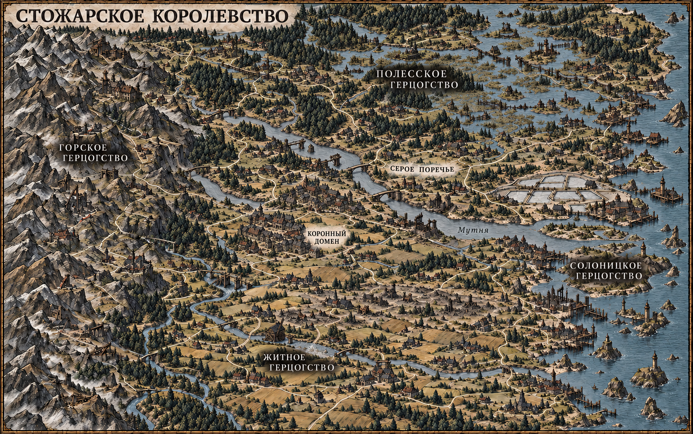

# Глобальная карта

## Единый редактор — WLC-07, 2026-11-08

`pnpm dev:map` открывает защищённый `/dev/playground/maps` на основном web stand.
[Map Editor](../../engineering/UNIFIED_MAP_EDITOR.md) объединяет World/Battle
Draft, серверные validation/preview и versioned import/export. Navigation Lab
выведен из использования; ниже сохранены его исторические результаты. Атлас v6,
игровые маршруты, координаты и текущие миры не изменены. Публикация artifact
вынесена в отдельный content delivery и не переназначает миры.

## Единственный рабочий атлас — WLC-03, 2026-11-07

Клиент, сервер и мастерская карты используют v6. В мастерской больше нет
переключателя старых рисунков; `pnpm dev:map` открывает актуальную карту.
Параметры `?map=v2`, `?map=v5` и `?map=atlas` не выбирают другую версию.
[Текущий manifest](../../../assets/manifest.json) фиксирует ресурсы и ревизии;
[архив](https://github.com/Vovanostm/warwrit/releases/tag/wlc-03-history-2026-11-07)
сохраняет предыдущие изображения, исходники и metadata.
[Результаты и восстановление](../../engineering/COMBAT_ASSET_CONSOLIDATION.md).
ID миров, координаты и принятые маршруты сохранены. Старые миры читаются своими
существующими readers; автоматического переноса координат нет.
Ниже сохранена датированная история: её прежние переключатели, команды и локальные
пути не являются текущими инструкциями запуска. Ссылки на удалённые ресурсы
закреплены за исходной Git-ревизией.

Владелец попросил: «Продумай и подготовь глобальную карту — сгенерируй
изображение мира в соответствии с лором». Результат этого цикла — обзорный
атлас королевства, который можно открыть целиком и рассмотреть крупно.

Первая версия: [атлас пяти опорных городов](https://github.com/Vovanostm/warwrit/blob/79a6ba025bba236dfe4be0665aece98d1c8c4353/assets/art/world/stozhar-v1/world-map.png).
После просмотра владелец потребовал больший масштаб и содержательное
разнообразие мест; эта версия сохранена как промежуточный рисунок.

## Действующие требования к карте — сводка решений 2026-10-08…28

Сведено 2026-11-09 из удалённого журнала (прежние разделы — в
[истории git](https://github.com/Vovanostm/warwrit/blob/87e785d537fc4bf4bbb6856456391015350d235b/docs/wiki/world/map.md)).

- **Масштаб.** Игра на десятки часов: больше 100 точек интереса; расстояние
  должно ощущаться (2026-10-08, 2026-10-25). Атлас — 9 участков 1536×1024,
  4608×3072 пикселя, 1,5625 м на пиксель.
- **Логичная география.** Дороги, леса, болота, мосты, деревни и поля
  расставлены осмысленно; через реку пройти нельзя — только по мостам и бродам.
- **Посещение места** — достичь его окраины, а не точки в центре
  ([общая зона поселения](#общая-зона-поселения-вместо-трёх-подходов--ux-предложение-2026-10-26)).
- **Управление.** Колесо — плавный зум вокруг курсора; W/A/S/D — обзор карты,
  не движение отряда; ПКМ — приказ; Space — стоп. «Следовать за отрядом»
  выключено по умолчанию.
- **Любая правка рисунка** требует пересобрать зоны, препятствия, дороги и
  граф пути из общего источника ([правило](#обязательное-обновление-навигации-после-рисунка--2026-10-28)).

## Основание и границы

Большой MMO-мир воюющих герцогств — решение владельца. Базовые имена королевства,
столицы, герцогств и их городов взяты из [мира](index.md) и
[таблицы герцогств](../../content/world/duchies.csv); их прежний статус
авторского предложения сохраняется. Дополнительные города и местности ниже
предложены для расширенного атласа по запросу владельца. Новых государств,
правителей, верований, чудовищ и датированных исторических событий карта не вводит.

Точные очертания, размеры земель, расположение городов внутри герцогств,
береговая линия, водосбор и межрегиональные дороги предложены для этого
рисунка. Течение Мутни с запада к восточному устью — связующее решение
композиции, а не уже установленный факт лора. Расположение Поречья на
Мутне и между Житным и Полесским герцогствами взято из
[страницы Поречья](porechye.md).

Владелец требует десятки часов игры и более 100 точек интереса
([REQ-20](../vision.md#масштаб-мира--2026-10-08)). Длина в километрах,
скорость переходов и фактическое время исследования пока не измерены. Земля продолжается за
северной, западной и южной рамками; соседние страны не названы. Восточное
побережье развивает уже указанную морскую торговлю Солоницы.

## Устройство рисунка

| Часть                          | Местность и опорный город                 | Связь с остальными землями                            |
| ------------------------------ | ----------------------------------------- | ----------------------------------------------------- |
| Север — Полесское герцогство   | Леса, болота, просеки; Дубровь            | Выход к спорной речной полосе                         |
| Юг — Житное герцогство         | Чернозём, полосы полей, пастбища; Колосов | Дороги к переправе и столице                          |
| Запад — Горское герцогство     | Горы, рудники, перевалы; Кремень          | Обозные дороги из горных долин                        |
| Восток — Солоницкое герцогство | Соляные озёра, устье, порт; Солоница      | Речной и сухопутный путь из внутренних земель         |
| Центр — коронный домен         | Небольшая территория; Белоречь            | Дороги между пятью опорными городами                  |
| Серое Поречье                  | Узкая полоса вдоль Мутни; Каменный Брод   | Житное и Полесское соприкасаются у каменной переправы |

Поречье занимает малую часть королевства: первый игровой регион не должен
выглядеть как весь мир. Березняк, Тихая Гать, Северный Двор и Старая
мельница отмечены в увеличиваемом атласе; это обзорные привязки района,
а не замена координат действующей игровой карты. Старая мельница
остаётся опасной сгоревшей руиной.

Различие земель задают рельеф и хозяйство. Тонкие прерывистые границы
показывают предложенное деление земель; ржаво-серая штриховка Поречья —
спорную полосу. Текущая линия фронта, захваты и положение войск не заданы.
Поселения преимущественно обитаемы; следы войны точечны.

## Большой мир — поправка владельца 2026-10-08

После первой версии: «Какая-то маленькая карта — масштаб должен быть больше —
больше городов, деревень, продумай места, разорённые войной, болота и пр. —
сделай мир интересным, не шаблонным».

Пять городов и четыре однообразные полосы биомов недостаточны. Новый рисунок
должен показывать 24 городских узла, около 120–160 небольших деревенских
групп, три самостоятельных речных бассейна и несколько разных округов
внутри каждого герцогства. Это художественное задание, а не измеренная
численность населённых пунктов или новое правило генерации игрового мира.
Новые реки, кроме Мутни, пока без названий. Поречье занимает примерно
3–4% изображённой суши; размер не задаёт реальные километры.

Горные хребты разбиты долинами и предгорьями. Полесье сочетает сухие лесные
гряды, озёрные берега, торговые речные долины и один большой болотный район.
Житное включает сады, луга, пастбища, пашни и локальную разорённую полосу.
В Солоницком два крупных соляных бассейна соседствуют с живыми устьевыми
и морскими округами. Границы следуют местности; столица не служит центром
симметричной звезды дорог.

### Города и округа

Первые пять столиц и Каменный Брод взяты из имеющихся страниц; остальные
18 городов — новые предложения. Типы и состояние дополнительных мест
не вводят готовых заданий, наград или права захвата.

| Земля          | Город         | Что отличает его округ                                    |
| -------------- | ------------- | --------------------------------------------------------- |
| Горское        | Кремень       | Столичный узел действующих рудников и горных обозов       |
| Горское        | Крутояр       | Долинный рынок перед узким перевалом                      |
| Горское        | Железец       | Рабочие рудники, отвалы, посёлки вдоль служебных дорог    |
| Горское        | Гранск        | Высокая обитаемая котловина с полями и каменными дорогами |
| Горское        | Вадич         | Живой город на краю покинутого добывающего округа         |
| Полесское      | Дубровь       | Столица среди лесных торговых долин                       |
| Полесское      | Стрежень      | Речной торг на северном водном пути                       |
| Полесское      | Шишково       | Лесные дворы и смолокурни у сухой гряды                   |
| Полесское      | Островец      | Озёрный берег, пристани и деревни на возвышенностях       |
| Полесское      | Чёрный Плёс   | Посад у болотного водосбора и деревянной гати             |
| Житное         | Колосов       | Главный хлебный рынок юга                                 |
| Житное         | Добрино       | Сады и пастбища в защищённых долинах                      |
| Житное         | Луговец       | Сенные луга, конные дворы и большой перекрёсток           |
| Житное         | Медов         | Садовые деревни между полями и лесистыми холмами          |
| Житное         | Рожин         | Уцелевший рынок у края разорённой хлебной полосы          |
| Солоницкое     | Солоница      | Главный торговый порт в устье Мутни                       |
| Солоницкое     | Устье         | Другой устьевой округ, рыболовные дворы и малые причалы   |
| Солоницкое     | Соляной Посад | Внутренний рынок соляных озёр и дорог по дамбам           |
| Солоницкое     | Плотов        | Речные склады и дворы на наносных островах                |
| Солоницкое     | Ладейск       | Второй морской торговый город в защищённой бухте          |
| Коронный домен | Белоречь      | Столица и монетный двор                                   |
| Коронный домен | Городец       | Живой рынок на пересечении межрегиональных путей          |
| Коронный домен | Вязов         | Разбитые городские кварталы и уцелевший речной посад      |
| Поречье        | Каменный Брод | Низкая каменная переправа, связывающая север и юг         |

### Места, которые меняют устройство пути

| Место                 | Что видно на карте                                                                    | Зачем идти туда или выбирать другой путь                       |
| --------------------- | ------------------------------------------------------------------------------------- | -------------------------------------------------------------- |
| Глухие топи           | Торфяной болотный водосбор, сухие обитаемые острова, длинная гать с провалом          | Деревни близки по прямой, но связаны большим обходом           |
| Пустые штольни        | Покинутые шахтные дворы, отвалы и оборванная служебная дорога рядом с живым городом   | Добывающий округ отличается от работающих соседних долин       |
| Узкий перевал         | Две каменные гряды, серпантин и небольшая обитаемая крепость над дорогой              | Дальний торговый путь сходится в одном проходе                 |
| Горелая межа          | Полоса разорённых деревень и заросших полей вдоль старого обозного пути               | Путь через хлебный край пересекает местную зону разрушений     |
| Вязов                 | Кварталы без крыш, уцелевший посад, разрушенная переправа и обход к Караульному мосту | Повреждённый городской узел вынуждает менять маршрут           |
| Горелая пристань      | Обугленные сваи, пустые склады, дорога, теряющаяся в кустах                           | Заброшенный причал соседствует с действующей портовой сетью    |
| Островные дворы       | Сады, дома на поднятом грунте, причалы и мостки на наносных островах                  | Поселения связаны водой и короткими переходами между островами |
| Размытый старый тракт | Прямой участок каменной дороги в лесу, разбитый мост, новая грунтовая дуга            | Видна причина, почему нынешняя дорога длиннее прежней          |
| Соляные озёра         | Два крупных бассейна, дамбы, соляные сараи и тростниковые дворы                       | Посады соединены узкими сухими коридорами                      |
| Садово-луговая полоса | Обитаемые долины между Добрино и Луговцом, ярмарочный перекрёсток                     | Живой хозяйственный район даёт контраст разрушенным округам    |

Война оставляет разные следы: потерянная переправа, пустой склад, сгоревший
амбар, заросший участок пашни, новый дом у старого пепелища. Не назначаем
им виновника или новую битву. На карте остаются работающие рынки и рудники,
рыбацкие дворы, дороги и восстановление. Ни одна область не состоит только
из одного ресурса или одного типа разрушений.

Дороги образуют местные петли и несколько дальних связей: рудники →
перевалы → хлебные рынки → речные и морские порты. Тупиковая дорога
упирается в шахту, гать или разрушенный узел по видимой причине. Это
пространственная композиция для будущего исследования, а не реализованная
механика проходимости или снабжения.

## Поселения и отряды на карте

### Общая зона поселения вместо трёх подходов — UX-предложение 2026-10-26

Владелец после испытания пилота предложил доступ к интерфейсу из общей зоны
поселения и спросил, какой вариант удобнее. Ниже — рекомендация к следующему
опыту; она не утверждает новое правило игры и не меняет текущий стенд.

Для открытой деревни рекомендуется одна область по внешним дворам и окраине,
вместо трёх маленьких обязательных дорожных зон. При нахождении в ней доступно
«Войти» независимо от предварительного выбора места. Случайный проход не
открывает окно. Это уменьшает необходимость попадать в условный круг, особенно
при приближении к деревне со стороны поля, и связывает взаимодействие с видимым
поселением. Это гипотеза удобства, не результат пользовательского измерения.

Предлагаемые действия:

- ПКМ по земле: обычный путь; при проходе через область появляется компактное
  предложение входа, без открытия интерфейса и автоматической остановки.
- Явное «Посетить» у поселения: путь к доступной границе зоны, затем открытие
  интерфейса. Это заранее выраженное намерение; дополнительный клик после
  прибытия не требуется. Переназначение пути отменяет намерение посещения.
- Уже в области: «Войти» открывает интерфейс из текущей позиции; возврат её
  сохраняет. Состояние глобального времени MMO этим предложением не меняется.
- Для укреплённого места остаются фактические ворота; для пристани — береговой
  подход. Нынешнему рисунку Брода не добавляются вымышленные стены/ворота.

Область должна следовать сухому берегу и реальным преградам. Вода исключается;
также нельзя разрешать вход с чужого берега только потому, что сухая точка
попала в большой круг. Необходимо размечать связную доступную область на
стороне поселения. Дороги продолжают давать преимущество по времени, но не
являются обязательными входами в открытую деревню. Поиск цели должен оценивать
доступную границу области, а не вести всё равно к центру или трём старым точкам.
Контур виден при выборе/наведении, не постоянной заливкой всего атласа.

Повторно открытые первичные источники:

- [Mount & Blade: Warband, руководство, §10, стр.39](https://shared.fastly.steamstatic.com/store_item_assets/steam/apps/48700/manuals/PDX5505US_Warband_Manual_US.pdf?t=1750147149):
  клик по земле или городу задаёт движение; прибытие останавливает время этой
  одиночной игры. Геометрия зоны из руководства не установлена; переносить
  глобальную паузу в Warwrit MMO не предлагается.
- [Battle Brothers, ответ разработчика](https://battlebrothersgame.com/forums/topic/age-old-world-map-navigation-bug/):
  описана отмена визита новым приказом на землю; старое намерение ошибочно
  сохранялось и открывало город при проходе через него. Разработчик сообщил
  об исправлении. Это подтверждает необходимость разделить близость и намерение.
- [Bannerlord, Settlement API v1.3.4](https://apidoc.bannerlord.com/v/1.3.4/class_tale_worlds_1_1_campaign_system_1_1_settlements_1_1_settlement.html):
  Position, GatePosition и PortPosition различаются. API подтверждает разные
  пространственные роли, но не точную форму зоны или удобство интерфейса.

Рекомендация: сначала сравнить общую область на тех же Березняке/Броде,
проход через неё и отдельное «Посетить». Проверить подход с поля, путь вдоль
противоположного берега, отмену визита и возврат без переноса. Текущее ограничение
пилота на выбранное место и три подхода проверено по исходнику; оно сохраняется.
Новых runtime-проверок/замеров удобства нет (NOT_RUN/NOT_MEASURED).

### Общая карта MMO: движущиеся отряды — проработка 2026-10-26

**Статус: предложение архитектуры и первого игрового цикла, local; код не
реализован.** Запрос владельца: собственный отряд, другие игроки, патрули NPC,
бандиты, дикие звери/твари; изучить концепт и выбрать место исполнения механик.
Срез исходников: `7ffac342`, поверх слитого PR328. Новая проработка не переносит
разрешение на публикацию/merge прежнего PR на будущую реализацию.

#### Основание и граница знания

Прочитаны live полные Notes/Purpose Airtable:
[WORLD](https://airtable.com/apph3bj1NyVrfJeLM/tblwAxG5Ek1FyWpiW/recTrujX2wy7V49qk),
[принятие RC-P2](https://airtable.com/apph3bj1NyVrfJeLM/tblwAxG5Ek1FyWpiW/rechIKj0hsvfXIvFU),
[лора/первого playable v1.2](https://airtable.com/apph3bj1NyVrfJeLM/tblwAxG5Ek1FyWpiW/recQNKqYfwoJpCXVu).
Более поздние [решения владельца](../vision.md#решение-владельца--2026-10-07)
и [офлайн-политика](../vision.md#компания-без-игрока) имеют приоритет.

У мира одна история; клиент отправляет намерение, сервер владеет положением.
Принятый начальный набор включает патрули, разбойников и чудовищ; торговцы
стационарны. Мир продолжает жить без подключения игрока; общего pause/reload
нет. Начальный Campaign Day6ч и свет600/300с — разные часы. PvP не включается
видимостью других компаний. Первая приватная проверка — 10–20 игроков;
дальняя цель200–1000 банд из [хода мира](../mechanics/world-turn.md) не является
проверенной ёмкостью сервера.

[Правила угроз](../bestiary/world-rules.md), [патрулей](../bestiary/guards.md),
[бандитов](../bestiary/bandits.md), [экологии](../bestiary/ecology.md) и
[контакта](../bestiary/encounters.md) дают осмысленные кандидаты поведения.
Их новые процедуры, числовые параметры и динамические засады отмечены как
предложения: не выдавать их за уже работающий или утверждённый полный AI.
Исходный ZIP не восстанавливался; прежняя source-concordance limitation сохранена.

#### Что уже есть и чего не хватает

| Граница              | Найдено в текущем исходнике                                                                                                                                                                                                    | Следствие                                                                                  |
| -------------------- | ------------------------------------------------------------------------------------------------------------------------------------------------------------------------------------------------------------------------------ | ------------------------------------------------------------------------------------------ |
| Нарисованный стенд   | `scripts/world-map/navigation-lab.ts` локально вызывает `findTravelPath`, `compileMovementPlan`, `positionAt`; ускоряет playback через `rate` и `walkingTimeScale`                                                             | Сейчас это один локальный отряд, без сетевого общего мира                                  |
| Геометрия            | [Атлас](../../../scripts/world-map/porechye-atlas.ts) имеет edition `porechye-atlas-3x3-proposal`, 4608×3072px, 3.5fp/px; [сервер](../../../apps/server/src/world/continuous-movement.ts) привязан к `CONTINUOUS_WORLD_REGION` | Нельзя просто наложить серверные координаты существующего мира на картинку                 |
| Собственная компания | Серверный `executeContinuousMovement` проверяет владельца, revision/epoch, время, воду, маршрут, снабжение; сохраняет план/receipt транзакционно                                                                               | Повторно использовать этот путь, не создавать второй command executor в стенде             |
| Выполнение маршрутов | [Route worker](../../../apps/server/src/world/route-worker.ts) раз в1с проверяет сохранённые маршруты; `processContinuousMovementCandidate` закрывает прибытие                                                                 | Это основа продолжения пути без клиента, но не общая симуляция NPC/контактов               |
| Окружающие           | [Surroundings](../../../apps/server/src/world/surroundings.ts) видит стоящие компании только в том же site; движущийся наблюдатель их не видит; враги охот привязаны к site                                                    | Нет непрерывной видимости движущихся групп                                                 |
| Клиент окружающих    | [Hook](../../../apps/web/src/game/surroundings.ts) опрашивает surroundings раз в15с                                                                                                                                            | Не использовать этот интервал для живых движущихся целей                                   |
| Сеть                 | [Colyseus encounter adapter](../../../apps/server/src/encounters/realtime.ts) уже установлен; core0.18.17/schema5.0.34                                                                                                         | Использовать существующий стек и отдельную проекцию карты; Room не хранит канонический мир |
| Бои                  | Нынешние JOIN/охоты имеют собственную admission-политику                                                                                                                                                                       | Они не равны универсальному столкновению двух движущихся отрядов                           |

Граф codebase-memory указывает на другой checkout/HEAD, поэтому выводы проверены
по указанным файлам, а не по устаревшему индексу. Текущий осмотр — source review;
новые сетевые/нагрузочные/игровые проверки NOT_RUN.

#### Где исполнять

Рекомендация: модуль мира в существующем `apps/server/src/world`, один
авторитетный исполнитель на тестовый world. Для исследования — отдельный
процесс того же приложения, своя PostgreSQL-база и loopback-порты.
Стенд запускается независимо от основной игры, но использует те же правила,
command handlers, persistence и сетевую проекцию. Отдельная программа с копией
механик создаст расхождения; выделение production-микросервиса пока не обосновано.
Это соответствует [ADR-0003](../../architecture/0003-m0-m1-technology-baseline.md).

| Слой                             | Ответственность                                                                                                                                                                    |
| -------------------------------- | ---------------------------------------------------------------------------------------------------------------------------------------------------------------------------------- |
| `packages/game-core/src/world`   | Чистая геометрия и движение, конечные правила выбора следующего действия NPC, видимость/контакт как функции явных времени, состояния и случайного входа                            |
| `apps/server/src/world`          | Авторизация команд; серверные часы; последовательное исполнение событий; сохранение и восстановление; решения AI из доступных ему наблюдений; подготовка разрешённого клиенту вида |
| PostgreSQL                       | Сохранённые планы, версии/эпохи и результаты команд игроков; отдельное состояние NPC с целью, маршрутом, следующим сроком решения и причинной идентичностью                        |
| `packages/protocol/src/world.ts` | Версионированные намерения и разрешённые наблюдения, без серверных целей/скрытого состава                                                                                          |
| Colyseus adapter                 | Доставка изменений карты, аутентифицированное подключение и reconnect; не источник времени, движения или сохранений                                                                |
| Нарисованная карта               | Выбор цели, плавная отрисовка серверного положения и доступные действия; не решает, кого обнаружили и начался ли бой                                                               |

Цикл мира живёт вне Room: последняя закрытая вкладка/удаление пустой Room не
останавливает NPC и не создаёт их заново. Начать с одного процесса; существующий
отдельный внутренний realtime-порт допустим. Redis, очередь сервисов, Go/Rust,
Nakama и распределённые регионы не нужны до измеренного ограничения.

#### Общая форма отряда без копирования компании

На карте нужна тонкая проекция `WorldGroup`: стабильный ID, категория,
разрешённое обозначение/отношение, поза и направление движения, наблюдаемое
состояние. Для игрока источник истины — существующие company/party/route;
не дублировать их деньги, людей и координаты в новой универсальной таблице.
Для NPC — отдельный сохраняемый экземпляр с группой реальных участников,
профилем поведения, местом службы/обитания и текущим планом. Общая проекция
не делает волка компанией с жалованьем и наследованием.

У одного NPC/стайной группы один ID и одна судьба. Существующие охотничьи враги
связываются с тем же экземпляром и последствиями, если входят в новый мир;
не создавать рядом независимую декоративную копию квестового врага. Тестовые
экземпляры имеют собственные fixture ID и не выдают награды боевого мира.

#### Поведение: кандидаты для проверки

| Кто          | Что видит игрок                                                             | Минимальное предлагаемое поведение                                                                        |
| ------------ | --------------------------------------------------------------------------- | --------------------------------------------------------------------------------------------------------- |
| Свой отряд   | Явная отметка, свой маршрут и цель; направление и состояние                 | Действительные MOVE_TO/STOP, новая команда начинается с текущей позиции                                   |
| Другой игрок | Компания и её текущее наблюдаемое движение                                  | Те же серверные маршруты; чужие кошелёк, полный состав, цель и весь будущий путь не передаются            |
| Патруль      | Опознаваемая дозорная группа на своём участке                               | Выход → точки обхода → остановка → возвращение; реакция только на известную доступную угрозу              |
| Бандиты      | Наблюдаемая вооружённая группа; статус бандитов лишь при достаточном знании | Стоянка → участок засады → наблюдение → ограниченное преследование/отход; не преследовать через всю карту |
| Дикие звери  | Стая или крупная особь в подходящей среде                                   | Обитание → поиск корма/короткий переход → настороженность → уход либо защита территории                   |
| Тварь        | Редкая угроза, связанная с конкретным местом и условиями                    | Локальный выход/возвращение по видовым условиям; не бесконечно бродящий универсальный монстр              |

В первом цикле достаточно маленьких таблиц переходов. Нужны цель, реальный
маршрут и естественная остановка; LLM/behaviour-tree framework/GOAP для каждого
тика не нужны. AI получает наблюдения от той же политики обнаружения, что и
остальные участники, а не всю приватную базу. Звери-цели отличаются от
декоративных бабочек/птиц, которые не являются боевыми сущностями.

Форма метки различает категории, цвет дополняет отношение; свой отряд читается
на любом масштабе. Название/численность выводятся в пределах знания, нейтральная
компания не становится красным врагом из-за принадлежности другому игроку.
Метки поддерживают выбор и доступные действия; красивый движущийся знак без
соответствующей сущности не выдаётся за MMO.

#### Видимость и доставка

Вся карта/камера и доступные живые сведения — разные вещи. Область наблюдения
идёт от действительной позиции компании, не от центра камеры. Сервер вычисляет
доступный набор групп по версии профиля (дальность, свет, влияние леса/преград),
после чего передаёт только этот набор. Числа дальности/распознавания ещё не
утверждены; для лаборатории нужны явные изменяемые параметры, не скрытая магия.

Для себя допустим полный принятый план. Для других — краткие подтверждённые
образцы движения с `observedAt`, epoch/revision и ограниченным сроком
интерполяции; не отдавать всю дорогу/секретную цель ради удобной анимации.
После потери наблюдения прекратить live-обновления. Последнее известное место,
если показывается, отмечается временем и не продолжает ехать за скрытой целью.
При потере связи клиент обозначает устаревание, а не предсказывает врага
бесконечно. Выбор удалённого target ID не даёт права узнать его текущую позицию.

Коллекция всех NPC в общем Colyseus Schema по умолчанию не обеспечивает эти
границы. Нужны разрешённые сервером проекции/StateView и проверка фактического
payload. Room не получает приватные inventory/AI цели. На reconnect сначала
переавторизация и свежий разрешённый snapshot, затем последующие изменения.
Команды проходят тот же executor независимо от транспорта; существующий HTTP
MOVE_TO/STOP можно сохранить, WebSocket использовать для наблюдений.

#### Частоты и стоимость

Рабочая отправная точка для измерения: выбор AI-действия около1раза/с,
обновление доступных позиций5раз/с, отрисовка по кадрам браузера. Это технические
предложения, не утверждённые скорости/баланс и не измеренный предел. Путь
пересчитывается при новой цели, потере доступа или значимом изменении маршрута,
а не на каждом сетевом кадре. Геометрия поля компилируется один раз на edition.

Положение выводится из принятого плана и серверного времени; не писать каждую
промежуточную координату в SQL. Сохраняются изменения планов/состояний, сроки
решений и совершённые результаты. Индекс окружающих — производная ускоряющая
структура; для шести участников первого сценария достаточно конечного списка.
При росте количества использовать пространственные ячейки вместо полного
сравнения всех со всеми, если измерение покажет необходимость. Лимитировать
количество решений и поисков за проход, не допускать перекрывающихся запусков.

Цель2ядра/4ГБ не доказывает ёмкость. После первого работающего сценария мерить
p95 длительности шага, отставание цикла, CPU/RSS, число поисков пути и байты
на клиента. Отдельный процесс симуляции нужен только при измеренном конфликте
ресурсов; он всё равно должен владеть world единолично, без двух writers.

#### Встреча — отдельная граница

Контакт проверяется сервером по обоим пройденным участкам за интервал, а не
только расстоянию между концами тика: быстрые группы не должны пройти друг
сквозь друга незамеченными. Видеть противоположный берег не означает иметь
доступ к рукопашному контакту через реку. Дальность обнаружения, подход к
поселению, физический контакт и допуск в бой — разные правила.

До боя нужна атомарная reservation/binding: отряд не может попасть сразу в
две встречи или одновременно продолжить марш и бой. Использовать нынешние
admission/terminal-механизмы, но не объявлять их универсальными без отдельной
интеграции. Возврат сохраняет действительное место контакта. Обычная встреча
с другой компанией не включает PvP. Механика подкреплений/помощи сохраняет
принятые ограничения и не расширяется случайным соседством.

Офлайн не убирает отряд с карты и не останавливает мир. Разрешённый путь
продолжается; явные лагерь/постой и приказ идти в город следуют более поздней
политике владельца. Момент автоматического перехода в лагерь, точные расходы,
правила нового нападения и долгое восстановление после простоя сервера требуют
конкретного профиля. Не выдумывать телепорт, страховку или случайные нападения
задним числом при reconnect. Первый стенд проверяет сохранение уже принятого
маршрута; полную offline combat/catch-up приёмку этим не заявлять.

#### Первый проверяемый цикл

Самый короткий результат: два независимых игрока в двух браузерных контекстах
управляют компаниями на том же нарисованном атласе; рядом идут один патруль,
одна банда, одна стая и одна ночная тварь. Это шесть групп в общей тестовой
базе, не четыре спрайта, созданных отдельно в каждом браузере.

1. Выделить чистое общее описание atlas edition: геометрия, единицы/масштаб,
   стабильные site ID и зоны входа. Сейчас atlas импортирует ещё и предложения
   контрактов: сервер не должен импортировать UI/script entry или все тексты.
   Сначала отдельный тестовый world/edition; старые сохранения не переводить
   на другие координаты молча. Зарегистрировать новую edition в чтении сохранённых
   планов/протоколе; старые v1–v5 не переименовывать и не пересчитывать.
   Проверить общий физический масштаб/скорость:
   текущий playback множитель не заменяет серверный speed profile.
2. Подключить нарисованную карту к существующим авторизованным MOVE_TO/STOP
   своей компании и сохранению. Два реальных клиента видят одно движение;
   локальный markerPosition больше не источник положения. Вход в поселение
   подтверждается сервером по тому же описанию зоны, а не условием DOM.
3. Добавить четыре сохраняемые NPC-группы, простые цели и наблюдение. Вначале
   реальные маршруты/остановки и наличие контакта; не обещать автоматический
   бой там, где новый admission ещё не реализован.
4. Повторить полноценный путь: обе компании → патруль на дороге → банда у
   опушки → стая в лесу → тварь ночью; скрытая цель не видна второму игроку,
   закрытие вкладки не останавливает NPC. Затем отдельно преследование/отход
   и физический world→encounter→world с действительными последствиями.

В MMO-режиме Space/«Пауза» останавливает только собственную компанию.
`×8…×512`, ночной переключатель и ручная установка старта остаются только
инструментами лаборатории; общий тестовый clock изменяется серверным пультом
для всех клиентов, не отдельным playback в одной вкладке. Тестовые аккаунты,
reset/seed, всевидящая диагностика доступны только вне production и только
локально, по образцу имеющегося fixture guard. Отдельная база защищает игру
от сброса стенда; одним новым worldId эта изоляция не исчерпывается.

Критерии первой реализации: одинаковые ID/позиции у двух наблюдателей в одной
области; собственные команды не управляют другой компанией; река не проходится;
STOP/reroute сохраняют позицию; NPC не исчезают при закрытии последней вкладки;
restart восстанавливает сохранённые ID/принятые пути; скрытые группы/маршруты
отсутствуют в сетевом payload; при сближении нет двойной встречи/контакта через
реку в том цикле, который действительно вводит встречи. Перед представлением
игрового результата обязательна независимая критика реальных текущих поездок.

Для старта технической реализации не нужен новый выбор между серверными
технологиями. Перед включением новых динамических боёв следует явно закрепить
условия враждебного контакта и распознавания, преследования/отрыва и офлайна.
Предложения выше дают конечную основу такого профиля, не новый принятый канон.
Сейчас выполнены только изучение источников и проектирование; implementation,
runtime/SQL/browser/load и playable critique NOT_RUN, ёмкость/удовольствие
NOT_MEASURED. Деплой, новый сервис или симуляция не запускались.

Проверка документации: новые локальные файлы/якоря ссылок, Prettier,
CURRENT_PLAN и scoped diff — PASS. Изменены только документы; новые игровые
тесты для этой проработки не запускались.

## Преследование видимой угрозы — 2026-10-27

По запросу владельца ПКМ по враждебному отряду теперь задаёт преследование,
а не путь к разовой точке. В сетевой лаборатории это бандиты, лесная стая
и ночная тварь; игроки и дозоры остаются нейтральными. Враждебная цель
получает пунктирное кольцо, слева показаны её имя и состояние преследования.
Enter на выбранном маркере задаёт тот же приказ. Пробел или новый принятый
приказ по земле/месту отменяет преследование; отклонённый приказ его сохраняет.

Владелец принял поведение при потере видимости: идти к последнему замеченному
месту и там остановиться. Скрытое положение не используется, повторного
автоматического захвата нет. Сближение заканчивается остановкой рядом с целью,
без запуска боя. Черновой радиус лаборатории — 24fp, около 11м; проверяется
также длина доступного пути, поэтому близость через реку не считается прибытием.
Это не утверждённая дистанция боя или правила PvP.

Сервер хранит намерение и последнюю разрешённую позицию в PostgreSQL
(migrations0016/0017). Отдельный цикл существующего процесса обновляет путь
раз в секунду при смещении цели от текущего назначения на 16fp. Комнаты
Colyseus передают разрешённые наблюдения. Приказы используют прежний
авторизованный исполнитель движения и общую транзакцию с отменой намерения.
Повтор старой квитанции не отменяет и не возрождает преследование.
Стабильный серверный orderId переживает обновления маршрута. Текущий клиент
передаёт его в заголовке приказа; сервер проверяет его под блокировкой владельца.
Задержанный приказ из другого окна не отменяет более новое преследование.
При обновлении пути того же намерения клиент может один раз повторить команду
со свежими ревизиями. Для совместимости прежние запросы лаборатории без
заголовка сохранены. Основной игровой API не требует нового заголовка.

Локально проверены 23 сценария на настоящем PostgreSQL, семь сценариев
парсинга/состояния, типы сервера/протокола/стенда и scoped lint; migration smoke PASS.
SQL проверяет движущуюся цель, новый пул БД, сохранение намерения, отмену,
старые квитанции, отказ по нейтральной/невидимой цели, воду, смену ночи на день,
замороженное последнее наблюдение и защиту отката с данными.
Автор в браузере проверил ПКМ, изменение цели пути без повторного клика,
движение своего маркера, кольцо цели, остановку и отсутствие возобновления,
отмену новым путём, отказ400 для некорректного ID. Два окна с одной компанией:
старый STOP409 не повторяется и сохраняет новый приказ; свежий STOP работает.
Обновление серверного маршрута того же намерения: STOP409 → повтор200.
Первый близкий подход не измерил смену цели до сближения; повтор с дистанции
её подтвердил. Две расширенные браузерные пробы оборвались из-за ожидания
ответа/ошибочного селектора теста; их частичные результаты не объявляются
полным PASS. Независимый source review не выявил существенных дефектов.
Чистый `scripts/bootstrap.sh` PASS: verify1204/84 skipped,
10000 стрессовых боёв, migration smoke и все74 SQL-сценария. Последующие
изменения только стенда (выделение цели и разбор ответа) проверены его типами,
scoped lint и повторными native приказами/двумя окнами; ядро/сервер не менялись.
Вход в Березняк и возврат после преследования подтверждены200/200.
Критик выявил перекрытие маленького кольца своим маркером при сближении:
контур цели теперь шире своего маркера, контрастный ржавый пунктир, подпись ниже.
Повторно сняты реальные DAY/NIGHT и сближение при1050×800. Независимый
визуальный критик: ACCEPT, шесть применимых критериев2/3; плотность подписей
при полном сближении оставлена как полировка. Независимый повтор управления
критиком — NOT_RUN; native сценарии выполнены автором.
Последняя организация повторного приказа отдельно принята source reviewer;
после неё повторены вход/два посещения, два окна и STOP409→200.
Дополнительно42 существующих навигационных сценария PASS. Первый commit audit
отклонил сложность обработчика и неполные измерения: ветка повтора вынесена
в связный helper, сохранены прежние применимые измерения неизменённых исходников
и добавлены новые реальные browser/SQL/navigation данные. Порог не ослаблялся. Обычный commit hook и audit PASS у `9b2c41a5`,
без обхода. Локальная реализация сохранена этим коммитом.
Настоящий перезапуск на обычном Node24.20 без профилирования сохранил тот же
orderId из PostgreSQL; при прочтении цель уже была достигнута. После перезапуска
новый ПКМ по стае и STOP200 подтвердили снятие намерения и неподвижность отряда.
Отключение сети только для запроса посещения обработано, следующий реальный
запрос200 и возврат восстановили интерфейс. Оба стенда5338/5326 доступны.

Запуск: `pnpm dev:world`, `/scripts/world-map/world-lab.html`, порт5338.
Сборка остаётся локальной в `codex/world-map-mmo-design`; PR/merge/deploy не было.
Автоматический бой и преследование других игроков не реализованы. Нагрузка
полного MMO и удовольствие от игры — NOT_MEASURED. Исходные ограничения источников предыдущего цикла сохранены.
Локальные снимки и журналы: output/playwright/map-navigation/pursuit/ (не tracked).

## Иконки отрядов и мест — 2026-10-27

По запросу владельца условные геометрические отметки сетевого стенда заменены
предметными иконками. Отряды игроков обозначены знамёнами, дозор — щитом,
бандиты — скрещёнными клинками, звери — волчьей головой, тварь — когтистой лапой.
Свой отряд отличается золотым двойным обрамлением; цель погони — ржавым пунктиром.
Те же силуэты используются в списке соседних отрядов, поэтому различие основано
на форме и цвете. Символы описывают существующий тип наблюдения, не вводят
новые фракции, биологию или правила обнаружения.

У34 существующих мест есть иконки по устойчивому siteId: деревня, двор, городские
ворота, мост, колесо мельницы, разрушенный дом, могилы, стоянка, амбар,
заболоченная местность, лесные работы, карьер, лодка, кувшин, скот, повозка,
кузница и вода. Разрушенный Вязов не получает замок, сгоревшие повозки остаются
повозками, выгон не показан пашней. Колесо — условный знак мельницы: она остаётся
сгоревшей водяной руиной, без восстановления или ветряных крыльев.

Векторный набор продолжает выбранное семейство боевого интерфейса:
21 исходный Game Icons SVG авторов Lorc, Delapouite и Sbed плюс три локальных
нейтральных силуэта (неподписанные могилы, разрушенный дом, простая гребная лодка).
[Набор и происхождение](../../../assets/art/world/map-icons-v1/README.md)
фиксируют редакцию источника, авторов, CC BY3.0 и изменения; атрибуция есть
на стенде. Одна локальная SVG-таблица содержит24 символа; новых зависимостей
и генерации растров нет. Серверные координаты, карта и проходимость прежние.
Значки отрядов сохраняют экранный размер при зуме и изменении окна; собственная
неинтерактивная рамка пропускает ПКМ к находящемуся под ней врагу.

Проверены типы scripts/world-map, scoped lint/format, разрешение24 символов и34
ссылок мест. Автор выполнил18 браузерных проверок: реальные иконки и ключи,
ПКМ-погоня/кольцо/движение/Space, ПКМ по земле, WASD, постоянный размер при зуме
и1050×800, два посещения, отказ сети при посещении с восстановлением, без page errors.
Размер видимой части своего знамени:26.871px до/после зума и изменения окна.
Пять дополнительных ночных проверок PASS; DAY/NIGHT сняты по реальному серверному
свету. Первый браузерный сценарий был частичным: близкий противник был пойман
до измерения кольца, а STOP сразу после ответа200 опередил обновление клиента.
Повтор использовал более далёкую цель и ждал фактического обновления интерфейса.
Исходный частичный сценарий не объявляется полным PASS.

При запуске обнаружен отдельный реальный блокер: стандартный macOS Bash3.2
с `set -u` считал пустой массив build_args неинициализированным. Защищённое
раскрытие восстановило обычный запуск `pnpm dev:world`; проверены синтаксис,
пустой/непустой аргумент и фактический запуск без профилирования. База/порты
и сохранённые данные не менялись. Независимый source review закрыл замечания
к смыслу двух иконок и не нашёл иных существенных дефектов. Визуальная оценка
и обычный commit audit пока выполняются.

Срез локальный в `codex/world-map-mmo-design`; основные игровые пакеты и
протокол не менялись. Их ранее выполненные gate сохраняются, новые полные
стрессовые/SQL-прогоны для иконок — NOT_RUN. Независимый повтор управления — NOT_RUN; пользовательское предпочтение
и удовольствие — NOT_MEASURED до отдельной оценки.
Локальные кадры/записи: output/playwright/map-navigation/icons/ (не tracked).

## Камера за своим отрядом — 2026-10-27

Следующий локальный цикл по запросу «Ok, continue»: в разделе «Ваш отряд»
появился явный переключатель «Следовать за отрядом», изначально выключенный.
После включения камера держит свой отряд в центре в пределах карты и сохраняет
выбранный масштаб. Она берёт ту же интерполированную позицию, что и значок;
отдельного источника координат или предсказания скрытых групп нет.
Колесо плавно меняет масштаб, сохраняя слежение. WASD, перетаскивание и «Вся карта»
возвращают свободный обзор; простой щелчок не отключает слежение. Space останавливает
отряд, но оставляет режим камеры включённым. «К своему отряду» теперь сохраняет
масштаб. На общем плане/у края действует прежнее ограничение границ карты;
новый сеанс/смена тестового игрока выключают слежение. Прежний предел устаревания
положения сохраняется. Сервер, протокол, перемещение и правила мира не менялись.

Независимый source reviewer обнаружил подавление WASD после фокуса на checkbox;
это воспроизведено в браузере. Общий input guard теперь разрешает WASD на checkbox,
сохраняя Space для переключения и защиту текста/диалогов/остальных контролов.
Повтор source review закрыл находку. Script types, map20, scoped ESLint/Prettier
и diff checks PASS. Native24 PASS: включение/центрирование без смены масштаба,
WASD с фокусом checkbox, Space checkbox, щелчок/drag, зум и его завершение,
реальное движение/STOP, преследование/STOP, resize1050×800 и смена игрока.
Первый legacy pan probe дал false на полностью вписанной карте: двигать её
некуда. Дополнительный zoomed probe подтвердил pan; ещё проверены Space checkbox,
изоляция текстового ввода, движение/STOP днём и отсутствие page errors — семь PASS.
60 кадров движущегося отряда: максимальное отклонение его значка от центра
0.000164px; это ограниченное измерение, не оценка производительности или удовольствия.
Для всех шести дневных и семи ночных снимков свет проверен до/после захвата.
Локальные данные: output/playwright/map-navigation/follow/ (не tracked).
Полный визуальный проход и обычный commit audit пока выполняются.
Сохраняются неизменённые server/core проверки предыдущего цикла;
новые полные SQL/stress gates — NOT_RUN, пользовательское удобство — NOT_MEASURED.
Независимый повтор native ввода — NOT_RUN. Публикации/слияния/деплоя нет.

Первый обычный commit audit отклонил отсутствие свежих измерений двух прежних
веток изменённого UI-файла: входа в поселение и повтора приказа при смене epoch.
Порог/проверка не ослаблялись, исходный код ради метрики не менялся.
На текущем клиенте повторены фактический STOP409→guarded retry200 после обновления
маршрута сервером, подтверждённая остановка и восстановление посещения после
реального прерванного запроса — четыре PASS. Объединение удерживает только
source-matched прежние server/core измерения и свежие измерения изменённого UI.
Повтор обычного hook/audit ещё ожидается.

## Туман войны — проект механики 2026-10-27

Владелец запросил серверную область видимости, зависимость от местности/погоды/света,
общую карту и постепенное исследование. [Спецификация и десять пар визуальных/кодовых
примеров](fog-of-war.md) отделяют public chart, память компании и текущие наблюдения.
Полный атлас/каталог POI в нынешней клиентской сборке не защищены наложением fog;
предложены авторизованные masked chunks и единая серверная проекция. Числа и новый
UX разведки — proposals. Это локальная галерея на синтетических данных, без изменения
сервера/SQL/игровых команд. Серверный fog и нагрузка NOT_RUN/NOT_MEASURED.

Локальный design DoD выполнен:10 пар/20 состояний,6 model cases, типы/lint,
architecture/format и source-checked audit PASS. После первого REJECT исправлены
источник/давность и обозначения заслонов; полный повторный visual ACCEPT для
учебных схем, четыре применимых критерия2. Серверная интеграция — следующий
отдельный цикл; текущий рисунок/каталог карты этим изменением не скрыты.

### Домашний регион и приобретение карт — решение владельца 2026-10-28

В начале у компании есть обзорная карта только домашнего региона. Регионов
много; остальные карты приобретаются или местность исследуется самостоятельно.
Это заменяет предложение о публичной общей карте всего мира. В [актуальной
спецификации](fog-of-war.md#расширение-атласа) различаются купленная картография,
личная разведка и текущее наблюдение. Карта не открывает текущие отряды,
неизвестные секретные места и актуальное состояние городов. Новый регион
не раскрывается целиком от одного пересечения границы.

### Карты городов и мест, наводки квестов — решение владельца 2026-10-28

У торговца приобретаются карты с разным составом сведений об одном мире:
весь регион, только расположение городов, одна конкретная локация и другие
наборы. «Карты городов» здесь не означают планы улиц; прежняя ошибочная
трактовка исправлена после уточнения владельца2026-10-28. Квест может явно подсветить место
либо сообщить примерное местоположение словами **без точки на карте**.
Словесная наводка не создаёт автоматически и область поиска; появление
отметки требует отдельного сведения или личного обнаружения места.
[Правило карт и наводок](fog-of-war.md#карты-городов-мест-и-квестовые-наводки--решение-владельца-2026-10-28) ·
[Правило квестов](../economy-quests/quest-rules.md#сведения-о-месте-выполнения--решение-владельца-2026-10-28).
Wiki update only; runtime и прежние карточки квестов не менялись.

### Персональное знание и посещение мест — 2026-10-28

Владелец уточнил: посещённые места добавляются в атлас. [Предложение хранения](fog-of-war.md#предлагаемое-хранение--postgresql-и-знание-компании)
отделяет общий мир от знания Company: неизменяемые издания карт и grants,
компактные chunks исследования, личные наблюдения/посещения мест, revision.
Текущий обзор рассчитывается сервером; известность места и факт его посещения
различаются. Схема хранения предложена для существующего PostgreSQL;
новых таблиц/runtime изменений этой документацией не создано.

## Основная игра использует рисованный атлас — поручение 2026-10-29

Владелец явно выбрал новую полностью рисованную карту из чата «Найти
референс карты мира». Конкретная база — atlas-v6, тот же полный атлас
с принятыми позднее исправлениями дорог. [Единый визуальный выбор](../vision.md#единая-визуальная-база-и-интеграция--поручение-2026-10-29).
Старый фрагментный материал обычной карты не является целевым результатом.
Картографический рисунок, геометрия/дороги и серверная выдача должны
использовать одну редакцию. На дату поручения интеграция в основную оболочку
ещё ожидалась. Требование сохранить прежние координаты/маршруты, ограничения
видимости и компании остаётся действующим.

Поправка 2026-11-05. Рисованный атлас основной игры слит в main через
[PR344](https://github.com/Vovanostm/warwrit/pull/344) как `ee03f4ee`.
Компания получает собственное сохранённое картографическое знание и защищённые
фрагменты рисунка. Обычный вход, открытие компании, выбор места, движение,
остановка и восстановление после перезагрузки проверены в браузере через CI.
Подробная приёмка и оставшиеся ограничения принадлежат существующему
[контракту интеграции](../../work-packages/WORLD-MAP-NAVIGATION-LAB.md#painted-ordinary-atlas-merged--2026-11-05).
Эта запись об итоговом слиянии пока локальная.

Поправка ввода 2026-11-05 в рабочем [PR350](https://github.com/Vovanostm/warwrit/pull/350).
ПКМ по подписи доступного места должен выбирать это место. Выявлено, что текст
пропускал нажатие на землю под собой, и отряд останавливался рядом с мельницей.
Подписи доступных мест теперь принимают ввод; обычный переход дошёл до двора
мельницы и открыл бой. Полная проверка текущего PR ещё продолжается.

### Обязательное обновление навигации после рисунка — 2026-10-28

Владелец потребовал после каждого обновления карты перегенерировать зоны и
пути. Правило закреплено в существующем
[warwrit-art](../../../.agents/skills/warwrit-art/SKILL.md#every-map-revision-rebuild-zones-and-navigation):
сверить зоны местности и входа, препятствия, дорожное покрытие и узлы с новым
рисунком, пересобрать сетку и дорожный граф из общего источника, затем проверить
новые маршруты и прибытие на обновлённом локальном стенде. Даже косметическая
правка требует пересборки и подтверждения соответствия прежних зон рисунку.
Визуальная критика получает актуальные наложения геометрии и свидетельства
переходов; одной принятой картинки недостаточно. Уже принятые планы сохраняют
свой путь и время. Обновление инструкций локальное; эта запись не означает
повторную игровую проверку, обновление работающих серверов или deployment.
