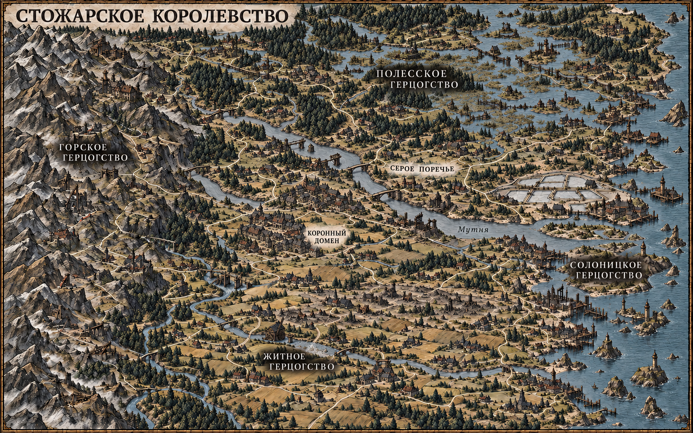

# Глобальная карта

Владелец попросил: «Продумай и подготовь глобальную карту — сгенерируй
изображение мира в соответствии с лором». Результат этого цикла — обзорный
атлас королевства, который можно открыть целиком и рассмотреть крупно.

Первая версия: [атлас пяти опорных городов](../../../assets/art/world/stozhar-v1/world-map.png).
После просмотра владелец потребовал больший масштаб и содержательное
разнообразие мест; эта версия сохранена как промежуточный рисунок.

## Основание и границы

Большой MMO-мир воюющих герцогств — решение владельца. Базовые имена королевства,
столицы, герцогств и их городов взяты из [мира](index.md) и
[таблицы герцогств](../../content/world/duchies.csv); их прежний статус
авторского предложения сохраняется. Дополнительные города и местности ниже
предложены для расширенного атласа по запросу владельца. Новых государств,
правителей, верований, чудовищ и датированных исторических событий карта не вводит.

Точные очертания, размеры земель, расположение городов внутри герцогств,
береговая линия, водосбор и межрегиональные дороги предложены для этого
рисунка. Течение Мутни с запада к восточному устью — связующее решение
композиции, а не уже установленный факт лора. Расположение Поречья на
Мутне и между Житным и Полесским герцогствами взято из
[страницы Поречья](porechye.md).

Владелец требует десятки часов игры и более 100 точек интереса
([REQ-20](../vision.md#масштаб-мира--2026-10-08)). Длина в километрах,
скорость переходов и фактическое время исследования пока не измерены. Земля продолжается за
северной, западной и южной рамками; соседние страны не названы. Восточное
побережье развивает уже указанную морскую торговлю Солоницы.

## Устройство рисунка

| Часть                          | Местность и опорный город                 | Связь с остальными землями                            |
| ------------------------------ | ----------------------------------------- | ----------------------------------------------------- |
| Север — Полесское герцогство   | Леса, болота, просеки; Дубровь            | Выход к спорной речной полосе                         |
| Юг — Житное герцогство         | Чернозём, полосы полей, пастбища; Колосов | Дороги к переправе и столице                          |
| Запад — Горское герцогство     | Горы, рудники, перевалы; Кремень          | Обозные дороги из горных долин                        |
| Восток — Солоницкое герцогство | Соляные озёра, устье, порт; Солоница      | Речной и сухопутный путь из внутренних земель         |
| Центр — коронный домен         | Небольшая территория; Белоречь            | Дороги между пятью опорными городами                  |
| Серое Поречье                  | Узкая полоса вдоль Мутни; Каменный Брод   | Житное и Полесское соприкасаются у каменной переправы |

Поречье занимает малую часть королевства: первый игровой регион не должен
выглядеть как весь мир. Березняк, Тихая Гать, Северный Двор и Старая
мельница отмечены в увеличиваемом атласе; это обзорные привязки района,
а не замена координат действующей игровой карты. Старая мельница
остаётся опасной сгоревшей руиной.

Различие земель задают рельеф и хозяйство. Тонкие прерывистые границы
показывают предложенное деление земель; ржаво-серая штриховка Поречья —
спорную полосу. Текущая линия фронта, захваты и положение войск не заданы.
Поселения преимущественно обитаемы; следы войны точечны.

## Большой мир — поправка владельца 2026-10-08

После первой версии: «Какая-то маленькая карта — масштаб должен быть больше —
больше городов, деревень, продумай места, разорённые войной, болота и пр. —
сделай мир интересным, не шаблонным».

Пять городов и четыре однообразные полосы биомов недостаточны. Новый рисунок
должен показывать 24 городских узла, около 120–160 небольших деревенских
групп, три самостоятельных речных бассейна и несколько разных округов
внутри каждого герцогства. Это художественное задание, а не измеренная
численность населённых пунктов или новое правило генерации игрового мира.
Новые реки, кроме Мутни, пока без названий. Поречье занимает примерно
3–4% изображённой суши; размер не задаёт реальные километры.

Горные хребты разбиты долинами и предгорьями. Полесье сочетает сухие лесные
гряды, озёрные берега, торговые речные долины и один большой болотный район.
Житное включает сады, луга, пастбища, пашни и локальную разорённую полосу.
В Солоницком два крупных соляных бассейна соседствуют с живыми устьевыми
и морскими округами. Границы следуют местности; столица не служит центром
симметричной звезды дорог.

### Города и округа

Первые пять столиц и Каменный Брод взяты из имеющихся страниц; остальные
18 городов — новые предложения. Типы и состояние дополнительных мест
не вводят готовых заданий, наград или права захвата.

| Земля          | Город         | Что отличает его округ                                    |
| -------------- | ------------- | --------------------------------------------------------- |
| Горское        | Кремень       | Столичный узел действующих рудников и горных обозов       |
| Горское        | Крутояр       | Долинный рынок перед узким перевалом                      |
| Горское        | Железец       | Рабочие рудники, отвалы, посёлки вдоль служебных дорог    |
| Горское        | Гранск        | Высокая обитаемая котловина с полями и каменными дорогами |
| Горское        | Вадич         | Живой город на краю покинутого добывающего округа         |
| Полесское      | Дубровь       | Столица среди лесных торговых долин                       |
| Полесское      | Стрежень      | Речной торг на северном водном пути                       |
| Полесское      | Шишково       | Лесные дворы и смолокурни у сухой гряды                   |
| Полесское      | Островец      | Озёрный берег, пристани и деревни на возвышенностях       |
| Полесское      | Чёрный Плёс   | Посад у болотного водосбора и деревянной гати             |
| Житное         | Колосов       | Главный хлебный рынок юга                                 |
| Житное         | Добрино       | Сады и пастбища в защищённых долинах                      |
| Житное         | Луговец       | Сенные луга, конные дворы и большой перекрёсток           |
| Житное         | Медов         | Садовые деревни между полями и лесистыми холмами          |
| Житное         | Рожин         | Уцелевший рынок у края разорённой хлебной полосы          |
| Солоницкое     | Солоница      | Главный торговый порт в устье Мутни                       |
| Солоницкое     | Устье         | Другой устьевой округ, рыболовные дворы и малые причалы   |
| Солоницкое     | Соляной Посад | Внутренний рынок соляных озёр и дорог по дамбам           |
| Солоницкое     | Плотов        | Речные склады и дворы на наносных островах                |
| Солоницкое     | Ладейск       | Второй морской торговый город в защищённой бухте          |
| Коронный домен | Белоречь      | Столица и монетный двор                                   |
| Коронный домен | Городец       | Живой рынок на пересечении межрегиональных путей          |
| Коронный домен | Вязов         | Разбитые городские кварталы и уцелевший речной посад      |
| Поречье        | Каменный Брод | Низкая каменная переправа, связывающая север и юг         |

### Места, которые меняют устройство пути

| Место                 | Что видно на карте                                                                    | Зачем идти туда или выбирать другой путь                       |
| --------------------- | ------------------------------------------------------------------------------------- | -------------------------------------------------------------- |
| Глухие топи           | Торфяной болотный водосбор, сухие обитаемые острова, длинная гать с провалом          | Деревни близки по прямой, но связаны большим обходом           |
| Пустые штольни        | Покинутые шахтные дворы, отвалы и оборванная служебная дорога рядом с живым городом   | Добывающий округ отличается от работающих соседних долин       |
| Узкий перевал         | Две каменные гряды, серпантин и небольшая обитаемая крепость над дорогой              | Дальний торговый путь сходится в одном проходе                 |
| Горелая межа          | Полоса разорённых деревень и заросших полей вдоль старого обозного пути               | Путь через хлебный край пересекает местную зону разрушений     |
| Вязов                 | Кварталы без крыш, уцелевший посад, разрушенная переправа и обход к Караульному мосту | Повреждённый городской узел вынуждает менять маршрут           |
| Горелая пристань      | Обугленные сваи, пустые склады, дорога, теряющаяся в кустах                           | Заброшенный причал соседствует с действующей портовой сетью    |
| Островные дворы       | Сады, дома на поднятом грунте, причалы и мостки на наносных островах                  | Поселения связаны водой и короткими переходами между островами |
| Размытый старый тракт | Прямой участок каменной дороги в лесу, разбитый мост, новая грунтовая дуга            | Видна причина, почему нынешняя дорога длиннее прежней          |
| Соляные озёра         | Два крупных бассейна, дамбы, соляные сараи и тростниковые дворы                       | Посады соединены узкими сухими коридорами                      |
| Садово-луговая полоса | Обитаемые долины между Добрино и Луговцом, ярмарочный перекрёсток                     | Живой хозяйственный район даёт контраст разрушенным округам    |

Война оставляет разные следы: потерянная переправа, пустой склад, сгоревший
амбар, заросший участок пашни, новый дом у старого пепелища. Не назначаем
им виновника или новую битву. На карте остаются работающие рынки и рудники,
рыбацкие дворы, дороги и восстановление. Ни одна область не состоит только
из одного ресурса или одного типа разрушений.

Дороги образуют местные петли и несколько дальних связей: рудники →
перевалы → хлебные рынки → речные и морские порты. Тупиковая дорога
упирается в шахту, гать или разрушенный узел по видимой причине. Это
пространственная композиция для будущего исследования, а не реализованная
механика проходимости или снабжения.

## Художественная поставка

Север сверху, горизонтальный атлас примерно 16:10. Это обзорная иллюстрация;
фиксированная 3/4-камера игрового клиента по ADR-0006 сохраняется.
Чернильный контур, штриховка, плотные тени и плоская приглушённая заливка
следуют стилю C. Референсы:

- [unit-c-ink.png](../../../assets/art/m1/style/unit-c-ink.png);
- [Каменный Брод](../../../assets/art/m1/places/settlements-v2/kamenny-brod-painting.png);
- [Старая мельница](../../../assets/art/m1/places/staraya-melnitsa.png).

Палитра: сланец, сажа, умбра, приглушённая охра, выцветшая олива,
немного ржавого. Материалы — тёмная черепица, старое дерево, неровный
камень; поля и леса различимы без ярких цветных заливок владений.

Точный [английский запрос](../../../assets/art/world/stozhar-v1/prompt.txt)
сохранён рядом с [рисунком](../../../assets/art/world/stozhar-v1/world-map.png)
и [происхождением](../../../assets/art/world/stozhar-v1/provenance.json).
Генерация — встроенный `imagegen`;
референсы просмотрены автором и описаны в запросе. Они не переданы как
изображения-мишени для редактирования.

## Результат и проверки — 2026-10-08

Первый рисунок сгенерирован встроенным `imagegen`: 1536×1024, непрозрачный
PNG. На запрос предпочтительного 3072×2048 инструмент вернул меньший размер;
увеличение разрешения не выполнено.

Независимый `warwrit_visual_critic` просмотрел рисунок, три референса и две
сравнительные таблицы одинаковой высоты. Первый проход: **REJECT**.
Материалы/износ — 1: Каменный Брод выглядел высоким светлым замком вместо
старого торгового города. Лор — 1: Мутня была синей вместо пепельно-серой.
Остальные применимые критерии — 2; движение не относится к неподвижному
атласу. Для исправления запрошены новая низкая городская композиция у
переправы, серый ил в реке и более плотные нерегулярные тени у опорных
городов. Точный [запрос исправления](../../../assets/art/world/stozhar-v1/edit-prompt.txt).
Исправленная версия получена: Мутня серая, у Каменного Брода низкая
каменная переправа и плотная группа тёмных крыш. Второй полный проход
статичного атласа: **ACCEPT**, применимые оценки 2/3/2/2/2/2/3; движение N/A.
Владелец затем отклонил достаточность масштаба: первой версии недостаточно
городов и разных мест. Это не отменяет исправления материалов и лора,
но блокирует завершение запроса до расширенной версии.

Расширенный атлас получен: **1586×992**. На рисунке нанесены новые города,
болотный округ с гатью, разорённый Вязов и хлебная полоса, покинутые штольни,
работающие и разрушенный порты. Точный
[запрос](../../../assets/art/world/stozhar-v2/prompt.txt),
[изображение](../../../assets/art/world/stozhar-v2/world-map.png),
[происхождение](../../../assets/art/world/stozhar-v2/provenance.json).
Независимая оценка второй версии: **REJECT**, мелкие подписи терялись
на обзоре; потребовалась увеличиваемая подача. Число деревенских групп и доля суши
Поречья **NOT_MEASURED**; изображение не является координатным каталогом мира.

Проверка новых локальных ссылок (10) и `git diff --check` прошли.
Форматирование изменённых документов и provenance выполнено.
Игровые тесты и подключение к клиенту — **NOT_RUN**: этот цикл меняет только
иллюстрацию и её описание. День/ночь и движение в игровом окружении не
проверены; полная интегрированная приёмка по VISUAL_CRITIQUE — **BLOCKED**
до отдельного цикла подключения. Это не препятствует оценке статичного
концепта по применимым критериям и не означает приёмку игровой карты.

## 128 мест и проверка географии — 2026-10-08

Последующие требования владельца:

> Игра должна быть рассчитана на десятки часов — текущая карта всё ещё
> маленькая, нужно более 100 точек интереса.
> Ещё раз перепроверь карту и расположи все элементы на ней логично —
> проверь дороги, леса, болота, мосты, деревни, поля и пр.

Текущая версия — [увеличиваемый атлас](../../../assets/art/world/stozhar-v3/atlas.html)
с поиском, фильтрами и выбором места. Его [каталог](../../../assets/art/world/stozhar-v3/places.json)
содержит **128** уникальных мест: 24 города, 40 деревень/хуторов,
18 следов войны, 16 природных мест, 16 дорожных узлов, 14 промысловых
и хозяйственных мест. У каждого места есть отдельное описание и связи.
Это точный счёт каталога и выбираемых меток; он не означает, что генератор
изображения создал ровно 128 различимых поселений.

Каталог владеет именами, типами и координатами. В HTML включена его
неизменяемая копия для автономного открытия; обновлять её из JSON.
Координаты — проценты рисунка с севером сверху, а не километры или
координаты игровых сущностей. Кнопки связанных мест — навигация атласа,
а не реализованный маршрут компании. На обзоре показаны значки; при
увеличении — подписи городов, остальные подписи при выборе/наведении.

### Логика размещения

- Мутня идёт по центральной долине к восточному устью, её вода
  пепельно-серая. Большая речная петля вокруг столицы убрана; вместо неё
  сухая терраса с полями и дорогами. Северный озёрно-болотный водосбор
  и южная сельскохозяйственная речная долина образуют другие округа.
  Северные озёра, сухие гряды и болото различаются по растительности.
- Дороги следуют долинам, сухим террасам, перевалам и краю полей.
  Переправы привязаны к нарисованным берегам: подходы соединяются
  с мостом, бродом или пристанями. Горные подъезды обходят скальные
  уступы; рабочие и покинутые выработки находятся у своих подъездов.
- Вязов стоит у разрушенного пролёта на верхней Мутне. Обход идёт
  береговой дорогой к ближайшему Караульному мосту; дальше путь ведёт
  к Каменному Броду. Нижний перевоз
  относится к нижнему течению и больше не объявлен местным обходом Вязова.
  Караульный мост имеет деревянный настил на старых опорах: единственная
  каменная тележная переправа **Поречья** остаётся у Каменного Брода.
- Длинная гать пересекает болотный комплекс между сухими островами,
  один участок прерван. Деревни и сады — на поднятом грунте; обычная
  пашня не назначена открытому болоту. Леса занимают сухие гряды и
  склоны, тростник — мокрые кромки.
- Южные поля сгруппированы вокруг дворов на пологой сухой земле.
  Низкие речные берега — покосы и выпас; сады близки к поселениям,
  лесные опушки остаются за пашней. Новая водяная мельница, Луговой
  брод и Сенной мост находятся на южной речке; разбитая плотина —
  на её верхнем притоке. Они не заменяют Старую мельницу Поречья.
- Соляные дворы стоят у двух соляных бассейнов, дороги проходят
  по береговым дамбам. Порты и рыбацкие дворы привязаны к береговым
  причалам, островные дома — к сухим наносам и лодочным сходам.
  Рабочие пристани отделены от обгоревших складов.
- Следы войны сосредоточены в разорённой хлебной полосе и отдельных
  повреждённых узлах. Сохраняются живые города, поля, рабочие рудники
  и порты. «Выжженный бор» заменён предложением «Брошенная делянка»:
  рисунок показывает пустые лесные дворы, а не сплошь сгоревший лес.

Проверка выполнялась по рисунку в увеличении, с последовательной
привязкой всех 128 мест к постройкам, сухому грунту, воде или дороге.
Первый независимый проход третьей версии выявил метки столицы на
надписи, брод/мост и водяные хозяйства на суше, неясную привязку Вязова.
Для исправления изменены центральная гидрография, локальные сооружения
и привязки каталога; новое изображение сохранено отдельно от чернового.

### Происхождение и пределы результата

[Исходный запрос](../../../assets/art/world/stozhar-v3/prompt.txt),
[правка географии](../../../assets/art/world/stozhar-v3/geography-edit-prompt.txt),
[правка переправ и водяных хозяйств](../../../assets/art/world/stozhar-v3/landmarks-edit-prompt.txt),
[правка по прямым референсам](../../../assets/art/world/stozhar-v3/style-edit-prompt.txt),
[графическая реконструкция](../../../assets/art/world/stozhar-v3/engraving-edit-prompt.txt)
и [provenance](../../../assets/art/world/stozhar-v3/provenance.json) сохранены
рядом с текущим рисунком. Использован встроенный imagegen.

Новые названия и география остаются предложением; атлас не подключён
к игровому клиенту. Десятки часов — требование к будущему наполнению,
а не измеренная длительность этого изображения или 128 меток.
Игровые дела, время переходов и продолжительность исследования —
**NOT_MEASURED**; интеграция, день/ночь и игровой маршрут — **NOT_RUN**.
Полная игровая приёмка не входит в поставку самостоятельного атласа.

Географический проход исправленной версии оценил привязки и лор на 2,
но отклонил мягкий рендер и высокие замковые городские силуэты (1).
В следующий запрос напрямую переданы три утверждённых референса:
чернильная штриховка и широкая низкая застройка вместо замков; расположение
мест и водной сети сохранено. Нативный размер текущего рисунка — 1585×992,
большее запрошенное разрешение инструмент не вернул.

Повторная оценка первой правки стиля снова отклонила силуэты, рендер
и материалы (1/1/1). После двух проходов с такой оценкой выполнена
графическая реконструкция: низкие группы крыш без замковых оград,
штрихованные плоскости рельефа и плоские заливки. География и привязки
сохранены; финальная независимая оценка относится к этой версии.

Независимый `warwrit_visual_critic` принял самостоятельный атлас на
обзорном масштабе: **ACCEPT**. Он просмотрел текущий рисунок, три
утверждённых референса, три сравнительные таблицы и девять desktop-снимков.

| Критерий             | Обзор | Увеличение |
| -------------------- | ----- | ---------- |
| Силуэты и пропорции  | 2     | 2          |
| Язык рисунка         | 2     | 1          |
| Тон и палитра        | 2     | 2          |
| Материалы и износ    | 2     | 1          |
| Предметы и лор       | 2     | 2          |
| Привязка к местности | 2     | 2          |

Поза и движение — N/A для неподвижного атласа. На увеличении 3×
чернильная детализация крыш, дерева и камня уступает референсам;
для приёмки близкого вида требуется рисунок с большим нативным разрешением
и авторская проработка деталей. Эти две оценки остались на 1 в двух
проходах; следующая правка должна менять способ детализации, а не только
общую палитру. Светлые дороги, охра полей и синяя вода вне Мутни
требуют дальнейшей полировки относительно референсов.

Автор сверил все 128 привязок; критик независимо проверил восемь выбранных
мест на девяти снимках. Выборка не подтверждает независимо все 128 меток.
Приёмка интегрированной игры по полному рубрикатору — **BLOCKED**:
игровые дневные/ночные снимки отсутствуют; подключение не входит в этот цикл.

Каталог/координаты/уникальные имена и ID/ссылки/встроенная копия JSON/
синтаксис JS — **PASS**. Локальные ссылки страницы (24), форматирование
и обычный diff — **PASS**. Desktop-проверка
1600×1000 во встроенном браузере: поиск, выбор Enter/мышью, переходы
мельница → брод → мост и разрушенный мост → действующий обход,
фильтры 40 деревень/18 следов войны/27 северных мест/128 всего,
увеличение/перетаскивание/возврат к обзору — **PASS**. Проверки каталога
не устанавливают наличие 128 различимых кластеров на самом PNG.
Native Chrome — **NOT_RUN** (этот браузер недоступен в текущем сеансе).

`pnpm check:changes` — **PASS** с предупреждением о синтаксической
атрибуции сравнения base/head; это проверка изменений, а не приёмка
игрового мира. Системный Python не имел Pillow; сравнительные таблицы
успешно сделаны доступным bundled Python. Локальные снимки проверки
хранятся по пути `output/world-map-2026-10-08/`, в коммит не входят.

## Второй анализ карты и мира — 2026-10-09

Запрос владельца: «Проанализируй карту, проанализируй мир — что можно
улучшить? Use codex для генерации изображений. Найди подходящие скиллы
для gamedev». Атлас просмотрен целиком и пятью вырезками; Поречье —
при увеличении 3×. Вырезки — по пути `output/map-review-2026-10-08b/`
(не в коммите).

### Расхождения рисунка с лором при близком виде

| Что на рисунке                                             | Что требует лор или каталог                                                                                    | Важность |
| ---------------------------------------------------------- | -------------------------------------------------------------------------------------------------------------- | -------- |
| Караульный мост — каменная арка                            | Деревянный настил на старых опорах; единственная каменная тележная переправа — Каменный Брод                   | Высокая  |
| Каменный Брод — высокая арка с воротной башней             | Низкая каменная переправа ([референс](../../../assets/art/m1/places/settlements-v2/kamenny-brod-painting.png)) | Высокая  |
| На месте Тихой Гати — руины с башнями                      | Речное село на настилах; разорена только Старая мельница                                                       | Высокая  |
| Подпись «Серое Поречье» закрывает Северный Двор и Березняк | Места региона должны читаться                                                                                  | Средняя  |
| Четыре переправы на коротком участке Мутни                 | Брод ценен как узел, за который дрались                                                                        | Средняя  |
| Столичная застройка вплотную к Поречью                     | Поречье — пограничье Житного и Полесского, а не пригород столицы                                               | Средняя  |

### Чего не хватает миру на карте

1. **Войны не видно.** Нет полков, лагерей, осадных работ, обозов. Армии решены
   ([REQ-21](../vision.md#требования--сводка)), но они меняются — их место
   в **динамическом слое** атласа из данных
   ([армии](../mechanics/armies.md), [ситуации мест](../mechanics/place-state.md)),
   а не в растре.
2. **Нет чудовищ.** Ни одного логова; бестиарий отобрал 30 существ
   ([каталог](../bestiary/catalogue.md)), но они не привязаны к местам
   мёртвых Смуты (Братские ямы, Вязов, Горелая межа).
3. **Нет глуши.** Плотность деревень и полей ровная; нет пустых опасных зон
   для напряжения пути.
4. **Однообразные детали.** Тонкие башни-маяки на рифах востока повторяются;
   соляные бассейны — правильная современная сетка; синяя вода вне Мутни.
5. **Столица без лица.** Белоречь — масса домов без узнаваемого силуэта
   и монетного двора.
6. **Описания мест без людей и причины прийти** — см.
   [ориентиры §8](../benchmarks.md#8-примеры-как-надо-и-как-не-надо).

### Улучшения по порядку

| №   | Улучшение                                                                 | Как                                                                                                   | Статус            |
| --- | ------------------------------------------------------------------------- | ----------------------------------------------------------------------------------------------------- | ----------------- |
| 1   | Крупный план Поречья с исправленными переправами, Тихой Гатью и мельницей | Codex `image_gen` по атласу и референсам                                                              | Этот цикл         |
| 2   | Динамический слой атласа: состояние мест, полки, ситуации                 | Данные + `atlas.html`, без растра                                                                     | Предложение       |
| 3   | Переписать описания мест: человек, беда, причина прийти                   | Начать с соседей Поречья                                                                              | Предложение       |
| 4   | Логова тварей у мест мёртвых Смуты                                        | Привязать отобранных существ к местам каталога                                                        | Предложение       |
| 5   | Паспорта шести опорных городов, силуэт столицы                            | Текст, затем изображение по паспорту                                                                  | Нужен лор столицы |
| 6   | Глушь и спорные полосы кроме Поречья                                      | Правка атласа                                                                                         | Предложение       |
| 7   | Вера, правители, название эпохи                                           | Решения владельца ([ориентиры §9](../benchmarks.md#9-предложения-по-лору--требуют-решения-владельца)) | Ждёт владельца    |

### Крупный план Поречья через Codex — 2026-10-09

Первое улучшение из таблицы выполнено как концепт: Codex CLI 0.146.0,
встроенный `image_gen` (модель `gpt-6.1-sol`), вызов из Claude Code через
`codex exec` с вырезкой атласа как раскладкой и тремя утверждёнными
референсами. Файлы, точные запросы и
[provenance](../../../assets/art/world/porechye-v1/provenance.json) —
в `assets/art/world/porechye-v1/`.

| Версия                                                                         | Критик | Оценки                                                           |
| ------------------------------------------------------------------------------ | ------ | ---------------------------------------------------------------- |
| [Первая](../../../assets/art/world/porechye-v1/porechye-detail.png)            | REJECT | Предметы и лор 1, раскладка 1; силуэты, язык, тон, материалы — 2 |
| [Вторая, правка](../../../assets/art/world/porechye-v1/porechye-detail-v2.png) | REJECT | Предметы и лор 2, раскладка 1; остальные — 2                     |

Исправлено во второй версии: Караульный мост — деревянный настил на
каменных опорах; Каменный Брод — низкая двухарочная переправа без замка;
одна Тихая Гать на сваях; сгоревшая мельница со сломанным колесом;
неглубокие могилы рядом с мельницей на том же берегу; окраина столицы
сведена к углу; серая Мутня. Язык рисунка и материалы при близком виде — 2
(у прежнего атласа было 1).

Осталось (раскладка 1 два прохода подряд): Северный Двор и Березняк не на
своих местах, Вязовский мост лежит вдоль реки, мельничный ручей читается
вторым руслом, появился лишний ручей на северо-востоке; кресты на могилах
при открытом вопросе веры. Правка всего листа текстом каждый раз сдвигает
другие места — нужна смена способа: правка по одному участку с наброском
по координатам каталога и вклейкой только этого участка. Игровые виды,
день/ночь и сравнительная таблица — **NOT_RUN**; лист не принят.

**Третья версия — решение владельца «a», 2026-10-09.**
[Лист](../../../assets/art/world/porechye-v1/porechye-detail-v3.png) собран
по участкам: Березняк вклеен из первой версии; одна правка Codex по листу
с рамками, из которой взяты только участки ниже мельницы и на северо-востоке
(остальное — Codex убрал нижнюю Мутню — отброшено); три правки Codex по
увеличенным вырезкам (Северный Двор, Вязовский мост, простые столбы на могилах
вместо крестов — решение владельца). Вклейка — Pillow с мягкой маской.

Новый независимый критик: **ACCEPT** самостоятельного концепта, все применимые
критерии — 2 (раскладка 1 → 1 → 2, предметы и лор 1 → 2 → 2). Игровое
использование — **BLOCKED**: нет игровых видов день/ночь и сравнительной
таблицы; проверка швов при 2× — **NOT_RUN**. Рекомендованная полировка: шов
южного берега справа внизу и настилы Тихой Гати поперёк русла; колесо мельницы
стоит рядом с ручьём, а не в нём; Каменный Брод деревянный, а в
[сцене](../../../assets/art/m1/places/settlements-v2/kamenny-brod-painting.png)
каменный; дым в Броде и Гати; главная дорога не выделена; крупные стога
и столбы; нижняя Мутня уходит в правый край, а не вниз.

**Четвёртая версия — полировка, 2026-10-09.** Владелец поручил выбрать облик
Брода автору («all yours») и согласился перенести Тихую Гать на южный берег.
[Лист](../../../assets/art/world/porechye-v1/porechye-detail-v4.png): Каменный
Брод на карте совпадает со сценой посещения — нижние этажи из бутового камня,
приземистая караульня у моста не выше домов с одним выцветшим знаменем,
каменный амбар с подъёмником, дым; без высоких башен и креста, пока вера
не решена. Тихая Гать на сваях у южного берега рядом с мельницей, русло
открыто, южный берег обведён; колесо мельницы стоит в каменном жёлобе.

Критик, четвёртый проход: **ACCEPT** концепта, материалы — 3, остальные — 2.
Проверка швов автором при 2×: следов воды нет, у изгороди Брода остался
едва заметный след лодки около 25×8 px; пятно на северном берегу — обломок
столба. Открытая полировка: главная дорога, крупные стога и столбы, выход
Мутни в правый край, насыщенность охры. Вопросы владельцу: эмблема с рогами
на знамени (взята из утверждённой сцены), фонарный столб у моста похож на
виселицу. Игровые виды — **NOT_RUN**, игровое использование — **BLOCKED**.

**Пятая версия — решения владельца, 2026-10-09:** эмблема с рогами на знамени
остаётся; фонарный столб, похожий на виселицу, заменён простым фонарём
(одна правка Codex, вклеен участок 55×75 px).
[Текущий лист](../../../assets/art/world/porechye-v1/porechye-detail-v5.png):
критик — **ACCEPT** концепта, материалы — 3, остальные — 2; шов не виден,
фонарь читается фонарём только при 2×. Открытая полировка прежняя плюс
след лодки у Брода.

## Стенд проходимости Поречья — 2026-10-25

Запрос: наложить дороги, леса, болота и другие биомы с разной скоростью,
попробовать поиск пути и проверить готовые GitHub-решения. Владелец выбрал
первый результат: **«Да, сначала интерактивный стенд»**. Подложка —
[Поречье v5](../../../assets/art/world/porechye-v1/porechye-detail-v5.png).
Это локальный опыт, не новая принятая география игрового мира.

### Как попробовать

В worktree `codex/world-map-painted`: `pnpm install --frozen-lockfile`, затем
`pnpm dev:map`. Открыть `http://127.0.0.1:5326/scripts/world-map/navigation-lab.html`.
[Страница](../../../scripts/world-map/navigation-lab.html) показывает рисунок,
включаемые слои и отряд. «Поставить старт» и щелчок задают начало; следующий
щелчок — цель. «Идти», «Стоп», «Продолжить» управляют просмотром движения.
×1/×8/×32 меняет скорость просмотра, а не стоимость пути. Колесо приближает,
перетаскивание двигает обзор, «Вся карта» возвращает исходный вид.
Ночной просмотр — цветовая проба, не работа игрового времени.

Примеры: через Каменный Брод к мельнице; обход разрушенной переправы через
Караульный мост; дорожный обход вместо прямой линии через местность.
Скрытие слоя убирает только цвет, сохраняя проходимость.

### Данные и границы

[Разметка](../../../scripts/world-map/porechye-navigation.ts) задана в пикселях
исходника. Одни полигоны питают подсветку и поиск пути. Дороги имеют ширину
и соединения; река образует непрерывную преграду. Два целых моста открывают
переправу; разрушенный пролёт не получает разрешающего коридора.

Используется существующий профиль `free-terrain-continuous-v3` из
[continuous-movement.ts](../../../packages/game-core/src/world/continuous-movement.ts):
поле ×1, лес ×0,6, болото ×0,3, холмы ×0,8, тропа ×1,4, грунтовая дорога
и мост ×1,8. Вода непроходима. Легенда получает значения через публичный
`continuousSurfaceAt`; второй таблицы скоростей в стенде нет.

[Контроллер](../../../scripts/world-map/navigation-lab.ts) использует публичные
`buildNavigationField`, `findTravelPath`, `compileMovementPlan`, `positionAt`.
Минимизируется время в существующем поисковом графе; глобальный непрерывный
оптимум не заявлен. Стенд отделён от web-клиента и не меняет сервер, сохранения,
правила доступа и принятую редакцию карты.

Контуры — ручной первый проход: границы биомов обобщены, не все тропинки
размечены; крыши и отдельные деревья не становятся индивидуальными
препятствиями. Масштаб — 4 fp на пиксель для опыта, не утверждённые километры.
Секунды показывают результат этого масштаба, не обещание игрового перехода.
Старую разметку v3 из `.claude/worktrees/world-live-map` не перенесли вслепую:
v5 меняет берега и Тихую Гать. Старый worktree и WIP сохранены.

### Готовые решения

GitHub-поиск 2026-10-25: weighted A*, terrain costs, Recast JavaScript;
затем чтение исходников/README трёх проектов на закреплённых коммитах.
Сторонний код не запускался и не установлен.

| Вариант                                                                                                                                         | Проверено                                                                                    | Выбор для первого стенда                                                                                           |
| ----------------------------------------------------------------------------------------------------------------------------------------------- | -------------------------------------------------------------------------------------------- | ------------------------------------------------------------------------------------------------------------------ |
| Существующий Warwrit                                                                                                                            | Полигоны биомов, дорожные коридоры, стоимость времени, запрет воды, воспроизводимый план     | Использован: решает текущую задачу без второй реализации                                                           |
| [EasyStar.js, `10615147`](https://github.com/prettymuchbryce/easystarjs/blob/10615147add3af46f76a5d86ee7b7e7bebf83ac5/src/easystar.js)          | Взвешенный A* по сетке, `setTileCost`, переключатели диагоналей/срезания углов; MIT в README | Альтернатива для сеточной модели; не заменяет разметку воды и узких дорог                                          |
| [recast-navigation-js, `8769e8b9`](https://github.com/isaac-mason/recast-navigation-js/blob/8769e8b9995f127033af9f6e6eeac3fad7d66201/README.md) | Документация navmesh из треугольников, запросов пути, WASM и Node/browser; MIT               | Добавляет преобразование рисунка в mesh и новый runtime. Сейчас не нужен; маршруты/стоимости в Warwrit **NOT_RUN** |

Также прочитан [javascript-astar, `ef5ec960`](https://github.com/bgrins/javascript-astar/blob/ef5ec96002f87f8ae9854c9a411e6f482d20ff35/astar.js):
диагональные соседи выдаются без проверки боковых стенок. README отдельно
указывает происхождение Binary Heap и CC BY 3.0; копирование под одной лишь
пометкой MIT не рекомендовано. Выбор движка изменится при воспроизведённом
дефекте маршрута на проверенной разметке; такого результата пока нет.

### Проверки и ограничения

[Сценарии стенда](../../../scripts/world-map/navigation-lab.test.ts): скорости
размеченных биомов; вода только на открытом мосту; обход разрушенной
переправы; выигрыш времени от дороги. В третьем примере дорожный обход
быстрее прямой проходимой линии при том же тестовом масштабе.

Строгие типы, ESLint, проверка границ пакетов и Chrome-журнал выбора точки,
отказа на воде, лесного старта, движения, паузы/продолжения/прибытия,
слоёв, ночного просмотра, масштаба и обзора — **PASS**. Локальные доказательства:
`output/playwright/map-navigation/journey.js`, снимки и сравнительный лист
в том же каталоге; не в коммите.

Первичная компиляция дорог отклонила три подхода внутри маски реки и
конечную точку на краю рисунка. Уточнены берег Брода и конечный участок тропы;
проверка коридоров проходит без обхода. Исправлена пробная точка легенды
холмов, попавшая за свой полигон. Первый `check:changes` не имел coverage-файла.
Прежняя большая карта с coverage дала timeout одного теста; без coverage
неизменённый набор прошёл 10/10. Покрытие стенда получено небольшим набором.
Следующий аудит выявил недостижимый для анализатора CSS, лишний export
и сложность UI-функции: entry CSS зарегистрирован, export убран, создание
плана отделено от обновления UI; старт и цель всегда существуют в состоянии
стенда, поэтому лишняя проверка цели удалена.

Первый визуальный проход — **BLOCKED**: неполная сравнительная пара при
увеличении; широкая подсветка скрывает мосты, болото заходит на дворы,
средний кадр слишком близок к старту, ночная линия слишком яркая. Оси
мостов критик перепроверил и подтвердил; незаконного перехода по кадрам не
установил. Коридоры мостов сужены до 20 px; масштаб 4 fp/px уменьшает
визуальный размер существующего зазора навигации. Дворы Гати и Северного
Двора размечены сухими участками, SVG-маски учитывают тот же приоритет
полигонов, что движок. Цвета слоёв смягчены, ночная линия приглушена;
маркер увеличен и показывает направление. Полный Chrome-сценарий повторён:
пауза после более 80 px пути, неподвижность, продолжение до точной цели
`440,460` px, масштаб 2,31× и обзор при неизменном пути — **PASS**,
ошибок страницы нет. Сравнительный лист дополнен парой одного крупного
участка при равной высоте. Итог аудита и повторного критика — ниже.

Полный игровой gate/БД/серверная интеграция — **NOT_RUN** для этого локального
стенда. Производительность MMO — **NOT_MEASURED**. Приёмка всего игрового
мира этим опытом не устанавливается.

### Непроходимая река — исправление по игровому просмотру

Владелец: «Нужны ещё непроходимые зоны — через реку нельзя пройти».
Второй проход критика выявил настоящий дефект разметки: путь сходил
с середины каменного моста вниз по нарисованной воде. Точка `790,600` px
ошибочно считалась полем. Алгоритм и отображение согласованно использовали
неверный южный берег; прежняя проверка «водные интервалы только на мосту»
не могла обнаружить воду, уже ошибочно объявленную сушей.

Водный контур перемечен по видимым берегам v5 с дополнительной сверкой
с сохранённой семантической маской v3. Маска v3 не перенесена целиком:
в v5 изменена Тихая Гать. Вода имеет приоритет над сухими дворами;
только явные коридоры двух целых мостов разрешают переход. Добавлена
регрессия на шесть выбранных по рисунку водных точек, включая перекрытие
с дворами Гати. Пять сценариев стенда, в том числе с coverage, — **PASS**.

Повторный реальный Chrome-переход Брод → мельница: **PASS**, 264 наблюдения
маркера; проход по мосту, ни одного попадания в проверяемый открытый участок
воды под ним, прибытие точно в `1090,927` px. Путь идёт через северный
съезд `922,537` до южного съезда около `674,592` px. Полный просмотр
остальных сценариев также повторён без ошибок страницы. Снимок прибытия:
локальный `output/playwright/map-navigation/brod-arrival.png`.
Это конечная выборка и выбранная область контроля, не независимая
попиксельная проверка всех берегов. Третий полный независимый проход —
**ACCEPT визуального результата диагностического стенда**, оценки
2/2/2/2/3/2/2/2; в крупном виде нет нулей. Просмотрены все новые дневные,
ночные и motion-кадры, сравнения и прибытие. Критик подтвердил выход через
весь каменный мост и сухой берег, сохранив границу: это не полная приёмка MMO.
Итог `pnpm check:changes` — **PASS**, ноль новых dead-code/complexity/duplication;
предупреждение о syntactic attribution и CSS-advisory сохранены.

### Просторнее и яснее — новая композиция

После просмотра владелец предложил увеличить карту и явнее разделить
дорогу, реку, поле и деревню. Принял направление: **«Да, просторнее и яснее»**,
сначала схема проходимости, затем рисунок в прежнем стиле. Это разрешает
новую композицию региона, сохраняя идентичность мест; километры и новое
время переходов не утверждены.

Подготовлена [схема](../../../assets/art/world/porechye-v2/layout-guide.svg)
с непрерывной рекой, двумя целыми основными мостами, разрушенной верхней
переправой, отдельными лесными массивами, полями, болотами и сухими
площадками деревень. Малый ручей у мельницы имеет свой деревянный переход.
Большие спокойные пространства между группами построек важнее простого
растяжения пикселей. Схема — производственный эскиз, не новый канон.

Встроенный `imagegen` создал [вариант 1](../../../assets/art/world/porechye-v2/porechye-spacious-v1.png)
по схеме, v5 и трём арт-референсам. Критик отметил простор и читаемость,
но отклонил смещение каменного моста и недостаточно сломанное колесо.
[Вариант 2](../../../assets/art/world/porechye-v2/porechye-spacious-v2.png)
создан заново по схеме и трём референсам стиля/материалов, без v5 во входах,
чтобы не импортировать его компоновку. Точные
[первый запрос](../../../assets/art/world/porechye-v2/prompt.txt),
[второй запрос](../../../assets/art/world/porechye-v2/prompt-v2.txt) и
[происхождение](../../../assets/art/world/porechye-v2/provenance.json) сохранены.

Оба запроса предпочитали нативные 3072×2048, инструмент вернул **1536×1024**.
Апскейла нет; увеличена просторность композиции, увеличение нативного
разрешения не достигнуто. Новый лист ещё не подложка стенда: его берега,
дороги и входы требуют новой сверки и разметки, прежние полигоны поверх
него применять нельзя. В стенде остаётся v5 с исправленной рекой.
Независимая оценка второго статичного концепта — **ACCEPT для просмотра
владельцем**, все семь применимых оценок 2, движение N/A. Критик открыл
сам лист, схему, равновысотное сравнение обзора/крупных мостов и мельницы,
v5 и три исходных арт-референса. Разделение местности и повреждённая мельница
соответствуют заданию. Концы каменного моста сместились примерно на 50–55 px
к северу, Караульного — на 25–30 px относительно схемы: связность сохранена,
но координаты для следующей разметки надо брать по самому v2. Северный
портал каменного моста чуть массивнее референса — необязательная полировка
черновика. Это не утверждённая владельцем география. Игровая приёмка,
движение и день/ночь на новом рисунке — **BLOCKED/NOT_RUN**.

### Реалистичный округ: планы, масштаб и работающая v2 — 2026-10-25

Владелец отклонил ощущение прежней композиции: «рядом 2 моста, домики
рядом», попросил посмотреть реальные карты средневековых областей, городов
и деревень. Это уточняет прежнее «просторнее и яснее»: увеличение пикселей
само по себе не исправляет разные масштабы объектов.

**Просмотренные источники, а не готовая география Поречья:**

| Источник                                                                                                                                                                                                                | Что действительно просмотрено                                                                                                          | Применение и граница                                                                                                                                                                       |
| ----------------------------------------------------------------------------------------------------------------------------------------------------------------------------------------------------------------------- | -------------------------------------------------------------------------------------------------------------------------------------- | ------------------------------------------------------------------------------------------------------------------------------------------------------------------------------------------ |
| [Wharram Percy, English Heritage, план 2015](https://www.english-heritage.org.uk/siteassets/home/visit/places-to-visit/wharram-percy-deserted-medieval-village/wharram-percy-deserted-medieval-village-phased-plan.pdf) | Измеренный археологический план со шкалой 100 м: ряды домов у дорог, протяжённые участки за ними, ручей, мельница и пруд ниже в долине | Небольшие дома и улица внутри поселения, отдельная хозяйственная земля. План совмещает средневековые и более поздние объекты; это не снимок одного средневекового года.                    |
| [Mark Pierce, Laxton, 1635, Bodleian MS. C17:48 (9)](https://digital.bodleian.ox.ac.uk/objects/ba2b7e70-348b-4b76-96d7-36fede6c946c/)                                                                                   | Листы 1, 5 и 8 через библиотечный IIIF: большие группы длинных полос пашни, подъездные линии, лес/парк за сельскими землями            | Земледельческий рисунок важнее россыпи декоративных домиков. Это раннее Новое время, не средневековый оригинал; размеры рисованных людей и деревьев не принимаются за метрический образец. |
| [York, FAS, 2 Clarence Street, отчёт 1998, рис. 3, стр. PDF 8](https://her.york.gov.uk/api/LibraryLink5WebServiceProxy/FetchResourceFromStub/1-0-5-7-8_d1ec1e3d9218907-10578_faee7863cf556a2.pdf)                       | План части средневекового города по Raine (1955), со шкалой 300 yards: дороги, crofts, река Foss и Monk Bridge                         | Городская сеть и подходы к переправе; современная исследовательская реконструкция, не карта, нарисованная в Средневековье.                                                                 |

Эти английские примеры — пространственные аналогии, не универсальный
стандарт средневековой Европы и не новые факты лора. Исследовательские
копии остались локально в `output/map-research/`; чужие карты не входят
в игровые ассеты и не использовались как изображения для генератора.

**Решение для стенда.** Новая v2 показывает местный округ сверху: компактные
поселения, огороды за домами, крупные полосы пашни, лес за обработанной
землёй, русло внутри более широкой поймы. Каменный Брод — главный узел
северо-южной дороги. Караульный мост отделён от него; рядом с Караульным
остаётся разрушенная переправа, которую он заменяет. Жилая Гать стоит на
сухом южном берегу; мельница остаётся чёрной сгоревшей руиной.

Первый региональный рисунок вновь увеличил дома; второй перешёл к
планиметрии, но не выдержал запрошенные автором 6×4 км. При такой подписи
крыши получались бы примерно 31–59 м. **Шкала 6 км отклонена.** Для
полученной планиметрии принят только как локальное авторское предложение
масштаб **2,4×1,6 км, 1,5625 м/px**: крыши примерно 12–23 м, отдельные
кроны 9–22 м, русло 55–94 м; между действующими мостами около 1,3 км
по прямой. Это оценки выбранных объектов по рисунку, не обмер каждого
пикселя и не утверждённая владельцем новая редакция мира.

Два независимых статичных прохода отвергли ширину мостов. Вместо третьей
перегенерации всей местности каждый мост исправлен отдельным увеличенным
фрагментом и вклеен обратно с мягкой маской. Оси, окружающие поля и
поселения сохранены. Дорожная светлая полоса включает обочины; рабочие
коридоры отмечают середину пути. Промежуточная
[подложка](../../../assets/art/world/porechye-v2/porechye-regional-v3.png),
[новая схема](../../../assets/art/world/porechye-v2/regional-guide.svg),
[запрос](../../../assets/art/world/porechye-v2/prompt-regional-v2.txt),
[локальные правки](../../../assets/art/world/porechye-v2/prompt-bridge-edits.txt)
и [происхождение](../../../assets/art/world/porechye-v2/provenance.json)
сохранены рядом. Нативный лист по-прежнему 1536×1024; увеличение фрагментов
для правки не является повышением разрешения всего листа.

[Новая разметка](../../../scripts/world-map/porechye-regional.ts) построена
по полученному рисунку; водный контур имеет приоритет 100, только два
узких мостовых коридора открывают переход. Прежние полигоны поверх новой
картинки не переносились. Леса обобщены; отдельные дома, деревья и маленькие
пойменные лужи не являются индивидуальными препятствиями. Холмы, которых
на новом плане нельзя уверенно выделить, в его слой не добавлены.

**Как попробовать:** открыть
`http://127.0.0.1:5326/scripts/world-map/navigation-lab.html?map=v2`.
Новая карта выбрана по умолчанию; прежняя v5 доступна в переключателе.
Добавлены названия мест, линейка 500 м, длина пути и координаты в метрах
эскиза. Существующие скорости биомов и перевод fp во время сохранены;
показанные секунды явно тестовые. Время реальной ходьбы и новый игровой
баланс этими метрами не устанавливаются.

**Проверено локально:** семь сценариев, строгие типы, ESLint и архитектура —
PASS. В браузере Брод→Гать: 232 наблюдения маркера, 18 на воде и все на
мосту, ноль в закрытой местности, стабильная пауза, точное прибытие
в `1390,800` px; длина 820 м при предложенной шкале. Обход Вязова:
58 наблюдений, прибытие `190,475` px, длина 518 м. Щелчок по видимой воде
отклонён; четыре примера находят путь. Слои, переключение v5/v2,
масштаб, день/ночь и продолжение после паузы просмотрены. Локальные
снимки, сравнение и JSON наблюдений — `output/playwright/map-navigation/regional-*`.
Это конечная проверка стенда; MMO, сервер, сохранения, каноническая редакция
и полный игровой gate — NOT_RUN, производительность и удовольствие — NOT_MEASURED.

#### Поправка: ощущение расстояния и места интереса

Владелец продолжил: **«расстояние должно ощущаться — нужно чтобы было
достаточно мест интереса»**. Для первого округа добавлены десять выбираемых
мест: пять основных поселений/руин, Караульный мост, южный подход к
разрушенному Вязову, Земляные редуты, Братские ямы и Глинистый берег.
Последние три берут идентичность из существующего проекта атласа
`war-13`, `war-14`, `nature-08`; их новые координаты — эскиз. Короткие
карточки описывают место, не выдают задания, добычу или новые события.
Метки не доказывают наличие нового игрового содержимого внутри места.

Место выбирается щелчком по метке, Enter/Space с клавиатуры или списком.
Следующая цель строится от текущего положения отряда, включая продолжение
после прибытия; возврата к исходному старту нет. Готовые диагностические
примеры явно заново задают обе точки. Выбор примера или произвольной цели
сбрасывает прежнюю карточку, чтобы описание места не относилось к другому пути.
Для разрушенного Вязова точка прибытия лежит на суше, а не на обломках в воде.

Прежние **820 м / 49,4 с** относились к некалиброванному предыдущему
просмотру. Теперь стенд использует пробный темп **1 м/с по полю** и те же
коэффициенты местности; переводятся только часы показа и движения маркера,
не канонический core-план и не игровые скорости. При ×1 показанная минута
соответствует минуте наблюдения; ×8/×32 — явное ускорение просмотра.
Путь 820 м показывает **7 мин 43 с**, Гать→мельница 1187 м — **12 мин 38 с**.
Остаток времени и полоса прохождения позволяют видеть протяжённость перехода.
Это локальный параметр для проверки ощущения расстояния, не утверждённый
баланс игры и не исторический норматив пешей скорости.

Восемь focused-сценариев и строгие типы — PASS, включая достижимость каждого
из десяти предлагаемых мест через публичный поиск пути. Браузерное продолжение:
метка Гати выбрана мышью, 711 наблюдений движения, пауза стабильна, прибытие
`1390,800`; следующая цель «Старая мельница» выбрана Enter, старт остаётся
`1390,800`, 906 наблюдений второго перехода, прибытие `810,620`. Повторный
выбор достигнутого места отвечает «Отряд уже здесь». Снимки и наблюдения —
локальные `output/playwright/map-navigation/poi-*`. Пространственные проверки
воды из предыдущего прохода сохраняются: правила и геометрия не изменены.
Субъективное ощущение расстояния, достаточность десяти мест и интересность
самих посещений — **NOT_MEASURED / требуют просмотра владельца**. Это первый
округ, не выполнение требования о сотне мест во всём большом мире.

**Физические ориентиры и окончательная разметка.** Независимый просмотр
отклонил два новых места, представленных только подписями. В активную
[подложку v4](../../../assets/art/world/porechye-v2/porechye-regional-v4.png)
вклеены отдельные сгенерированные фрагменты с низкими земляными валами
и тремя погребальными насыпями; полная местность не перегенерировалась.
После замечания о перекрытии насыпей точка подхода перенесена на сухую
дорогу `975,623`, чтобы путь и конечная метка останавливались перед ними.
Видимая открытая пойменная заводь ниже дороги получила отдельный запрещающий
водный контур. Четыре выбранные по рисунку водные точки добавлены в имеющуюся
регрессию; все десять подходов остаются достижимыми. Повторная проверка
сохранённых браузерных наблюдений по новой геометрии: 711/906 кадров,
65 водных кадров только на мосту в первом переходе, ноль во втором,
ноль кадров в закрытой местности. Субъективное удовольствие этим не доказано.

Первый текущий аудит изменений — FAIL: одинаковые имена экспортов двух
карт, дублированное построение дорожных коридоров и сложные UI-функции без
unit coverage. Имена разделены, один `roadOverlays` строит коридоры обеих
карт, форматирование показателей/координат и переход прибытия выделены
в небольшие функции. После этого аудит — PASS: ноль новых dead-code,
complexity и duplication; предупреждение о syntactic attribution и
CSS-advisory сохранены. Первый несуженный coverage сообщил ошибки разбора
непрофильных TSX при remap; целевой coverage `scripts/world-map/**/*.ts`
завершился без них. Восемь сценариев и типы после уточнения заводи — PASS.
Проверено на Node 24.20.0 / pnpm 11.25.0. Финальный критик и штатный commit
hook отмечаются ниже после фактического завершения.

**Финальный независимый проход v4 — ACCEPT локального стенда.** Просмотрены
полная подложка, принятые art-референсы, равновысотная общая и крупная пары,
дневной/ночной обзор, крупные редуты и сухой подход к погребениям, оба
неизменённых пространственных перехода. Рисунок, палитра, материалы,
объекты/лор, встраивание и движение — по 2; персонаж/поза — N/A, нулей
в крупном виде нет. Критик подтвердил разрыв между линией пути и насыпями
после переноса подхода. Детализация каменной кладки и более органичные
контуры диагностических зон — полировка уровня 2, не препятствия стенду.
Это независимая визуальная приёмка локального результата; интересность,
достаточность десяти мест, принятый масштаб мира и игровой баланс всё ещё
не объявляются проверенными или одобренными владельцем.

**Локальная поставка:** код, рисунки и записи сохранены в `defbe8da`
на `codex/world-map-painted`. Штатный commit hook — PASS без обхода:
ноль новых dead-code/complexity/duplication, прежние предупреждение об
attribution и CSS-advisory остаются. Последние восемь сценариев, строгие
типы, scoped lint, архитектура, форматирование, локальные ссылки и diff —
PASS. Исследовательские снимки и браузерные наблюдения остаются локальными
в `output/`; публикации, PR, merge, deployment и автоматизации не выполнялись.

### Атлас 3×3 и 24 проекта контрактов — 2026-10-25

Владелец попросил увеличить карту примерно в девять раз, собрать больше
тайлов и добавить ещё 20+ разных контрактов и мест. Локальный стенд
получил девять участков: прежний округ в центре и восемь новых вокруг.
Физический эскиз вырос с **2,4×1,6 до 7,2×4,8 км**, площадь — с 3,84
до 34,56 км². Исходный рисунок каждого участка — 1536×1024; атлас —
4608×3072. Это новая территория при прежних 1,5625 м/пиксель,
не растяжение центрального изображения. Масштаб остаётся предложением.

Открыть: `pnpm dev:map`, затем
`/scripts/world-map/navigation-lab.html?map=atlas`. Атлас выбран по умолчанию;
v2 и v5 остаются в списке. Выберите место или метку, нажмите «Идти».
«Вся карта» возвращает общий обзор; при выборе места обзор приближается.
На общем плане подписаны основные поселения, на крупном — все места.
Слои выключены по умолчанию у атласа, включаются прежними переключателями.
Река и пруд закрыты независимо от видимости слоёв; через Мутню ведут только
два прежних моста. Старт следующего перехода — текущее положение отряда.
Для длинного пути есть ×128/×512, ускоряющие показ, но не расчётное время.

**24 новые карточки — авторские предложения.** Они не заменяют восемь
контрактов M1, не создают квестов, наград, принятия или автоматического
выполнения. На стенде можно прочесть карточку RU/EN, построить путь к
заказчику и к месту. Названия новых людей/мест, бытовые конфликты и
варианты исходов не объявляются утверждённым каноном. Дизайнерские
доказательства, выборы, условные исходы и `authorTruth` в интерфейс не
попадают. Владелец текстов и координат —
[scripts/world-map/porechye-atlas-contracts.ts](../../../scripts/world-map/porechye-atlas-contracts.ts);
таблица ниже — производный указатель, не второй редактируемый каталог.

| №   | Проект            | Место               | Вид работы            |
| --- | ----------------- | ------------------- | --------------------- |
| 1   | Смола на оси      | Смолокурня          | Сопровождение         |
| 2   | Чужой силок       | Ловчая стоянка      | Розыск                |
| 3   | Дым над сторожкой | Старая сторожка     | Помощь человеку       |
| 4   | Сбитая мерка      | Житный амбар        | Проверка меры         |
| 5   | Лестница в саду   | Садовый хутор       | Хозяйственная работа  |
| 6   | До первой травы   | Северный выгон      | Проводка стада        |
| 7   | Торф под водой    | Торфяные резы       | Вывоз припасов        |
| 8   | Последний настил  | Просевшая гать      | Разведка пути         |
| 9   | Собаки у делянки  | Зимняя делянка      | Защита работников     |
| 10  | Плохая глина      | Глиняный карьер     | Осмотр материала      |
| 11  | Лодка на цепи     | Заброшенный перевоз | Поиск хозяина вещи    |
| 12  | Сено на кочке     | Затопленный луг     | Заготовка корма       |
| 13  | Лишняя печать     | Пустая мытарня      | Проверка документов   |
| 14  | Поперёк волокон   | Плотницкий двор     | Починка               |
| 15  | Тёплая печь       | Гончарная слобода   | Смена у печи          |
| 16  | Нижний козёл      | Пильный стан        | Освобождение раненого |
| 17  | Сбитая тропа      | Охотничий лаз       | Охота                 |
| 18  | Камень для опоры  | Щебёночный карьер   | Разведка и вывоз      |
| 19  | Стол для обозных  | Постоялый двор      | Переговоры о ночлеге  |
| 20  | Чужие клейма      | Скотный загон       | Спор о собственности  |
| 21  | Три целых обода   | Обгоревшие повозки  | Сбор уцелевшего       |
| 22  | Не тот огонь      | Сторожевой холм     | Наблюдение            |
| 23  | Чья вода          | Мочильный пруд      | Хозяйственный спор    |
| 24  | Молот в залог     | Кузнечный хутор     | Возврат инструмента   |

**Разнообразие территории.** На северо-западе — смолокурение и лесные
работы; на севере — зерно, сады и выгон; на северо-востоке — торф и гать;
по берегам — глина, старый причал, плотницкий двор и гончары; на юге —
постоялый двор, скот, камень, кузница и мочильный пруд. У мест есть
нарисованные физические ориентиры. Подход к месту не моделирует столкновения
с каждой крышей, деревом или рабочим предметом.

**Рисунок.** Первые восемь генераций слишком буквально повторили центральный
референс: на сухих тайлах появились лишние реки. Эти варианты отклонены.
Второй подход использует отдельный образец фактуры без реки и схему
географии. Остаточные прямоугольники схемы убраны локальными генерациями;
стыки обрабатываются отдельными фрагментами. Все генерации выполнены
встроенным imagegen; промпты и происхождение —
[provenance](../../../assets/art/world/porechye-atlas-v1/provenance.json).

**Текстовая проверка — ACCEPT проектов.** Независимый критик прочёл все
24 RU/EN карточки и реальный порядок вывода. Семь критериев — 2, лор — 3.
Исправлены однообразные торговые прозвища, неясная оплата сопровождения,
несогласованный способ перевозки торфа, причина поездки гончара, вода
для скота, срочность защиты лодки и переключение названий в английском
списке. Осталась полировка голосов и отдельных формулировок. Это не
утверждение контрактов владельцем и не приёмка их будущей реализации.

**Проверки и пределы.** Достижимость всех 34 мест и заказчиков, дальний путь
с мостовым пересечением, видимая вода новых тайлов и пруда, локализация
предпросмотра и скрытость дизайнерской правды покрыты focused-сценариями.
Проверка браузером, итоговая визуальная критика и штатный commit audit
фиксируются ниже после выполнения. Субъективный интерес, плотность
содержимого, баланс длительности и интеграция в MMO — NOT_MEASURED.

**Исполненные проверки стенда.** Типы и 12 focused-сценариев — PASS;
среди них все 34 места/заказчика, дальний путь только по мосту, видимая
вода обоих новых речных участков, стыков и пруда, английский список
и карточка без дизайнерской правды. Scoped lint, формат и архитектура —
PASS. Первый аудит нашёл один неиспользуемый экспорт `onAtlas`; экспорт
убран, после этого аудит — PASS с прежними attribution/CSS-advisory.
Первый запуск DOM-регрессии остановился на отсутствующих типах JSDOM;
проверка переведена на уже установленную среду Vitest JSDOM без новой
зависимости, все 12 сценариев и типы затем прошли.

В браузере пройден путь Смолокурня→Кузнечный хутор: **7921 м / 80 мин
59 с**, пауза стабильна, продолжение приводит точно к `4222,2398`.
Следующая цель, постоялый двор: **2699 м / 25 мин**, старт остаётся
`4222,2398`. На итоговой подложке v5 дальний переход повторён; метки
выбираются мышью/Enter. Выбор уже текущего места очищает прежний маршрут,
показатели и кнопку движения — проверено отдельно. RU/EN-карточка
и все 24 английских названия в списке проверены в реальном браузере.
Это проверка локального стенда, не исполнения контрактов.

Визуальный проход v3 — **REJECT**: прямые вертикальные стыки при
приближении, встраивание 1, прочие применимые критерии 2. Семь
горизонтальных/северных фрагментов были готовы; пять зависших генераций
остановлены автором и не использованы. Для исправления после критики
пять вертикальных участков сгенерированы отдельной ограниченной серией.
Узкая вклейка v4 отклонена автором до внешнего просмотра; v5 использует
более широкую локальную вклейку с растушёвкой и согласованием материала.
Геометрия переправ и внутренние точки посещения сохранены. Промежуточные
рисунки остаются в постоянной локальной папке `output/map-atlas/archive`.
Итоговые изображения и точные промпты находятся в
[каталоге атласа](../../../assets/art/world/porechye-atlas-v1/provenance.json).
Браузерные кадры — локальные `output/playwright/map-navigation/atlas/atlas-v5-*`.

**Итоговый независимый визуальный проход v5 — ACCEPT.** Просмотрены
принятые референсы, актуальные равновысотные общая и крупная пары,
дневной/ночной обзор и приближение, начало/остановка/прибытие реального
перехода. Все шесть применимых критериев — 2, персонаж/поза — N/A;
нулей в крупном виде нет. Прежние прямые стыки на текущих кадрах
устранены. Мягкость малых крыш/крон и оформление светлой линии пути
остались полировкой. Приёмка относится к локальному стенду, не к
удовольствию игрока, канону карты, балансу или выполнению контрактов.

**Сохранение:** `codex/world-map-painted`, локально; итоговая подложка —
[atlas-v5.png](../../../assets/art/world/porechye-atlas-v1/atlas-v5.png),
девять вырезанных из неё native-тайлов и промпты лежат рядом.
Финальные 12 сценариев/типы, scoped lint/format, архитектура и аудит
изменений — PASS. Полный игровой/DB-gate — NOT_RUN: игра, сервер и
база не менялись. Публикация, PR, merge, deployment и автоматизация
не выполнялись.

**Локальный commit closeout.** Основной результат сохранён локальным
коммитом; штатный hook выполнил focused coverage и аудит без обхода,
новых dead-code/complexity/duplication нет. Проверка diff заметила
концевые пробелы в четырёх сохранённых промптах: TXT нормализованы,
буквальные строки инструмента сохранены в `v4-prompts-exact.json`.
Код, рисунок и независимые оценки при этом не менялись.

### Плавный зум и цель по ПКМ — 2026-10-26

По запросу владельца колесо меняет масштаб плавно вокруг курсора.
Величина прокрутки учитывается, включая мелкие движения трекпада;
новые импульсы накапливаются в цели камеры. При перетаскивании,
выборе места и «Вся карта» прежняя анимация отменяется. Границы
листа и прежний предел приближения сохранены.

ПКМ отмечает цель и строит путь от текущего положения отряда, даже
если перед этим выбрано «Поставить старт». Контекстное меню браузера
на карте подавлено. Для отправления по построенному пути остаётся
«Идти». ЛКМ выбирает точки/места и двигает обзор перетаскиванием.
Продолжение от текущего положения теперь одинаково у атласа, v2 и v5.

Владелец математики камеры —
[map-camera.ts](../../../scripts/world-map/map-camera.ts); управление и
отрисовка — прежний контроллер стенда. Доменные скорости, рисунок,
сохранения, сервер и зависимости не менялись.

**Проверки:** 14 focused-сценариев и типы, scoped lint/format — PASS.
Два новых сценария проверяют мелкие/накопленные импульсы, привязку
к курсору, предел и сходимость камеры при 60/120 шагах в секунду.
Реальный Playwright mousewheel дал 43 разных ширины viewBox за
65 наблюдений; ошибка положения под курсором меньше 0,001 исходного
пикселя. Нативный ПКМ при активном инструменте старта выбрал цель,
нашёл путь и запретил контекстное меню. После паузы новый путь
начался точно в текущем положении; ПКМ по воде оставил прежний
путь и вывел отказ. Перетаскивание меняет обзор и после отпускания
не дрейфует; «Вся карта» отменяет незавершённый зум.
Локальные кадры/наблюдения: `output/playwright/map-navigation/camera/`.

Независимый визуальный критик — **ACCEPT**: все шесть применимых
критериев 2, персонаж/поза N/A; просмотрены начало/середина/конец
зума, ПКМ, ночь и неизменённые референсы. Это проверка ограниченного
управления стендом; субъективная удобность остаётся для владельца.
Полный игровой/DB-gate NOT_RUN: доменные и серверные пути не менялись.
Локально на `codex/world-map-painted`; без публикации и развёртывания.

### Обзор карты на WASD — 2026-10-26

По запросу владельца удержание **W/A/S/D** плавно двигает камеру вверх,
влево, вниз и вправо. Это обзор карты, не прямое управление отрядом.
При отпускании движение останавливается; диагональ не ускоряет обзор.
Скорость зависит от видимой ширины, поэтому остаётся одинаковой
в долях экрана при разном приближении. Камера остаётся в пределах
листа: при полном обзоре двигать её некуда — сначала приблизить.

Используются физические `KeyW/KeyA/KeyS/KeyD`. В списках, полях ввода,
редактируемом тексте и сочетаниях Ctrl/Alt/Meta клавиши не перехватываются.
Фокус ввода очищает удержанные клавиши. Колесо, перетаскивание и ПКМ
над картой возвращают ей фокус; после этого WASD работает без отдельного
щелчка. Зум и клавиатурный обзор можно совмещать. Сигналы потери фокуса
окна и скрытия документа также очищают клавиши.

Изменены только существующие camera/controller, подсказка и focused-тест.
**15 сценариев/типы и scoped lint/format — PASS.** Добавленный сценарий
проверяет одинаковую скорость по диагонали, 60/120 шагов и границы листа.
Реальные Playwright keydown/keyup подтвердили четыре направления и
стабильный viewBox после отпускания; фокус списка блокирует обзор и
останавливает уже удержанную клавишу. Колесо над SVG переводит фокус
на карту, после него D двигает обзор. Совместный wheel/WASD проверен.
Локальные кадры/наблюдения: `output/playwright/map-navigation/wasd/`.

В этом runner открытие другой вкладки не выдаёт native blur/visibility
и оставляет `document.hasFocus()` истинным. Поэтому настоящее
переключение окна/вкладки — **NOT_MEASURED**, а не пройденная проверка.
Отдельная явная отправка blur-сигнала подтверждает только работу
обработчика очистки. Это ограничение доказательства, не подмена
нативного события.

Независимый визуальный критик — **ACCEPT**: шесть применимых оценок 2,
персонаж/поза N/A. Проверены начало/середина/конец движения и ночь
с неизменёнными принятыми референсами. Диагональ и границы проверяются
сценарием, не выводятся из снимков. Рисунок, правила движения отряда,
сервер, сохранения и зависимости не менялись; полный игровой/DB-gate
NOT_RUN. Локальная поставка в `codex/world-map-painted`.

### Окрестности и входы в места — исследование 2026-10-26

Владелец заметил: для посещения деревни отряду логичнее достичь её
окрестности, а не центра, и попросил сравнить с другими играми. Ниже —
проверенные источники и **предложение**, не утверждённая игровая механика.
Код стенда и действительные условия посещения пока не менялись.

| Источник                                                                                                                                                                                                             | Что подтверждено                                                                                                                                | Вывод для проекта                                                                                             |
| -------------------------------------------------------------------------------------------------------------------------------------------------------------------------------------------------------------------- | ----------------------------------------------------------------------------------------------------------------------------------------------- | ------------------------------------------------------------------------------------------------------------- |
| [Heroes III, руководство 1999, раздел Your Towns](https://shared.fastly.steamstatic.com/store_item_assets/steam/apps/297000/manuals/BONUS_Heroes_of_Might_and_Magic_III_HDEdition_OldManual1999_EN.pdf?t=1699009789) | Герой посещает город через передние ворота; вход открывает экран города                                                                         | Назначать путь к входу, не к геометрическому центру изображения                                               |
| [Bannerlord, официальная API-документация Settlement v1.3.4](https://apidoc.bannerlord.com/v/1.3.4/class_tale_worlds_1_1_campaign_system_1_1_settlements_1_1_settlement.html)                                        | Модель отдельно содержит Position, GatePosition и PortPosition                                                                                  | Разделять метку поселения, сухопутный вход и пристань; документация не устанавливает для нас численный радиус |
| [Battle Brothers, ответ разработчика на баг входа при проходе мимо](https://battlebrothersgame.com/forums/topic/age-old-world-map-navigation-bug/)                                                                   | Исторический баг: после отмены намерения войти отряд всё равно входил, если новый путь проходил через город; разработчик сообщил об исправлении | Простая близость/проход через область не должна сама означать намерение посетить место                        |

Границы доказательства: API и исторические документы, не запущенные
сейчас игры. Численные радиусы входа в этих играх не измерены. У Heroes III
прочитан индексируемый фрагмент руководства; полное открытие PDF инструментом
не удалось из-за размера 14,5 МБ. Остальные две страницы открыты напрямую.

**Рекомендация для стенда:** отделить рисунок/подпись, окрестность и
разрешённые подходы. Неподвижная центральная точка остаётся меткой места,
но не обязательной конечной точкой путешествия.

- У открытой деревни/хутора — область окраины вокруг внешних дворов
  и доступные подходы с дорог; число и форма зависят от рисунка.
- У укреплённого места — подходы к настоящим воротам. Для нынешнего
  Каменного Брода размечать существующие дорожные въезды, не выдумывать
  новые стены или ворота, которых нет на подложке.
- У мельницы, карьера, пруда — небольшой конкретный подход: двор, съезд
  или сухой берег. Переправа остаётся переходом, не дверью в поселение.
- Путь заканчивается на доступном подходе к выбранному месту. Выбирать
  его по времени законного пути с текущими биомами, а не по расстоянию
  по прямой. Открытая вода/скалы/стены не становятся доступными из-за
  близости метки; противоположный берег не даёт входа без переправы.
- При прибытии показать «У окраины …» и предложить «Войти». Проход
  мимо и ПКМ по обычной земле не открывают место автоматически.
  Выбор «Войти» — отдельное намерение; предварительный просмотр издали
  сохраняет отличие от действительного посещения.
- Выход возвращает к тому же использованному подходу; переход к другому
  въезду нельзя подменять бесплатным переносом через место или реку.
- Подсвечивать область только у выбранного/наведённого места, без
  постоянных кругов поверх всего атласа.

Размеры и формы здесь намеренно не превращены в единый радиус: нужна
привязка к фактическим границам нарисованных дворов и дорог. Первое
испытание — Березняк с двух направлений и Каменный Брод с двух берегов.
Это ещё не реализация; runtime/типовые игровые проверки NOT_RUN,
субъективная удобность и размеры зон NOT_MEASURED. При будущем
подключении действительных посещений сохраняется ограничение
[M1](../m1-spec.md#3-игровые-части-экраны-и-повествовательные-сцены):
издали возможен просмотр, доступ внутрь требует физического присутствия.

### Вход с окраины — рабочий пилот 2026-10-26

Владелец одобрил реализацию предложения: “Review, improve, implement”.
Локальный стенд на ветке `codex/world-map-painted`, база `866ee389`:
[открыть атлас](http://127.0.0.1:5326/scripts/world-map/navigation-lab.html?map=atlas).
Выбрать Березняк или Каменный Брод → «Идти» → «Войти» → «Вернуться на карту».
Пилот доступен также в v2. У остальных 32 мест атласа пока сохранены точки пути;
это явно указано в интерфейсе. Старый v5 сохраняет прежнюю навигацию.

[Разметка и поиск подхода](../../../scripts/world-map/place-entries.ts)
отделяют центральную метку, выпуклый контур жилых дворов и три подхода
к каждому поселению. Координаты в пикселях центрального листа:

| Место         | Подходы (x, y; радиус)                                                        |
| ------------- | ----------------------------------------------------------------------------- |
| Березняк      | западная дорога (125,198;14), восточная (265,228;14), от моста (265,275;14)   |
| Каменный Брод | северная дорога (1120,270;14), восточная (1255,383;14), у моста (1157,441;10) |

Радиусы около 22/16 м при масштабе рисунка — параметры опыта, не канон
и не измеренные значения из других игр. Атлас сдвигает разметку на (1536,1024).
Маршрут к каждому доступному подходу обрезается при достижении его зоны;
сравнивается время именно обрезанных планов с действующими скоростями.
Это выбор лучшего из трёх построенных подходов, не доказательство глобального
оптимума по любой точке непрерывной области.

Достигнутая зона должна иметь прямое проходимое соединение с центром подхода:
проверка использует существующий компилятор движения. Близость через открытую
воду не даёт входа. Уже находящийся внутри жилого контура отряд может войти,
если есть такое соединение с одним из подходов. Пилот не добавляет коллизии
отдельных домов/деревьев или серверные правила доступа.

Посещение — отдельная кнопка; проход мимо и ПКМ по земле сбрасывают намерение
посетить место. Открывается существующий рисунок поселения с его описанием,
без магазинов, наград или выполнения контрактов. Открытие, Escape и возврат
не меняют координаты и маршрут. Карта не получает WASD, пока окно открыто.
Контуры и круги видны только у выбранного поселения; выбранный подход выделен.
Кнопка входа размещена рядом с управлением движением, чтобы не теряться после
прокрутки к «Идти». У прибытия к поселению повтор маршрута отключён.

Проверки автора: 19 сценариев `pnpm test:map` вместе с типами PASS;
целевой ESLint/Prettier PASS. Геометрия проверяет обе редакции, разные стороны
Березняка, более быстрый дальний подход вместо ближайшего лесного, переход
южный берег → мост → Брод, внутреннее присутствие и радиус поверх реки.
В браузере PASS: два подхода к Березняку; северный/южный подходы к Броду; остановка/
продолжение; вход/возврат без переноса; Escape; проход по земле без открытия;
WASD заблокирован в окне и работает после закрытия. Ошибок страницы нет.
Файлы локального доказательства: `output/playwright/map-navigation/entries/`
(`browser-results.json`, `browser-probe.cjs`, кадры начала/пути/прибытия,
дневные/ночные виды и сравнение с референсом).
Дополнительный `compatibility-results.txt`: вход/выход v2 и навигация v5 PASS.
Первый пробник v2 ошибочно ожидал старт в Березняке; исправлен под фактический
старт в Броду, после чего выполнен заново. Это ошибка пробника, не продукта.
Независимый визуальный критик: ACCEPT, шесть применимых критериев2;
силуэт/поза персонажа Н/П. Более мягкая фактура атласа и бледные круги на общем
масштабе — полировка, не блокирующие дефекты. Проверены абсолютные сравнения,
день/ночь, начало/середина/конец пути, оба подхода к деревне и окна посещений.
Источник сохранён локально как `88114965`. Первый аудит коммита выявил
сложность `updateEntryControls`; повтор условия входа заменён одной проверкой,
общей для кнопки и её обработчика. После этого типы/lint и отдельный браузерный
вход/Escape без переноса PASS (`entry-readback.txt`); обычный commit hook/audit
PASS без обхода. Сохранены предупреждения о синтаксической атрибуции аудита
относительно старой базы и необязательных CSS-замечаниях.
Полный игровой/БД gate NOT_RUN: game-core/server/save/dependencies не менялись.
Удобство для владельца, окончательная геометрия и игровой баланс NOT_MEASURED.
Публикации, merge, deploy и запуска автоматизации/Orca не было.

### Общая зона поселения вместо трёх подходов — UX-предложение 2026-10-26

Владелец после испытания пилота предложил доступ к интерфейсу из общей зоны
поселения и спросил, какой вариант удобнее. Ниже — рекомендация к следующему
опыту; она не утверждает новое правило игры и не меняет текущий стенд.

Для открытой деревни рекомендуется одна область по внешним дворам и окраине,
вместо трёх маленьких обязательных дорожных зон. При нахождении в ней доступно
«Войти» независимо от предварительного выбора места. Случайный проход не
открывает окно. Это уменьшает необходимость попадать в условный круг, особенно
при приближении к деревне со стороны поля, и связывает взаимодействие с видимым
поселением. Это гипотеза удобства, не результат пользовательского измерения.

Предлагаемые действия:

- ПКМ по земле: обычный путь; при проходе через область появляется компактное
  предложение входа, без открытия интерфейса и автоматической остановки.
- Явное «Посетить» у поселения: путь к доступной границе зоны, затем открытие
  интерфейса. Это заранее выраженное намерение; дополнительный клик после
  прибытия не требуется. Переназначение пути отменяет намерение посещения.
- Уже в области: «Войти» открывает интерфейс из текущей позиции; возврат её
  сохраняет. Состояние глобального времени MMO этим предложением не меняется.
- Для укреплённого места остаются фактические ворота; для пристани — береговой
  подход. Нынешнему рисунку Брода не добавляются вымышленные стены/ворота.

Область должна следовать сухому берегу и реальным преградам. Вода исключается;
также нельзя разрешать вход с чужого берега только потому, что сухая точка
попала в большой круг. Необходимо размечать связную доступную область на
стороне поселения. Дороги продолжают давать преимущество по времени, но не
являются обязательными входами в открытую деревню. Поиск цели должен оценивать
доступную границу области, а не вести всё равно к центру или трём старым точкам.
Контур виден при выборе/наведении, не постоянной заливкой всего атласа.

Повторно открытые первичные источники:

- [Mount & Blade: Warband, руководство, §10, стр.39](https://shared.fastly.steamstatic.com/store_item_assets/steam/apps/48700/manuals/PDX5505US_Warband_Manual_US.pdf?t=1750147149):
  клик по земле или городу задаёт движение; прибытие останавливает время этой
  одиночной игры. Геометрия зоны из руководства не установлена; переносить
  глобальную паузу в Warwrit MMO не предлагается.
- [Battle Brothers, ответ разработчика](https://battlebrothersgame.com/forums/topic/age-old-world-map-navigation-bug/):
  описана отмена визита новым приказом на землю; старое намерение ошибочно
  сохранялось и открывало город при проходе через него. Разработчик сообщил
  об исправлении. Это подтверждает необходимость разделить близость и намерение.
- [Bannerlord, Settlement API v1.3.4](https://apidoc.bannerlord.com/v/1.3.4/class_tale_worlds_1_1_campaign_system_1_1_settlements_1_1_settlement.html):
  Position, GatePosition и PortPosition различаются. API подтверждает разные
  пространственные роли, но не точную форму зоны или удобство интерфейса.

Рекомендация: сначала сравнить общую область на тех же Березняке/Броде,
проход через неё и отдельное «Посетить». Проверить подход с поля, путь вдоль
противоположного берега, отмену визита и возврат без переноса. Текущее ограничение
пилота на выбранное место и три подхода проверено по исходнику; оно сохраняется.
Новых runtime-проверок/замеров удобства нет (NOT_RUN/NOT_MEASURED).
